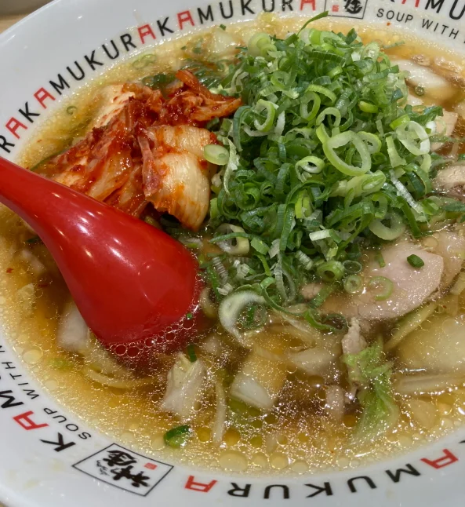

---

title: "오랜만에 카무쿠라에서 파김치 라멘을 먹다"
slug: "何年かぶりの카무쿠라（かむくら）（라면）"
date: 2022-09-09T21:45:19+09:00
lastmod: 2026-11-24T00:00:00+09:00
tags: ["라멘", "카무쿠라"]
draft: false
image: "images/img2.webp"
categories: ["it-technology"]
description: "몇 년 만에 도톤보리 카무쿠라를 다시 방문해 파김치 라멘을 먹은 짧은 기록입니다."
---

몇 년 만에 카무쿠라(라멘)에 다녀왔습니다.

**파김치 라멘**

맛있었습니다. 가끔 먹고 싶어지는 맛이네요.
