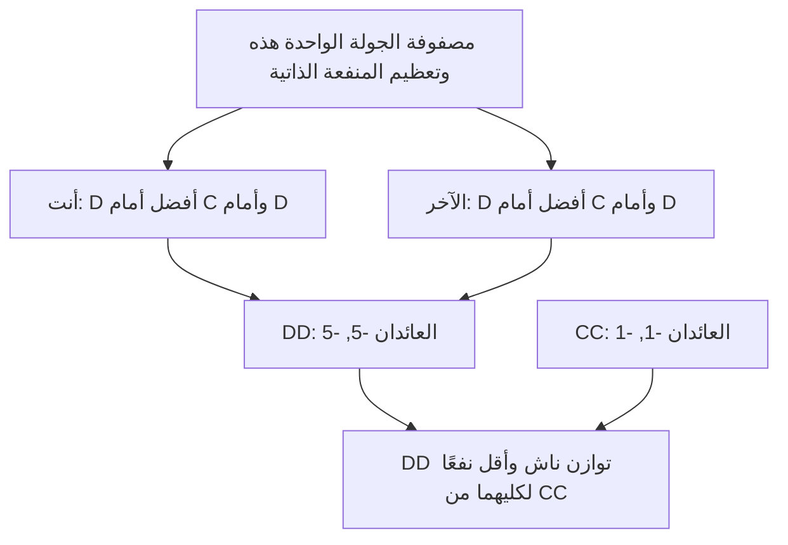
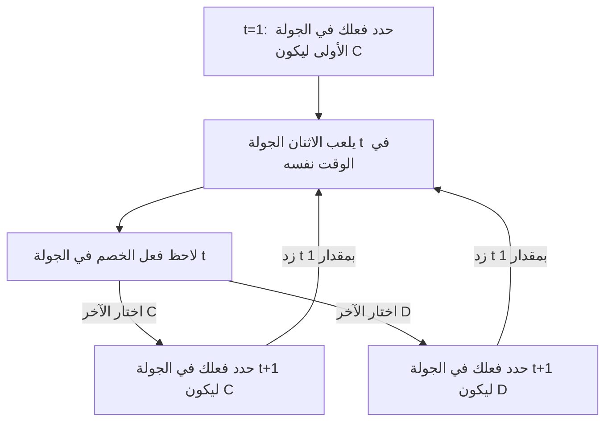

## 1. الصمت أم الاعتراف: تعريف لعبة افتراضية

لنفترض أن شخصين يُشتبه في ارتكابهما جريمة موجودان في غرفتين منفصلتين، ويختاران في الوقت نفسه، من دون تشاور، الصمت أو الاعتراف. ندرس **لعبة افتراضية** تكون فيها مدد السجن التالية محددة يقينًا. لا يصف ذلك قواعد التحقيق أو صفقات الإقرار بالذنب الفعلية، ولا يقرر قاعدة قانونية تقول إن الاعتراف يؤدي إلى البراءة.

- إذا صمت الاثنان: سنة لكل منهما.
- إذا اعترف أحدهما فقط: صفر سنة له، وعشر سنوات لمن صمت.
- إذا اعترف الاثنان: خمس سنوات لكل منهما.

نرمز إلى الصمت بالحرف C (cooperate، التعاون مع اللاعب الآخر)، وإلى الاعتراف بالحرف D (defect، ترك ذلك التعاون). المقصود هنا التعاون بين اللاعبين، لا التعاون مع المحققين. والحرفان اسمان لفعلين داخل هذا النموذج.

نفترض أن كل شخص يهتم بمدة سجنه وحدها ويفضل المدة الأقصر. ولا نضيف منفعة مستقلة للصداقة أو الشعور بالذنب أو السمعة. إذا كانت y_i مدة السجن وu_i العائد، أي المنفعة، نستخدم القيم التالية. المنفعة السالبة لا تعني مدة سجن سالبة.

$$
u_i=-y_i,\qquad y_i\in\{0,1,5,10\}
$$

في ظل هذه الافتراضات نستطيع دراسة تعارض الحوافز الفردية مع نتيجة أفضل لكليهما. وليس هذا قانونًا نفسيًا يفرض على البشر الحقيقيين الاختيار نفسه دائمًا.

## 2. معنى مصفوفة العوائد وكفاءة باريتو

يمثل كل زوج بالترتيب (منفعتك، منفعة اللاعب الآخر). وكلما ارتفع العدد كان الناتج أفضل للاعب المعني. تُكتب الأزواج العددية من اليسار إلى اليمين للحفاظ على هذا الترتيب.

| أنت／اللاعب الآخر | C: الصمت | D: الاعتراف |
| --- | --- | --- |
| C: الصمت | <bdi dir="ltr">(-1, -1)</bdi> | <bdi dir="ltr">(-10, 0)</bdi> |
| D: الاعتراف | <bdi dir="ltr">(0, -10)</bdi> | <bdi dir="ltr">(-5, -5)</bdi> |

في الترميز المعتاد، T هو عائدك عندما تختار D وحدك، وR عندما يختار الاثنان C، وP عندما يختار الاثنان D، وS عندما تختار C وحدك. تحقق هذه المصفوفة الترتيب التالي.

$$
T=0>R=-1>P=-5>S=-10
$$

تكون النتيجة **مثلى أو كفؤة وفق باريتو** إذا لم توجد نتيجة أخرى ممكنة تزيد عائد لاعب واحد على الأقل من دون خفض عائد أي شخص. وليس هذا تعريف تعظيم مجموع العوائد.

من بين تشكيلات الأفعال النقية الأربع في المصفوفة، تكون CC وCD وDC كفؤة وفق باريتو. ففي CD، مثلًا، يحصل صاحب D بالفعل على أعلى عائد له، وهو صفر؛ ولا يمكن تحسين عائد الآخر من دون الإضرار به. أما DD فليست كفؤة، لأن الانتقال إلى CC يحسن عائد كل منهما من -5 إلى -1.

وبشكل منفصل، إذا جمعنا هذه الأعداد بأوزان متساوية، فإن CC تعظم مجموع العوائد. ويقابل ذلك تقليل مجموع مدتي السجن.

$$
(u_1+u_2)(CC)=-2,\qquad(u_1+u_2)(CD)=(u_1+u_2)(DC)=(u_1+u_2)(DD)=-10
$$

مجموع المدتين في CC سنتان، وفي كل من التشكيلات الثلاث الأخرى عشر سنوات. يوضح الفصل بين معيار المجموع وكفاءة باريتو مصالح من نقيمها. والقائمة السابقة تخص نتائج الأفعال النقية؛ وليست تعدادًا لكل مجموعة العوائد الكفؤة عند السماح أيضًا بالاختيار العشوائي بين النتائج.

## 3. الاستراتيجية المهيمنة وتوازن ناش

عند تثبيت فعل اللاعب الآخر، يكون عائدك من D أعلى في الحالتين. وهنا u_i(X,Y) هو عائدك عندما تختار X ويختار الآخر Y.

$$
u_i(D,C)=0>-1=u_i(C,C),\qquad u_i(D,D)=-5>-10=u_i(C,D)
$$

الاستراتيجية التي تعطي عائدًا أعلى بصرامة من البديل أمام كل فعل للخصم تسمى **مهيمنة بالمعنى الصارم (strictly dominant strategy)**. وحتى إذا نسبت احتمالًا p لاختيار الآخر C، يبقى فرق العائدين المتوقعين موجبًا.

$$
\begin{aligned}
0&\le p\le1,\\
\mathrm{EU}(D)&=0p-5(1-p)=-5+5p,\\
\mathrm{EU}(C)&=-p-10(1-p)=-10+9p,\\
\mathrm{EU}(D)-\mathrm{EU}(C)&=5-4p\ge1.
\end{aligned}
$$

إذا كان الآخر أيضًا يعظم منفعته المتوقعة وفق المصفوفة نفسها، يختار الاثنان D. ولأن D أفضل بصرامة من C أمام استراتيجيات الخصم النقية والمختلطة، فإن توازن ناش الوحيد لهذه اللعبة هو DD.

**توازن ناش** هو تشكيلة استراتيجيات لا يستطيع فيها أي لاعب زيادة عائده بتغيير استراتيجيته وحدها مع تثبيت استراتيجيات الآخرين. ولا يعني أن تغييرًا مشتركًا لا يستطيع تحسين النتيجة. في DD، يخفض انتقالك وحدك إلى C عائدك من -5 إلى -10؛ أما الانتقال المشترك إلى CC فيحسن عائد كليكما.

المعضلة أن هذه الحوافز الفردية لا تدعم CC بوصفها توازنًا، مع أنها تحسن عائدي اللاعبين. وهذا استنتاج عن نموذج حُددت عوائده وخياراته ومعلوماته.

## 4. الأسعار والبيئة والرياضة تحتاج إلى نماذج عوائد مستقلة

### المنافسة السعرية

قد تساعد هذه البنية أحيانًا في تحليل حافز خفض السعر لزيادة المبيعات، إلى جانب تقلص هوامش الربح عندما تخفض الشركتان أسعارهما. لكنها لا تستلزم أن انخفاض السعر من 1000 إلى 500 ين يجعل الشركتين خاسرتين حتمًا. فالطلب والتكلفة والجودة ودخول المنافسين تؤثر في الربح. وجمع أرباح الشركات وحدها يختلف أيضًا عن تقييم مصالح المستهلكين أو الرفاه الاجتماعي العام.

### خفض غازات الاحتباس الحراري

إذا كانت منافع الخفض واسعة المشاركة بينما يتحمل كل طرف تكلفته، يمكن دراسة حوافز الاستفادة من جهود الآخرين من دون مساهمة. لكن قد تكون الدول كثيرة بدلًا من لاعبين اثنين؛ والمنافع والتكاليف والأضرار غير متماثلة، كما تؤثر الاتفاقات والمراقبة. لا تثبت هذه المصفوفة أن جميع الدول ستترك التعاون حتمًا أو أن الخفض المنفرد يسبب بالضرورة خسائر اقتصادية كبيرة.

### المنشطات في الرياضة

قد يستخدم النموذج أيضًا لتشبيه الحوافز التنافسية في السلوك المحظور. لكن العوائد الفعلية تتأثر بالفحوص والعقوبات والآثار الصحية وقيم الرياضيين، ضمن عوامل أخرى. وليست المصفوفة دليلًا تجريبيًا على أن المخالفة تضمن الفوز، أو أن كل الرياضيين يخالفون، أو أن ضررًا صحيًا معينًا حتمي.

في كل تطبيق يجب تحديد اللاعبين والأفعال والعوائد وما يمكن ملاحظته، ثم التحقق مما إذا كانت العوائد تحقق فعلًا ترتيب معضلة السجين.

## 5. التكرار واستراتيجية «العين بالعين»

### العلاقة الطويلة وحدها لا تكفي

لنتناول الحالة القياسية: تتكرر المصفوفة نفسها عددًا محدودًا وثابتًا ومعلومًا من الجولات، وتكون الأفعال الماضية قابلة للملاحظة، وتكون بنية اللعبة والعقلانية معرفة مشتركة (common knowledge). في الجولة الأخيرة لا توجد استجابات مستقبلية، فيختار الاثنان D. ويعطي الاستقراء العكسي اختيار D لكليهما في كل الجولات السابقة أيضًا. هذا هو سلوك التوازن التام في الألعاب الفرعية (subgame-perfect equilibrium) في هذه الحالة. فزيادة الجولات وحدها لا تضمن التعاون.

إذا كانت النهاية غير مؤكدة، أو قيّم اللاعبون العوائد المستقبلية على أفق لا نهائي، فقد تغير الاستجابات المستقبلية للسلوك الحالي الحوافز. [ملاحظات MIT عن الألعاب المتكررة](https://www.ocw.mit.edu/courses/14-15j-networks-spring-2018/pages/lecture-and-recitation-notes/recitation-10-notes/) تتناول الاستقراء العكسي للحالة المحدودة ومثالًا للأفق اللانهائي. وتختلف قيم عوائدها عن هذه المقالة.

### العين بالعين تقلد فعل الخصم في الجولة السابقة

تختار استراتيجية العين بالعين (Tit for Tat، TFT) الفعل C في الجولة الأولى، ثم تقلد فعل اللاعب الآخر في الجولة السابقة. نرمز إلى فعلك في الجولة t بالرمز a_i,t، وإلى اللاعب الآخر بالحرف j.

$$
a_{i,1}=C,\qquad a_{i,t}=a_{j,t-1}\quad(t\ge2)
$$

ليست هذه استراتيجية ترى فعل الخصم في الجولة الحالية قبل اختيار فعلك. في المخطط يلعب الاثنان الجولة الحالية معًا، ثم يلاحظان نتيجتها ويحددان فعل الجولة التالية.

تذكر [مقالة Axelrod وHamilton عام 1981](https://public.websites.umich.edu/~axe/research/Axelrod%20and%20Hamilton%20EC%201981.pdf) أن TFT التي قدمها Anatol Rapoport احتلت المركز الأول في متوسط النقاط في بطولتي برامج Axelrod. وكانت عوائد البطولات الموصوفة T=5 وR=3 وP=1 وS=0، وهي مختلفة عن مصفوفة مدد السجن هنا.

لا تبدأ الاستراتيجية بالفعل D، وتستجيب لاختيار الخصم D، وتعود إلى C في الجولة التالية لعودة الخصم إلى C. كما يمكن وصف قاعدتها بإيجاز. لكن لا توجد مبرهنة تضمن أعلى النقاط مهما تغيرت استراتيجيات المشاركين وطريقة تشكيل المواجهات والعوائد والمدة. فحتى بين لاعبين يستخدمان TFT قد يؤدي خطأ في الفعل إلى CD، ثم DC، ثم CD، ليستمر التناوب في ترك التعاون. ومعالجة الأخطاء مسألة تصميم مستقلة.

### مثال لحساب شروط دعم التعاون في التوازن

لننظر إلى **استراتيجية العقاب الدائم (grim trigger)**، وهي مختلفة عن TFT: اختر C إذا كانت كل الجولات الماضية CC؛ وبعد ظهور أي D اختر D إلى الأبد. نفترض أفقًا لا نهائيًا، وملاحظة دقيقة للأفعال، وتقييم كل لاعب للمجموع التالي من العوائد المخصومة هندسيًا.

$$
V_i=\sum_{t=1}^{\infty}\delta^{t-1}u_{i,t},\qquad0\le\delta<1
$$

يحدد معامل الخصم δ وزن المستقبل. في مصفوفة هذه المقالة، تكون قيمة استمرار التعاون وقيمة الانتقال المنفرد إلى D الآن ثم DD إلى الأبد كما يلي.

$$
V_{\mathrm{coop}}=\frac{-1}{1-\delta},\qquad V_{\mathrm{deviate}}=0+\frac{-5\delta}{1-\delta}
$$

إذن شرط عدم وجود حافز للانحراف عن التعاون هو:

$$
\frac{-1}{1-\delta}\ge\frac{-5\delta}{1-\delta}\quad\Longleftrightarrow\quad-1\ge-5\delta\quad\Longleftrightarrow\quad\delta\ge\frac15
$$

بعد بدء العقاب، تكون D أيضًا أفضل استجابة لخصم سيختار D دائمًا. لذلك، مع هذه العوائد والملاحظة والخصم، يستطيع اللاعبان باستخدام grim trigger دعم التعاون كتوازن تام في الألعاب الفرعية عندما تكون δ على الأقل 1/5. وعند الحد تتساوى قيمة التعاون والانحراف مرة واحدة. وينتج 1/5 من هذه المصفوفة وهذه الاستراتيجية؛ وليس عتبة عالمية لكل معضلات السجين أو برهانًا على أن TFT هي الأفضل دائمًا.

كذلك تبقى تشكيلة الاستراتيجيات التي يختار فيها الاثنان D دائمًا توازنًا أيضًا. وجود توازن تعاوني واختيار التعاون فعليًا مسألتان مختلفتان.

## 6. التفكير في الثقة من خلال الحوافز والافتراضات

توضح معضلة السجين كيف قد تفشل الخيارات المفيدة فرديًا في دعم نتيجة تحسن عائدي اللاعبين. وللفهم يجب التمييز بين الاستراتيجية المهيمنة وتوازن ناش وكفاءة باريتو ومجموع العوائد.

قد يوسع التكرار إمكانات التعاون، لكن الأفق ووزن المستقبل وملاحظة الأفعال والأخطاء وقواعد الاستجابة كلها مهمة. ولا يمكن استنتاج أن العلاقة الطويلة تجعل الثقة والتعاون أمثل دائمًا. عند تطبيق النموذج، حدد أولًا العوائد والمؤسسات الفعلية، ثم ادرس الشروط التي قد تدعم التعاون.
