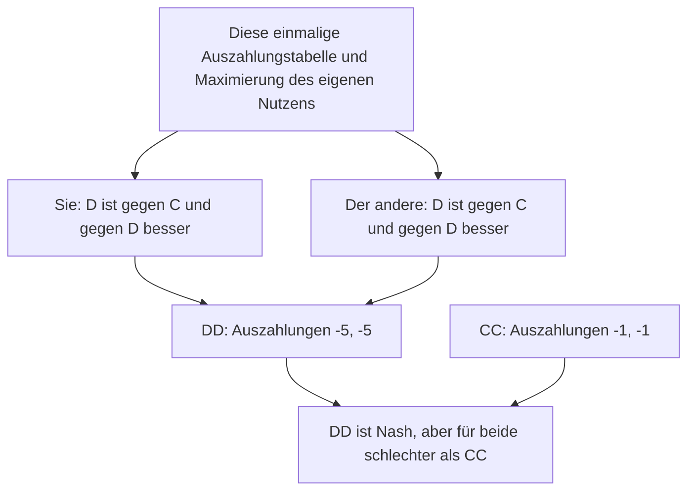
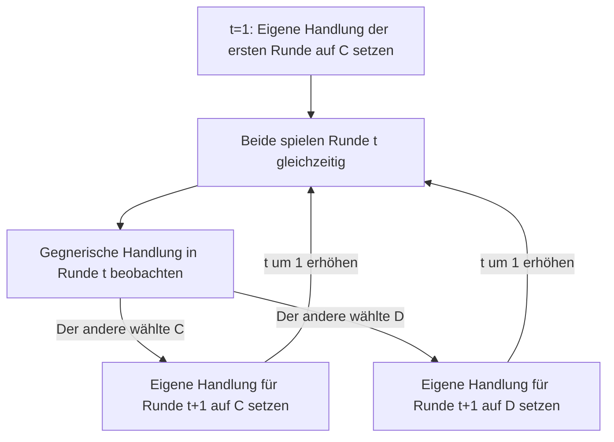

## 1. Schweigen oder gestehen: ein fiktives Spiel definieren

Angenommen, zwei Verdächtige entscheiden in getrennten Räumen ohne Absprache gleichzeitig, ob sie schweigen oder gestehen. Wir betrachten ein **fiktives Spiel**, in dem die folgenden Haftzeiten sicher feststehen. Es beschreibt weder tatsächliche Ermittlungs- oder Verständigungsverfahren noch eine Rechtsregel, nach der ein Geständnis einen Freispruch bewirkt.

- Beide schweigen: jeweils ein Jahr.
- Nur einer gesteht: null Jahre für diesen Spieler, zehn für den schweigenden Spieler.
- Beide gestehen: jeweils fünf Jahre.

Schweigen bezeichnen wir mit C (cooperate, mit dem anderen Spieler kooperieren), Gestehen mit D (defect, diese Kooperation verlassen). Kooperation meint hier die Zusammenarbeit zwischen den beiden Spielern, nicht mit den Ermittlern. C und D sind Handlungsbezeichnungen dieses Modells.

Wir nehmen an, dass jeder nur die eigene Haftzeit bewertet und eine kürzere bevorzugt. Freundschaft, Schuldgefühle und Ansehen bringen im Modell keinen zusätzlichen Nutzen. Sei y_i die Haftzeit und u_i die Auszahlung beziehungsweise der Nutzen. Dafür verwenden wir folgende Werte. Ein negativer Nutzen bedeutet keine negative Haftdauer.

$$
u_i=-y_i,\qquad y_i\in\{0,1,5,10\}
$$

Unter diesen Annahmen lässt sich untersuchen, wie individuelle Anreize mit einem für beide besseren Ergebnis in Konflikt geraten. Das ist kein psychologisches Gesetz, nach dem wirkliche Menschen immer gleich entscheiden müssen.

## 2. Auszahlungsmatrix und Pareto-Effizienz

Jedes Paar bedeutet (Ihr Nutzen, Nutzen des anderen Spielers). Eine höhere Zahl steht für ein vom jeweiligen Spieler bevorzugtes Ergebnis.

| Sie / Anderer Spieler | C: schweigen | D: gestehen |
| --- | --- | --- |
| C: schweigen | (-1, -1) | (-10, 0) |
| D: gestehen | (0, -10) | (-5, -5) |

In der üblichen Notation ist T Ihre Auszahlung, wenn nur Sie D wählen; R gilt bei beiderseitigem C, P bei beiderseitigem D und S, wenn nur Sie C wählen. Für diese Tabelle gilt die folgende Reihenfolge.

$$
T=0>R=-1>P=-5>S=-10
$$

Ein Ergebnis ist **Pareto-optimal oder Pareto-effizient**, wenn kein anderes erreichbares Ergebnis die Auszahlung mindestens eines Spielers erhöht, ohne die eines anderen zu senken. Das ist nicht die Definition einer maximalen Summe der Auszahlungen.

Unter den vier reinen Handlungsprofilen der Tabelle sind CC, CD und DC Pareto-effizient. Bei CD erhält beispielsweise der Spieler mit D bereits seine höchste Auszahlung null; die Auszahlung des anderen lässt sich nicht verbessern, ohne diesen Spieler schlechterzustellen. DD ist ineffizient: Ein Wechsel zu CC verbessert beide Auszahlungen von -5 auf -1.

Unabhängig davon maximiert CC die Summe, wenn wir diese Zahlen mit gleichem Gewicht addieren. Das entspricht einer minimalen gesamten Haftzeit.

$$
(u_1+u_2)(CC)=-2,\qquad(u_1+u_2)(CD)=(u_1+u_2)(DC)=(u_1+u_2)(DD)=-10
$$

Die Haftzeiten summieren sich bei CC auf zwei Jahre und bei jedem der anderen drei Profile auf zehn. Die Unterscheidung von Summenkriterium und Pareto-Effizienz macht klar, wessen Interessen eine Bewertung betrifft. Die genannten effizienten Profile beziehen sich auf Ergebnisse reiner Handlungen; sie zählen nicht die gesamte effiziente Auszahlungsmenge auf, wenn auch Lotterien über Ergebnisse erlaubt sind.

## 3. Dominante Strategien und Nash-Gleichgewicht

Halten Sie die Handlung des anderen Spielers fest, ist Ihre Auszahlung mit D in beiden Fällen höher. Hier bezeichnet u_i(X,Y) Ihre Auszahlung, wenn Sie X und der andere Y wählen.

$$
u_i(D,C)=0>-1=u_i(C,C),\qquad u_i(D,D)=-5>-10=u_i(C,D)
$$

Eine Strategie, deren Auszahlung gegen jede gegnerische Handlung strikt höher als die der Alternative ist, ist **strikt dominant**. Auch wenn Sie dem gegnerischen C die Wahrscheinlichkeit p zuordnen, bleibt die Differenz der erwarteten Auszahlungen positiv.

$$
\begin{aligned}
0&\le p\le1,\\
\mathrm{EU}(D)&=0p-5(1-p)=-5+5p,\\
\mathrm{EU}(C)&=-p-10(1-p)=-10+9p,\\
\mathrm{EU}(D)-\mathrm{EU}(C)&=5-4p\ge1.
\end{aligned}
$$

Maximiert der andere ebenfalls den eigenen erwarteten Nutzen anhand derselben Tabelle, wählen beide D. Da D gegen reine und gemischte gegnerische Strategien strikt besser als C ist, ist DD das einzige Nash-Gleichgewicht dieses Spiels.

Ein **Nash-Gleichgewicht** ist ein Strategieprofil, in dem kein Spieler seine Auszahlung erhöhen kann, indem er nur die eigene Strategie ändert und die Strategien der anderen festhält. Das bedeutet nicht, dass eine gemeinsame Änderung das Ergebnis nicht verbessern könnte. Bei DD verschlechtert ein einseitiger Wechsel zu C den eigenen Nutzen von -5 auf -10; wechseln beide zu CC, verbessern sich beide Auszahlungen.

Das Dilemma besteht darin, dass diese individuellen Anreize CC nicht als Gleichgewicht stützen, obwohl CC beide Auszahlungen verbessert. Diese Folgerung betrifft ein Modell mit festgelegten Auszahlungen, Wahlmöglichkeiten und Informationen.

## 4. Preise, Umwelt und Sport brauchen eigene Auszahlungsmodelle

### Preiswettbewerb

Diese Struktur kann manchmal helfen, den Anreiz einer Preissenkung zur Absatzsteigerung und die sinkenden Margen bei beiderseitigen Preissenkungen zu untersuchen. Daraus folgt nicht, dass ein Rückgang von 1000 auf 500 Yen beide Unternehmen zwingend in die Verlustzone bringt. Nachfrage, Kosten, Qualität und Markteintritt beeinflussen die Gewinne. Nur Unternehmensgewinne zu addieren ist auch etwas anderes, als Verbraucherinteressen oder die gesamte gesellschaftliche Wohlfahrt zu bewerten.

### Verringerung von Treibhausgasen

Werden die Vorteile von Emissionsminderungen breit geteilt, während jeder Akteur eigene Kosten trägt, lassen sich Anreize zum Trittbrettfahren untersuchen. Es können aber viele Länder statt zweier Spieler beteiligt sein; Nutzen, Kosten und Schäden sind asymmetrisch, und Abkommen sowie Überwachung spielen eine Rolle. Diese Tabelle belegt weder, dass jedes Land zwingend die Kooperation aufgibt, noch, dass ein allein handelndes Land zwingend große wirtschaftliche Verluste erleidet.

### Doping im Sport

Das Modell kann auch als Analogie für Wettbewerbsanreize bei verbotenen Handlungen dienen. Tatsächliche Auszahlungen hängen jedoch unter anderem von Kontrollen, Sanktionen, Gesundheitsfolgen und Wertvorstellungen der Sportler ab. Die Tabelle ist kein empirischer Beleg dafür, dass ein Regelverstoß den Sieg garantiert, alle Sportler Regeln verletzen oder ein bestimmter Gesundheitsschaden unvermeidlich eintritt.

Für jede Anwendung müssen zunächst Spieler, Handlungen, Auszahlungen und Beobachtungsmöglichkeiten bestimmt werden. Dann ist zu prüfen, ob die Auszahlungen tatsächlich die Reihenfolge des Gefangenendilemmas aufweisen.

## 5. Wiederholung und Tit for Tat

### Eine lange Beziehung allein genügt nicht

Betrachten wir den Standardfall: Dieselbe Tabelle wird eine bekannte, feste, endliche Zahl von Runden wiederholt, vergangene Handlungen sind beobachtbar, und Spielstruktur sowie Rationalität sind gemeinsames Wissen (common knowledge). In der letzten Runde wählen beide D, weil keine zukünftigen Reaktionen mehr folgen. Durch Rückwärtsinduktion ergibt sich auch für jede frühere Runde beiderseitiges D. Das ist das Verhalten im teilspielperfekten Gleichgewicht dieser Situation. Mehr Runden allein garantieren keine Kooperation.

Ist das Ende ungewiss oder werden zukünftige Auszahlungen über einen unendlichen Horizont bewertet, können spätere Reaktionen auf heutiges Verhalten die Anreize verändern. [Die MIT-Notizen zu wiederholten Spielen](https://www.ocw.mit.edu/courses/14-15j-networks-spring-2018/pages/lecture-and-recitation-notes/recitation-10-notes/) behandeln endliche Rückwärtsinduktion und ein Beispiel mit unendlichem Horizont. Ihre Zahlenwerte unterscheiden sich von denen dieses Artikels.

### Tit for Tat kopiert die vorherige Handlung des anderen

Tit for Tat (TFT) wählt in Runde 1 C und danach jeweils die Handlung des Gegners aus der vorherigen Runde. Sei a_i,t Ihre Handlung in Runde t, und j der andere Spieler.

$$
a_{i,1}=C,\qquad a_{i,t}=a_{j,t-1}\quad(t\ge2)
$$

Dabei sieht man nicht zuerst die aktuelle gegnerische Handlung und trifft dann die eigene Wahl. Im Diagramm spielen beide die aktuelle Runde gleichzeitig, beobachten danach deren Ergebnis und legen ihre Handlung für die nächste Runde fest.

[Axelrod und Hamilton berichten 1981](https://public.websites.umich.edu/~axe/research/Axelrod%20and%20Hamilton%20EC%201981.pdf), dass die von Anatol Rapoport eingereichte TFT-Strategie in Axelrods beiden Computerturnieren die höchste durchschnittliche Punktzahl erreichte. Die dort beschriebenen Turnierauszahlungen waren T=5, R=3, P=1 und S=0 und unterschieden sich von der Haftzeittabelle dieses Artikels.

Die Strategie beginnt nicht selbst mit D, reagiert auf gegnerisches D und kehrt in der Runde nach dem gegnerischen Wechsel zu C ebenfalls zu C zurück. Ihre Regel lässt sich zudem kurz beschreiben. Es gibt aber keinen Satz, der für beliebige Teilnehmerstrategien, Paarungen, Auszahlungen oder Spieldauern stets die höchste Punktzahl garantiert. Selbst zwischen zwei TFT-Spielern kann beispielsweise ein Handlungsfehler mit dem Ergebnis CD zu DC, dann wieder CD und damit zu abwechselnder Nichtkooperation führen. Der Umgang mit Fehlern ist eine zusätzliche Gestaltungsfrage.

### Ein Rechenbeispiel für Bedingungen kooperativer Gleichgewichte

Betrachten wir die von TFT verschiedene **Grim-Trigger-Strategie**: C wählen, solange alle vergangenen Runden CC waren; sobald irgendwann D auftrat, für immer D wählen. Wir nehmen einen unendlichen Horizont, perfekt beobachtete Handlungen und für jeden Spieler die folgende geometrisch diskontierte Summe der Auszahlungen an.

$$
V_i=\sum_{t=1}^{\infty}\delta^{t-1}u_{i,t},\qquad0\le\delta<1
$$

Der Diskontfaktor δ bestimmt das Gewicht der Zukunft. Für die Tabelle dieses Artikels ergeben sich für fortgesetzte Kooperation und für einen einseitigen Wechsel zu D jetzt mit anschließendem dauerhaftem DD die folgenden Werte.

$$
V_{\mathrm{coop}}=\frac{-1}{1-\delta},\qquad V_{\mathrm{deviate}}=0+\frac{-5\delta}{1-\delta}
$$

Kein Anreiz zur Abweichung von der Kooperation besteht unter folgender Bedingung:

$$
\frac{-1}{1-\delta}\ge\frac{-5\delta}{1-\delta}\quad\Longleftrightarrow\quad-1\ge-5\delta\quad\Longleftrightarrow\quad\delta\ge\frac15
$$

Nach Beginn der Bestrafung ist D auch die beste Antwort auf einen Gegner, der immer D wählen wird. Mit diesen Auszahlungen, dieser Beobachtung und Diskontierung können beide Spieler mit Grim Trigger daher Kooperation als teilspielperfektes Gleichgewicht stützen, wenn δ mindestens 1/5 beträgt. Am Grenzwert haben Kooperation und eine einmalige Abweichung denselben Wert. Der Wert 1/5 ergibt sich aus dieser Tabelle und dieser Strategie; er ist weder ein universeller Schwellenwert des Gefangenendilemmas noch ein Beleg für die allgemeine Überlegenheit von TFT.

Außerdem bleibt das Strategieprofil, in dem beide immer D wählen, ebenfalls ein Gleichgewicht. Die Existenz eines kooperativen Gleichgewichts und die tatsächliche Wahl der Kooperation sind verschiedene Fragen.

## 6. Vertrauen anhand von Anreizen und Annahmen betrachten

Das Gefangenendilemma verdeutlicht, wie individuell vorteilhafte Entscheidungen ein Ergebnis, das beide besserstellt, möglicherweise nicht stützen. Dafür muss man dominante Strategien, Nash-Gleichgewicht, Pareto-Effizienz und die Summe der Auszahlungen unterscheiden.

Wiederholung kann die Möglichkeiten zur Kooperation erweitern. Entscheidend sind aber Horizont, Gewicht der Zukunft, Beobachtung der Handlungen, Fehler und Reaktionsregeln. Eine lange Beziehung macht Vertrauen und Kooperation nicht zwangsläufig optimal. Wer das Modell anwenden möchte, sollte zunächst die tatsächlichen Auszahlungen und Institutionen klären und dann die Bedingungen untersuchen, die Kooperation stützen könnten.
