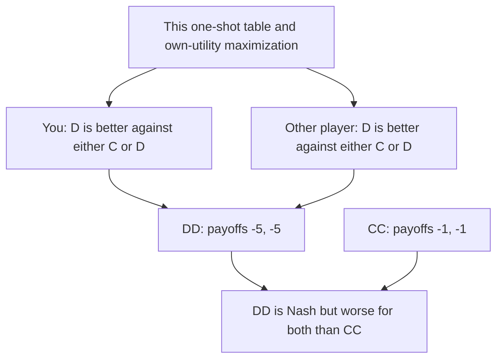
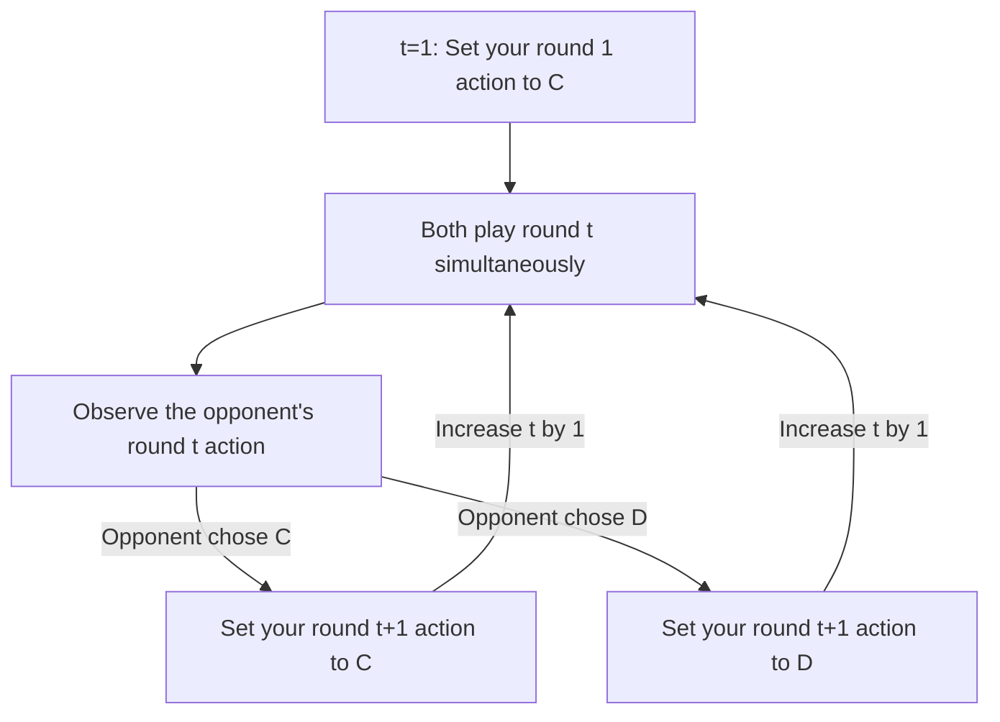

## 1. Silence or confession: defining a fictional game

Two suspects in separate rooms choose simultaneously, without consulting each other, whether to remain silent or confess. Consider a **fictional game** in which the following sentences are certain. This does not describe actual investigation or plea-bargaining rules, or establish that confessing makes someone legally innocent.

- Both remain silent: one year each.
- Only one confesses: zero years for that person and ten years for the person remaining silent.
- Both confess: five years each.

Call silence C (cooperate with the other player) and confession D (defect from that cooperation). Cooperation here means cooperation between the two players, not cooperation with investigators. C and D are action labels in this model.

Assume each person cares only about their own sentence and prefers fewer years. Friendship, guilt and reputation have no additional utility in this model. Let y_i be a sentence's duration and u_i its payoff (utility), using the following numbers. A negative payoff does not mean a negative sentence duration.

$$
u_i=-y_i,\qquad y_i\in\{0,1,5,10\}
$$

Under these assumptions, we can examine how individual incentives conflict with an outcome better for both. This is not a psychological law that real people must always make the same choice.

## 2. What the payoff matrix and Pareto efficiency mean

Each pair is (your utility, the other player's utility). Higher numbers mean outcomes that the respective player prefers.

| You / Other player | C: remain silent | D: confess |
| --- | --- | --- |
| C: remain silent | (-1, -1) | (-10, 0) |
| D: confess | (0, -10) | (-5, -5) |

In standard notation, T is your payoff when you alone defect, R when both cooperate, P when both defect, and S when you alone cooperate. This table has the following ordering.

$$
T=0>R=-1>P=-5>S=-10
$$

An outcome is **Pareto optimal (Pareto efficient)** if no other feasible outcome improves at least one player's payoff without reducing anyone else's. This is not the definition of maximizing the sum of everyone's payoffs.

Among the table's four pure action profiles, CC, CD and DC are Pareto efficient. For example, in CD the player choosing D already receives their maximum payoff of zero; there is no way to improve the other player's payoff without making that player worse off. DD is inefficient: changing to CC improves both players' payoffs from -5 to -1.

Separately, if we add these numerical payoffs with equal weights, CC maximizes their sum. This corresponds to minimizing the total sentence duration.

$$
(u_1+u_2)(CC)=-2,\qquad(u_1+u_2)(CD)=(u_1+u_2)(DC)=(u_1+u_2)(DD)=-10
$$

The total sentence is two years at CC and ten at each of the other three profiles. Separating this sum criterion from Pareto efficiency makes clear whose interests an evaluation concerns. The efficient profiles listed above concern pure action outcomes; they are not an enumeration of the efficient payoff set when lotteries over outcomes are also available.

## 3. Dominant strategies and Nash equilibrium

Holding the other player's action fixed, your payoff from D is higher in either case. Here u_i(X,Y) denotes your payoff when you choose X and the other player chooses Y.

$$
u_i(D,C)=0>-1=u_i(C,C),\qquad u_i(D,D)=-5>-10=u_i(C,D)
$$

A strategy that yields a higher payoff than an alternative for every opposing action is **strictly dominant**. Even if you assign probability p to the other player choosing C, the difference in expected payoffs is positive.

$$
\begin{aligned}
0&\le p\le1,\\
\mathrm{EU}(D)&=0p-5(1-p)=-5+5p,\\
\mathrm{EU}(C)&=-p-10(1-p)=-10+9p,\\
\mathrm{EU}(D)-\mathrm{EU}(C)&=5-4p\ge1.
\end{aligned}
$$

If the other player also maximizes their own expected utility using the same table, both choose D. Because D strictly dominates against both pure and mixed opposing strategies, DD is this game's unique Nash equilibrium.

A **Nash equilibrium** is a strategy profile in which no player can increase their payoff by changing only their own strategy while the others' strategies remain fixed. It does not mean that a joint change cannot improve the outcome. At DD, changing alone to C worsens your payoff from -5 to -10, whereas changing together to CC improves both players' payoffs.

The dilemma is that these individual incentives do not sustain CC as an equilibrium, even though CC improves both players' payoffs. That conclusion concerns a model with specified payoffs, choices and information.

## 4. Prices, the environment and sport need their own payoff models

### Price competition

This structure can sometimes help analyze incentives to undercut a competitor to increase sales, alongside reduced margins when both cut prices. It does not imply that a price falling from 1,000 yen to 500 yen must put both firms into loss. Demand, costs, quality and entry affect profits. Adding firms' profits also differs from evaluating consumer interests or overall social welfare.

### Greenhouse-gas reductions

When the benefits of reductions are widely shared but costs fall on individual actors, we can examine incentives to free-ride on others' efforts. But there may be many countries rather than two players; benefits, costs and damage are asymmetric, and agreements and monitoring matter. This two-player table cannot establish that every country must defect or that acting alone must cause a large economic loss.

### Doping in sport

The model can also serve as an analogy for competitive incentives involving prohibited conduct. Actual payoffs, however, depend on testing, sanctions, health effects and athletes' values, among other factors. This table is not empirical evidence that a violation guarantees victory, every athlete violates the rules, or a particular health outcome inevitably occurs.

For each application, identify the players, actions, payoffs and what can be observed, and check whether the payoffs actually have the prisoner's-dilemma ordering.

## 5. Repetition and Tit for Tat

### A long relationship alone is insufficient

Consider the standard setting in which the same payoff table is repeated a known, fixed, finite number of times, past actions are observable, and the game's structure and rationality are common knowledge. With no future responses after the last round, both choose D then. Backward induction gives mutual defection in every earlier round too. This is subgame-perfect equilibrium play in this setting. Merely adding more rounds does not guarantee cooperation.

When the end is uncertain, or when players value future payoffs over an infinite horizon, future responses to present behavior can change incentives. [MIT's notes on repeated games](https://www.ocw.mit.edu/courses/14-15j-networks-spring-2018/pages/lecture-and-recitation-notes/recitation-10-notes/) cover finite backward induction and an infinite-horizon example. The numerical payoffs in those notes differ from this article's table.

### Tit for Tat copies the opponent's previous move

Tit for Tat (TFT) chooses C in round 1 and copies the opponent's previous action thereafter. Let a_i,t be your action in round t, with j denoting the other player.

$$
a_{i,1}=C,\qquad a_{i,t}=a_{j,t-1}\quad(t\ge2)
$$

This does not let you see the other player's current move before making your own. In the diagram, both play the current round, then observe its outcome and choose their actions for the next round.

[Axelrod and Hamilton's 1981 paper](https://public.websites.umich.edu/~axe/research/Axelrod%20and%20Hamilton%20EC%201981.pdf) reports that TFT, submitted by Anatol Rapoport, ranked first by average score in Axelrod's two computer tournaments. The tournament payoffs reported there were T=5, R=3, P=1 and S=0, different from this article's sentence table.

The strategy does not initiate defection, responds to the other player's D, and returns to C in the next round after the other player returns to C. Its rule is also short to describe. But there is no theorem that it always has the highest score regardless of the competing strategies, matching procedure, payoffs or horizon. For example, even between two TFT players, one action error producing CD can be followed by DC, then CD, sustaining alternating defection. Handling errors is a further design issue.

### An example of conditions sustaining cooperation in equilibrium

Consider **grim trigger**, a different strategy from TFT: choose C if all previous rounds were CC; after any D, choose D forever. Assume an infinite horizon, perfectly observed actions and each player's geometrically discounted sum of payoffs.

$$
V_i=\sum_{t=1}^{\infty}\delta^{t-1}u_{i,t},\qquad0\le\delta<1
$$

The discount factor δ sets the weight on future payoffs. For this article's table, the value of continued cooperation and the value of choosing D now followed by DD forever are as follows.

$$
V_{\mathrm{coop}}=\frac{-1}{1-\delta},\qquad V_{\mathrm{deviate}}=0+\frac{-5\delta}{1-\delta}
$$

The condition for having no incentive to leave cooperation is therefore:

$$
\frac{-1}{1-\delta}\ge\frac{-5\delta}{1-\delta}\quad\Longleftrightarrow\quad-1\ge-5\delta\quad\Longleftrightarrow\quad\delta\ge\frac15
$$

Once punishment begins, D is also the best response to an opponent who will always choose D. Thus, with these payoffs, monitoring and discounting, mutual grim trigger can sustain cooperation as a subgame-perfect equilibrium when δ is at least 1/5. At the boundary, cooperation and a one-round deviation have equal value. The 1/5 comes from this table and strategy; it is neither a universal prisoner's-dilemma threshold nor evidence that TFT is universally best.

Moreover, always choosing D also remains an equilibrium. The existence of a cooperative equilibrium and the actual selection of cooperation are separate matters.

## 6. Examining trust through incentives and assumptions

The prisoner's dilemma makes precise how individually advantageous choices can fail to sustain an outcome that improves both players' payoffs. Understanding it requires distinguishing dominant strategies, Nash equilibrium, Pareto efficiency and the sum of payoffs.

Repetition can expand the possibilities for cooperation, but the horizon, weight on the future, observation of actions, errors and response rules matter. We cannot conclude that a long relationship always makes trust and cooperation optimal. To apply the model, first establish the actual payoffs and institutions, then examine the conditions that could sustain cooperation.
