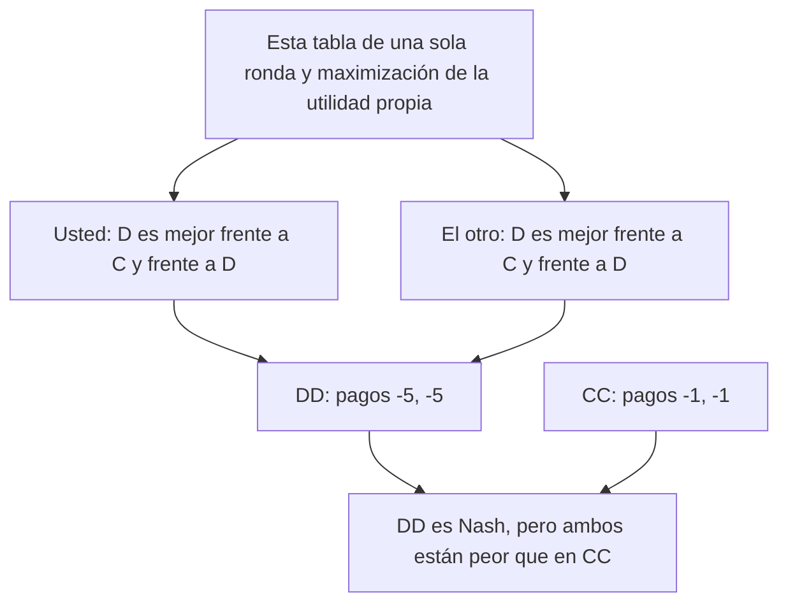
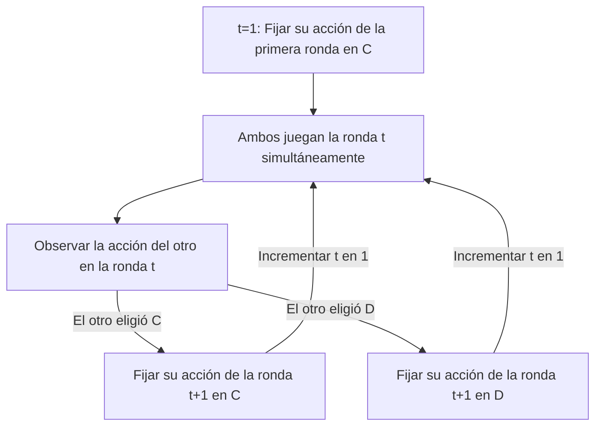

## 1. Silencio o confesión: definir un juego ficticio

Supongamos que dos sospechosos, en salas separadas y sin poder consultarse, eligen simultáneamente entre guardar silencio y confesar. Consideramos un **juego ficticio** en el que se aplican con certeza las siguientes penas. No describe las normas reales de investigación ni de acuerdos de culpabilidad, ni establece que confesar implique ser declarado inocente.

- Ambos guardan silencio: un año cada uno.
- Solo uno confiesa: cero años para quien confiesa y diez para quien guarda silencio.
- Ambos confiesan: cinco años cada uno.

Llamamos C (cooperate, cooperar con el otro jugador) al silencio y D (defect, abandonar esa cooperación) a la confesión. Aquí cooperar significa hacerlo con el otro jugador, no con los investigadores. C y D son nombres de acciones dentro de este modelo.

Suponemos que cada persona solo valora la duración de su propia pena y prefiere menos años. No añadimos utilidad por amistad, culpa o reputación. Si y_i es la duración de la pena y u_i el pago o utilidad, utilizamos estos valores. Una utilidad negativa no significa una pena de duración negativa.

$$
u_i=-y_i,\qquad y_i\in\{0,1,5,10\}
$$

Con estos supuestos podemos estudiar cómo los incentivos individuales entran en conflicto con un resultado mejor para ambos. No es una ley psicológica según la cual las personas reales deban elegir siempre lo mismo.

## 2. Qué significan la matriz de pagos y la eficiencia de Pareto

Cada par representa (su utilidad, la utilidad del otro jugador). Un número mayor indica un resultado preferido por el jugador correspondiente.

| Usted / Otro jugador | C: guardar silencio | D: confesar |
| --- | --- | --- |
| C: guardar silencio | (-1, -1) | (-10, 0) |
| D: confesar | (0, -10) | (-5, -5) |

En la notación habitual, T es su pago cuando solo usted elige D; R, cuando ambos eligen C; P, cuando ambos eligen D; y S, cuando solo usted elige C. Esta tabla cumple el siguiente orden.

$$
T=0>R=-1>P=-5>S=-10
$$

Un resultado es **óptimo o eficiente en el sentido de Pareto** si no existe otro resultado factible que mejore el pago de al menos un jugador sin reducir el de ningún otro. Esta no es la definición de maximizar la suma de los pagos.

Entre los cuatro perfiles de acciones puras de la tabla, CC, CD y DC son eficientes en el sentido de Pareto. Por ejemplo, en CD quien elige D ya recibe su máximo pago, cero; no se puede mejorar el pago del otro sin perjudicar a ese jugador. DD es ineficiente: pasar a CC mejora los pagos de ambos de -5 a -1.

Por separado, si sumamos estos valores con el mismo peso, CC maximiza la suma de los pagos. Esto corresponde a minimizar la duración total de las penas.

$$
(u_1+u_2)(CC)=-2,\qquad(u_1+u_2)(CD)=(u_1+u_2)(DC)=(u_1+u_2)(DD)=-10
$$

La pena total es de dos años en CC y de diez en cada uno de los otros tres perfiles. Distinguir el criterio de la suma de la eficiencia de Pareto aclara a quién beneficia una evaluación. Los perfiles eficientes enumerados corresponden a resultados de acciones puras; no constituyen una enumeración del conjunto de pagos eficientes cuando se permiten sorteos entre resultados.

## 3. Estrategias dominantes y equilibrio de Nash

Si mantiene fija la acción del otro jugador, su pago por elegir D es mayor en ambos casos. Aquí u_i(X,Y) representa su pago cuando usted elige X y el otro elige Y.

$$
u_i(D,C)=0>-1=u_i(C,C),\qquad u_i(D,D)=-5>-10=u_i(C,D)
$$

Una estrategia que ofrece un pago estrictamente mayor que la alternativa frente a cualquier acción del otro jugador es **estrictamente dominante**. Incluso si atribuye una probabilidad p a que el otro elija C, la diferencia de pagos esperados es positiva.

$$
\begin{aligned}
0&\le p\le1,\\
\mathrm{EU}(D)&=0p-5(1-p)=-5+5p,\\
\mathrm{EU}(C)&=-p-10(1-p)=-10+9p,\\
\mathrm{EU}(D)-\mathrm{EU}(C)&=5-4p\ge1.
\end{aligned}
$$

Si el otro jugador también maximiza su propia utilidad esperada con la misma tabla, ambos eligen D. Como D domina estrictamente a C frente a estrategias rivales tanto puras como mixtas, DD es el único equilibrio de Nash de este juego.

Un **equilibrio de Nash** es un perfil de estrategias en el que ningún jugador puede aumentar su pago cambiando solo su propia estrategia, manteniendo fijas las de los demás. No significa que un cambio conjunto no pueda mejorar el resultado. En DD, cambiar unilateralmente a C empeora su pago de -5 a -10; si ambos pasan a CC, los pagos de los dos mejoran.

El dilema es que estos incentivos individuales no sostienen CC como equilibrio, aunque CC mejore los pagos de ambos. La conclusión corresponde a un modelo con pagos, opciones e información definidos.

## 4. Precios, medio ambiente y deporte necesitan modelos propios

### Competencia de precios

Esta estructura puede ayudar en algunos casos a analizar el incentivo de bajar el precio para aumentar las ventas, junto con la reducción de los márgenes cuando ambas empresas bajan sus precios. No implica que pasar de 1000 a 500 yenes deba causar pérdidas a ambas. La demanda, los costes, la calidad y la entrada de competidores afectan a los beneficios. Sumar solo los beneficios empresariales tampoco equivale a evaluar los intereses de los consumidores o el bienestar social total.

### Reducción de gases de efecto invernadero

Cuando los beneficios de reducir emisiones se comparten ampliamente y cada actor asume sus costes, podemos estudiar incentivos a aprovecharse del esfuerzo ajeno sin contribuir. Pero puede haber muchos países, no solo dos jugadores; los beneficios, costes y daños son asimétricos, y los acuerdos y la supervisión importan. Esta tabla no permite concluir que todos los países deban abandonar la cooperación ni que actuar en solitario deba causar grandes pérdidas económicas.

### Dopaje en el deporte

El modelo también sirve como analogía para los incentivos competitivos relacionados con conductas prohibidas. Sin embargo, los pagos reales dependen de controles, sanciones, efectos sobre la salud y valores de los deportistas, entre otros factores. La tabla no es evidencia empírica de que infringir las reglas garantice ganar, de que todos los deportistas las infrinjan o de que un daño concreto a la salud sea inevitable.

Para cada aplicación hay que identificar a los jugadores, las acciones, los pagos y lo que se puede observar, y comprobar si los pagos tienen realmente el orden del dilema del prisionero.

## 5. Repetición y la estrategia de toma y daca

### Una relación larga no basta

Consideremos el caso estándar en el que la misma tabla se repite un número finito, fijo y conocido de veces, las acciones pasadas son observables, y la estructura del juego y la racionalidad son conocimiento común. En la última ronda, sin respuestas futuras, ambos eligen D. Por inducción hacia atrás, ambos eligen D también en todas las rondas anteriores. Ese es el comportamiento de equilibrio perfecto en subjuegos en este contexto. Añadir rondas no garantiza la cooperación.

Si el final es incierto, o si se valoran los pagos futuros en un horizonte infinito, las respuestas futuras a la conducta presente pueden cambiar los incentivos. [Los apuntes del MIT sobre juegos repetidos](https://www.ocw.mit.edu/courses/14-15j-networks-spring-2018/pages/lecture-and-recitation-notes/recitation-10-notes/) tratan la inducción hacia atrás en el caso finito y un ejemplo de horizonte infinito. Sus pagos numéricos difieren de los de este artículo.

### Toma y daca copia la acción anterior del otro

La estrategia de toma y daca (Tit for Tat, TFT) elige C en la primera ronda y después copia la acción del otro jugador en la ronda anterior. Sea a_i,t su acción en la ronda t, y j el otro jugador.

$$
a_{i,1}=C,\qquad a_{i,t}=a_{j,t-1}\quad(t\ge2)
$$

No permite observar la acción actual del otro antes de elegir la propia. En el diagrama ambos juegan la ronda actual, luego observan el resultado y eligen su acción para la siguiente.

[El artículo de Axelrod y Hamilton de 1981](https://public.websites.umich.edu/~axe/research/Axelrod%20and%20Hamilton%20EC%201981.pdf) informa de que TFT, presentada por Anatol Rapoport, ocupó el primer lugar por puntuación media en los dos torneos de programas de Axelrod. Los pagos de los torneos descritos eran T=5, R=3, P=1 y S=0, distintos de esta tabla de penas.

La estrategia no inicia la deserción, responde a la D del otro y vuelve a C en la ronda posterior a que el otro vuelva a C. Su regla también es breve. Pero no hay un teorema que garantice la mayor puntuación independientemente de las estrategias participantes, el sistema de emparejamiento, los pagos o la duración. Por ejemplo, incluso entre dos jugadores TFT, un error de acción que produzca CD puede ir seguido de DC, luego CD, manteniendo la deserción alternada. Gestionar los errores es otra cuestión de diseño.

### Un ejemplo de condiciones para sostener la cooperación en equilibrio

Consideremos **la estrategia de gatillo implacable (grim trigger)**, distinta de TFT: elegir C si todas las rondas anteriores fueron CC; después de cualquier D, elegir D para siempre. Suponemos un horizonte infinito, acciones perfectamente observadas y que cada jugador valora la siguiente suma de pagos con descuento geométrico.

$$
V_i=\sum_{t=1}^{\infty}\delta^{t-1}u_{i,t},\qquad0\le\delta<1
$$

El factor de descuento δ determina el peso del futuro. Con la tabla de este artículo, el valor de seguir cooperando y el de cambiar unilateralmente a D ahora, seguido de DD para siempre, son los siguientes.

$$
V_{\mathrm{coop}}=\frac{-1}{1-\delta},\qquad V_{\mathrm{deviate}}=0+\frac{-5\delta}{1-\delta}
$$

La condición para no tener incentivos a desviarse de la cooperación es:

$$
\frac{-1}{1-\delta}\ge\frac{-5\delta}{1-\delta}\quad\Longleftrightarrow\quad-1\ge-5\delta\quad\Longleftrightarrow\quad\delta\ge\frac15
$$

Una vez iniciado el castigo, D también es la mejor respuesta a un rival que siempre elegirá D. Por tanto, con estos pagos, observación y descuento, el uso mutuo de gatillo implacable puede sostener la cooperación como equilibrio perfecto en subjuegos cuando δ es al menos 1/5. En el valor límite, cooperar y desviarse una vez tienen el mismo valor. El 1/5 procede de esta tabla y esta estrategia; no es un umbral universal del dilema del prisionero ni demuestra que TFT sea siempre la mejor.

Además, elegir siempre D también sigue siendo un equilibrio. La existencia de un equilibrio cooperativo y la elección efectiva de la cooperación son cuestiones distintas.

## 6. Pensar en la confianza mediante los incentivos y los supuestos

El dilema del prisionero precisa cómo unas elecciones ventajosas individualmente pueden no sostener un resultado que mejore los pagos de ambos. Para entenderlo hay que distinguir las estrategias dominantes, el equilibrio de Nash, la eficiencia de Pareto y la suma de pagos.

La repetición puede ampliar las posibilidades de cooperación, pero importan el horizonte, el peso del futuro, la observación de acciones, los errores y las reglas de respuesta. No podemos concluir que una relación larga haga siempre óptimas la confianza y la cooperación. Para aplicar el modelo, hay que establecer primero los pagos y las instituciones reales y después estudiar qué condiciones podrían sostener la cooperación.
