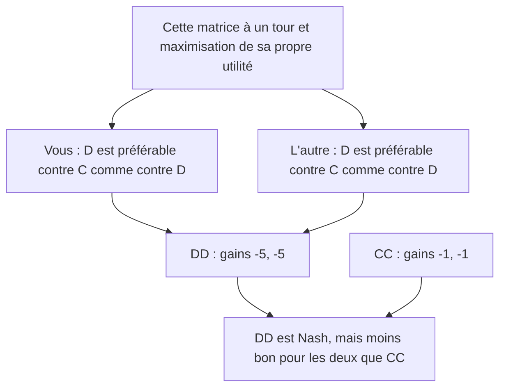
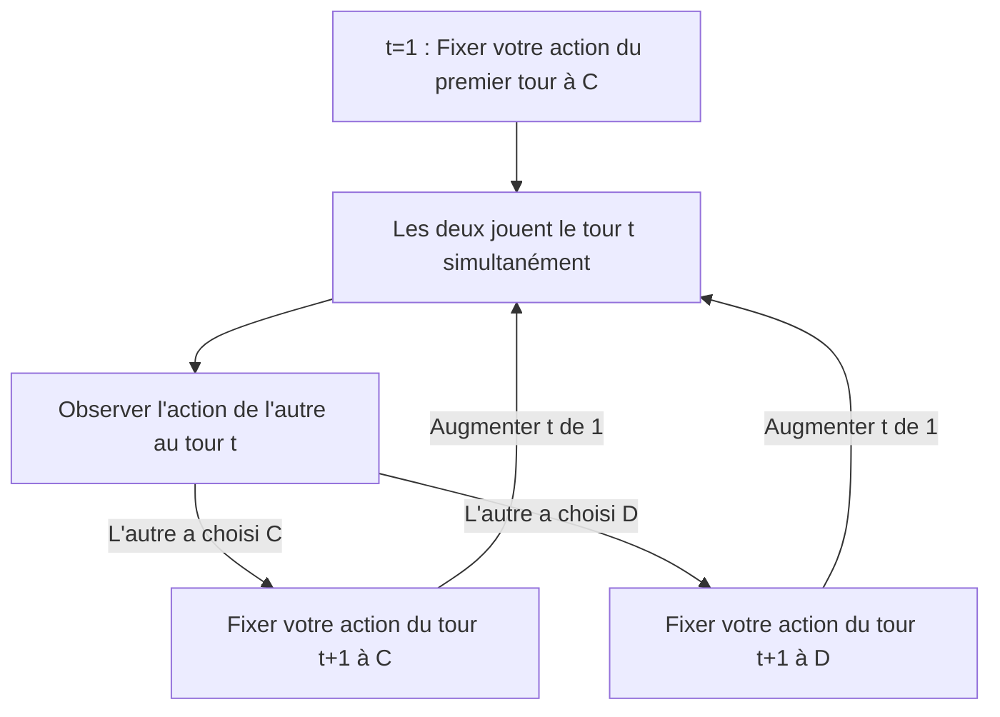

## 1. Silence ou aveu : définir un jeu fictif

Supposons que deux suspects, placés dans des pièces séparées sans pouvoir se consulter, choisissent simultanément de garder le silence ou d'avouer. Nous considérons un **jeu fictif** dans lequel les peines suivantes sont certaines. Il ne décrit pas les règles réelles d'une enquête ou d'une négociation de peine, ni une règle juridique selon laquelle avouer rendrait innocent.

- Les deux gardent le silence : un an chacun.
- Un seul avoue : zéro année pour celui qui avoue, dix pour celui qui se tait.
- Les deux avouent : cinq ans chacun.

Notons C (cooperate, coopérer avec l'autre joueur) le silence et D (defect, abandonner cette coopération) l'aveu. Coopérer signifie ici coopérer entre les deux joueurs, et non avec les enquêteurs. C et D sont les noms des actions du modèle.

Supposons que chaque personne ne se préoccupe que de la durée de sa propre peine et préfère une durée plus courte. L'amitié, la culpabilité et la réputation n'apportent aucune utilité supplémentaire dans ce modèle. Si y_i est la durée de la peine et u_i le gain ou l'utilité, nous utilisons les valeurs suivantes. Une utilité négative ne signifie pas une durée de peine négative.

$$
u_i=-y_i,\qquad y_i\in\{0,1,5,10\}
$$

Sous ces hypothèses, nous pouvons étudier le conflit entre les incitations individuelles et un résultat meilleur pour les deux. Ce n'est pas une loi psychologique imposant ce choix à toutes les personnes réelles.

## 2. Matrice des gains et efficacité au sens de Pareto

Chaque couple représente (votre utilité, l'utilité de l'autre joueur). Une valeur plus élevée signifie un résultat préféré par le joueur concerné.

| Vous / Autre joueur | C : silence | D : aveu |
| --- | --- | --- |
| C : silence | (-1, -1) | (-10, 0) |
| D : aveu | (0, -10) | (-5, -5) |

Dans la notation habituelle, T est votre gain lorsque vous seul choisissez D ; R, lorsque les deux choisissent C ; P, lorsque les deux choisissent D ; et S, lorsque vous seul choisissez C. Cette matrice respecte l'ordre suivant.

$$
T=0>R=-1>P=-5>S=-10
$$

Un résultat est **optimal ou efficace au sens de Pareto** s'il n'existe aucun autre résultat réalisable qui augmente le gain d'au moins une personne sans réduire celui d'une autre. Ce n'est pas la définition de la maximisation de la somme des gains.

Parmi les quatre profils d'actions pures de la matrice, CC, CD et DC sont efficaces au sens de Pareto. Par exemple, dans CD, le joueur qui choisit D reçoit déjà son gain maximal, zéro ; on ne peut améliorer le gain de l'autre sans détériorer le sien. DD est inefficace : passer à CC améliore les gains des deux, de -5 à -1.

Séparément, si nous additionnons ces valeurs avec le même poids, CC maximise la somme des gains. Cela correspond à minimiser la durée totale des peines.

$$
(u_1+u_2)(CC)=-2,\qquad(u_1+u_2)(CD)=(u_1+u_2)(DC)=(u_1+u_2)(DD)=-10
$$

La peine totale est de deux ans dans CC et de dix dans chacun des trois autres profils. Distinguer le critère de somme de l'efficacité de Pareto clarifie les intérêts que l'on évalue. Les profils efficaces cités concernent les résultats d'actions pures ; ils n'énumèrent pas l'ensemble des gains efficaces lorsqu'on autorise aussi des tirages au sort entre résultats.

## 3. Stratégies dominantes et équilibre de Nash

En maintenant fixe l'action de l'autre joueur, votre gain est supérieur avec D dans les deux cas. Ici, u_i(X,Y) désigne votre gain lorsque vous choisissez X et l'autre joueur Y.

$$
u_i(D,C)=0>-1=u_i(C,C),\qquad u_i(D,D)=-5>-10=u_i(C,D)
$$

Une stratégie dont le gain est strictement supérieur à celui de l'autre choix, quelle que soit l'action adverse, est **strictement dominante**. Même si vous attribuez une probabilité p au choix C de l'autre, la différence des gains espérés reste positive.

$$
\begin{aligned}
0&\le p\le1,\\
\mathrm{EU}(D)&=0p-5(1-p)=-5+5p,\\
\mathrm{EU}(C)&=-p-10(1-p)=-10+9p,\\
\mathrm{EU}(D)-\mathrm{EU}(C)&=5-4p\ge1.
\end{aligned}
$$

Si l'autre joueur maximise lui aussi son utilité espérée à partir de la même matrice, les deux choisissent D. Puisque D domine strictement C contre des stratégies adverses pures ou mixtes, DD est l'unique équilibre de Nash de ce jeu.

Un **équilibre de Nash** est un profil de stratégies dans lequel aucun joueur ne peut augmenter son gain en modifiant uniquement sa propre stratégie, celles des autres restant fixes. Cela ne signifie pas qu'un changement conjoint ne puisse améliorer le résultat. Dans DD, passer seul à C dégrade votre gain de -5 à -10 ; passer ensemble à CC améliore les gains des deux.

Le dilemme tient au fait que ces incitations individuelles ne soutiennent pas CC comme équilibre, bien que CC améliore les gains des deux. Cette conclusion concerne un modèle dont les gains, les choix et l'information sont définis.

## 4. Prix, environnement et sport nécessitent leurs propres modèles

### Concurrence par les prix

Cette structure peut parfois aider à analyser l'incitation à baisser son prix pour augmenter ses ventes, ainsi que la réduction des marges lorsque les deux entreprises baissent leurs prix. Elle n'implique pas qu'une baisse de 1000 à 500 yens mette nécessairement les deux en déficit. Demande, coûts, qualité et entrée de concurrents influent sur les bénéfices. Additionner uniquement les bénéfices des entreprises n'équivaut pas non plus à évaluer l'intérêt des consommateurs ou le bien-être collectif.

### Réduction des gaz à effet de serre

Lorsque les bénéfices des réductions sont largement partagés et que chaque acteur supporte ses propres coûts, on peut examiner l'incitation à profiter de l'effort d'autrui sans contribuer. Mais les pays peuvent être nombreux, plutôt que deux joueurs ; bénéfices, coûts et dommages sont asymétriques, et accords et surveillance comptent. Cette matrice ne permet pas de conclure que tous les pays doivent abandonner la coopération ou qu'agir seul entraîne nécessairement d'importantes pertes économiques.

### Dopage dans le sport

Le modèle peut aussi servir d'analogie pour les incitations compétitives liées à des conduites interdites. Les gains réels dépendent toutefois des contrôles, des sanctions, des effets sur la santé et des valeurs des athlètes, entre autres facteurs. La matrice n'est pas une preuve empirique qu'une infraction garantit la victoire, que tous les athlètes enfreignent les règles ou qu'un dommage précis pour la santé est inévitable.

Pour chaque application, il faut identifier les joueurs, les actions, les gains et ce qui peut être observé, puis vérifier si les gains respectent réellement l'ordre du dilemme du prisonnier.

## 5. Répétition et stratégie donnant-donnant

### Une relation longue ne suffit pas

Considérons le cadre standard dans lequel la même matrice est répétée un nombre fini, fixe et connu de fois, les actions passées sont observables, et la structure du jeu ainsi que la rationalité sont de connaissance commune. Au dernier tour, sans réactions futures, les deux choisissent D. Par récurrence à rebours, ils choisissent aussi D à tous les tours précédents. C'est le comportement d'équilibre parfait en sous-jeux dans ce cadre. Ajouter des tours ne garantit pas la coopération.

Si la fin est incertaine, ou si les joueurs évaluent les gains futurs sur un horizon infini, les réactions futures au comportement présent peuvent modifier les incitations. [Les notes du MIT sur les jeux répétés](https://www.ocw.mit.edu/courses/14-15j-networks-spring-2018/pages/lecture-and-recitation-notes/recitation-10-notes/) traitent la récurrence à rebours dans le cas fini et un exemple à horizon infini. Leurs gains numériques diffèrent de ceux de cet article.

### Donnant-donnant copie l'action précédente de l'autre

La stratégie donnant-donnant (Tit for Tat, TFT) choisit C au premier tour, puis copie l'action de l'autre joueur au tour précédent. Notons a_i,t votre action au tour t, et j l'autre joueur.

$$
a_{i,1}=C,\qquad a_{i,t}=a_{j,t-1}\quad(t\ge2)
$$

Elle ne permet pas de voir l'action actuelle de l'autre avant de choisir la sienne. Dans le schéma, les deux jouent le tour actuel, observent son résultat, puis déterminent leur action pour le tour suivant.

[L'article d'Axelrod et Hamilton de 1981](https://public.websites.umich.edu/~axe/research/Axelrod%20and%20Hamilton%20EC%201981.pdf) rapporte que TFT, soumise par Anatol Rapoport, a obtenu le meilleur score moyen dans les deux tournois de programmes d'Axelrod. Les gains des tournois décrits étaient T=5, R=3, P=1 et S=0, différents de ceux de la matrice des peines de cet article.

La stratégie ne prend pas l'initiative de faire défection, réagit au choix D de l'autre et revient à C au tour suivant le retour de l'autre à C. Sa règle est également courte à décrire. Mais aucun théorème ne garantit qu'elle obtienne toujours le meilleur score, quels que soient les stratégies participantes, les appariements, les gains ou la durée. Même entre deux joueurs TFT, par exemple, une erreur d'action produisant CD peut être suivie de DC, puis CD, entretenant une défection alternée. La gestion des erreurs est une autre question de conception.

### Un exemple de conditions soutenant la coopération à l'équilibre

Considérons une **stratégie de punition permanente (grim trigger)**, différente de TFT : choisir C si tous les tours précédents ont été CC ; après tout choix D, choisir D pour toujours. Supposons un horizon infini, des actions parfaitement observées et, pour chaque joueur, la somme suivante des gains actualisés géométriquement.

$$
V_i=\sum_{t=1}^{\infty}\delta^{t-1}u_{i,t},\qquad0\le\delta<1
$$

Le facteur d'actualisation δ fixe le poids du futur. Avec la matrice de cet article, la valeur de la coopération continue et celle d'un passage unilatéral à D maintenant, suivi de DD pour toujours, sont les suivantes.

$$
V_{\mathrm{coop}}=\frac{-1}{1-\delta},\qquad V_{\mathrm{deviate}}=0+\frac{-5\delta}{1-\delta}
$$

La condition pour ne pas avoir intérêt à dévier de la coopération est donc :

$$
\frac{-1}{1-\delta}\ge\frac{-5\delta}{1-\delta}\quad\Longleftrightarrow\quad-1\ge-5\delta\quad\Longleftrightarrow\quad\delta\ge\frac15
$$

Après le début de la punition, D est aussi la meilleure réponse à un adversaire qui choisira toujours D. Ainsi, avec ces gains, cette observation et cette actualisation, l'usage mutuel de grim trigger peut soutenir la coopération comme équilibre parfait en sous-jeux lorsque δ est au moins égal à 1/5. À la frontière, coopérer et dévier une fois ont la même valeur. Le 1/5 provient de cette matrice et de cette stratégie ; ce n'est ni un seuil universel du dilemme du prisonnier ni une preuve que TFT est toujours la meilleure.

De plus, le profil où chacun choisit toujours D reste lui aussi un équilibre. L'existence d'un équilibre coopératif et le choix effectif de la coopération sont deux questions distinctes.

## 6. Penser la confiance à partir des incitations et des hypothèses

Le dilemme du prisonnier précise comment des choix avantageux individuellement peuvent ne pas soutenir un résultat améliorant les gains des deux. Pour le comprendre, il faut distinguer stratégies dominantes, équilibre de Nash, efficacité de Pareto et somme des gains.

La répétition peut élargir les possibilités de coopération, mais l'horizon, le poids du futur, l'observation des actions, les erreurs et les règles de réponse comptent. On ne peut conclure qu'une relation longue rende toujours optimales la confiance et la coopération. Pour appliquer le modèle, il faut d'abord établir les gains et les institutions réels, puis examiner les conditions qui pourraient soutenir la coopération.
