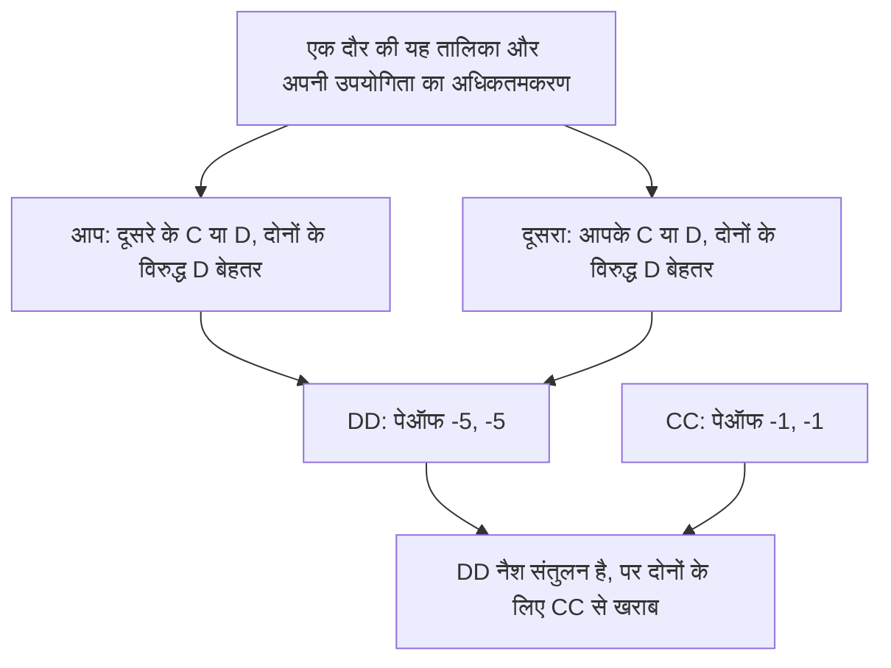
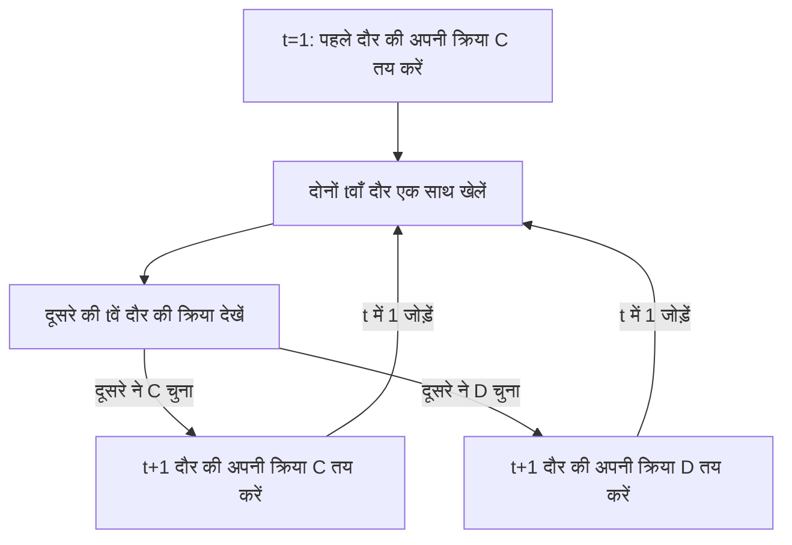

## 1. चुप रहना या कबूल करना: एक काल्पनिक खेल की परिभाषा

मान लें कि दो संदिग्ध अलग-अलग कमरों में, आपस में सलाह किए बिना, एक साथ तय करते हैं कि चुप रहें या कबूल करें। हम एक **काल्पनिक खेल** पर विचार कर रहे हैं जिसमें नीचे दी गई जेल की अवधियाँ निश्चित हैं। यह वास्तविक जाँच या दलील-सौदे के नियमों का वर्णन नहीं है, न ही यह कानूनी नियम बताता है कि कबूल करने पर व्यक्ति निर्दोष हो जाता है।

- दोनों चुप रहें: प्रत्येक के लिए एक वर्ष।
- केवल एक कबूल करे: कबूल करने वाले के लिए शून्य वर्ष, चुप रहने वाले के लिए दस वर्ष।
- दोनों कबूल करें: प्रत्येक के लिए पाँच वर्ष।

चुप रहने को C (cooperate, दूसरे खिलाड़ी का सहयोग करना) और कबूल करने को D (defect, इस सहयोग से हटना) कहते हैं। यहाँ सहयोग दो खिलाड़ियों के बीच है, जाँचकर्ताओं के साथ नहीं। C और D इस मॉडल की क्रियाओं के नाम हैं।

मान लें कि हर व्यक्ति केवल अपनी जेल की अवधि को महत्त्व देता है और कम अवधि पसंद करता है। दोस्ती, अपराधबोध या प्रतिष्ठा की अलग उपयोगिता मॉडल में शामिल नहीं है। y_i जेल की अवधि और u_i पेऑफ अर्थात उपयोगिता है; इसके लिए हम निम्न संख्याएँ लेते हैं। ऋणात्मक उपयोगिता का अर्थ जेल की ऋणात्मक अवधि नहीं है।

$$
u_i=-y_i,\qquad y_i\in\{0,1,5,10\}
$$

इन मान्यताओं के तहत हम देख सकते हैं कि व्यक्तिगत प्रोत्साहन, दोनों के लिए बेहतर परिणाम से कैसे टकराते हैं। यह ऐसा मनोवैज्ञानिक नियम नहीं है जिसके अनुसार वास्तविक लोग हमेशा एक ही चुनाव करें।

## 2. पेऑफ मैट्रिक्स और पैरेटो दक्षता का अर्थ

हर जोड़ी में (आपकी उपयोगिता, दूसरे खिलाड़ी की उपयोगिता) दी गई है। संबंधित खिलाड़ी के लिए बड़ी संख्या अधिक पसंदीदा परिणाम दर्शाती है।

| आप／दूसरा खिलाड़ी | C: चुप रहना | D: कबूल करना |
| --- | --- | --- |
| C: चुप रहना | (-1, -1) | (-10, 0) |
| D: कबूल करना | (0, -10) | (-5, -5) |

सामान्य संकेतन में T वह पेऑफ है जब केवल आप D चुनते हैं; R दोनों के C चुनने पर, P दोनों के D चुनने पर, और S केवल आपके C चुनने पर मिलता है। यह तालिका निम्न क्रम पूरा करती है।

$$
T=0>R=-1>P=-5>S=-10
$$

कोई परिणाम **पैरेटो-इष्टतम या पैरेटो-दक्ष** तब है जब ऐसा कोई दूसरा संभव परिणाम न हो जो किसी का पेऑफ घटाए बिना कम से कम एक खिलाड़ी का पेऑफ बढ़ाए। इसकी परिभाषा सभी के पेऑफ का योग अधिकतम करना नहीं है।

तालिका के चार शुद्ध क्रिया-संयोजनों में CC, CD और DC पैरेटो-दक्ष हैं। उदाहरण के लिए CD में D चुनने वाला पहले ही अपना अधिकतम पेऑफ शून्य पा रहा है; उसे नुकसान पहुँचाए बिना दूसरे का पेऑफ नहीं बढ़ाया जा सकता। DD दक्ष नहीं है: CC पर जाने से दोनों का पेऑफ -5 से -1 हो जाता है।

अलग से, यदि हम इन संख्याओं को समान भार देकर जोड़ें, तो CC पेऑफ के योग को अधिकतम करता है। यह जेल की कुल अवधि को न्यूनतम करने के अनुरूप है।

$$
(u_1+u_2)(CC)=-2,\qquad(u_1+u_2)(CD)=(u_1+u_2)(DC)=(u_1+u_2)(DD)=-10
$$

CC में कुल अवधि दो वर्ष और बाकी तीन संयोजनों में दस-दस वर्ष है। योग के मानदंड और पैरेटो दक्षता में अंतर करने से स्पष्ट होता है कि मूल्यांकन किसके हित की बात कर रहा है। ऊपर दक्ष संयोजनों की सूची शुद्ध क्रियाओं के परिणामों के लिए है; परिणामों के बीच लॉटरी की अनुमति मिलने पर दक्ष पेऑफ का पूरा समुच्चय इसमें सूचीबद्ध नहीं है।

## 3. प्रभुत्वशाली रणनीति और नैश संतुलन

दूसरे खिलाड़ी की क्रिया स्थिर रखकर तुलना करें, तो दोनों स्थितियों में D चुनने से आपका पेऑफ अधिक है। यहाँ u_i(X,Y) आपका पेऑफ है जब आप X और दूसरा खिलाड़ी Y चुनता है।

$$
u_i(D,C)=0>-1=u_i(C,C),\qquad u_i(D,D)=-5>-10=u_i(C,D)
$$

दूसरे खिलाड़ी की हर क्रिया के विरुद्ध विकल्प से सख्ती से अधिक पेऑफ देने वाली रणनीति **सख्ती से प्रभुत्वशाली रणनीति (strictly dominant strategy)** है। यदि आप दूसरे के C चुनने की प्रायिकता p मानें, तब भी अपेक्षित पेऑफ का अंतर धनात्मक रहता है।

$$
\begin{aligned}
0&\le p\le1,\\
\mathrm{EU}(D)&=0p-5(1-p)=-5+5p,\\
\mathrm{EU}(C)&=-p-10(1-p)=-10+9p,\\
\mathrm{EU}(D)-\mathrm{EU}(C)&=5-4p\ge1.
\end{aligned}
$$

यदि दूसरा खिलाड़ी भी इसी तालिका के आधार पर अपनी अपेक्षित उपयोगिता अधिकतम करता है, तो दोनों D चुनते हैं। प्रतिद्वंद्वी की शुद्ध और मिश्रित, दोनों प्रकार की रणनीतियों के विरुद्ध D, C से सख्ती से बेहतर है; इसलिए DD इस खेल का एकमात्र नैश संतुलन है।

**नैश संतुलन** रणनीतियों का ऐसा संयोजन है जिसमें अन्य खिलाड़ियों की रणनीतियाँ स्थिर रखने पर कोई खिलाड़ी केवल अपनी रणनीति बदलकर पेऑफ नहीं बढ़ा सकता। इसका अर्थ यह नहीं है कि दोनों साथ में बदलें तो भी सुधार असंभव है। DD में अकेले C पर जाने से आपका पेऑफ -5 से -10 हो जाता है; दोनों CC पर जाएँ तो दोनों का पेऑफ सुधरता है।

दुविधा यह है कि ये व्यक्तिगत प्रोत्साहन CC को संतुलन के रूप में कायम नहीं रखते, जबकि CC दोनों का पेऑफ सुधारता है। यह निश्चित पेऑफ, विकल्पों और जानकारी वाले मॉडल का निष्कर्ष है।

## 4. कीमत, पर्यावरण और खेल के लिए अलग पेऑफ मॉडल चाहिए

### मूल्य प्रतिस्पर्धा

प्रतिद्वंद्वी से कम कीमत रखकर बिक्री बढ़ाने के प्रोत्साहन और दोनों की कीमत घटने पर लाभ-मार्जिन कम होने का विश्लेषण करते समय यह संरचना कभी-कभी उपयोगी हो सकती है। इससे यह निष्कर्ष नहीं निकलता कि कीमत 1000 येन से 500 येन होने पर दोनों कंपनियों को अनिवार्य रूप से घाटा होगा। माँग, लागत, गुणवत्ता और नए प्रतिस्पर्धियों के प्रवेश से मुनाफा बदलता है। केवल कंपनियों का मुनाफा जोड़ना भी उपभोक्ताओं के हित या पूरे समाज के कल्याण का मूल्यांकन नहीं है।

### ग्रीनहाउस गैसों में कटौती

यदि कटौती के लाभ व्यापक रूप से साझा होते हों, पर लागत प्रत्येक पक्ष उठाए, तो दूसरों के प्रयास का लाभ बिना योगदान किए लेने के प्रोत्साहन को देख सकते हैं। लेकिन इसमें दो खिलाड़ियों के बजाय कई देश हो सकते हैं; लाभ, लागत और नुकसान असमान होते हैं, और समझौते तथा निगरानी भी महत्त्व रखते हैं। यह दो-खिलाड़ी तालिका साबित नहीं करती कि हर देश अनिवार्य रूप से सहयोग छोड़ेगा या अकेले कटौती करने पर अनिवार्य रूप से भारी आर्थिक नुकसान होगा।

### खेलों में डोपिंग

यह मॉडल प्रतिबंधित आचरण के प्रतिस्पर्धात्मक प्रोत्साहन की उपमा भी हो सकता है। वास्तविक पेऑफ में जाँच, दंड, स्वास्थ्य पर प्रभाव और खिलाड़ियों के मूल्य जैसे कारक शामिल हैं। यह तालिका ऐसा अनुभवजन्य प्रमाण नहीं है कि नियम तोड़ने से जीत निश्चित है, हर खिलाड़ी नियम तोड़ेगा या कोई खास स्वास्थ्य नुकसान अनिवार्य रूप से होगा।

हर उपयोग में पहले खिलाड़ी, क्रियाएँ, पेऑफ और क्या देखा जा सकता है यह तय करें, फिर जाँचें कि वास्तविक पेऑफ कैदी की दुविधा का क्रम पूरा करते हैं या नहीं।

## 5. दोहराए गए खेल और जैसे को तैसा

### लंबा संबंध अपने आप पर्याप्त नहीं है

मानक स्थिति लें: यही तालिका पहले से ज्ञात, निश्चित, सीमित दौरों तक दोहराई जाती है; पिछली क्रियाएँ देखी जा सकती हैं; खेल की संरचना और तर्कसंगतता साझा ज्ञान (common knowledge) हैं। अर्थात हर खिलाड़ी इन्हें जानता है, जानता है कि दूसरे भी जानते हैं, और यह जानकारी इसी तरह सभी स्तरों पर साझा है। अंतिम दौर के बाद भविष्य की प्रतिक्रिया नहीं है, इसलिए दोनों D चुनते हैं। अंतिम दौर से पीछे की ओर तर्क करने पर हर पहले दौर में भी दोनों D चुनते हैं। यह इस स्थिति के उपखेल-पूर्ण संतुलन (subgame-perfect equilibrium) का व्यवहार है। केवल दौर बढ़ाने से सहयोग की गारंटी नहीं मिलती।

यदि अंत अनिश्चित हो, या अनंत अवधि में भविष्य के पेऑफ का मूल्यांकन किया जाए, तो वर्तमान आचरण पर भविष्य की प्रतिक्रिया प्रोत्साहन बदल सकती है। [दोहराए गए खेलों पर MIT के नोट्स](https://www.ocw.mit.edu/courses/14-15j-networks-spring-2018/pages/lecture-and-recitation-notes/recitation-10-notes/) सीमित दौरों में पीछे की ओर तर्क और अनंत अवधि के एक उदाहरण को समझाते हैं। उनकी पेऑफ संख्याएँ इस लेख से अलग हैं।

### जैसे को तैसा दूसरे की पिछली क्रिया की नकल करता है

जैसे को तैसा रणनीति (Tit for Tat, TFT) पहले दौर में C चुनती है और दूसरे दौर से दूसरे खिलाड़ी की पिछली क्रिया चुनती है। a_i,t आपकी tवें दौर की क्रिया है और j दूसरा खिलाड़ी है।

$$
a_{i,1}=C,\qquad a_{i,t}=a_{j,t-1}\quad(t\ge2)
$$

यह उसी दौर में दूसरे की क्रिया पहले देखकर अपना चुनाव करने की रणनीति नहीं है। चित्र में दोनों वर्तमान दौर खेलते हैं, फिर उसका परिणाम देखते हैं और अगले दौर की क्रिया तय करते हैं।

[Axelrod और Hamilton का 1981 का लेख](https://public.websites.umich.edu/~axe/research/Axelrod%20and%20Hamilton%20EC%201981.pdf) बताता है कि Anatol Rapoport की प्रस्तुत TFT ने Axelrod की दोनों कंप्यूटर प्रतियोगिताओं में औसत स्कोर में पहला स्थान पाया। वहाँ वर्णित प्रतियोगिताओं के पेऑफ T=5, R=3, P=1 और S=0 थे, जो इस लेख की जेल-अवधि वाली तालिका से अलग हैं।

रणनीति स्वयं D से शुरुआत नहीं करती, दूसरे के D का जवाब देती है और दूसरे के C पर लौटने के अगले दौर में स्वयं C पर लौटती है। इसका नियम भी संक्षेप में बताया जा सकता है। पर ऐसा कोई प्रमेय नहीं है कि भाग लेने वाली रणनीतियाँ, जोड़ी बनाने की विधि, पेऑफ या अवधि कुछ भी हों, इसका स्कोर हमेशा सबसे अधिक होगा। उदाहरण के लिए TFT खेलने वाले दो लोगों में भी एक क्रिया की गलती से CD हो, तो अगला परिणाम DC, फिर CD हो सकता है और बारी-बारी से सहयोग छोड़ना जारी रह सकता है। गलतियों से निपटना अलग डिज़ाइन का प्रश्न है।

### सहयोग को संतुलन में बनाए रखने की शर्त का उदाहरण

अब TFT से अलग **स्थायी दंड की रणनीति (grim trigger)** लें: यदि पिछले सभी दौर CC रहे हों तो C चुनें; एक बार भी D होने पर आगे हमेशा D चुनें। अनंत अवधि, क्रियाओं का सटीक अवलोकन और हर खिलाड़ी के पेऑफ का निम्न ज्यामितीय रूप से डिस्काउंट किया गया योग मानते हैं।

$$
V_i=\sum_{t=1}^{\infty}\delta^{t-1}u_{i,t},\qquad0\le\delta<1
$$

डिस्काउंट गुणक δ भविष्य का भार तय करता है। इस लेख की तालिका में लगातार सहयोग का मूल्य और अभी अकेले D चुनने के बाद हमेशा DD होने का मूल्य निम्न हैं।

$$
V_{\mathrm{coop}}=\frac{-1}{1-\delta},\qquad V_{\mathrm{deviate}}=0+\frac{-5\delta}{1-\delta}
$$

सहयोग से हटने का प्रोत्साहन न होने की शर्त इसलिए है:

$$
\frac{-1}{1-\delta}\ge\frac{-5\delta}{1-\delta}\quad\Longleftrightarrow\quad-1\ge-5\delta\quad\Longleftrightarrow\quad\delta\ge\frac15
$$

दंड शुरू होने के बाद दूसरा हमेशा D चुनता है, इसलिए स्वयं D चुनना भी सबसे अच्छा जवाब है। इन पेऑफ, अवलोकन और डिस्काउंट की मान्यताओं में, δ कम से कम 1/5 होने पर दोनों की grim trigger रणनीति सहयोग को उपखेल-पूर्ण संतुलन के रूप में कायम रख सकती है। सीमा पर सहयोग और एक बार हटने का मूल्य बराबर है। 1/5 इसी तालिका और रणनीति से मिलता है; यह हर कैदी की दुविधा का सार्वभौमिक मान नहीं है और TFT को हमेशा सर्वश्रेष्ठ नहीं साबित करता।

इसके अलावा, दोनों के हमेशा D चुनने का रणनीति-संयोजन भी संतुलन बना रहता है। सहयोगी संतुलन का अस्तित्व और वास्तव में सहयोग का चुना जाना अलग प्रश्न हैं।

## 6. प्रोत्साहन और मान्यताओं से भरोसे पर विचार करना

कैदी की दुविधा स्पष्ट करती है कि व्यक्तिगत रूप से लाभदायक चुनाव, दोनों का पेऑफ सुधारने वाले परिणाम को कायम रखने में विफल हो सकते हैं। इसे समझने के लिए प्रभुत्वशाली रणनीति, नैश संतुलन, पैरेटो दक्षता और पेऑफ के योग में अंतर करना आवश्यक है।

दोहराव सहयोग की संभावनाएँ बढ़ा सकता है, लेकिन अवधि, भविष्य का भार, क्रियाओं का अवलोकन, गलतियाँ और जवाब देने के नियम महत्त्व रखते हैं। लंबा संबंध होने भर से भरोसा और सहयोग हमेशा सर्वोत्तम हैं, यह निष्कर्ष नहीं निकलता। मॉडल लागू करते समय पहले वास्तविक पेऑफ और संस्थागत नियम समझें, फिर सहयोग को कायम रखने वाली शर्तों पर विचार करें।
