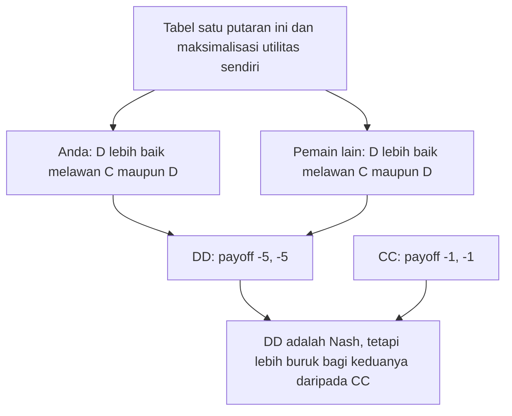
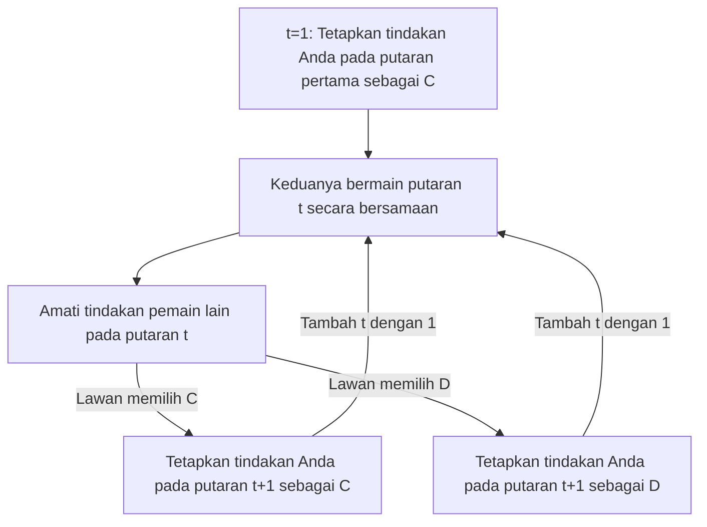

## 1. Diam atau mengaku: mendefinisikan permainan fiktif

Misalkan dua tersangka berada di ruangan terpisah, tidak dapat berdiskusi, dan secara bersamaan memilih diam atau mengaku. Kita membahas **permainan fiktif** dengan masa hukuman berikut yang ditetapkan secara pasti. Ini bukan uraian aturan penyidikan atau kesepakatan pengakuan bersalah yang sebenarnya, dan tidak menyatakan bahwa mengaku membuat seseorang dinyatakan tidak bersalah secara hukum.

- Keduanya diam: masing-masing satu tahun.
- Hanya satu yang mengaku: nol tahun bagi yang mengaku, sepuluh tahun bagi yang diam.
- Keduanya mengaku: masing-masing lima tahun.

Kita menyebut diam sebagai C (cooperate, bekerja sama dengan pemain lain) dan mengaku sebagai D (defect, meninggalkan kerja sama itu). Kerja sama di sini berarti kerja sama antara kedua pemain, bukan dengan penyidik. C dan D adalah nama tindakan dalam model ini.

Anggap setiap orang hanya memperhatikan masa hukumannya sendiri dan lebih menyukai masa yang lebih singkat. Persahabatan, rasa bersalah, dan reputasi tidak memberikan utilitas tambahan dalam model. Jika y_i adalah masa hukuman dan u_i adalah payoff atau utilitas, kita menggunakan nilai berikut. Utilitas negatif tidak berarti masa hukuman negatif.

$$
u_i=-y_i,\qquad y_i\in\{0,1,5,10\}
$$

Dengan asumsi ini, kita dapat melihat bagaimana insentif individu berbenturan dengan hasil yang lebih baik bagi keduanya. Ini bukan hukum psikologis yang mewajibkan manusia nyata selalu membuat pilihan yang sama.

## 2. Makna matriks payoff dan efisiensi Pareto

Setiap pasangan menunjukkan (utilitas Anda, utilitas pemain lain). Nilai lebih besar berarti hasil yang lebih disukai pemain terkait.

| Anda / Pemain lain | C: diam | D: mengaku |
| --- | --- | --- |
| C: diam | (-1, -1) | (-10, 0) |
| D: mengaku | (0, -10) | (-5, -5) |

Dalam notasi umum, T adalah payoff Anda jika hanya Anda memilih D; R ketika keduanya memilih C; P ketika keduanya memilih D; dan S jika hanya Anda memilih C. Tabel ini memenuhi urutan berikut.

$$
T=0>R=-1>P=-5>S=-10
$$

Hasil disebut **optimal atau efisien menurut Pareto** jika tidak ada hasil lain yang mungkin dicapai yang meningkatkan payoff setidaknya satu pemain tanpa menurunkan payoff siapa pun. Ini bukan definisi memaksimalkan jumlah payoff semua pemain.

Di antara empat profil tindakan murni dalam tabel, CC, CD, dan DC efisien menurut Pareto. Misalnya, pada CD pemain yang memilih D sudah mendapat payoff tertingginya, nol; payoff pemain lain tidak dapat ditingkatkan tanpa merugikannya. DD tidak efisien: berpindah ke CC meningkatkan payoff keduanya dari -5 menjadi -1.

Secara terpisah, jika angka-angka ini dijumlahkan dengan bobot sama, CC memaksimalkan jumlah payoff. Ini bersesuaian dengan meminimalkan total masa hukuman.

$$
(u_1+u_2)(CC)=-2,\qquad(u_1+u_2)(CD)=(u_1+u_2)(DC)=(u_1+u_2)(DD)=-10
$$

Total masa hukuman pada CC adalah dua tahun, sedangkan pada masing-masing dari tiga profil lainnya sepuluh tahun. Membedakan kriteria jumlah dari efisiensi Pareto memperjelas kepentingan siapa yang dinilai. Profil efisien yang disebutkan adalah hasil tindakan murni; daftar itu bukan keseluruhan himpunan payoff efisien jika pengundian antarhasil juga diperbolehkan.

## 3. Strategi dominan dan keseimbangan Nash

Dengan tindakan pemain lain tetap, payoff Anda dari D lebih tinggi dalam kedua kasus. Di sini u_i(X,Y) berarti payoff Anda ketika Anda memilih X dan pemain lain memilih Y.

$$
u_i(D,C)=0>-1=u_i(C,C),\qquad u_i(D,D)=-5>-10=u_i(C,D)
$$

Strategi yang memberikan payoff lebih tinggi secara ketat daripada alternatifnya untuk setiap tindakan lawan disebut **strategi dominan ketat (strictly dominant strategy)**. Sekalipun Anda memberi probabilitas p pada pilihan C lawan, selisih payoff harapannya tetap positif.

$$
\begin{aligned}
0&\le p\le1,\\
\mathrm{EU}(D)&=0p-5(1-p)=-5+5p,\\
\mathrm{EU}(C)&=-p-10(1-p)=-10+9p,\\
\mathrm{EU}(D)-\mathrm{EU}(C)&=5-4p\ge1.
\end{aligned}
$$

Jika pemain lain juga memaksimalkan utilitas harapannya sendiri berdasarkan tabel yang sama, keduanya memilih D. Karena D lebih baik secara ketat daripada C terhadap strategi lawan murni maupun campuran, DD merupakan satu-satunya keseimbangan Nash dalam permainan ini.

**Keseimbangan Nash** adalah profil strategi ketika tidak ada pemain yang dapat meningkatkan payoff dengan hanya mengubah strateginya sendiri, sementara strategi pemain lain tetap. Ini tidak berarti perubahan bersama tidak dapat memperbaiki hasil. Pada DD, beralih sendiri ke C memperburuk payoff Anda dari -5 menjadi -10; jika keduanya beralih ke CC, payoff keduanya meningkat.

Dilemanya adalah bahwa insentif individu ini tidak menopang CC sebagai keseimbangan, meskipun CC meningkatkan payoff keduanya. Kesimpulan ini berlaku bagi model dengan payoff, pilihan, dan informasi yang ditetapkan.

## 4. Harga, lingkungan, dan olahraga memerlukan model sendiri

### Persaingan harga

Struktur ini kadang membantu menganalisis insentif menurunkan harga untuk meningkatkan penjualan, serta penyempitan margin ketika kedua perusahaan menurunkan harga. Ini tidak berarti penurunan dari 1000 menjadi 500 yen pasti membuat keduanya rugi. Permintaan, biaya, kualitas, dan masuknya pesaing memengaruhi laba. Menjumlahkan laba perusahaan saja juga berbeda dari menilai kepentingan konsumen atau kesejahteraan masyarakat secara keseluruhan.

### Pengurangan gas rumah kaca

Ketika manfaat pengurangan emisi dinikmati secara luas tetapi setiap pihak menanggung biayanya sendiri, kita dapat menelaah insentif menikmati usaha pihak lain tanpa ikut berkontribusi. Namun, jumlah negara yang terlibat bisa lebih dari dua; manfaat, biaya, dan kerugian tidak simetris, serta perjanjian dan pemantauan penting. Tabel ini tidak membuktikan bahwa semua negara pasti meninggalkan kerja sama atau bahwa bertindak sendiri pasti menimbulkan kerugian ekonomi besar.

### Doping dalam olahraga

Model ini juga dapat menjadi analogi untuk insentif persaingan dalam tindakan terlarang. Namun, payoff nyata bergantung antara lain pada pemeriksaan, sanksi, dampak kesehatan, dan nilai-nilai atlet. Tabel ini bukan bukti empiris bahwa pelanggaran menjamin kemenangan, semua atlet melanggar, atau suatu gangguan kesehatan tertentu pasti terjadi.

Untuk setiap penerapan, identifikasi pemain, tindakan, payoff, dan apa yang dapat diamati, lalu periksa apakah payoff benar-benar memiliki urutan dilema tahanan.

## 5. Pengulangan dan Tit for Tat

### Hubungan panjang saja tidak cukup

Pertimbangkan situasi standar ketika tabel yang sama diulang selama jumlah putaran terbatas, tetap, dan diketahui, tindakan terdahulu dapat diamati, serta struktur permainan dan rasionalitas merupakan pengetahuan bersama (common knowledge). Pada putaran terakhir, tanpa respons masa depan, keduanya memilih D. Induksi mundur menghasilkan pilihan D oleh keduanya juga pada semua putaran sebelumnya. Itulah perilaku keseimbangan sempurna subpermainan (subgame-perfect equilibrium) dalam situasi ini. Menambah putaran saja tidak menjamin kerja sama.

Jika akhirnya tidak pasti, atau pemain menilai payoff masa depan dalam horizon tak terhingga, respons masa depan terhadap perilaku sekarang dapat mengubah insentif. [Catatan MIT tentang permainan berulang](https://www.ocw.mit.edu/courses/14-15j-networks-spring-2018/pages/lecture-and-recitation-notes/recitation-10-notes/) membahas induksi mundur dalam kasus terbatas dan contoh horizon tak terhingga. Angka payoff dalam catatan itu berbeda dari artikel ini.

### Tit for Tat meniru tindakan lawan pada putaran sebelumnya

Tit for Tat (TFT) memilih C pada putaran pertama, kemudian meniru tindakan pemain lain pada putaran sebelumnya. Misalkan a_i,t adalah tindakan Anda pada putaran t, dan j menunjukkan pemain lain.

$$
a_{i,1}=C,\qquad a_{i,t}=a_{j,t-1}\quad(t\ge2)
$$

Ini bukan strategi melihat tindakan lawan pada putaran sekarang sebelum memilih tindakan sendiri. Dalam diagram, keduanya bermain pada putaran sekarang, mengamati hasilnya, lalu menentukan tindakan untuk putaran berikutnya.

[Artikel Axelrod dan Hamilton tahun 1981](https://public.websites.umich.edu/~axe/research/Axelrod%20and%20Hamilton%20EC%201981.pdf) melaporkan bahwa TFT, yang diajukan Anatol Rapoport, memperoleh peringkat pertama menurut skor rata-rata dalam kedua turnamen program Axelrod. Payoff turnamen yang dijelaskan adalah T=5, R=3, P=1, dan S=0, berbeda dari tabel masa hukuman artikel ini.

Strategi ini tidak memulai dengan D, merespons D lawan, dan kembali ke C pada putaran setelah lawan kembali ke C. Aturannya juga singkat untuk dijelaskan. Namun, tidak ada teorema yang menjamin skor tertinggi untuk semua strategi peserta, pemasangan lawan, payoff, atau durasi. Bahkan di antara dua pemain TFT, satu kesalahan tindakan yang menghasilkan CD dapat diikuti DC, lalu CD, sehingga tindakan tidak bekerja sama terus bergantian. Menangani kesalahan merupakan persoalan desain tersendiri.

### Contoh syarat yang menopang kerja sama dalam keseimbangan

Pertimbangkan **strategi pemicu dengan hukuman permanen (grim trigger)**, berbeda dari TFT: pilih C jika semua putaran sebelumnya adalah CC; setelah pernah ada D, pilih D selamanya. Asumsikan horizon tak terhingga, tindakan teramati sempurna, dan setiap pemain menilai jumlah payoff yang didiskontokan secara geometris berikut.

$$
V_i=\sum_{t=1}^{\infty}\delta^{t-1}u_{i,t},\qquad0\le\delta<1
$$

Faktor diskonto δ menentukan bobot masa depan. Dengan tabel artikel ini, nilai melanjutkan kerja sama dan nilai beralih sendiri ke D sekarang, diikuti DD selamanya, adalah sebagai berikut.

$$
V_{\mathrm{coop}}=\frac{-1}{1-\delta},\qquad V_{\mathrm{deviate}}=0+\frac{-5\delta}{1-\delta}
$$

Syarat tidak adanya insentif menyimpang dari kerja sama adalah:

$$
\frac{-1}{1-\delta}\ge\frac{-5\delta}{1-\delta}\quad\Longleftrightarrow\quad-1\ge-5\delta\quad\Longleftrightarrow\quad\delta\ge\frac15
$$

Setelah hukuman dimulai, D juga merupakan respons terbaik terhadap lawan yang selalu memilih D. Jadi, dengan payoff, pengamatan, dan diskonto ini, kedua pemain yang memakai grim trigger dapat menopang kerja sama sebagai keseimbangan sempurna subpermainan ketika δ setidaknya 1/5. Pada batas itu, bekerja sama dan menyimpang sekali memiliki nilai sama. Nilai 1/5 berasal dari tabel dan strategi ini; bukan ambang universal dilema tahanan dan bukan bukti bahwa TFT selalu terbaik.

Selain itu, profil strategi ketika keduanya selalu memilih D tetap merupakan keseimbangan. Keberadaan keseimbangan kooperatif dan pilihan nyata untuk bekerja sama adalah hal yang berbeda.

## 6. Memikirkan kepercayaan melalui insentif dan asumsi

Dilema tahanan memperjelas bagaimana pilihan yang menguntungkan secara individual dapat gagal menopang hasil yang meningkatkan payoff keduanya. Untuk memahaminya, bedakan strategi dominan, keseimbangan Nash, efisiensi Pareto, dan jumlah payoff.

Pengulangan dapat memperluas kemungkinan kerja sama, tetapi horizon, bobot masa depan, pengamatan tindakan, kesalahan, dan aturan respons tetap penting. Kita tidak dapat menyimpulkan bahwa hubungan panjang selalu membuat kepercayaan dan kerja sama optimal. Untuk menerapkan model, tetapkan dahulu payoff dan institusi nyata, lalu periksa syarat yang dapat menopang kerja sama.
