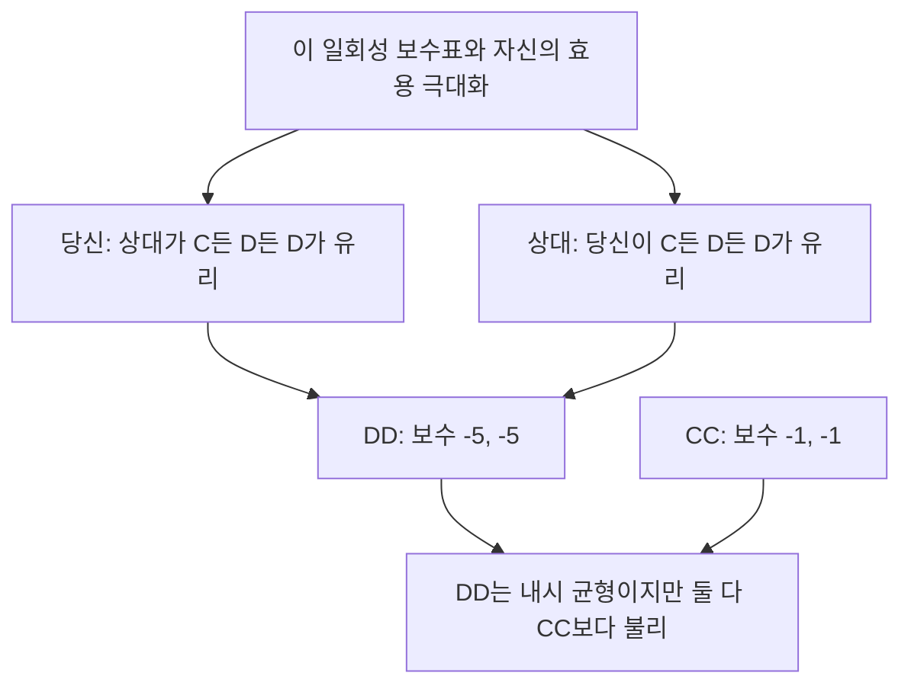
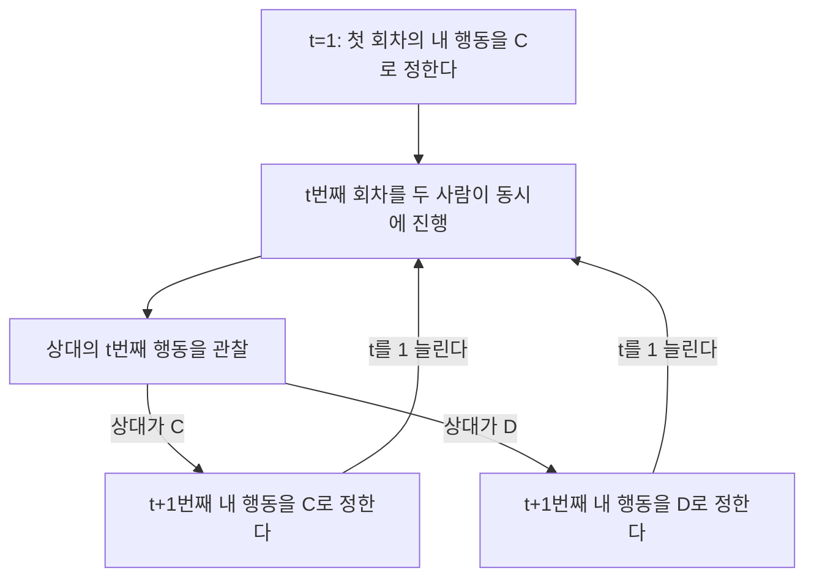

## 1. 침묵과 자백: 가상의 게임을 정의하기

두 용의자가 서로 다른 방에서 상의하지 못한 채, 침묵할지 자백할지를 동시에 선택한다고 합시다. 여기서는 다음 형기가 확정되는 **가상의 게임**을 생각합니다. 실제 수사나 유죄 협상 제도를 설명하거나, 자백하면 무죄가 된다는 법적 규칙을 제시하는 이야기가 아닙니다.

- 둘 다 침묵하면 각자 1년.
- 한 사람만 자백하면 자백한 사람은 0년, 침묵한 사람은 10년.
- 둘 다 자백하면 각자 5년.

침묵을 C(cooperate, 상대와 협력), 자백을 D(defect, 두 사람 사이의 협력에서 이탈)라고 부릅니다. 여기서 협력은 수사에 대한 협조가 아니라 두 참가자 사이의 협력입니다. C와 D는 이 모델의 행동 이름입니다.

각자는 자신의 형기에만 관심을 두며, 짧을수록 좋다고 가정합니다. 우정, 죄책감, 평판에 따른 별도의 효용은 포함하지 않습니다. 형기를 y_i, 보수 또는 효용을 u_i라고 하고 다음 수치를 사용합니다. 보수가 음수라는 것은 형기가 음수라는 뜻이 아닙니다.

$$
u_i=-y_i,\qquad y_i\in\{0,1,5,10\}
$$

이 가정 아래에서 개인에게 가장 유리한 선택과 두 사람 모두에게 더 좋은 결과가 어떻게 충돌하는지 살펴볼 수 있습니다. 실제 사람이 반드시 같은 선택을 한다는 심리 법칙은 아닙니다.

## 2. 보수 행렬과 파레토 효율성의 의미

각 순서쌍은 (당신의 효용, 상대의 효용)입니다. 각자에게 수치가 클수록 더 바람직한 결과입니다.

| 당신／상대 | C: 침묵 | D: 자백 |
| --- | --- | --- |
| C: 침묵 | (-1, -1) | (-10, 0) |
| D: 자백 | (0, -10) | (-5, -5) |

통상적인 기호에서 T는 자신만 D를 선택할 때, R은 둘 다 C일 때, P는 둘 다 D일 때, S는 자신만 C일 때의 보수입니다. 이 표는 다음 순서를 만족합니다.

$$
T=0>R=-1>P=-5>S=-10
$$

**파레토 최적 또는 파레토 효율적**이라는 것은 누구의 보수도 낮추지 않으면서 적어도 한 사람의 보수를 높이는 다른 실현 가능한 결과가 없다는 뜻입니다. 모든 사람의 보수 합계가 최대라는 정의가 아닙니다.

표의 순수 행동 조합 네 가지를 비교하면 CC, CD, DC는 파레토 효율적입니다. 예를 들어 CD에서 D를 선택한 사람은 이미 자신의 최대 보수인 0을 얻으므로, 그 사람을 불리하게 만들지 않고 다른 사람의 보수를 개선할 수 없습니다. DD는 CC로 바꾸면 둘 다 -5에서 -1로 개선되므로 효율적이지 않습니다.

이와 별개로, 이 수치들을 같은 가중치로 더하면 CC에서 보수 합계가 최대가 됩니다. 이는 형기 합계가 최소가 되는 것에 대응합니다.

$$
(u_1+u_2)(CC)=-2,\qquad(u_1+u_2)(CD)=(u_1+u_2)(DC)=(u_1+u_2)(DD)=-10
$$

CC의 형기 합계는 2년이고 나머지 세 조합은 각각 10년입니다. 합계에 따른 평가와 파레토 효율성을 구분하면 누구에게 좋은지를 명확히 할 수 있습니다. 위의 효율적 조합 목록은 순수 행동의 결과에 관한 것이며, 추첨으로 결과를 섞을 때의 효율적인 보수 집합 전체를 나열한 것은 아닙니다.

## 3. 우월전략과 내시 균형

상대의 행동을 고정하고 자신의 선택을 비교하면 어느 경우든 D의 보수가 더 높습니다. 여기서 u_i(X,Y)는 자신이 X, 상대가 Y를 선택했을 때 자신의 보수입니다.

$$
u_i(D,C)=0>-1=u_i(C,C),\qquad u_i(D,D)=-5>-10=u_i(C,D)
$$

상대의 어떤 행동에 대해서도 다른 선택보다 보수가 엄격히 높은 전략을 **엄격한 우월전략**이라고 합니다. 상대가 C를 선택할 확률을 p라고 생각하더라도 기대 보수의 차이는 양수입니다.

$$
\begin{aligned}
0&\le p\le1,\\
\mathrm{EU}(D)&=0p-5(1-p)=-5+5p,\\
\mathrm{EU}(C)&=-p-10(1-p)=-10+9p,\\
\mathrm{EU}(D)-\mathrm{EU}(C)&=5-4p\ge1.
\end{aligned}
$$

상대도 같은 표에 따라 자신의 기대 효용을 극대화한다면 둘 다 D를 선택합니다. 상대의 순수전략과 혼합전략 모두에 대해 D가 C보다 엄격히 우월하므로, DD가 이 게임의 유일한 내시 균형입니다.

**내시 균형**은 다른 참가자들의 전략을 고정했을 때, 누구도 자기 전략만 바꾸어 보수를 높일 수 없는 전략 조합입니다. 두 사람이 함께 행동을 바꾸어도 개선할 수 없다는 뜻이 아닙니다. DD에서 혼자 C로 바꾸면 -5에서 -10으로 나빠지지만, 둘 다 CC로 바꾸면 두 사람의 보수가 모두 개선됩니다.

딜레마는 이러한 개인별 유인이 두 사람 모두를 개선하는 CC를 균형으로 뒷받침하지 못한다는 데 있습니다. 이는 보수, 선택지, 정보를 정한 모델의 결론입니다.

## 4. 가격·환경·스포츠에는 별도의 보수 모델이 필요하다

### 가격 경쟁

경쟁사보다 가격을 낮추어 판매량을 늘리려는 유인과 양쪽의 가격 인하로 이윤 폭이 줄어드는 상황을 분석할 때 이 구조가 도움이 되는 경우가 있습니다. 하지만 가격이 1000엔에서 500엔으로 내려가면 두 회사가 반드시 적자를 낸다는 결론은 나오지 않습니다. 수요, 원가, 품질, 시장 진입 등에 따라 이윤이 달라집니다. 기업의 이윤만 더하는 평가도 소비자의 이익이나 사회 전체의 후생을 평가하는 것과 다릅니다.

### 온실가스 감축

감축의 편익은 널리 공유하고 비용은 각 주체가 부담하는 설정에서는 타인의 노력에 무임승차하려는 유인을 살펴볼 수 있습니다. 하지만 국가는 둘뿐이 아닐 수 있고, 편익·비용·피해는 비대칭이며, 협약과 감시도 있습니다. 이 두 사람의 표에서 모든 국가가 반드시 이탈한다거나 혼자 감축하면 반드시 큰 경제적 손실을 본다고 추론할 수는 없습니다.

### 스포츠 도핑

금지 행위에 따르는 경쟁 유인을 생각하는 비유로도 쓸 수 있습니다. 하지만 검사, 제재, 건강 영향, 선수의 가치관 등이 실제 보수에 영향을 줍니다. 이 표는 위반하면 반드시 이긴다거나, 모든 선수가 위반한다거나, 특정 건강 피해가 반드시 발생한다는 실증 결과가 아닙니다.

어느 분야든 먼저 참가자, 행동, 보수와 무엇을 관찰할 수 있는지를 정하고, 실제 보수가 죄수의 딜레마의 순서를 만족하는지 확인해야 합니다.

## 5. 반복 게임과 팃포탯 전략

### 관계가 오래 지속되는 것만으로는 충분하지 않다

같은 보수표를 알려진 고정된 유한 횟수만큼 반복하며, 과거 행동을 관찰할 수 있고, 게임의 구조와 합리성이 공통지식인 표준적인 설정을 생각해 봅시다. 마지막 회차에는 미래의 반응이 없으므로 둘 다 D를 선택합니다. 거기서 역진귀납으로 거슬러 올라가면 이전의 모든 회차에서도 둘 다 D가 됩니다. 이것이 이 설정의 부분게임완전균형에서의 행동입니다. 단순히 횟수를 늘린다고 협력이 보장되지는 않습니다.

반면 종료 시점이 확정되지 않았거나 무한 기간의 미래 보수를 평가한다면, 현재 행동에 따른 미래의 반응이 유인을 바꿀 수 있습니다. [MIT의 반복 게임 강의 노트](https://www.ocw.mit.edu/courses/14-15j-networks-spring-2018/pages/lecture-and-recitation-notes/recitation-10-notes/)는 유한 반복의 역진귀납과 무한 반복의 예를 다룹니다. 그 노트의 보수 수치는 이 글과 다릅니다.

### 팃포탯은 상대의 이전 행동을 따라 한다

팃포탯(Tit for Tat, TFT)은 첫 회차에 C를 선택하고, 두 번째부터는 상대의 이전 회차 행동을 그대로 선택하는 전략입니다. a_i,t는 자신의 t번째 행동, j는 상대를 뜻합니다.

$$
a_{i,1}=C,\qquad a_{i,t}=a_{j,t-1}\quad(t\ge2)
$$

같은 회차의 상대 행동을 먼저 보고 선택하는 전략이 아닙니다. 그림에서는 두 사람이 해당 회차를 동시에 진행한 뒤 결과를 관찰하고, 다음 회차의 행동을 정합니다.

[Axelrod와 Hamilton의 1981년 논문](https://public.websites.umich.edu/~axe/research/Axelrod%20and%20Hamilton%20EC%201981.pdf)은 Anatol Rapoport가 제출한 TFT가 Axelrod의 두 컴퓨터 전략 대회에서 평균 점수 1위를 차지했다고 보고합니다. 논문에 설명된 대회의 보수는 T=5, R=3, P=1, S=0으로, 이 글의 형기 표와 다릅니다.

TFT는 먼저 D를 선택하지 않고 상대의 D에 반응하며, 상대가 C로 돌아오면 다음 회차에 자신도 C로 돌아갑니다. 규칙도 짧게 설명할 수 있습니다. 그러나 참가 전략, 대진 방식, 보수, 기간이 달라져도 항상 최고 점수를 얻는다는 정리는 아닙니다. 예를 들어 TFT끼리도 한쪽의 행동 실수로 CD가 되면, 다음에는 DC, 그다음에는 CD로 이탈이 번갈아 이어질 수 있습니다. 실수를 다루는 방법은 별도의 설계 문제입니다.

### 협력을 균형으로 뒷받침하는 조건의 계산 예

여기서는 TFT와 다른 **영구 보복 전략(grim trigger)**을 생각합니다. 지금까지 매번 CC였다면 C를 선택하고, 한 번이라도 D가 나오면 이후 영원히 D를 선택하는 전략입니다. 무한 기간, 정확한 행동 관찰, 각자의 보수는 다음 할인합으로 평가한다고 가정합니다.

$$
V_i=\sum_{t=1}^{\infty}\delta^{t-1}u_{i,t},\qquad0\le\delta<1
$$

δ는 미래의 가중치를 정하는 할인인자입니다. 이 글의 보수표에서 계속 협력할 때의 가치와 자신이 지금만 D로 바꾼 뒤 영원히 DD가 될 때의 가치는 다음과 같습니다.

$$
V_{\mathrm{coop}}=\frac{-1}{1-\delta},\qquad V_{\mathrm{deviate}}=0+\frac{-5\delta}{1-\delta}
$$

협력에서 이탈할 유인이 없을 조건은 다음과 같이 구합니다.

$$
\frac{-1}{1-\delta}\ge\frac{-5\delta}{1-\delta}\quad\Longleftrightarrow\quad-1\ge-5\delta\quad\Longleftrightarrow\quad\delta\ge\frac15
$$

처벌 단계에 들어간 뒤에는 상대가 계속 D를 선택하므로 자신도 D가 최선의 반응입니다. 따라서 이 관찰·보수·할인 설정에서는 δ가 1/5 이상이면 두 사람의 영구 보복 전략으로 협력을 부분게임완전균형으로 뒷받침할 수 있습니다. 경계에서는 협력과 한 번의 이탈이 같은 가치를 갖습니다. 1/5은 이 표와 전략에서 나온 값이며, 모든 죄수의 딜레마에 공통인 값도 TFT가 만능임을 보여 주는 값도 아닙니다.

또한 항상 D를 선택하는 전략 조합도 균형으로 남습니다. 협력하는 균형이 존재한다는 것과 실제로 협력이 선택된다는 것은 별개입니다.

## 6. 유인과 가정을 통해 신뢰를 생각하기

죄수의 딜레마는 개인에게 유리한 선택이 두 사람 모두를 개선할 결과를 뒷받침하지 못하는 경우를 명확히 보여 줍니다. 이를 이해하려면 우월전략, 내시 균형, 파레토 효율성, 보수 합계를 구분해야 합니다.

반복은 협력의 가능성을 넓힐 수 있지만 기간, 미래의 가중치, 행동 관찰, 실수, 반응 규칙에 좌우됩니다. 장기 관계라면 신뢰와 협력이 반드시 최선이라고 결론 내릴 수는 없습니다. 현실에 적용할 때는 실제 보수와 제도를 먼저 확인한 뒤 협력을 뒷받침할 조건을 살펴보는 것이 이 모델의 유용한 활용법입니다.
