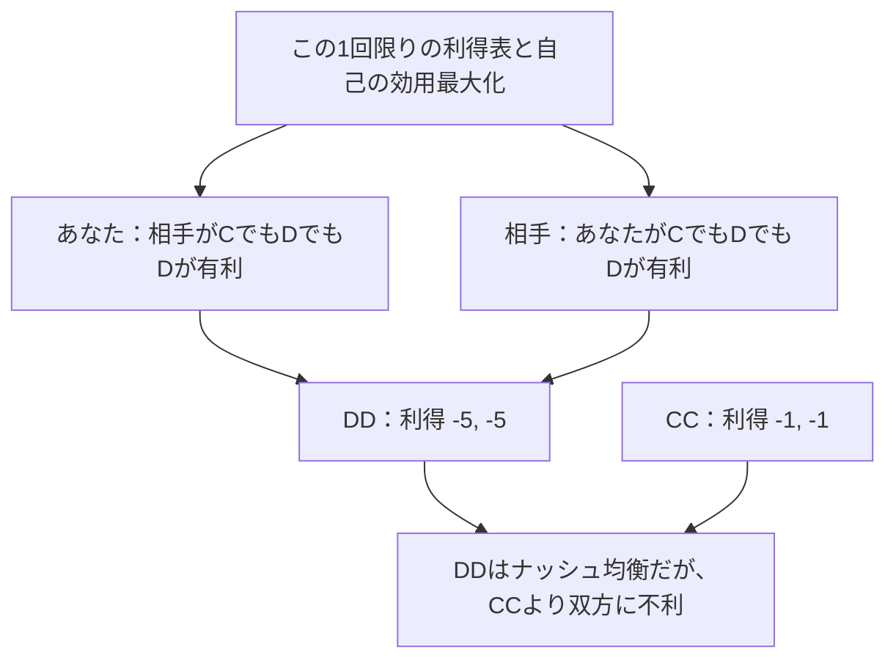
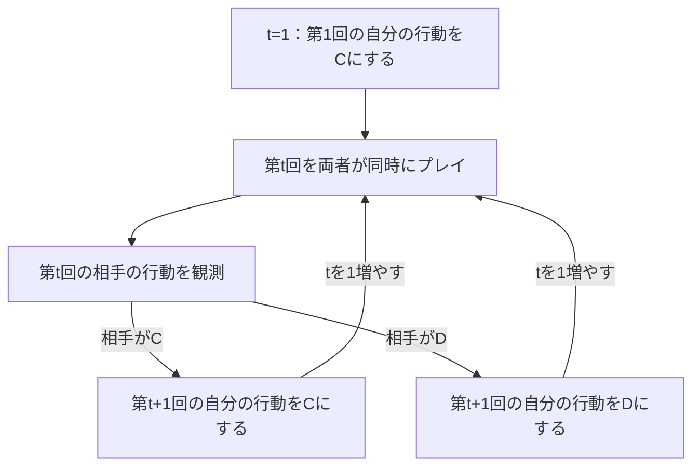

## 1. 黙秘か自白か：架空の選択をモデルにする

2人の容疑者が別々の部屋に置かれ、相談せずに「黙秘」か「自白」を同時に選ぶとします。ここでは、次の刑期が確定する**架空のゲーム**を考えます。実際の捜査・司法取引の制度や、「自白すれば無罪になる」という法的な規則を説明するものではありません。

- 双方が黙秘：それぞれ1年。
- 一方だけ自白：自白した人は0年、黙秘した人は10年。
- 双方が自白：それぞれ5年。

黙秘をC（cooperate、相手との協力）、自白をD（defect、協力からの離脱）と呼びます。「協力」は捜査への協力ではなく、2人の間の協力を指します。C・Dは、このモデルの行動名です。

各人は自分の刑期だけを気にし、短いほどよいと仮定します。友情、罪悪感、評判などの効用は含めません。刑期をy_i、利得（効用）をu_iとして、次の数値を使います。負の利得は「刑期が負」という意味ではありません。

$$
u_i=-y_i,\qquad y_i\in\{0,1,5,10\}
$$

この仮定の下で、個人にとっての最善と、双方にとって望ましい結果がどう食い違うかを調べます。現実の人が必ず同じ選択をするという心理法則ではありません。

## 2. 利得表とパレート最適は何を表すか

各組は（あなたの効用、相手の効用）です。大きい数ほど、その人にとって望ましい結果です。

| あなた／相手 | C：黙秘 | D：自白 |
| --- | --- | --- |
| C：黙秘 | (-1, -1) | (-10, 0) |
| D：自白 | (0, -10) | (-5, -5) |

一般的な記号では、Tは自分だけDの利得、Rは双方C、Pは双方D、Sは自分だけCの利得です。この表では次の順序になります。

$$
T=0>R=-1>P=-5>S=-10
$$

**パレート最適（パレート効率的）**とは、誰の利得も下げずに、少なくとも1人の利得を上げる別の実現可能な結果がないことです。「全員の利得の合計が最大」の定義ではありません。

表の4つの純粋な行動の組を比較すると、CC・CD・DCはパレート効率的です。例えばCDでは、Dを選んだ人がすでに最大の0を得ているため、その人を悪化させずにもう1人を改善することはできません。DDはCCへ変えれば双方が-5から-1へ改善するので、効率的ではありません。

一方、この数値を同じ重みで足すという評価では、CCが合計利得を最大にします。これは刑期の合計を最小にすることと対応します。

$$
(u_1+u_2)(CC)=-2,\qquad(u_1+u_2)(CD)=(u_1+u_2)(DC)=(u_1+u_2)(DD)=-10
$$

CCの合計刑期は2年、残り3つは各10年です。合計での評価とパレート効率性を分けることで、「誰にとってよいか」が明確になります。上の効率的な組の列挙は純粋な行動の結果についてであり、抽選で結果を混ぜる場合の効率的な利得集合を列挙したものではありません。

## 3. 支配戦略とナッシュ均衡

あなたが相手の行動を固定して比較すると、どちらの場合にもDの利得が上です。ここでu_i(X,Y)は、自分がX、相手がYを選んだときの自分の利得です。

$$
u_i(D,C)=0>-1=u_i(C,C),\qquad u_i(D,D)=-5>-10=u_i(C,D)
$$

このように、相手のどの行動に対しても他の行動より利得が高い戦略を**厳密な支配戦略**と呼びます。相手がCを選ぶ確率をpと考える場合も、期待利得の差は正になります。

$$
\begin{aligned}
0&\le p\le1,\\
\mathrm{EU}(D)&=0p-5(1-p)=-5+5p,\\
\mathrm{EU}(C)&=-p-10(1-p)=-10+9p,\\
\mathrm{EU}(D)-\mathrm{EU}(C)&=5-4p\ge1.
\end{aligned}
$$

相手も同じ利得表に従って自分の期待効用を最大にするなら、双方がDを選びます。このゲームでDは、相手の純粋戦略にも混合戦略にも厳密に優越するため、DDが唯一のナッシュ均衡です。

**ナッシュ均衡**とは、相手の戦略を固定したとき、どのプレイヤーも自分だけ戦略を変えて利得を増やせない戦略の組です。「2人で同時に行動を変えても改善できない」という意味ではありません。DDでは片方だけCに変えると-5から-10へ悪化しますが、双方がCへ変えれば双方とも改善します。

ジレンマは、この個人ごとの誘因が、双方を改善できるCCを均衡として支えないことにあります。これは利得・選択肢・情報を定めたモデルの結論です。

## 4. 価格・環境・スポーツへの応用には別の利得表が必要

### 価格競争

企業が相手より安くして販売を増やす誘因と、互いの値下げによる利幅の縮小を考える際に、この構造が参考になる場合があります。ただし、価格1000円が500円になれば必ず両社が赤字になる、といった結論は出ません。需要、原価、品質、参入などで利益は変わります。企業間の利益だけを足す評価は、消費者の利益や社会全体の厚生とも異なります。

### 温室効果ガスの削減

削減の便益を広く共有し、費用は各主体が負担する設定では、他者の努力にただ乗りする誘因を検討できます。ただし、国は2人とは限らず、便益・費用・被害は非対称で、協定や監視もあります。「どの国も必ず離脱し、自国だけ削減すると必ず経済的に大損する」と、この2人の表から推定することはできません。

### スポーツのドーピング

禁止行為による競争上の誘因を考える類推にも使えます。ただし、検査、処分、健康への影響、選手の価値観などが実際の利得に関わります。この表は、違反すれば必ず勝つ、全選手が違反する、特定の健康被害が必ず起こるという実証結果を示しません。

いずれも、まずプレイヤー・行動・利得と観測可能性を特定し、実際に囚人のジレンマの順序になっているかを確認する必要があります。

## 5. 繰り返しと「しっぺ返し戦略」

### 同じ相手と長く続くだけでは十分ではない

同じ利得表を既知の有限回だけ繰り返し、過去の行動が観測でき、ゲームの構造と合理性が共有知識である標準的な設定を考えます。最終回には将来の反応がないため双方Dとなり、そこから後ろ向きに考えると、それより前も双方Dとなります。これが、この設定での部分ゲーム完全均衡です。単に回数を増やすだけで協力が保証されるわけではありません。

一方、終わりが確定していない場合や、無限期間で将来の利得を評価する場合には、今の行動に応じた将来の反応が誘因を変え得ます。[MITの繰り返しゲームの講義ノート](https://www.ocw.mit.edu/courses/14-15j-networks-spring-2018/pages/lecture-and-recitation-notes/recitation-10-notes/)は、有限回の後ろ向き帰納と無限回の例を扱っています。同ノートの利得の数値はこの記事とは異なります。

### しっぺ返しは「前回の相手」をまねる

しっぺ返し戦略（Tit for Tat、TFT）は、1回目にC、2回目以降には相手の前回の行動を選ぶ戦略です。a_i,tを自分の第t回の行動、jを相手とします。

$$
a_{i,1}=C,\qquad a_{i,t}=a_{j,t-1}\quad(t\ge2)
$$

同じ回の相手の行動を先に見る戦略ではありません。図では、その回を両者がプレイしてから観測し、次の回の行動を決めます。

[AxelrodとHamiltonの1981年の論文](https://public.websites.umich.edu/~axe/research/Axelrod%20and%20Hamilton%20EC%201981.pdf)は、Axelrodの2つのコンピュータ大会で、Anatol Rapoportが提出したTFTが平均得点で首位になったことを報告しています。同論文の大会の利得はT=5、R=3、P=1、S=0であり、この記事の刑期の表とは異なります。

自分からDを始めず、相手のDには反応し、相手がCへ戻れば次回にCへ戻ることが、この戦略の特徴です。ルールも短く表現できます。ただし、参加戦略・対戦方法・利得・期間が変わっても常に最高得点になる、という定理ではありません。例えばTFT同士でも、一方の行動ミスでCDになれば、次にDC、その次にCDと交互の離脱が続くことがあります。誤りへの対処も別の設計課題です。

### 協力を均衡として支える条件の計算例

ここではTFTとは別の**グリム・トリガー戦略**を考えます。これまで毎回CCならCを選び、一度でもDがあれば、その後はずっとDを選ぶ戦略です。無限期間、行動は正確に観測でき、各人の利得は次の割引和と仮定します。

$$
V_i=\sum_{t=1}^{\infty}\delta^{t-1}u_{i,t},\qquad0\le\delta<1
$$

δは将来の重みを決める割引因子です。この記事の利得表で、協力が続くときの価値と、自分が今だけDに変え、その後DDになるときの価値は次の通りです。

$$
V_{\mathrm{coop}}=\frac{-1}{1-\delta},\qquad V_{\mathrm{deviate}}=0+\frac{-5\delta}{1-\delta}
$$

協力を続ける誘因の条件は、次のように求まります。

$$
\frac{-1}{1-\delta}\ge\frac{-5\delta}{1-\delta}\quad\Longleftrightarrow\quad-1\ge-5\delta\quad\Longleftrightarrow\quad\delta\ge\frac15
$$

処罰に入った後は、相手がずっとDなので自分もDが最善です。したがって、この監視・利得・割引の設定では、δが1/5以上なら双方のグリム・トリガーで協力を部分ゲーム完全均衡として支えられます。境界では協力と1回の離脱が同価値です。1/5はこの表と戦略から出る数で、すべての囚人のジレンマに共通の値でも、TFTの万能性を示す値でもありません。

さらに、常にDを選ぶ戦略の組も均衡として残ります。協力する均衡が存在することと、実際に協力が選ばれることは別です。

## 6. 信頼を考えるために、誘因と前提を見る

囚人のジレンマは、個々のプレイヤーに有利な選択が、双方を改善できる結果を支えない場合を明確にします。その理解には、支配戦略・ナッシュ均衡・パレート効率性・合計利得を区別することが役立ちます。

繰り返しは協力の可能性を広げますが、期間、将来の重み、行動の観測、誤り、反応の規則に左右されます。「長期なら必ず信頼と協力が最善」とは結論できません。身近な問題に使うときは、まず実際の利得と制度を確かめ、その上で協力を支える条件を考えるのが、このモデルの有用な使い方です。
