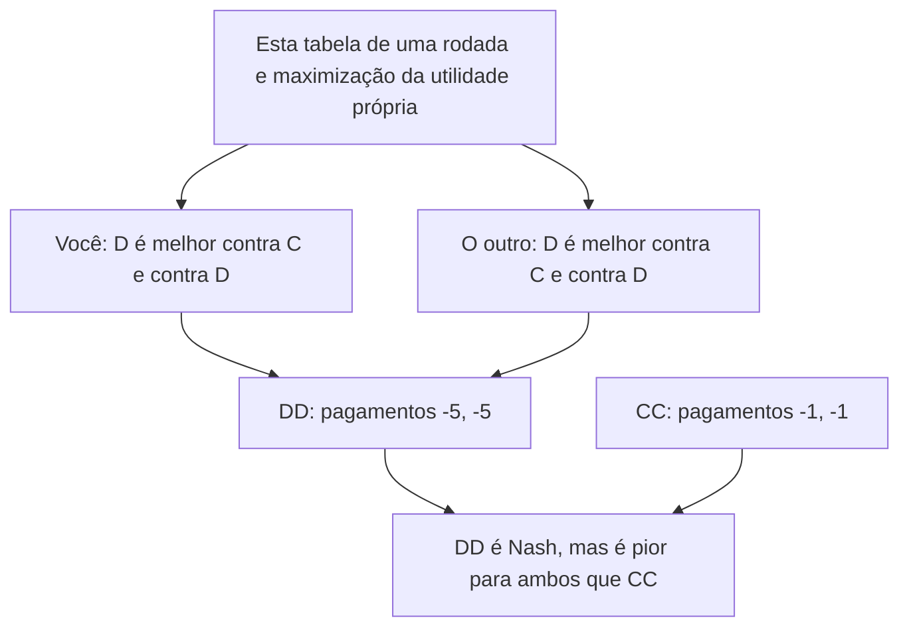
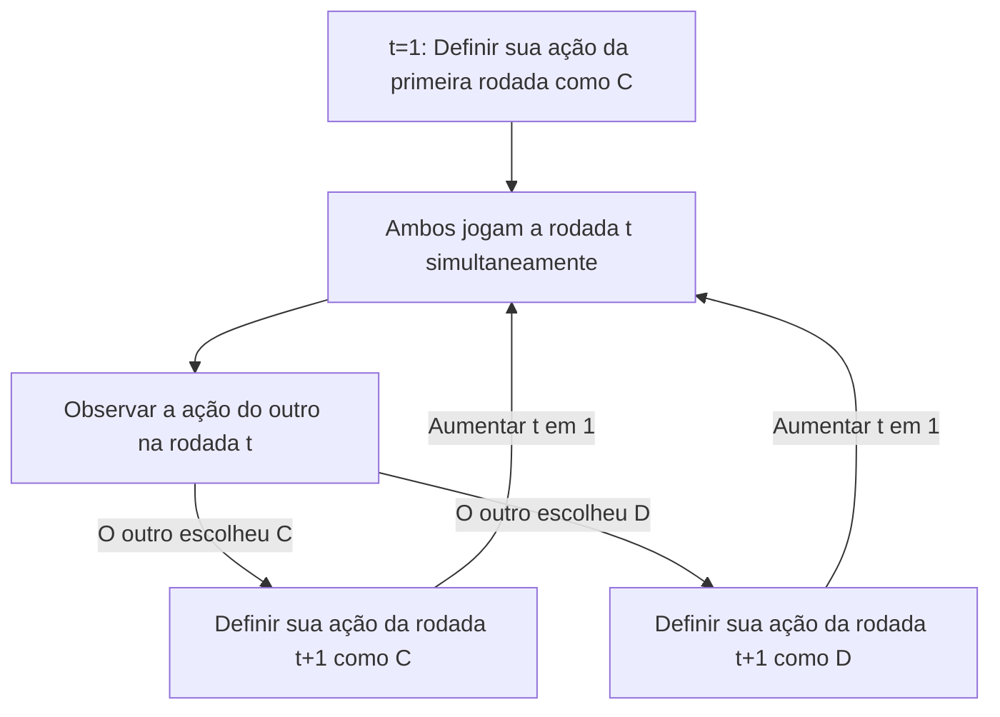

## 1. Silêncio ou confissão: definir um jogo fictício

Suponha que dois suspeitos, em salas separadas e sem poder conversar, escolham simultaneamente entre ficar em silêncio e confessar. Consideramos um **jogo fictício** no qual as seguintes penas são certas. Ele não descreve regras reais de investigação ou acordos penais, nem estabelece que confessar torne alguém juridicamente inocente.

- Ambos ficam em silêncio: um ano para cada um.
- Apenas um confessa: zero anos para quem confessa e dez para quem fica em silêncio.
- Ambos confessam: cinco anos para cada um.

Chamamos o silêncio de C (cooperate, cooperar com o outro jogador) e a confissão de D (defect, abandonar essa cooperação). Cooperar aqui significa cooperar entre os dois participantes, não com os investigadores. C e D são nomes de ações neste modelo.

Supomos que cada pessoa se importe apenas com a duração da própria pena e prefira menos anos. Amizade, culpa e reputação não acrescentam utilidade ao modelo. Se y_i é a duração da pena e u_i o pagamento ou utilidade, usamos os seguintes valores. Uma utilidade negativa não significa uma pena de duração negativa.

$$
u_i=-y_i,\qquad y_i\in\{0,1,5,10\}
$$

Com essas hipóteses, podemos examinar como os incentivos individuais entram em conflito com um resultado melhor para ambos. Isso não é uma lei psicológica segundo a qual pessoas reais devam sempre fazer a mesma escolha.

## 2. O significado da matriz de pagamentos e da eficiência de Pareto

Cada par representa (sua utilidade, a utilidade do outro jogador). Um número maior significa um resultado preferido pelo respectivo jogador.

| Você / Outro jogador | C: silêncio | D: confissão |
| --- | --- | --- |
| C: silêncio | (-1, -1) | (-10, 0) |
| D: confissão | (0, -10) | (-5, -5) |

Na notação habitual, T é seu pagamento quando apenas você escolhe D; R, quando ambos escolhem C; P, quando ambos escolhem D; e S, quando apenas você escolhe C. Esta tabela apresenta a seguinte ordem.

$$
T=0>R=-1>P=-5>S=-10
$$

Um resultado é **ótimo ou eficiente no sentido de Pareto** quando não existe outro resultado viável que melhore o pagamento de pelo menos uma pessoa sem reduzir o de nenhuma outra. Essa não é a definição de maximizar a soma dos pagamentos.

Entre os quatro perfis de ações puras da tabela, CC, CD e DC são eficientes no sentido de Pareto. Em CD, por exemplo, quem escolhe D já recebe seu pagamento máximo, zero; não é possível melhorar o pagamento do outro sem prejudicar essa pessoa. DD é ineficiente: passar a CC melhora os pagamentos de ambos de -5 para -1.

Separadamente, se somarmos esses valores com o mesmo peso, CC maximiza a soma dos pagamentos. Isso corresponde a minimizar a duração total das penas.

$$
(u_1+u_2)(CC)=-2,\qquad(u_1+u_2)(CD)=(u_1+u_2)(DC)=(u_1+u_2)(DD)=-10
$$

A pena total é de dois anos em CC e de dez em cada um dos outros três perfis. Distinguir o critério da soma da eficiência de Pareto esclarece de quem são os interesses avaliados. Os perfis eficientes listados referem-se a resultados de ações puras; não enumeram o conjunto de pagamentos eficientes quando também se permitem sorteios entre resultados.

## 3. Estratégias dominantes e equilíbrio de Nash

Mantendo fixa a ação do outro jogador, seu pagamento ao escolher D é maior nos dois casos. Aqui u_i(X,Y) representa seu pagamento quando você escolhe X e o outro escolhe Y.

$$
u_i(D,C)=0>-1=u_i(C,C),\qquad u_i(D,D)=-5>-10=u_i(C,D)
$$

Uma estratégia cujo pagamento é estritamente maior que o da alternativa contra qualquer ação do outro jogador é **estritamente dominante**. Mesmo atribuindo probabilidade p à escolha de C pelo outro, a diferença entre os pagamentos esperados é positiva.

$$
\begin{aligned}
0&\le p\le1,\\
\mathrm{EU}(D)&=0p-5(1-p)=-5+5p,\\
\mathrm{EU}(C)&=-p-10(1-p)=-10+9p,\\
\mathrm{EU}(D)-\mathrm{EU}(C)&=5-4p\ge1.
\end{aligned}
$$

Se o outro também maximiza a própria utilidade esperada com a mesma tabela, ambos escolhem D. Como D domina estritamente C contra estratégias adversárias puras ou mistas, DD é o único equilíbrio de Nash deste jogo.

Um **equilíbrio de Nash** é um perfil de estratégias no qual nenhum jogador pode aumentar seu pagamento mudando apenas a própria estratégia, mantendo fixas as dos demais. Isso não significa que uma mudança conjunta não possa melhorar o resultado. Em DD, mudar sozinho para C piora seu pagamento de -5 para -10; se ambos mudarem para CC, os pagamentos dos dois melhoram.

O dilema está em esses incentivos individuais não sustentarem CC como equilíbrio, embora CC melhore os pagamentos de ambos. Essa conclusão pertence a um modelo com pagamentos, escolhas e informações definidos.

## 4. Preços, ambiente e esporte precisam de modelos próprios

### Concorrência de preços

Essa estrutura pode ajudar, em alguns casos, a analisar o incentivo de reduzir o preço para aumentar as vendas, junto com a redução das margens quando ambas as empresas baixam os preços. Não implica que uma queda de 1000 para 500 ienes deva causar prejuízo às duas. Demanda, custos, qualidade e entrada de concorrentes afetam os lucros. Somar apenas os lucros empresariais também difere de avaliar os interesses dos consumidores ou o bem-estar social total.

### Redução de gases de efeito estufa

Quando os benefícios da redução são amplamente compartilhados, mas cada agente arca com seus custos, podemos examinar incentivos para aproveitar o esforço alheio sem contribuir. Entretanto, pode haver muitos países em vez de apenas dois jogadores; benefícios, custos e danos são assimétricos, e acordos e monitoramento importam. Essa tabela não permite concluir que todos os países necessariamente abandonem a cooperação ou que agir sozinho necessariamente cause grandes perdas econômicas.

### Doping no esporte

O modelo também pode servir de analogia para os incentivos competitivos de condutas proibidas. Os pagamentos reais, porém, dependem de testes, sanções, efeitos sobre a saúde e valores dos atletas, entre outros fatores. A tabela não é evidência empírica de que uma infração garanta a vitória, de que todos os atletas infrinjam as regras ou de que um dano específico à saúde seja inevitável.

Em cada aplicação é preciso identificar os jogadores, as ações, os pagamentos e o que pode ser observado, e verificar se os pagamentos realmente apresentam a ordem do dilema do prisioneiro.

## 5. Repetição e a estratégia olho por olho

### Uma relação longa não basta

Considere o caso padrão em que a mesma tabela se repete um número finito, fixo e conhecido de vezes, as ações passadas são observáveis, e a estrutura do jogo e a racionalidade são conhecimento comum. Na última rodada, sem respostas futuras, ambos escolhem D. Por indução retroativa, ambos escolhem D também em todas as rodadas anteriores. Esse é o comportamento de equilíbrio perfeito em subjogos nesse contexto. Apenas aumentar o número de rodadas não garante cooperação.

Se o fim for incerto, ou se os jogadores valorizarem pagamentos futuros em um horizonte infinito, as respostas futuras ao comportamento presente poderão mudar os incentivos. [As notas do MIT sobre jogos repetidos](https://www.ocw.mit.edu/courses/14-15j-networks-spring-2018/pages/lecture-and-recitation-notes/recitation-10-notes/) abordam a indução retroativa no caso finito e um exemplo de horizonte infinito. Os pagamentos numéricos dessas notas diferem dos deste artigo.

### Olho por olho copia a ação anterior do outro

A estratégia olho por olho (Tit for Tat, TFT) escolhe C na primeira rodada e, depois, copia a ação do adversário na rodada anterior. Seja a_i,t sua ação na rodada t, com j indicando o outro jogador.

$$
a_{i,1}=C,\qquad a_{i,t}=a_{j,t-1}\quad(t\ge2)
$$

Ela não permite ver a ação atual do outro antes de escolher a própria. No diagrama, ambos jogam a rodada atual, observam seu resultado e definem a ação para a rodada seguinte.

[O artigo de Axelrod e Hamilton de 1981](https://public.websites.umich.edu/~axe/research/Axelrod%20and%20Hamilton%20EC%201981.pdf) relata que TFT, apresentada por Anatol Rapoport, ficou em primeiro lugar por pontuação média nos dois torneios de programas de Axelrod. Os pagamentos dos torneios descritos eram T=5, R=3, P=1 e S=0, diferentes dos da tabela de penas deste artigo.

A estratégia não inicia a deserção, reage à D do outro e volta a C na rodada posterior ao retorno do outro a C. Sua regra também é curta. Mas não há um teorema de que obtenha sempre a maior pontuação, independentemente das estratégias participantes, dos emparelhamentos, dos pagamentos ou da duração. Por exemplo, mesmo entre dois jogadores TFT, um erro de ação que produza CD pode ser seguido de DC, depois CD, mantendo a deserção alternada. Lidar com erros é outra questão de projeto.

### Um exemplo das condições para sustentar a cooperação em equilíbrio

Considere a **estratégia de gatilho com punição permanente (grim trigger)**, diferente de TFT: escolher C se todas as rodadas anteriores foram CC; depois de qualquer D, escolher D para sempre. Supomos horizonte infinito, ações perfeitamente observadas e que cada jogador avalie a seguinte soma de pagamentos com desconto geométrico.

$$
V_i=\sum_{t=1}^{\infty}\delta^{t-1}u_{i,t},\qquad0\le\delta<1
$$

O fator de desconto δ determina o peso do futuro. Na tabela deste artigo, o valor de continuar cooperando e o de mudar unilateralmente para D agora, seguido de DD para sempre, são os seguintes.

$$
V_{\mathrm{coop}}=\frac{-1}{1-\delta},\qquad V_{\mathrm{deviate}}=0+\frac{-5\delta}{1-\delta}
$$

A condição para não haver incentivo a desviar da cooperação é:

$$
\frac{-1}{1-\delta}\ge\frac{-5\delta}{1-\delta}\quad\Longleftrightarrow\quad-1\ge-5\delta\quad\Longleftrightarrow\quad\delta\ge\frac15
$$

Depois de iniciado o castigo, D também é a melhor resposta a um adversário que sempre escolherá D. Portanto, com esses pagamentos, observação e desconto, o uso mútuo dessa estratégia de gatilho pode sustentar a cooperação como equilíbrio perfeito em subjogos quando δ é pelo menos 1/5. No limite, cooperar e desviar uma vez têm o mesmo valor. O 1/5 vem desta tabela e desta estratégia; não é um limiar universal do dilema do prisioneiro nem demonstra que TFT seja sempre a melhor.

Além disso, o perfil em que ambos sempre escolhem D também continua sendo um equilíbrio. A existência de um equilíbrio cooperativo e a escolha efetiva da cooperação são questões distintas.

## 6. Pensar na confiança por meio de incentivos e hipóteses

O dilema do prisioneiro esclarece como escolhas individualmente vantajosas podem não sustentar um resultado que melhore os pagamentos de ambos. Para entendê-lo, é preciso distinguir estratégias dominantes, equilíbrio de Nash, eficiência de Pareto e soma de pagamentos.

A repetição pode ampliar as possibilidades de cooperação, mas importam o horizonte, o peso do futuro, a observação das ações, os erros e as regras de resposta. Não podemos concluir que uma relação longa torne sempre ótimas a confiança e a cooperação. Para aplicar o modelo, é preciso primeiro estabelecer os pagamentos e as instituições reais e então examinar as condições que poderiam sustentar a cooperação.
