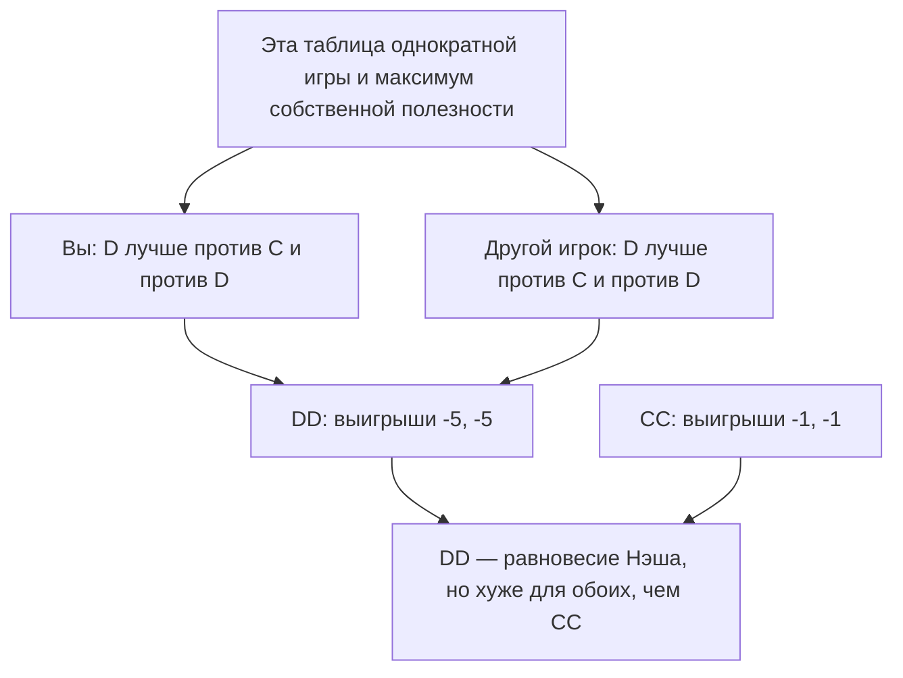
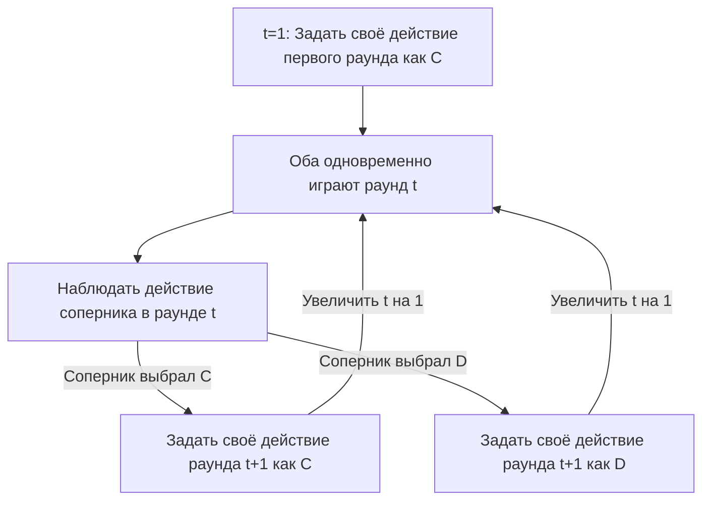

## 1. Молчать или признаться: задаём вымышленную игру

Предположим, что двое подозреваемых находятся в разных комнатах, не могут совещаться и одновременно выбирают молчание или признание. Рассмотрим **вымышленную игру**, в которой следующие сроки заключения заданы точно. Это не описание реальных правил расследования или сделки со следствием и не правовое утверждение, что признание приводит к оправданию.

- Оба молчат: по одному году каждому.
- Признаётся только один: ему ноль лет, молчащему — десять.
- Оба признаются: по пять лет каждому.

Обозначим молчание через C (cooperate, сотрудничать с другим игроком), а признание через D (defect, отказаться от этого сотрудничества). Сотрудничество здесь означает сотрудничество между игроками, а не со следствием. C и D — названия действий в модели.

Предположим, что каждого интересует только собственный срок и что меньший срок предпочтительнее. Дружба, чувство вины и репутация не добавляют отдельной полезности. Пусть y_i — срок заключения, а u_i — выигрыш, или полезность; используем следующие значения. Отрицательная полезность не означает отрицательный срок.

$$
u_i=-y_i,\qquad y_i\in\{0,1,5,10\}
$$

При этих предпосылках можно исследовать конфликт индивидуальных стимулов с результатом, лучшим для обоих. Это не психологический закон, заставляющий реальных людей всегда делать одинаковый выбор.

## 2. Матрица выигрышей и эффективность по Парето

Каждая пара означает (ваша полезность, полезность другого игрока). Большее число соответствует более предпочтительному для соответствующего игрока результату.

| Вы / Другой игрок | C: молчать | D: признаться |
| --- | --- | --- |
| C: молчать | (-1, -1) | (-10, 0) |
| D: признаться | (0, -10) | (-5, -5) |

В обычных обозначениях T — ваш выигрыш, если только вы выбираете D; R — если оба выбирают C; P — если оба выбирают D; S — если только вы выбираете C. Для этой таблицы выполнен следующий порядок.

$$
T=0>R=-1>P=-5>S=-10
$$

Результат **оптимален, или эффективен, по Парето**, если нет другого достижимого результата, повышающего выигрыш хотя бы одного игрока без снижения чьего-либо выигрыша. Это не определение максимума суммы выигрышей.

Среди четырёх чистых профилей действий в таблице CC, CD и DC эффективны по Парето. Например, в CD игрок с действием D уже получает свой максимальный выигрыш — ноль; улучшить выигрыш другого, не ухудшая положение этого игрока, нельзя. DD неэффективен: переход к CC улучшает оба выигрыша с -5 до -1.

Отдельно, если складывать эти числа с одинаковыми весами, CC максимизирует сумму выигрышей. Это соответствует минимуму общей продолжительности заключения.

$$
(u_1+u_2)(CC)=-2,\qquad(u_1+u_2)(CD)=(u_1+u_2)(DC)=(u_1+u_2)(DD)=-10
$$

Суммарный срок в CC составляет два года, а в каждом из остальных трёх профилей — десять. Различение суммарной оценки и эффективности по Парето уточняет, чьи интересы оцениваются. Перечисленные эффективные профили относятся к результатам чистых действий; это не перечисление всего эффективного множества выигрышей, если разрешены также лотереи между результатами.

## 3. Доминирующие стратегии и равновесие Нэша

При фиксированном действии другого игрока ваш выигрыш от D выше в обоих случаях. Здесь u_i(X,Y) — ваш выигрыш, когда вы выбираете X, а другой игрок Y.

$$
u_i(D,C)=0>-1=u_i(C,C),\qquad u_i(D,D)=-5>-10=u_i(C,D)
$$

Стратегия, дающая строго больший выигрыш, чем альтернатива, при любом действии соперника, называется **строго доминирующей**. Даже если вы приписываете выбору C другим игроком вероятность p, разность ожидаемых выигрышей положительна.

$$
\begin{aligned}
0&\le p\le1,\\
\mathrm{EU}(D)&=0p-5(1-p)=-5+5p,\\
\mathrm{EU}(C)&=-p-10(1-p)=-10+9p,\\
\mathrm{EU}(D)-\mathrm{EU}(C)&=5-4p\ge1.
\end{aligned}
$$

Если другой игрок также максимизирует собственную ожидаемую полезность по той же таблице, оба выбирают D. Поскольку D строго лучше C против чистых и смешанных стратегий соперника, DD — единственное равновесие Нэша этой игры.

**Равновесие Нэша** — профиль стратегий, в котором ни один игрок не может повысить свой выигрыш, изменив только собственную стратегию при неизменных стратегиях остальных. Это не означает, что совместное изменение не может улучшить результат. В DD односторонний переход к C ухудшает ваш выигрыш с -5 до -10; если оба перейдут к CC, оба выигрыша улучшатся.

Дилемма состоит в том, что эти индивидуальные стимулы не поддерживают CC как равновесие, хотя CC улучшает положение обоих. Это вывод о модели с заданными выигрышами, вариантами выбора и информацией.

## 4. Цены, экология и спорт требуют собственных моделей

### Ценовая конкуренция

Эта структура иногда помогает анализировать стимул снизить цену ради увеличения продаж и сокращение маржи при снижении цен обеими компаниями. Из неё не следует, что падение цены с 1000 до 500 иен обязательно сделает обе компании убыточными. Прибыль зависит от спроса, затрат, качества и выхода конкурентов на рынок. Суммирование только прибыли компаний также отличается от оценки интересов потребителей или общего общественного благосостояния.

### Сокращение парниковых выбросов

Если выгоды сокращений широко распределяются, а затраты несёт каждый участник, можно исследовать стимулы пользоваться чужими усилиями без собственного вклада. Но стран может быть много, а не только два игрока; выгоды, затраты и ущерб асимметричны, важны соглашения и контроль. Эта таблица не доказывает, что все страны обязательно откажутся от сотрудничества или что самостоятельные сокращения обязательно вызовут большие экономические потери.

### Допинг в спорте

Модель может служить аналогией конкурентных стимулов к запрещённым действиям. Однако реальные выигрыши зависят, среди прочего, от проверок, санкций, последствий для здоровья и ценностей спортсменов. Таблица не является эмпирическим доказательством того, что нарушение гарантирует победу, все спортсмены нарушают правила или определённый вред здоровью неизбежен.

В каждом применении нужно сначала определить игроков, действия, выигрыши и возможности наблюдения, затем проверить, действительно ли выигрыши имеют порядок дилеммы заключённого.

## 5. Повторение и стратегия «око за око»

### Одних длительных отношений недостаточно

Рассмотрим стандартную ситуацию: одна и та же таблица повторяется известное фиксированное конечное число раундов, прошлые действия наблюдаемы, а структура игры и рациональность являются общим знанием (common knowledge). В последнем раунде будущих ответов нет, поэтому оба выбирают D. Обратная индукция даёт взаимный выбор D и во всех предыдущих раундах. Это поведение в совершенном в подыграх равновесии при данных условиях. Простое увеличение числа раундов не гарантирует сотрудничества.

Если момент окончания не определён заранее или игроки оценивают будущие выигрыши на бесконечном горизонте, будущие реакции на нынешнее поведение могут изменить стимулы. [Конспект MIT о повторяющихся играх](https://www.ocw.mit.edu/courses/14-15j-networks-spring-2018/pages/lecture-and-recitation-notes/recitation-10-notes/) рассматривает обратную индукцию в конечном случае и пример бесконечного горизонта. Его числовые выигрыши отличаются от таблицы этой статьи.

### «Око за око» копирует предыдущее действие соперника

Стратегия «око за око» (Tit for Tat, TFT) выбирает C в первом раунде, а затем копирует действие соперника из предыдущего раунда. Пусть a_i,t — ваше действие в раунде t, а j — другой игрок.

$$
a_{i,1}=C,\qquad a_{i,t}=a_{j,t-1}\quad(t\ge2)
$$

Она не позволяет сначала увидеть текущее действие соперника, а затем выбрать своё. На схеме оба одновременно играют текущий раунд, наблюдают его результат и определяют действие на следующий раунд.

[Статья Axelrod и Hamilton 1981 года](https://public.websites.umich.edu/~axe/research/Axelrod%20and%20Hamilton%20EC%201981.pdf) сообщает, что TFT, представленная Anatol Rapoport, заняла первое место по среднему счёту в обоих компьютерных турнирах Axelrod. Выигрыши описанных турниров составляли T=5, R=3, P=1 и S=0 и отличались от таблицы сроков заключения в этой статье.

Стратегия не начинает с D, отвечает на D соперника и возвращается к C в раунде после его возврата к C. Её правило также можно описать кратко. Но нет теоремы, гарантирующей наивысший счёт при любых стратегиях участников, способах составления пар, выигрышах или длительности игры. Например, даже между двумя игроками TFT ошибка действия, давшая CD, может привести затем к DC, снова к CD и продолжающемуся чередованию отказов от сотрудничества. Работа с ошибками — отдельная задача проектирования.

### Пример условий поддержки сотрудничества в равновесии

Рассмотрим отличную от TFT **триггерную стратегию с постоянным наказанием (grim trigger)**: выбирать C, если все прошлые раунды были CC; после любого D выбирать D всегда. Предположим бесконечный горизонт, совершенное наблюдение действий и оценку каждым игроком следующей геометрически дисконтированной суммы выигрышей.

$$
V_i=\sum_{t=1}^{\infty}\delta^{t-1}u_{i,t},\qquad0\le\delta<1
$$

Коэффициент дисконтирования δ задаёт вес будущего. Для таблицы этой статьи ценность непрерывного сотрудничества и ценность одностороннего выбора D сейчас с последующим постоянным DD равны:

$$
V_{\mathrm{coop}}=\frac{-1}{1-\delta},\qquad V_{\mathrm{deviate}}=0+\frac{-5\delta}{1-\delta}
$$

Условие отсутствия стимула отклониться от сотрудничества имеет вид:

$$
\frac{-1}{1-\delta}\ge\frac{-5\delta}{1-\delta}\quad\Longleftrightarrow\quad-1\ge-5\delta\quad\Longleftrightarrow\quad\delta\ge\frac15
$$

После начала наказания D также является наилучшим ответом на соперника, который всегда выбирает D. Поэтому при этих выигрышах, наблюдении и дисконтировании взаимное использование grim trigger поддерживает сотрудничество как совершенное в подыграх равновесие, если δ не меньше 1/5. На границе сотрудничество и однократное отклонение имеют одинаковую ценность. Число 1/5 получается из этой таблицы и этой стратегии; это не универсальный порог дилеммы заключённого и не доказательство безусловного превосходства TFT.

Кроме того, профиль стратегий, при котором оба всегда выбирают D, тоже остаётся равновесием. Существование кооперативного равновесия и фактический выбор сотрудничества — разные вопросы.

## 6. Рассматривать доверие через стимулы и предпосылки

Дилемма заключённого уточняет, как индивидуально выгодные решения могут не поддерживать результат, улучшающий положение обоих. Для понимания нужно различать доминирующие стратегии, равновесие Нэша, эффективность по Парето и сумму выигрышей.

Повторение может расширить возможности сотрудничества, но важны горизонт, вес будущего, наблюдение действий, ошибки и правила реакции. Нельзя заключить, что длительные отношения всегда делают доверие и сотрудничество оптимальными. Применяя модель, сначала установите реальные выигрыши и институты, а затем исследуйте условия, которые могли бы поддерживать сотрудничество.
