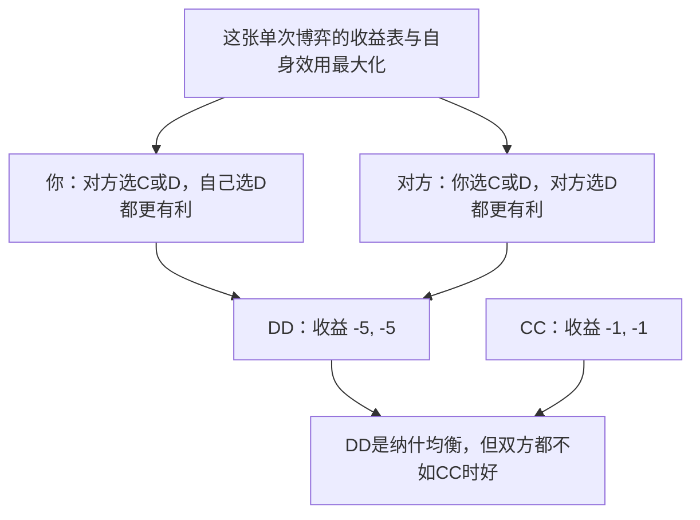
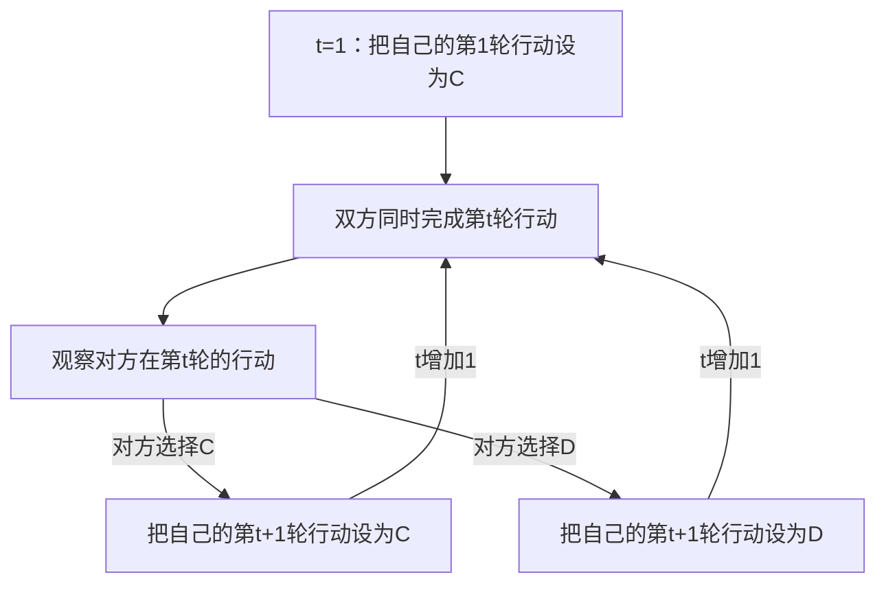

## 1. 沉默还是招供：先定义一个虚构的博弈

假设两名嫌疑人分别待在不同的房间，不能商量，同时选择“保持沉默”或“招供”。这里考虑的是以下刑期确定生效的**虚构博弈**，并不是在介绍现实中的侦查、认罪协商制度，也不意味着“招供就会被认定无罪”。

- 双方都沉默：各1年。
- 只有一方招供：招供者0年，沉默者10年。
- 双方都招供：各5年。

用C（cooperate，与对方合作）表示沉默，用D（defect，背离双方的合作）表示招供。“合作”指两名参与者之间的合作，而不是配合调查。C和D是这个模型的行动名称。

假设每个人只在意自己的刑期，刑期越短越好；不另外计入友情、内疚或声誉的效用。用y_i表示刑期，用u_i表示收益（效用），并采用以下数值。负的收益并不表示刑期是负数。

$$
u_i=-y_i,\qquad y_i\in\{0,1,5,10\}
$$

在这些假设下，我们可以分析个人的最佳选择与对双方都较好的结果如何发生冲突。这不是声称现实中的人必然如此选择的心理规律。

## 2. 收益矩阵与帕累托最优分别表示什么

每一对数字表示（你的效用，对方的效用）。对各自而言，数值越大，结果越好。

| 你／对方 | C：沉默 | D：招供 |
| --- | --- | --- |
| C：沉默 | (-1, -1) | (-10, 0) |
| D：招供 | (0, -10) | (-5, -5) |

按通常的记号，T是只有自己选择D时的收益，R是双方都选C时的收益，P是双方都选D时的收益，S是只有自己选择C时的收益。本表满足以下顺序。

$$
T=0>R=-1>P=-5>S=-10
$$

**帕累托最优（帕累托有效）**是指：不存在另一个可行结果，能够在不降低任何人收益的同时，提高至少一人的收益。它的定义不是“所有人的收益总和最大”。

比较表中的4个纯行动组合，CC、CD和DC都是帕累托有效的。例如，在CD中，选择D的人已经获得自己的最高收益0，无法在不让其受损的同时改善另一人的收益。DD则不是帕累托有效的，因为改为CC能使双方都从-5提高到-1。

另一方面，如果按相同权重把这里的数值相加，CC会使收益总和最大。这也对应于刑期总和最小。

$$
(u_1+u_2)(CC)=-2,\qquad(u_1+u_2)(CD)=(u_1+u_2)(DC)=(u_1+u_2)(DD)=-10
$$

CC的刑期总和是2年，其余3个组合都是10年。把总和这一评价标准与帕累托有效性分开，才能说清楚“对谁更好”。上面列举的是纯行动结果中的有效组合，并没有列举允许对结果进行随机抽签时的整个有效收益集合。

## 3. 占优策略与纳什均衡

固定对方的行动，再比较自己的选择，无论对方如何选择，D的收益都更高。这里u_i(X,Y)表示自己选择X、对方选择Y时，自己的收益。

$$
u_i(D,C)=0>-1=u_i(C,C),\qquad u_i(D,D)=-5>-10=u_i(C,D)
$$

对于对方的每一种行动，收益都严格高于另一选择的策略，称为**严格占优策略**。即使认为对方以概率p选择C，期望收益之差仍然为正。

$$
\begin{aligned}
0&\le p\le1,\\
\mathrm{EU}(D)&=0p-5(1-p)=-5+5p,\\
\mathrm{EU}(C)&=-p-10(1-p)=-10+9p,\\
\mathrm{EU}(D)-\mathrm{EU}(C)&=5-4p\ge1.
\end{aligned}
$$

如果对方也按照同一张收益表最大化自己的期望效用，双方就都会选择D。无论对方采用纯策略还是混合策略，D都严格优于C，所以DD是这个博弈唯一的纳什均衡。

**纳什均衡**是指：固定其他参与者的策略时，没有任何参与者能仅靠改变自己的策略来提高收益。它不意味着“两人一起改变行动也无法改善结果”。在DD中，只有自己改选C会从-5降到-10；但双方一起改为CC，就能同时改善各自的收益。

困境就在于，个人的这些激励无法把能改善双方收益的CC支撑为均衡。这是在给定收益、选项和信息的模型中得到的结论。

## 4. 价格、环境和体育问题需要各自的收益模型

### 价格竞争

企业可能有降低价格以增加销量的激励，而双方降价又可能压缩利润率；分析这类问题时，这个结构有时可以提供参考。但不能据此断言，价格从1000日元降到500日元，双方就必然亏损。需求、成本、质量和市场进入都会影响利润。只把企业利润相加，也不同于评价消费者的利益或整个社会的福利。

### 温室气体减排

在减排收益被广泛共享、成本由各主体承担的设定中，可以分析搭他人努力“便车”的激励。但国家通常不止两个，收益、成本和损害也不对称，还有协定与监督。不能用这张两人收益表推断“所有国家必然背离合作，只有本国减排就必然蒙受巨大经济损失”。

### 体育中的兴奋剂问题

这个模型也能用来类比禁止行为背后的竞争激励。但检查、处罚、健康影响和运动员的价值观等都会影响实际收益。这张表并不是违规必定获胜、所有选手都会违规，或某种健康损害必然出现的实证证据。

无论应用在哪个领域，都应先明确参与者、行动、收益以及哪些行为可被观察，再检查收益是否确实满足囚徒困境的顺序。

## 5. 重复博弈与“一报还一报”

### 长期交往本身还不够

考虑一个标准设定：同一张收益表重复已知且固定的有限次，过去的行动可以被观察，博弈结构与理性是共同知识。最后一轮没有后续反应，因此双方都选择D。再由后向归纳可得，更早的各轮也都选择D。这就是该设定下的子博弈精炼均衡行为。仅仅增加轮数，并不能保证合作。

如果结束时间不确定，或者在无限期中评价未来收益，那么当前行为引起的未来反应就可能改变激励。[MIT的重复博弈讲义](https://www.ocw.mit.edu/courses/14-15j-networks-spring-2018/pages/lecture-and-recitation-notes/recitation-10-notes/)讨论了有限次的后向归纳和无限期的例子。该讲义的收益数值与本文不同。

### 一报还一报模仿的是“对方上一轮的行动”

一报还一报策略（Tit for Tat，TFT）在第1轮选择C，从第2轮开始模仿对方上一轮的行动。用a_i,t表示自己在第t轮的行动，j表示对方。

$$
a_{i,1}=C,\qquad a_{i,t}=a_{j,t-1}\quad(t\ge2)
$$

这不是先看到对方本轮的行动再做选择。图中，双方先完成本轮行动，再观察结果，决定下一轮的行动。

[Axelrod与Hamilton在1981年的论文](https://public.websites.umich.edu/~axe/research/Axelrod%20and%20Hamilton%20EC%201981.pdf)报告，Anatol Rapoport提交的TFT在Axelrod的两次计算机策略竞赛中，平均得分均排名第一。论文中所述竞赛采用T=5、R=3、P=1、S=0，与本文的刑期收益表不同。

TFT不主动选择D，会对对方的D作出反应，而对方回到C后，自己也会在下一轮回到C。它的规则也很简短。不过，这并不是一个无论参赛策略、对战方式、收益和期限如何变化，都能保证得分最高的定理。例如，两个TFT参与者之间，一方的行动失误造成CD后，可能接着出现DC，再出现CD，从而持续交替背离合作。如何处理失误，是另一个设计问题。

### 用一个例子计算支撑合作均衡的条件

下面考虑不同于TFT的**冷酷触发策略（grim trigger）**：此前每一轮都是CC，就选C；只要曾经出现D，此后永远选D。假设博弈无限期持续，行动可被准确观察，每个人的收益采用以下折现总和。

$$
V_i=\sum_{t=1}^{\infty}\delta^{t-1}u_{i,t},\qquad0\le\delta<1
$$

δ是决定未来权重的折现因子。采用本文的收益表，持续合作的价值，以及现在单方面改选一次D、随后永久进入DD的价值如下。

$$
V_{\mathrm{coop}}=\frac{-1}{1-\delta},\qquad V_{\mathrm{deviate}}=0+\frac{-5\delta}{1-\delta}
$$

没有动机偏离合作的条件因此为：

$$
\frac{-1}{1-\delta}\ge\frac{-5\delta}{1-\delta}\quad\Longleftrightarrow\quad-1\ge-5\delta\quad\Longleftrightarrow\quad\delta\ge\frac15
$$

进入惩罚阶段后，对方会一直选D，自己选D也是最佳回应。因此，在这里的监测、收益和折现设定下，δ至少为1/5时，双方采用冷酷触发策略可以把合作支撑为子博弈精炼均衡。在边界上，继续合作与偏离一次的价值相同。1/5来自这张表和这个策略，不是所有囚徒困境通用的数值，也不证明TFT万能。

此外，双方始终选择D仍然是一个均衡。存在合作均衡与实际选择合作，是两回事。

## 6. 从激励和假设来思考信任

囚徒困境清楚地展示了：对个人有利的选择，可能无法支撑一个能改善双方收益的结果。理解这一点，需要区分占优策略、纳什均衡、帕累托有效性和收益总和。

重复互动可以增加合作的可能性，但期限、未来的权重、行动是否可被观察、失误以及回应规则都很重要。不能得出“只要关系长久，信任和合作就必然最优”的结论。应用这个模型时，应先查明实际收益和制度，再分析哪些条件能支撑合作。
