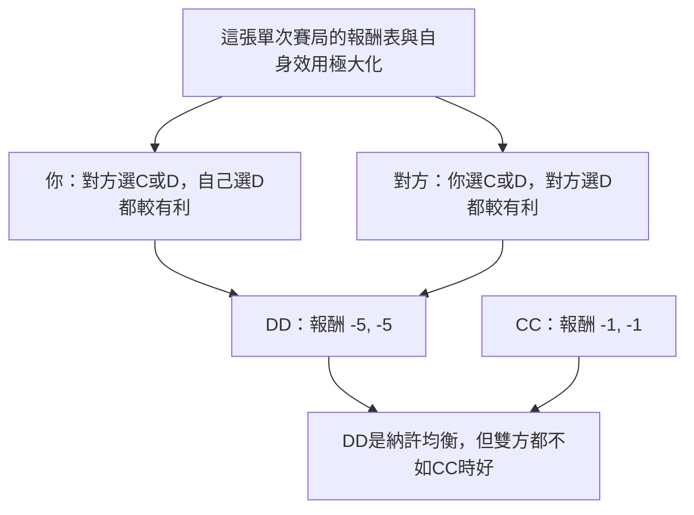
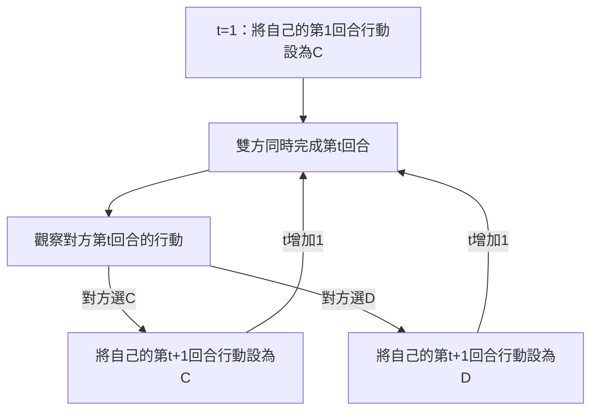

## 1. 沉默或認罪：先定義一個虛構的賽局

假設兩名嫌疑人分別待在不同的房間，不能商量，同時選擇「保持沉默」或「認罪」。以下考慮的是刑期確定依照這些規則決定的**虛構賽局**，並不是介紹現實中的偵查或認罪協商制度，也不表示「認罪就會獲判無罪」。

- 雙方都沉默：各1年。
- 只有一方認罪：認罪者0年，沉默者10年。
- 雙方都認罪：各5年。

用C（cooperate，與對方合作）表示沉默，用D（defect，背離雙方的合作）表示認罪。這裡的「合作」指兩名參賽者之間的合作，不是配合調查。C與D是模型中的行動名稱。

假設每個人只在意自己的刑期，刑期越短越好，不另外計入友情、內疚或聲譽的效用。用y_i表示刑期，用u_i表示報酬（效用），採用以下數值。報酬為負數，不表示刑期是負數。

$$
u_i=-y_i,\qquad y_i\in\{0,1,5,10\}
$$

在這些假設下，我們可以分析個人的最佳選擇與對雙方都較好的結果如何產生衝突。這並不是宣稱現實中的人必然如此選擇的心理法則。

## 2. 報酬矩陣與柏雷多效率的意義

每組數字表示（你的效用，對方的效用）。對各自而言，數值越大，結果越好。

| 你／對方 | C：沉默 | D：認罪 |
| --- | --- | --- |
| C：沉默 | (-1, -1) | (-10, 0) |
| D：認罪 | (0, -10) | (-5, -5) |

依通常的記號，T是只有自己選D時的報酬，R是雙方都選C時的報酬，P是雙方都選D時的報酬，S是只有自己選C時的報酬。這張表滿足以下順序。

$$
T=0>R=-1>P=-5>S=-10
$$

**柏雷多效率（Pareto efficiency，也稱Pareto optimality）**是指：不存在另一個可行結果，能夠在不降低任何人報酬的同時，提高至少一人的報酬。它的定義並不是「所有人的報酬總和最大」。

比較表中的4個純行動組合，CC、CD與DC都具有柏雷多效率。例如，在CD中，選D的人已得到自己的最高報酬0，無法在不讓這個人變差的同時改善另一人的報酬。DD則不具柏雷多效率，因為改為CC可以讓雙方都從-5提高到-1。

另一方面，如果以相同權重把這些數值相加，CC會使報酬總和最大。這對應到刑期總和最小。

$$
(u_1+u_2)(CC)=-2,\qquad(u_1+u_2)(CD)=(u_1+u_2)(DC)=(u_1+u_2)(DD)=-10
$$

CC的刑期總和是2年，其餘3個組合都是10年。區分總和這個評估標準與柏雷多效率，才能說清楚「對誰較好」。上面列舉的是純行動結果中的有效率組合，並未列出允許以抽籤混合不同結果時，整個有效率的報酬集合。

## 3. 優勢策略與納許均衡

固定對方的行動，比較自己的選擇，不論哪一種情況，D的報酬都較高。這裡u_i(X,Y)表示自己選X、對方選Y時，自己的報酬。

$$
u_i(D,C)=0>-1=u_i(C,C),\qquad u_i(D,D)=-5>-10=u_i(C,D)
$$

無論對方採取哪一種行動，報酬都嚴格高於另一選擇的策略，稱為**嚴格優勢策略**。即使認為對方以機率p選C，期望報酬的差仍為正。

$$
\begin{aligned}
0&\le p\le1,\\
\mathrm{EU}(D)&=0p-5(1-p)=-5+5p,\\
\mathrm{EU}(C)&=-p-10(1-p)=-10+9p,\\
\mathrm{EU}(D)-\mathrm{EU}(C)&=5-4p\ge1.
\end{aligned}
$$

如果對方也依同一張報酬表極大化自己的期望效用，雙方都會選D。不論對方採取純策略或混合策略，D都嚴格優於C，因此DD是這個賽局唯一的納許均衡。

**納許均衡**是指：固定其他參賽者的策略時，沒有任何參賽者能僅靠改變自己的策略來提高報酬。這不表示「兩人一起改變行動也無法改善結果」。在DD中，只有自己改選C會從-5降至-10；但雙方一起改為CC，兩人的報酬都會改善。

困境在於，個人的這些誘因無法將能改善雙方報酬的CC支撐為均衡。這是在給定報酬、選項與資訊的模型中得到的結論。

## 4. 價格、環境與運動問題需要各自的報酬模型

### 價格競爭

企業可能有削價以增加銷量的誘因，而雙方削價又可能壓縮利潤；分析這類問題時，這個結構有時能提供參考。但不能據此斷言，價格從1000日圓降到500日圓，兩家公司就必然虧損。需求、成本、品質與市場進入都會影響利潤。只把企業利潤相加，也不同於評估消費者利益或整體社會福利。

### 溫室氣體減量

在減量效益由眾人共享、成本由各行動者負擔的設定下，可以分析搭他人努力便車的誘因。但國家不一定只有兩個，效益、成本與損害也不對稱，還有協定與監督。這張兩人報酬表不能推導出「所有國家必然背離合作，只有本國減量就必然蒙受巨大經濟損失」。

### 運動中的禁藥問題

這個模型也能用來類比違禁行為背後的競爭誘因。但檢測、處分、健康影響與選手的價值觀等都會影響實際報酬。這張表並不是違規必定獲勝、所有選手都會違規，或某種健康損害必然發生的實證證據。

不論應用在哪個領域，都應先釐清參賽者、行動、報酬以及哪些行為可被觀察，再檢查報酬是否確實符合囚徒困境的順序。

## 5. 重複賽局與「以牙還牙」

### 長期關係本身並不足夠

考慮一個標準設定：同一張報酬表重複已知且固定的有限次，過去的行動可被觀察，賽局結構與理性是共同知識。最後一回合沒有後續反應，因此雙方都選D。再由逆向歸納可得，更早的每一回合也都選D。這就是該設定下的子賽局完美均衡行為。僅僅增加回合數，不能保證合作。

若結束時間不確定，或在無限期中評估未來報酬，當前行為引起的未來反應就可能改變誘因。[MIT的重複賽局講義](https://www.ocw.mit.edu/courses/14-15j-networks-spring-2018/pages/lecture-and-recitation-notes/recitation-10-notes/)討論了有限次的逆向歸納與無限期的例子。該講義的報酬數值與本文不同。

### 以牙還牙模仿的是「對方上一回合的行動」

以牙還牙策略（Tit for Tat，TFT）在第1回合選C，從第2回合開始模仿對方上一回合的行動。用a_i,t表示自己在第t回合的行動，j表示對方。

$$
a_{i,1}=C,\qquad a_{i,t}=a_{j,t-1}\quad(t\ge2)
$$

這不是先看到對方本回合的行動再做選擇。圖中，雙方先完成本回合，再觀察結果，決定下一回合的行動。

[Axelrod與Hamilton於1981年的論文](https://public.websites.umich.edu/~axe/research/Axelrod%20and%20Hamilton%20EC%201981.pdf)報告，Anatol Rapoport提交的TFT在Axelrod的兩次電腦策略競賽中，平均得分都排名第一。論文中所述競賽採用T=5、R=3、P=1、S=0，與本文的刑期報酬表不同。

TFT不主動選D，會回應對方的D，而對方回到C後，自己也在下一回合回到C。它的規則也很簡短。但這不是一個不論參賽策略、對戰方式、報酬或期限如何改變，都保證得分最高的定理。例如，即使兩人都採TFT，一方的行動失誤造成CD後，也可能接著出現DC、再出現CD，持續交替背離合作。如何處理失誤，是另一個設計問題。

### 計算支撐合作均衡的條件：一個例子

以下考慮不同於TFT的**冷酷觸發策略（grim trigger）**：如果之前每一回合都是CC，就選C；只要曾經出現D，之後永遠選D。假設賽局無限期持續，行動可被正確觀察，每個人的報酬採用以下折現總和。

$$
V_i=\sum_{t=1}^{\infty}\delta^{t-1}u_{i,t},\qquad0\le\delta<1
$$

δ是決定未來權重的折現因子。依本文的報酬表，持續合作的價值，以及自己現在單方面改選一次D、隨後永久進入DD的價值如下。

$$
V_{\mathrm{coop}}=\frac{-1}{1-\delta},\qquad V_{\mathrm{deviate}}=0+\frac{-5\delta}{1-\delta}
$$

沒有誘因偏離合作的條件因此為：

$$
\frac{-1}{1-\delta}\ge\frac{-5\delta}{1-\delta}\quad\Longleftrightarrow\quad-1\ge-5\delta\quad\Longleftrightarrow\quad\delta\ge\frac15
$$

進入懲罰階段後，對方會一直選D，自己選D也是最佳回應。因此，在這裡的監督、報酬與折現設定下，δ至少為1/5時，雙方採冷酷觸發策略，可以將合作支撐為子賽局完美均衡。在邊界上，持續合作與偏離一次的價值相同。1/5來自這張表和這個策略，不是所有囚徒困境通用的數值，也不證明TFT萬能。

此外，雙方永遠選D仍是均衡。存在合作均衡與實際選擇合作，是兩回事。

## 6. 從誘因與假設來思考信任

囚徒困境清楚呈現：對個人有利的選擇，可能無法支撐一個能改善雙方報酬的結果。理解這點，需要區分優勢策略、納許均衡、柏雷多效率與報酬總和。

重複互動可以增加合作的可能性，但期限、未來的權重、行動能否被觀察、失誤與回應規則都很重要。不能因此認定「只要關係長久，信任與合作就必然最優」。應用這個模型時，應先釐清實際報酬與制度，再分析哪些條件能支撐合作。
