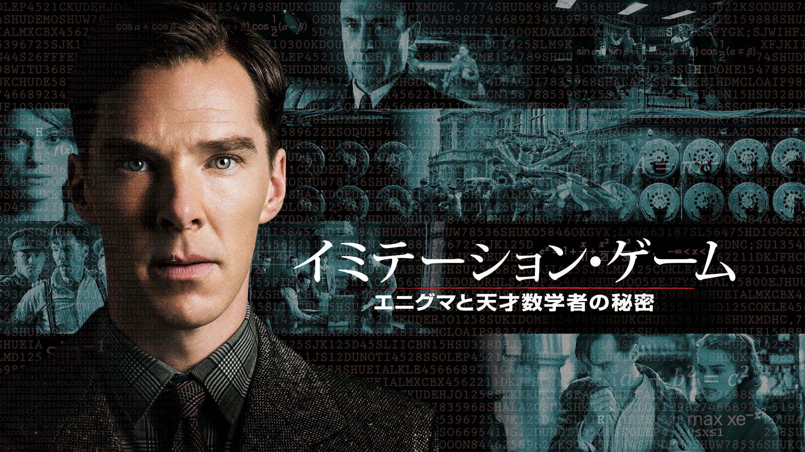

# 6 Filme über Mathematik, Codeknacken und Physik

Hier sind sechs Filme und Dokumentationen über Mathematiker, Codeknacker und Physiker. Dramen nach wahren Personen oder Ereignissen verändern für die Handlung mitunter Szenen und Zeitabläufe. Sie sind als Filme gedacht, nicht als historische Quellen.

## Dramen über Mathematiker und Codeknacker

### A Beautiful Mind

Dieses biografische Drama mit Russell Crowe ist vom Leben des Mathematikers John Nash inspiriert. Es enthält dramaturgische Änderungen und schildert sein Leben nicht wortgetreu.

### Enigma

Dieser fiktive Film aus dem Jahr 2001 basiert auf Robert Harris’ Roman. Der Thriller spielt vor dem Hintergrund der Codeknacker in Bletchley Park während des Zweiten Weltkriegs und ist keine Biografie über Nash oder Turing.

### The Imitation Game

Das Drama zeigt den Mathematiker, Logiker und Codeknacker Alan Turing und die Codearbeit während des Krieges. Es beruht auf einer realen Person, enthält aber filmische Dramatisierungen.

### Die Poesie des Unendlichen

Der Film erzählt von dem indischen Mathematiker Srinivasa Ramanujan und dem Cambridge-Mathematiker G. H. Hardy. Lies auch unser [Porträt von Ramanujan](/de/p/ramanujan/). Es ist ein Drama nach wahren Begebenheiten.

## Forschung und Wissenschaft im Alltag

### Die Entdeckung der Unendlichkeit

Dieses biografische Drama begleitet die Beziehung zwischen dem theoretischen Physiker Stephen Hawking und Jane Hawking. Es basiert auf Janes Memoiren.

### Particle Fever

Diese Dokumentation begleitet Physiker bei der Arbeit am Large Hadron Collider (LHC), einschließlich der Forschung zum Higgs-Boson. Sie unterscheidet sich von Spielfilmen über Mathematiker.

## Quellen zu den Filmen

- [Universal Pictures](https://www.universalpicturesathome.com/movies/a-beautiful-mind)

- [British Council UK Films Database](https://filmsandfestivals.britishcouncil.org/projects/enigma)

- [Black Bear Pictures](https://www.blackbearpictures.com/film-and-tv/the-imitation-game)

- [Paramount Pictures](https://www.paramount.com/movies/the-man-who-knew-infinity)

- [Focus Features](https://www.focusfeatures.com/the_theory_of_everything)

- [Particle Fever official site](https://particlefever.com/)

Wenn dich ein Film interessiert, sieh dir zuerst den Trailer und die aktuellen Möglichkeiten zum Ansehen an.
