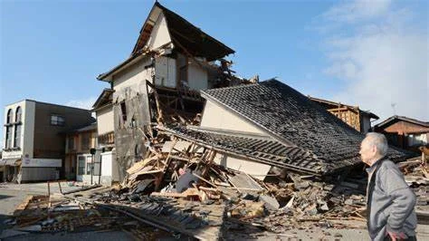

# Terremoto da Península de Noto de 2024: resumo e danos

Em 1º de janeiro de 2024, às 16h10 no horário padrão do Japão, um terremoto de magnitude 7,6 atingiu a região de Noto, na província de Ishikawa, e alcançou intensidade sísmica máxima 7 na escala japonesa. A Agência Meteorológica do Japão deu o nome de Terremoto da Península de Noto de 2024 a esse evento e à sequência sísmica relacionada desde dezembro de 2020. Consulte a [página informativa da agência](https://www.jma.go.jp/jma/menu/20240101_noto_jishin.html).

## Resumo dos danos

O relatório 123 da Agência de Gestão de Incêndios e Desastres do Japão, datado de 31 de março de 2026, registra 720 mortes, das quais 492 relacionadas ao desastre, 2 pessoas desaparecidas e danos em 165.813 edifícios residenciais. Esses números são preliminares e podem ser revisados. Consulte o [relatório da agência](https://www.fdma.go.jp/disaster/info/items/b055402cefac7721623c30034b25489118dbec38.pdf) para ver definições e detalhes.

## Fontes

- [Agência Meteorológica do Japão: informações sobre o terremoto de Noto de 2024](https://www.jma.go.jp/jma/menu/20240101_noto_jishin.html)
- [Agência de Gestão de Incêndios e Desastres: relatório 123 sobre o terremoto de Noto](https://www.fdma.go.jp/disaster/info/items/b055402cefac7721623c30034b25489118dbec38.pdf)
