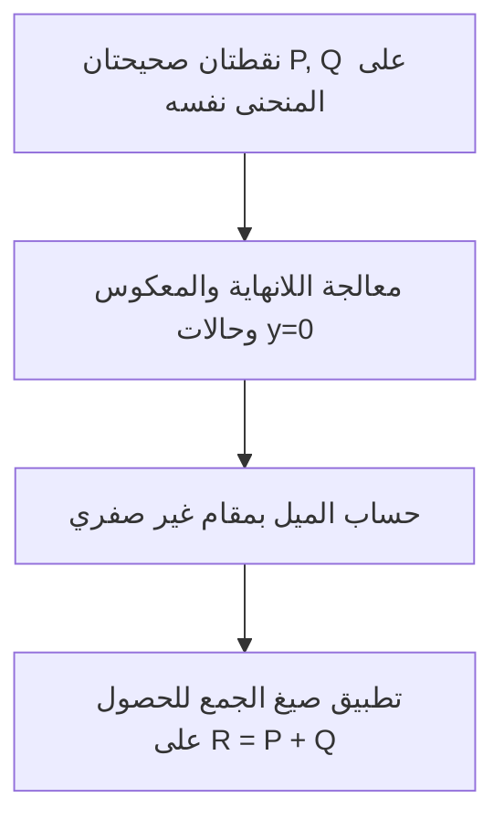
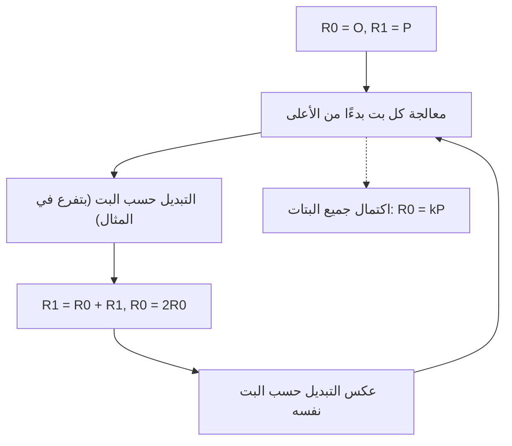
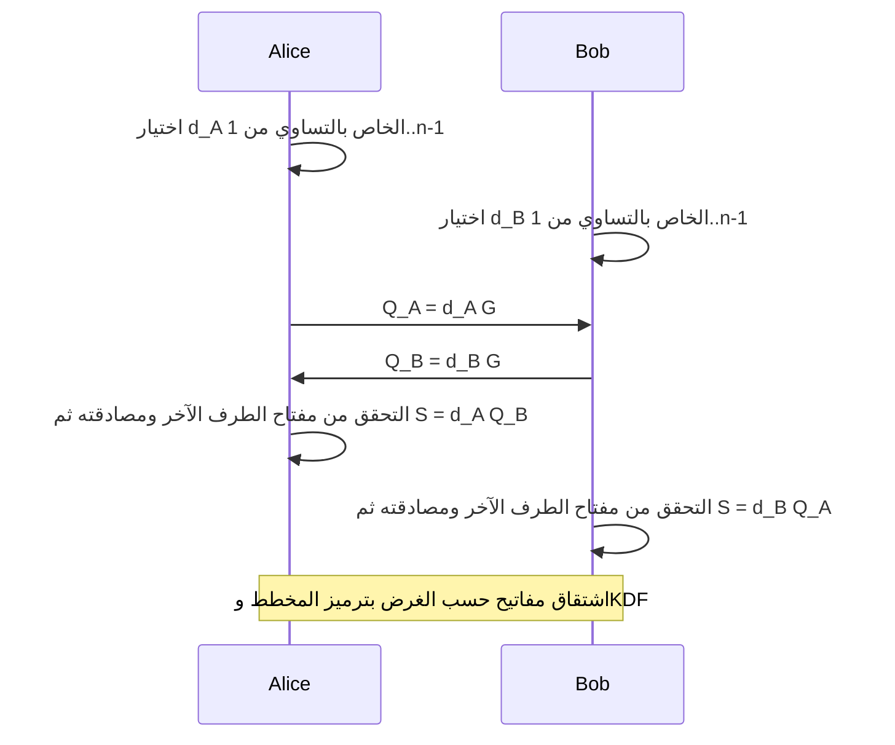

علم تشفير المنحنيات الإهليلجية (Elliptic Curve Cryptography، واختصاره ECC) عائلة من تقنيات المفتاح العام المبنية على زمر المنحنيات الإهليلجية. يختلف دور الاتفاق على المفاتيح باستخدام ECDH عن دور التوقيعات مثل ECDSA؛ فـ ECC ليست عملية تشفير واحدة توفر جميع خصائص الأمان. إلى جانب [مقدمة المفاتيح العامة والتجزئة والتوقيعات](/ar/p/modern-cryptography-public-key-hash-signature/)، يشرح هذا المقال الشروط الرياضية وشروط التنفيذ.

مثال C++ هو **عرض رياضي تعليمي بزمن تنفيذ متغير** يستخدم معلمات secp256k1 العامة. لا ينفذ توليد مفاتيح خاصة أو اتفاقًا موثَّقًا على المفاتيح أو توقيعات أو تشفيرًا بزمن ثابت. ونوضح أيضًا لماذا لا يكفي هيكل السُّلَّم وحده لضمان الزمن الثابت.

## 1. الأمان وأحجام المفاتيح

نختار زمرة جزئية ذات رتبة أولية كبيرة $n$ وعنصرًا مولِّدًا $G$. إيجاد $d$ من $Q=dG$ هو مسألة اللوغاريتم المتقطع على المنحنيات الإهليلجية (ECDLP). يتحدد العدد بترديد $n$. ويُختار المفتاح الخاص بالتساوي من $1\le d<n$ باستخدام مولد أعداد عشوائية آمن تشفيريًا. يجب الفصل بين حجم الحقل $p$ ورتبة الزمرة الجزئية $n$ وقيمة المفتاح الخاص.

لزمرة جزئية مناسبة ذات رتبة أولية كبيرة، يحتاج هجوم كلاسيكي عام مثل Pollard rho إلى نحو $O(\sqrt n)$ عملية زمرة. ولا يعني ذلك أن البحث الشامل هو الهجوم الوحيد، أو أن كل المنحنيات الإهليلجية لها الصعوبة نفسها. تتيح بعض البنى الخاصة والزمر الجزئية الصغيرة هجمات أخرى، لذا يجب اختيار المعلمات والمخطط على نحو مناسب.

المقارنة التالية تنقل **تقديرات أقصى قوة أمان ضد الحواسيب الكلاسيكية** من NIST SP 800-57 Part 1 Rev.5، Table 2. يبين عمود RSA طول المعامل بالبتات، ويبين عمود ECC طول $f$ بالبتات لرتبة نقطة الأساس $n$، لا حجم المفتاح العام بعد ترميزه.

| القوة المقدَّرة (بت) | معامل RSA (بت) | ECC: $f$ (بت) |
| :---: | :---: | :---: |
| 80 على الأكثر (مقارنة تاريخية) | 1024 | 160–223 |
| 112 | 2048 | 224–255 |
| 128 | 3072 | 256–383 |
| 192 | 7680 | 384–511 |
| 256 | 15360 | 512 على الأقل |

صف 80 بت ليس توصية لنظام جديد. ولا يعتمد هذا الجدول منحنى أو تنفيذًا أو مدة استخدام بعينها، ولا يوفر مقاومة كمية. قد تقلل المعلمات الأقصر تكلفة الاتصال، لكن ECC ليست بالضرورة أسرع من RSA في كل عملية.

## 2. الزمر والحقول المنتهية

تتكون الزمرة من مجموعة وعملية تحقق الانغلاق والتجميع (associativity)، ووجود عنصر محايد ومعكوس لكل عنصر. وإذا حققت الإبدال أيضًا، فهي زمرة أبيلية. وتشكل نقاط المنحنى الإهليلجي، بما فيها نقطة اللانهاية وباستخدام قانون الجمع أدناه، زمرة أبيلية.

لعدد أولي $p$، نمثل عناصر الحقل الأولي $\mathbb F_p$ بالأعداد $0,\ldots,p-1$، ونحسب الجمع والطرح والضرب بترديد $p$. وتُعرَّف القسمة $u/v$ بأنها $uv^{-1}$ **فقط عندما يكون $v$ غير صفري**.

$$vv^{-1}\equiv1\pmod p$$

يمكن حساب المعكوس بخوارزمية إقليدس الممتدة، أو بصيغة $v^{p-2}\bmod p$ وفق مبرهنة فيرما الصغرى. اختيار الطريقة الثانية لا يجعل التنفيذ بزمن ثابت تلقائيًا. بل يجب أيضًا فحص الرفع للأس والضرب والاختزال وتخصيص الذاكرة.

## 3. المنحنى ونقطة اللانهاية

نقصر هذا المقال على **صيغة فايرشتراس القصيرة** فوق حقل أولي مع $p>3$. لا تشمل هذه الصيغة بصورة موحدة الحقول ذات المميزة اثنين أو ثلاثة، ولا نموذجي مونتغمري وإدواردز.

$$y^2\equiv x^3+ax+b\pmod p$$

المعاملات عناصر في الحقل. ولعدم وجود نقاط شاذة (nonsingularity)، يلزم الشرط التالي داخل الحقل:

$$\Delta=-16(4a^3+27b^2)\not\equiv0\pmod p$$

هذا الشرط وحده لا يجعل المنحنى مناسبًا تشفيريًا. نضيف إلى النقاط المنتهية التي تحقق المعادلة العنصر المحايد، أي نقطة اللانهاية $\mathcal O$.

$$P+\mathcal O=\mathcal O+P=P$$

$$-(x,y)=(x,-y\bmod p),\qquad P+(-P)=\mathcal O$$

توفر الصورة فوق الأعداد الحقيقية، برسم مستقيم يقطع المنحنى ثم انعكاس نقطة التقاطع، حدسًا لقانون الزمرة. أما فوق حقل منتهٍ فنحسب بالصيغ الجبرية المقابلة، لا بمنحنى مرسوم بصورة متصلة.

## 4. الجمع والمضاعفة والحالات الاستثنائية

لتكن $P=(x_1,y_1)$ و$Q=(x_2,y_2)$. نعالج أولًا الجمع مع $\mathcal O$ وحالة $Q=-P$. وتشمل الحالة الثانية المضاعفة عندما $P=Q$ و$y_1=0$؛ والناتج هو $\mathcal O$.

عندما $x_1\ne x_2$ نستخدم:

$$\lambda\equiv(y_2-y_1)(x_2-x_1)^{-1}\pmod p$$

وعندما $P=Q$ و$y_1\ne0$ نستخدم صيغة المماس:

$$\lambda\equiv(3x_1^2+a)(2y_1)^{-1}\pmod p$$

بعد أن تضمن هذه الشروط مقامًا غير صفري، نحسب الناتج بالصيغ المشتركة:

$$x_3\equiv\lambda^2-x_1-x_2\pmod p$$

$$y_3\equiv\lambda(x_1-x_3)-y_1\pmod p$$



تحتاج الإحداثيات الأفينية إلى حساب المعكوس. ويمكن للتنفيذات العملية تقليل عدد هذه الحسابات باستخدام أنظمة مثل الإحداثيات اليعقوبية (Jacobian). لكن تغيير الإحداثيات وحده لا يضمن الزمن الثابت أو الأمان.

## 5. ضرب النقطة في عدد

للعدد الصحيح غير السالب $k$، نعرّف $kP$ بالجمع المتكرر، مع $0P=\mathcal O$. هذا هو ضرب النقطة في عدد (scalar multiplication)، وليس الجداء الداخلي لمتجهين. تعالج طريقة المضاعفة والجمع (double-and-add) البتات من الأعلى إلى الأدنى: تضاعف الناتج المتراكم وتضيف $P$ إذا كان البت واحدًا. فينخفض عدد عمليات الزمرة من $k$ عملية جمع مباشرة إلى $O(\log k)$. ولا يعني ذلك تكلفة ثابتة لكل عملية أو زمن تنفيذ مطلقًا محددًا.

الشيفرة الوصفية التالية لشرح الفكرة، وليست جزءًا من برنامج C++ اللاحق. وهي تتفرع حسب بتات سرية.

```text
R = O
for bit in bits_of_k_from_most_significant:
    R = 2R
    if bit == 1:
        R = R + P
```

ينفذ التحديث بأسلوب سُلَّم مونتغمري جمعًا واحدًا ومضاعفة واحدة لكل بت. إذا كانت البادئة المعالجة تمثل $r$، فيمكنه الحفاظ على $(R_0,R_1)=(rP,(r+1)P)$. يوضح المثال اللاحق هذا الثابت باستخدام نقاط أفينية كاملة؛ وهو ليس تنفيذًا لـ X25519 أو X448 في RFC 7748.



## 6. ECDH: الاتفاق والمصادقة

تشمل معلمات المجال العامة المنحنى والحقل ونقطة الأساس $G$ ورتبتها $n$ والعامل المساعد (cofactor). يولد كل طرف عددًا خاصًا مناسبًا ويتبادل الطرفان النقاط العامة.

$$Q_A=d_AG,\qquad Q_B=d_BG$$

$$S=d_AQ_B=d_BQ_A=(d_Ad_B)G$$



حساب القيمة المشتركة من النقاط العامة هو مسألة ديفي–هيلمان الحسابية (CDH)، ويختلف تعريفها عن ECDLP. يتيح حل ECDLP حساب القيمة المشتركة؛ ولا نفترض هنا تكافؤًا عامًا في الاتجاه المعاكس.

لا يصادق ECDH وحده على الطرف الآخر ولا يمنع المهاجم من استبدال المفاتيح العامة. يربط البروتوكول الفعلي المفاتيح والتبادل والهويات، ويطبق فحوص الترميز ونطاق الإحداثيات والانتماء إلى المنحنى واللانهاية وشروط الزمرة الجزئية وفق المخطط. لا تستخدم النقطة المشتركة أو إحداثيها x مباشرة مفتاحًا لـ AES؛ بل اتبع ترميز البروتوكول وربطه بالسياق واشتقاق المفاتيح، مثل HKDF. وليس الرسم مصافحة TLS كاملة.

## 7. شروط التنفيذ بزمن ثابت

قد تكشف التفرعات والوصول إلى الذاكرة والحالات الاستثنائية وأزمنة العمليات الحسابية المعتمدة على الأسرار معلوماتٍ في نموذج رصد مناسب. يعتمد عدد الملاحظات وإمكان استعادة المفتاح كاملًا على التنفيذ والهجوم. ولا يوجد ضمان عام بأن بضعة آلاف من القياسات تكشف كل بت.

لا يضمن تساوي عدد عمليات الجمع في كل تكرار الزمن الثابت إذا كانت العمليات نفسها تتفرع حسب قيم وسيطة سرية. والتبديل الشرطي بالقناع جزء من الدفاع فحسب؛ فتمثيل الأعداد الصحيحة والمترجم والمعالج المستهدف كلها عوامل مهمة أيضًا. يوضح RFC 7748 §5.1 أن تسلسل عمليات الحقل نفسه لا يمنع وحده جميع القنوات الجانبية.

`cpp_int` نوع أعداد صحيحة متغير الحجم، ويحتوي كل من `conditionalSwapDemo` وجمع النقاط أدناه على تفرعات. **هذه الشيفرة ليست بزمن ثابت، ولا يجوز أن تعالج المفاتيح السرية في أنظمة التشفير الإنتاجية.**

## 8. عرض رياضي تعليمي بلغة C++17

اجمع كتل C++ الخمس التالية بالترتيب في ملف واحد. تحتاج إلى ترويسات Boost.Multiprecision. يستخدم البرنامج معلمات ثابتة وقيم اختبار عامة فقط؛ ولا يولد مفاتيح سرية أو يحفظها أو يطبعها.

### 8.1. حسابات الحقل الأولي

تقتصر `modInverse` على العدد الأولي الثابت $p$ هنا وترفض الصفر. وحساب المعكوس وفق فيرما باستخدام `powerMod` متغير الزمن أيضًا.

```cpp
#include <cstdint>
#include <iostream>
#include <stdexcept>
#include <utility>
#include <boost/multiprecision/cpp_int.hpp>

using boost::multiprecision::cpp_int;

// Public secp256k1 parameters; this entire example is variable-time.
const cpp_int p("0xFFFFFFFFFFFFFFFFFFFFFFFFFFFFFFFFFFFFFFFFFFFFFFFFFFFFFFFEFFFFFC2F");
const cpp_int a = 0;
const cpp_int b = 7;
const cpp_int n("0xFFFFFFFFFFFFFFFFFFFFFFFFFFFFFFFEBAAEDCE6AF48A03BBFD25E8CD0364141");

cpp_int mod(cpp_int x, const cpp_int& m) {
    if (m <= 0) throw std::invalid_argument("Modulus must be positive");
    cpp_int r = x % m;
    if (r < 0) r += m;
    return r;
}

cpp_int powerMod(cpp_int base, cpp_int exp, const cpp_int& m) {
    if (m <= 1 || exp < 0) throw std::invalid_argument("Invalid powerMod input");
    cpp_int result = 1;
    base = mod(base, m);
    while (exp > 0) {
        if (exp % 2 == 1) result = mod(result * base, m);
        base = mod(base * base, m);
        exp /= 2;
    }
    return result;
}

// Inversion in the fixed prime field F_p only; zero has no inverse.
cpp_int modInverse(cpp_int value) {
    value = mod(value, p);
    if (value == 0) throw std::invalid_argument("Zero has no inverse");
    return powerMod(value, p - 2, p);
}
```

### 8.2. النقاط والجمع

يجب أن تحقق النقطة المنتهية نطاق الإحداثيات $0\le x,y<p$ ومعادلة المنحنى. تسمح حسابات الزمرة بنقطة اللانهاية، لكن يجب رفضها منفصلًا كمفتاح عام للطرف الآخر في ECDH. العامل المساعد لـ secp256k1 هو واحد؛ ولا تحل هذه الفحوص محل التحقق من الزمرة الجزئية اللازم للمنحنيات عمومًا.

```cpp
struct Point {
    cpp_int x = 0;
    cpp_int y = 0;
    bool isInfinity = true;

    Point() = default;
    Point(cpp_int xValue, cpp_int yValue)
        : x(std::move(xValue)), y(std::move(yValue)), isInfinity(false) {}
};

bool isOnCurve(const Point& point) {
    if (point.isInfinity) return true;
    if (point.x < 0 || point.x >= p || point.y < 0 || point.y >= p) return false;
    return mod(point.y * point.y - point.x * point.x * point.x - a * point.x - b, p) == 0;
}

Point pointAdd(const Point& P, const Point& Q) {
    if (!isOnCurve(P) || !isOnCurve(Q)) throw std::invalid_argument("Invalid curve point");
    if (P.isInfinity) return Q;
    if (Q.isInfinity) return P;
    if (P.x == Q.x && mod(P.y + Q.y, p) == 0) return Point();

    cpp_int slope;
    if (P.x == Q.x && P.y == Q.y) {
        slope = mod((3 * P.x * P.x + a) * modInverse(2 * P.y), p);
    } else {
        slope = mod((Q.y - P.y) * modInverse(Q.x - P.x), p);
    }
    cpp_int x3 = mod(slope * slope - P.x - Q.x, p);
    cpp_int y3 = mod(slope * (P.x - x3) - P.y, p);
    return Point(x3, y3);
}
```

### 8.3. محاكاة التبديل

تستخدم هذه الدالة تفرعًا، ولذلك يتضمن اسمها Demo.

```cpp
// A branching simulation of conditional swap, NOT constant-time.
void conditionalSwapDemo(Point& left, Point& right, std::uint8_t bit) {
    if (bit > 1) throw std::invalid_argument("Bit must be zero or one");
    if (bit == 1) std::swap(left, right);
}
```

### 8.4. سُلَّم مع فحص النطاق

يقبل المثال $0\le k<2^{256}$ ويرفض القيم خارجه. يختلف ذلك عن نطاق المفتاح الخاص $1\le d<n$. ولا تُحذف البتات العليا بصمت.

```cpp
// A functional ladder demonstration for 0 <= k < 2^256.
// Zero is allowed for group arithmetic, but is not a valid private key.
Point scalarMultiply(const Point& P, const cpp_int& k) {
    if (k < 0 || k >= (cpp_int(1) << 256)) throw std::invalid_argument("Scalar outside demo range");
    if (!isOnCurve(P)) throw std::invalid_argument("Invalid curve point");
    Point R0;
    Point R1 = P;
    for (int i = 255; i >= 0; --i) {
        std::uint8_t bit = boost::multiprecision::bit_test(k, i) ? 1 : 0;
        conditionalSwapDemo(R0, R1, bit);
        R1 = pointAdd(R0, R1);
        R0 = pointAdd(R0, R0);
        conditionalSwapDemo(R0, R1, bit);
    }
    return R0;
}
```

### 8.5. الفحص بقيم عامة

نستخدم العنصر المولد لـ secp256k1 من SEC 2 لفحص $2G$ و$nG=\mathcal O$. لا يثبت هذا الاختبار الذاتي وحده أمان تنفيذ تشفيري.

```cpp
int main() {
    const Point G(
        cpp_int("0x79BE667EF9DCBBAC55A06295CE870B07029BFCDB2DCE28D959F2815B16F81798"),
        cpp_int("0x483ADA7726A3C4655DA4FBFC0E1108A8FD17B448A68554199C47D08FFB10D4B8")
    );
    const Point doubled = scalarMultiply(G, 2);
    if (doubled.isInfinity || !isOnCurve(doubled) || !scalarMultiply(G, n).isInfinity) {
        throw std::runtime_error("Arithmetic self-check failed");
    }
    std::cout << "2G.x = " << std::hex << doubled.x << "\n";
    std::cout << "2G.y = " << std::hex << doubled.y << "\n";
    std::cout << "nG = infinity\n";
}
```

مثلًا، احفظ الكتل الخمس في `ecc_demo.cpp` وشغّلها في بيئة ضُبط فيها مسار تضمين Boost:

```sh
g++ -std=c++17 -O2 -Wall -Wextra ecc_demo.cpp -o ecc_demo
./ecc_demo
```

## 9. الخلاصة

يجب الفصل بين الحقل والمنحنى والزمرة الجزئية والمخطط التشفيري. حالات الجمع الاستثنائية ونطاقات الأعداد الخاصة والتحقق من المفاتيح العامة ومصادقة الطرف الآخر واشتقاق المفاتيح كلها مهمة. صحة حسابات السُّلَّم وتنفيذه بزمن ثابت مسألتان مختلفتان للتحقق.

هذا العرض لتتبّع حسابات الزمرة. أما الاتفاق الفعلي على المفاتيح والتوقيعات فيتطلب مكتبات تخضع للصيانة والتحقق وتدعم البروتوكول والمنحنى المقصودين.

### المراجع

- [RFC 6090: Fundamental Elliptic Curve Cryptography Algorithms](https://www.rfc-editor.org/rfc/rfc6090.html) (§§2–4, 10)
- [RFC 7748: Elliptic Curves for Security](https://www.rfc-editor.org/rfc/rfc7748.html) (§§5–5.1)
- [NIST SP 800-57 Part 1 Rev.5](https://nvlpubs.nist.gov/nistpubs/SpecialPublications/NIST.SP.800-57pt1r5.pdf) (§5.6.1.1, Table 2)
- [Standards for Efficient Cryptography 2 (SEC 2), version 2.0](https://www.secg.org/sec2-v2.pdf) (§2.4.1, secp256k1)
- [RFC 5869: HKDF](https://www.rfc-editor.org/rfc/rfc5869.html) (§§1, 3.2–3.3)
- [Boost.Multiprecision: cpp_int](https://www.boost.org/doc/libs/1_83_0/libs/multiprecision/doc/html/boost_multiprecision/tut/ints/cpp_int.html)


