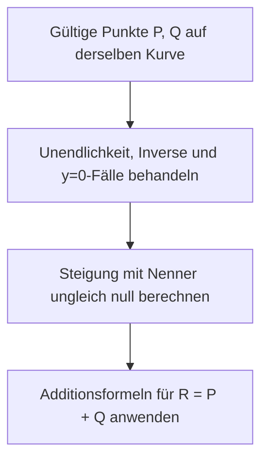
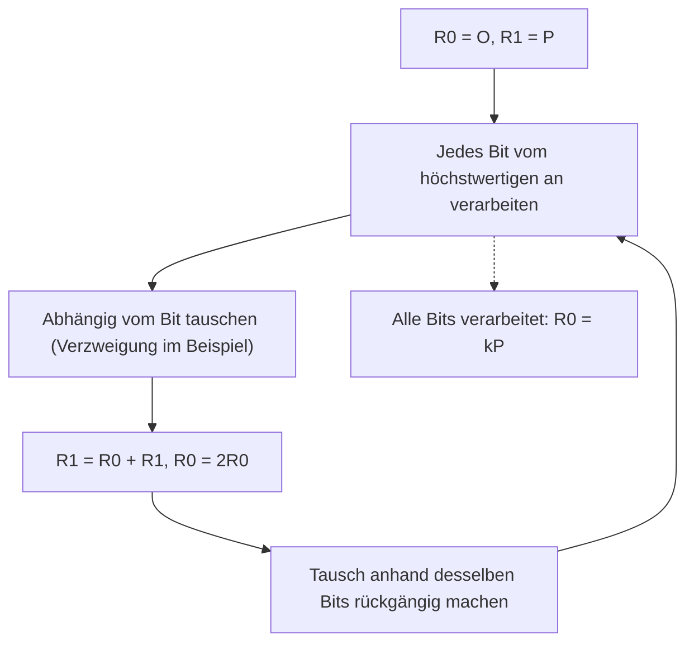
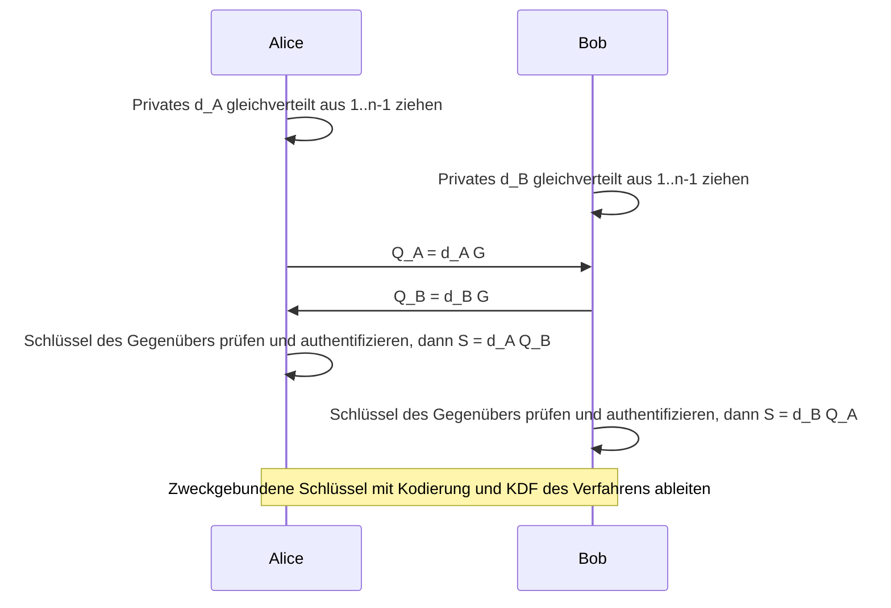

Elliptische-Kurven-Kryptographie (Elliptic Curve Cryptography, ECC) bezeichnet eine Familie von Public-Key-Verfahren auf Grundlage elliptischer Kurvengruppen. Die Schlüsselvereinbarung ECDH und Signaturen wie ECDSA haben unterschiedliche Aufgaben. ECC ist kein einzelner Verschlüsselungsvorgang, der alle Sicherheitseigenschaften bereitstellt. Ergänzend zum [Überblick über öffentliche Schlüssel, Hashes und Signaturen](/de/p/modern-cryptography-public-key-hash-signature/) erläutert dieser Artikel die mathematischen und technischen Voraussetzungen.

Das C++-Beispiel ist eine **mathematische Demonstration mit variabler Laufzeit**, die öffentliche secp256k1-Parameter verwendet. Es implementiert weder die Erzeugung privater Schlüssel noch authentifizierte Schlüsselvereinbarung, Signaturen oder Kryptographie mit konstanter Laufzeit. Außerdem erklären wir, weshalb eine Leiterstruktur allein keine konstante Laufzeit garantiert.

## 1. Sicherheit und Schlüsselgrößen

Man wählt eine Untergruppe mit großer Primzahlordnung $n$ und Erzeuger $G$. Aus $Q=dG$ den Wert $d$ zu bestimmen, ist das diskrete Logarithmusproblem auf elliptischen Kurven (ECDLP). Der Skalar ist modulo $n$ bestimmt. Ein privater Schlüssel wird mit einem kryptographisch sicheren Zufallszahlengenerator gleichverteilt aus $1\le d<n$ gezogen. Körpergröße $p$, Untergruppenordnung $n$ und der Wert des privaten Schlüssels sind zu unterscheiden.

Für eine geeignete Untergruppe großer Primzahlordnung benötigt ein generischer klassischer Angriff wie Pollard rho ungefähr $O(\sqrt n)$ Gruppenoperationen. Das bedeutet weder, dass nur vollständige Suche möglich ist, noch, dass alle elliptischen Kurven gleich schwer anzugreifen sind. Besondere Strukturen und kleine Untergruppen erlauben weitere Angriffe. Parameter und Verfahren müssen entsprechend gewählt werden.

Der folgende Vergleich übernimmt die **geschätzten maximalen Sicherheitsstärken gegenüber klassischen Rechnern** aus NIST SP 800-57 Part 1 Rev.5, Table 2. Die RSA-Spalte nennt die Bitlänge des Modulus; die ECC-Spalte nennt die Bitlänge $f$ der Ordnung $n$ des Basispunkts, nicht die Größe des kodierten öffentlichen Schlüssels.

| Geschätzte Stärke (Bit) | RSA-Modulus (Bit) | ECC $f$ (Bit) |
| :---: | :---: | :---: |
| Höchstens 80 (historischer Vergleich) | 1024 | 160–223 |
| 112 | 2048 | 224–255 |
| 128 | 3072 | 256–383 |
| 192 | 7680 | 384–511 |
| 256 | 15360 | Mindestens 512 |

Die 80-Bit-Zeile ist keine Empfehlung für ein neues System. Die Tabelle zertifiziert weder eine bestimmte Kurve oder Implementierung noch eine Einsatzdauer und bietet keine Quantenresistenz. Kürzere Parameter können den Kommunikationsaufwand verringern, aber ECC ist nicht bei jeder Operation schneller als RSA.

## 2. Gruppen und endliche Körper

Eine Gruppe besteht aus einer Menge und einer Operation mit Abgeschlossenheit, Assoziativität, einem neutralen Element und einem inversen Element zu jedem Element. Gilt zusätzlich Kommutativität, handelt es sich um eine abelsche Gruppe. Die Punkte einer elliptischen Kurve bilden zusammen mit dem Punkt im Unendlichen und der unten beschriebenen Addition eine abelsche Gruppe.

Für eine Primzahl $p$ stellt man die Elemente des Primkörpers $\mathbb F_p$ durch $0,\ldots,p-1$ dar. Addition, Subtraktion und Multiplikation werden modulo $p$ reduziert. Division $u/v$ ist **nur für $v$ ungleich null** als $uv^{-1}$ definiert.

$$vv^{-1}\equiv1\pmod p$$

Ein Inverses lässt sich mit dem erweiterten euklidischen Algorithmus oder nach dem kleinen fermatschen Satz als $v^{p-2}\bmod p$ berechnen. Die zweite Wahl macht eine Implementierung allein noch nicht laufzeitkonstant. Potenzierung, Multiplikation, Reduktion und Speicherallokation müssen ebenfalls betrachtet werden.

## 3. Kurve und Punkt im Unendlichen

Dieser Artikel beschränkt sich auf die **kurze Weierstraß-Form** über einem Primkörper mit $p>3$. Diese Formel behandelt weder Charakteristik zwei oder drei noch Montgomery- und Edwards-Modelle einheitlich.

$$y^2\equiv x^3+ax+b\pmod p$$

Die Koeffizienten sind Körperelemente. Für Nichtsingularität muss innerhalb dieses Körpers gelten:

$$\Delta=-16(4a^3+27b^2)\not\equiv0\pmod p$$

Diese Bedingung allein macht eine Kurve noch nicht kryptographisch geeignet. Zu den endlichen Punkten, welche die Gleichung erfüllen, kommt das neutrale Element hinzu: der Punkt im Unendlichen $\mathcal O$.

$$P+\mathcal O=\mathcal O+P=P$$

$$-(x,y)=(x,-y\bmod p),\qquad P+(-P)=\mathcal O$$

Das Bild einer Geraden, die eine reelle Kurve schneidet, mit anschließender Spiegelung des Schnittpunkts vermittelt eine Anschauung des Gruppengesetzes. Über einem endlichen Körper rechnet man mit den entsprechenden algebraischen Formeln statt mit einer kontinuierlich gezeichneten Kurve.

## 4. Addition, Verdopplung und Ausnahmefälle

Seien $P=(x_1,y_1)$ und $Q=(x_2,y_2)$. Zunächst behandelt man die Addition mit $\mathcal O$ und den Fall $Q=-P$. Letzterer umfasst auch die Verdopplung bei $P=Q$ und $y_1=0$; das Ergebnis ist $\mathcal O$.

Für $x_1\ne x_2$ verwendet man:

$$\lambda\equiv(y_2-y_1)(x_2-x_1)^{-1}\pmod p$$

Für $P=Q$ und $y_1\ne0$ verwendet man die Tangentenformel:

$$\lambda\equiv(3x_1^2+a)(2y_1)^{-1}\pmod p$$

Wenn diese Bedingungen einen von null verschiedenen Nenner sicherstellen, berechnet man das Ergebnis mit den gemeinsamen Formeln:

$$x_3\equiv\lambda^2-x_1-x_2\pmod p$$

$$y_3\equiv\lambda(x_1-x_3)-y_1\pmod p$$



Affine Koordinaten benötigen Inversionen. Praktische Implementierungen können deren Anzahl etwa durch Jacobi-Koordinaten (Jacobian coordinates) verringern. Ein Koordinatenwechsel allein garantiert weder konstante Laufzeit noch Sicherheit.

## 5. Skalarmultiplikation

Für nichtnegatives $k$ definiert man $kP$ durch wiederholte Addition mit $0P=\mathcal O$. Double-and-Add verarbeitet die Bits vom höchstwertigen zum niederwertigsten: Der Akkumulator wird verdoppelt, und wenn das Bit eins ist, wird $P$ addiert. Das reduziert die Zahl der Gruppenoperationen von $k$ naiven Additionen auf $O(\log k)$. Es ist keine Aussage über konstante Kosten je Operation oder eine absolute Ausführungszeit.

Der folgende konzeptionelle Pseudocode gehört nicht zum späteren C++-Programm. Er enthält eine von geheimen Bits abhängige Verzweigung.

```text
R = O
for bit in bits_of_k_from_most_significant:
    R = 2R
    if bit == 1:
        R = R + P
```

Eine Aktualisierung nach Art der Montgomery-Leiter führt je Bit eine Addition und eine Verdopplung aus. Stellt das verarbeitete Präfix $r$ dar, kann sie $(R_0,R_1)=(rP,(r+1)P)$ erhalten. Das spätere Beispiel zeigt diese Invariante mit vollständigen affinen Punkten; es implementiert weder X25519 noch X448 aus RFC 7748.



## 6. ECDH: Vereinbarung und Authentifizierung

Öffentliche Domänenparameter umfassen Kurve, Körper, Basispunkt $G$, dessen Ordnung $n$ und den Kofaktor. Jede Partei erzeugt einen geeigneten privaten Skalar und tauscht öffentliche Punkte aus.

$$Q_A=d_AG,\qquad Q_B=d_BG$$

$$S=d_AQ_B=d_BQ_A=(d_Ad_B)G$$



Den gemeinsamen Wert aus den öffentlichen Punkten zu berechnen, ist das rechnerische Diffie–Hellman-Problem (CDH), dessen Definition sich von ECDLP unterscheidet. Wer ECDLP löst, kann den gemeinsamen Wert berechnen; eine allgemeine Äquivalenz in umgekehrter Richtung wird hier nicht vorausgesetzt.

ECDH allein authentifiziert das Gegenüber nicht und verhindert nicht, dass Angreifer öffentliche Schlüssel ersetzen. Ein reales Protokoll bindet Schlüssel, Austausch und Identitäten aneinander und prüft nach seinen Vorgaben Kodierung, Koordinatenbereiche, Kurvenzugehörigkeit, Unendlichkeit und Untergruppenbedingungen. Der gemeinsame Punkt oder seine x-Koordinate darf nicht direkt als AES-Schlüssel verwendet werden. Stattdessen gelten die vorgeschriebene Kodierung, Kontextbindung und Schlüsselableitung, etwa mit HKDF. Das Diagramm ist kein vollständiger TLS-Handshake.

## 7. Bedingungen für konstante Laufzeit

Geheimnisabhängige Verzweigungen, Speicherzugriffe, Ausnahmefälle und arithmetische Laufzeiten können unter einem passenden Beobachtungsmodell Informationen preisgeben. Die benötigte Anzahl von Beobachtungen und die Möglichkeit einer vollständigen Schlüsselrekonstruktion hängen von Implementierung und Angriff ab. Es gibt keine allgemeine Garantie, dass einige Tausend Messungen jedes Bit offenlegen.

Gleich viele Additionen je Schleifendurchlauf garantieren keine konstante Laufzeit, wenn diese Additionen anhand geheimer Zwischenwerte verzweigen. Maskierter bedingter Tausch ist nur ein Teil der Abwehr. Ganzzahldarstellung, Compiler und Zielprozessor sind ebenfalls relevant. RFC 7748 §5.1 erläutert, dass dieselbe Folge von Körperoperationen allein nicht alle Seitenkanäle verhindert.

`cpp_int` ist ein Ganzzahltyp mit variabler Größe. Sowohl `conditionalSwapDemo` als auch die folgende Punktaddition enthalten Verzweigungen. **Dieser Code ist nicht laufzeitkonstant und darf keine geheimen Schlüssel in produktiver Kryptographie verarbeiten.**

## 8. Mathematische Demonstration in C++17

Die folgenden fünf C++-Blöcke werden der Reihe nach in einer Datei zusammengefügt. Die Header von Boost.Multiprecision werden benötigt. Das Programm verwendet nur öffentliche feste Parameter und Testwerte; es erzeugt, speichert oder druckt keine geheimen Schlüssel.

### 8.1. Primkörperarithmetik

`modInverse` gilt speziell für die hier festgelegte Primzahl $p$ und weist null zurück. Auch die Fermat-Inversion mit `powerMod` hat variable Laufzeit.

```cpp
#include <cstdint>
#include <iostream>
#include <stdexcept>
#include <utility>
#include <boost/multiprecision/cpp_int.hpp>

using boost::multiprecision::cpp_int;

// Public secp256k1 parameters; this entire example is variable-time.
const cpp_int p("0xFFFFFFFFFFFFFFFFFFFFFFFFFFFFFFFFFFFFFFFFFFFFFFFFFFFFFFFEFFFFFC2F");
const cpp_int a = 0;
const cpp_int b = 7;
const cpp_int n("0xFFFFFFFFFFFFFFFFFFFFFFFFFFFFFFFEBAAEDCE6AF48A03BBFD25E8CD0364141");

cpp_int mod(cpp_int x, const cpp_int& m) {
    if (m <= 0) throw std::invalid_argument("Modulus must be positive");
    cpp_int r = x % m;
    if (r < 0) r += m;
    return r;
}

cpp_int powerMod(cpp_int base, cpp_int exp, const cpp_int& m) {
    if (m <= 1 || exp < 0) throw std::invalid_argument("Invalid powerMod input");
    cpp_int result = 1;
    base = mod(base, m);
    while (exp > 0) {
        if (exp % 2 == 1) result = mod(result * base, m);
        base = mod(base * base, m);
        exp /= 2;
    }
    return result;
}

// Inversion in the fixed prime field F_p only; zero has no inverse.
cpp_int modInverse(cpp_int value) {
    value = mod(value, p);
    if (value == 0) throw std::invalid_argument("Zero has no inverse");
    return powerMod(value, p - 2, p);
}
```

### 8.2. Punkte und Addition

Ein endlicher Punkt muss Koordinaten $0\le x,y<p$ besitzen und die Kurvengleichung erfüllen. Unendlichkeit ist in der Gruppenarithmetik erlaubt, muss als öffentlicher ECDH-Schlüssel des Gegenübers aber gesondert zurückgewiesen werden. Der Kofaktor von secp256k1 ist eins. Diese Prüfungen ersetzen nicht die für beliebige Kurven erforderliche Untergruppenvalidierung.

```cpp
struct Point {
    cpp_int x = 0;
    cpp_int y = 0;
    bool isInfinity = true;

    Point() = default;
    Point(cpp_int xValue, cpp_int yValue)
        : x(std::move(xValue)), y(std::move(yValue)), isInfinity(false) {}
};

bool isOnCurve(const Point& point) {
    if (point.isInfinity) return true;
    if (point.x < 0 || point.x >= p || point.y < 0 || point.y >= p) return false;
    return mod(point.y * point.y - point.x * point.x * point.x - a * point.x - b, p) == 0;
}

Point pointAdd(const Point& P, const Point& Q) {
    if (!isOnCurve(P) || !isOnCurve(Q)) throw std::invalid_argument("Invalid curve point");
    if (P.isInfinity) return Q;
    if (Q.isInfinity) return P;
    if (P.x == Q.x && mod(P.y + Q.y, p) == 0) return Point();

    cpp_int slope;
    if (P.x == Q.x && P.y == Q.y) {
        slope = mod((3 * P.x * P.x + a) * modInverse(2 * P.y), p);
    } else {
        slope = mod((Q.y - P.y) * modInverse(Q.x - P.x), p);
    }
    cpp_int x3 = mod(slope * slope - P.x - Q.x, p);
    cpp_int y3 = mod(slope * (P.x - x3) - P.y, p);
    return Point(x3, y3);
}
```

### 8.3. Simulation eines Tauschs

Diese Funktion verzweigt, daher trägt ihr Name den Zusatz Demo.

```cpp
// A branching simulation of conditional swap, NOT constant-time.
void conditionalSwapDemo(Point& left, Point& right, std::uint8_t bit) {
    if (bit > 1) throw std::invalid_argument("Bit must be zero or one");
    if (bit == 1) std::swap(left, right);
}
```

### 8.4. Eine Leiter mit Bereichsprüfung

Die Demonstration akzeptiert $0\le k<2^{256}$ und weist Werte außerhalb dieses Bereichs zurück. Das ist ein anderer Bereich als der für private Schlüssel, $1\le d<n$. Höherwertige Bits werden nie stillschweigend abgeschnitten.

```cpp
// A functional ladder demonstration for 0 <= k < 2^256.
// Zero is allowed for group arithmetic, but is not a valid private key.
Point scalarMultiply(const Point& P, const cpp_int& k) {
    if (k < 0 || k >= (cpp_int(1) << 256)) throw std::invalid_argument("Scalar outside demo range");
    if (!isOnCurve(P)) throw std::invalid_argument("Invalid curve point");
    Point R0;
    Point R1 = P;
    for (int i = 255; i >= 0; --i) {
        std::uint8_t bit = boost::multiprecision::bit_test(k, i) ? 1 : 0;
        conditionalSwapDemo(R0, R1, bit);
        R1 = pointAdd(R0, R1);
        R0 = pointAdd(R0, R0);
        conditionalSwapDemo(R0, R1, bit);
    }
    return R0;
}
```

### 8.5. Prüfung mit öffentlichen Werten

Mit dem secp256k1-Erzeuger aus SEC 2 prüft man $2G$ und $nG=\mathcal O$. Dieser Selbsttest allein beweist keine Sicherheit einer kryptographischen Implementierung.

```cpp
int main() {
    const Point G(
        cpp_int("0x79BE667EF9DCBBAC55A06295CE870B07029BFCDB2DCE28D959F2815B16F81798"),
        cpp_int("0x483ADA7726A3C4655DA4FBFC0E1108A8FD17B448A68554199C47D08FFB10D4B8")
    );
    const Point doubled = scalarMultiply(G, 2);
    if (doubled.isInfinity || !isOnCurve(doubled) || !scalarMultiply(G, n).isInfinity) {
        throw std::runtime_error("Arithmetic self-check failed");
    }
    std::cout << "2G.x = " << std::hex << doubled.x << "\n";
    std::cout << "2G.y = " << std::hex << doubled.y << "\n";
    std::cout << "nG = infinity\n";
}
```

Beispielsweise speichert man die fünf Blöcke als `ecc_demo.cpp` und führt sie in einer Umgebung mit konfiguriertem Boost-Include-Pfad aus:

```sh
g++ -std=c++17 -O2 -Wall -Wextra ecc_demo.cpp -o ecc_demo
./ecc_demo
```

## 9. Zusammenfassung

Körper, Kurve, Untergruppe und kryptographisches Verfahren sind zu unterscheiden. Ausnahmefälle der Addition, Skalarbereiche, Prüfung öffentlicher Schlüssel, Authentifizierung des Gegenübers und Schlüsselableitung sind alle wichtig. Arithmetische Korrektheit der Leiter und konstante Laufzeit sind getrennte Prüfaufgaben.

Diese Demonstration dient dazu, Gruppenarithmetik nachzuvollziehen. Tatsächliche Schlüsselvereinbarung und Signaturen benötigen gepflegte und geprüfte Bibliotheken, die das vorgesehene Protokoll und die gewählte Kurve unterstützen.

### Quellen

- [RFC 6090: Fundamental Elliptic Curve Cryptography Algorithms](https://www.rfc-editor.org/rfc/rfc6090.html) (§§2–4, 10)
- [RFC 7748: Elliptic Curves for Security](https://www.rfc-editor.org/rfc/rfc7748.html) (§§5–5.1)
- [NIST SP 800-57 Part 1 Rev.5](https://nvlpubs.nist.gov/nistpubs/SpecialPublications/NIST.SP.800-57pt1r5.pdf) (§5.6.1.1, Table 2)
- [Standards for Efficient Cryptography 2 (SEC 2), version 2.0](https://www.secg.org/sec2-v2.pdf) (§2.4.1, secp256k1)
- [RFC 5869: HKDF](https://www.rfc-editor.org/rfc/rfc5869.html) (§§1, 3.2–3.3)
- [Boost.Multiprecision: cpp_int](https://www.boost.org/doc/libs/1_83_0/libs/multiprecision/doc/html/boost_multiprecision/tut/ints/cpp_int.html)


