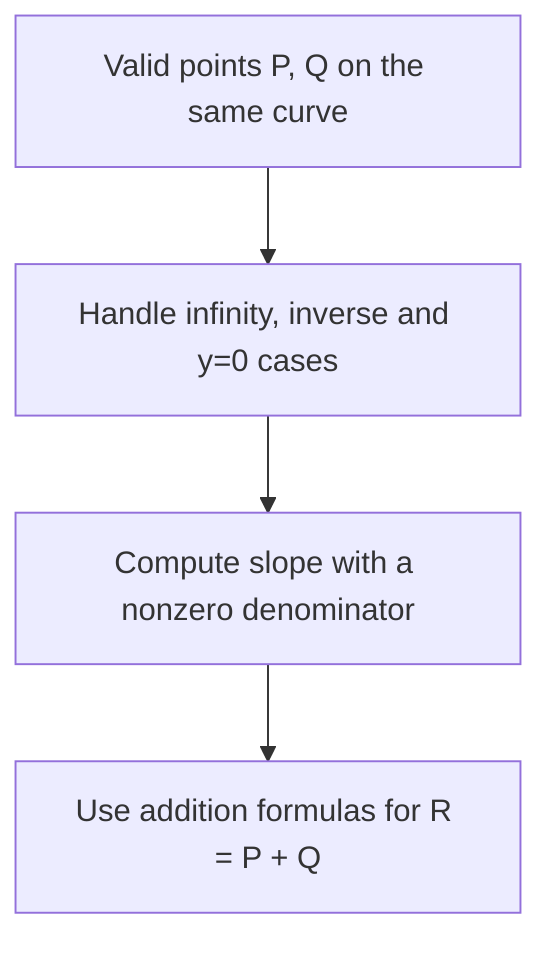
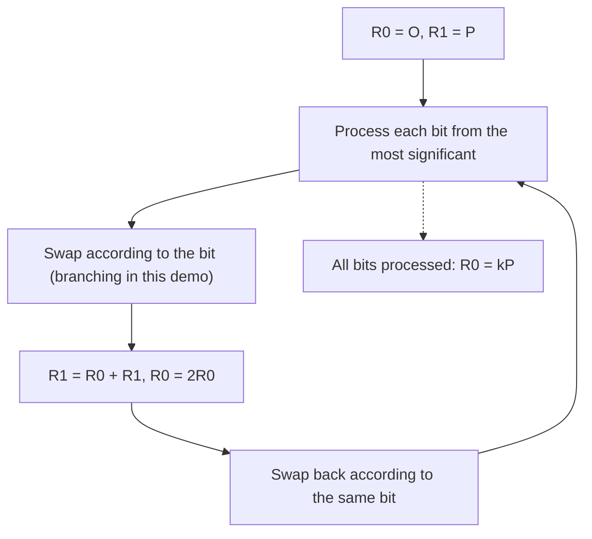
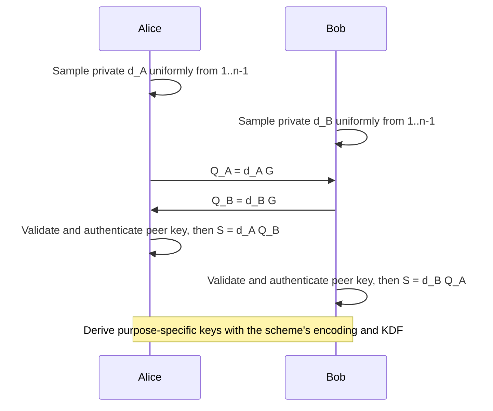

Elliptic Curve Cryptography (ECC) is a family of public-key techniques based on elliptic-curve groups. ECDH key agreement and signatures such as ECDSA have different roles; ECC is not one encryption operation that provides every security property. Alongside the [overview of public keys, hashes and signatures](/en/p/modern-cryptography-public-key-hash-signature/), this article explains the mathematical and implementation conditions.

The C++ example is a **variable-time mathematical demonstration** using public secp256k1 parameters. It does not implement secret-key generation, authenticated key agreement, signatures or constant-time cryptography. We also explain why a ladder structure alone does not establish constant-time behavior.

## 1. Security and key sizes

Choose a large prime-order subgroup of order $n$ with generator $G$. Recovering $d$ from $Q=dG$ is the elliptic-curve discrete logarithm problem (ECDLP). The scalar is determined modulo $n$. A private key is sampled uniformly from $1\le d<n$ using a cryptographically secure random generator. Distinguish the field size $p$, subgroup order $n$ and private-key value.

For a suitable large prime-order subgroup, a generic classical attack such as Pollard rho takes approximately $O(\sqrt n)$ group operations. This does not mean exhaustive search is the only attack, or that every elliptic curve has the same difficulty. Special curve structures and small subgroups permit other attacks. Parameters and schemes must be selected appropriately.

The following comparison reproduces the **estimated maximum security strengths against classical computers** in NIST SP 800-57 Part 1 Rev.5, Table 2. The RSA column gives the modulus bit length; the ECC column gives the bit length $f$ of the base-point order $n$, not the encoded public-key size.

| Estimated strength (bits) | RSA modulus (bits) | ECC $f$ (bits) |
| :---: | :---: | :---: |
| At most 80 (historical comparison) | 1024 | 160–223 |
| 112 | 2048 | 224–255 |
| 128 | 3072 | 256–383 |
| 192 | 7680 | 384–511 |
| 256 | 15360 | At least 512 |

The 80-bit row is not a recommendation for a new system. The table does not certify a particular curve, implementation or deployment lifetime, or provide quantum resistance. Shorter parameters can reduce communication costs, but ECC is not necessarily faster than RSA for every operation.

## 2. Groups and finite fields

A group consists of a set and an operation satisfying closure, associativity, an identity and inverses for every element. A group that also satisfies commutativity is an abelian group. Elliptic-curve points, including the point at infinity and the addition law below, form an abelian group.

For a prime $p$, represent elements of the prime field $\mathbb F_p$ by $0,\ldots,p-1$ and reduce addition, subtraction and multiplication modulo $p$. Division $u/v$ is defined as $uv^{-1}$ **only for nonzero $v$**.

$$vv^{-1}\equiv1\pmod p$$

An inverse can be computed with the extended Euclidean algorithm or as $v^{p-2}\bmod p$ using Fermat's little theorem. Choosing the latter does not make an implementation constant-time. Exponentiation, multiplication, reduction and memory allocation must all be considered.

## 3. The curve and point at infinity

We restrict this article to the **short Weierstrass form** over a prime field with $p>3$. This formula does not uniformly cover characteristic two or three, or Montgomery and Edwards models.

$$y^2\equiv x^3+ax+b\pmod p$$

The coefficients are field elements, and nonsingularity requires the following condition in the field:

$$\Delta=-16(4a^3+27b^2)\not\equiv0\pmod p$$

This condition alone does not make a curve cryptographically suitable. Add the identity, the point at infinity $\mathcal O$, to the finite points satisfying the equation.

$$P+\mathcal O=\mathcal O+P=P$$

$$-(x,y)=(x,-y\bmod p),\qquad P+(-P)=\mathcal O$$

The real-number picture of intersecting a line with a curve and reflecting the intersection gives intuition for the group law. Over a finite field, we calculate with the corresponding algebraic formulas rather than a continuous drawn curve.

## 4. Addition, doubling and exceptional cases

Let $P=(x_1,y_1)$ and $Q=(x_2,y_2)$. First handle addition with $\mathcal O$ and the case $Q=-P$. The latter includes doubling when $P=Q$ and $y_1=0$; the result is $\mathcal O$.

When $x_1\ne x_2$, use:

$$\lambda\equiv(y_2-y_1)(x_2-x_1)^{-1}\pmod p$$

When $P=Q$ and $y_1\ne0$, use the tangent formula:

$$\lambda\equiv(3x_1^2+a)(2y_1)^{-1}\pmod p$$

Once these conditions ensure a nonzero denominator, compute the result with the common formulas:

$$x_3\equiv\lambda^2-x_1-x_2\pmod p$$

$$y_3\equiv\lambda(x_1-x_3)-y_1\pmod p$$



Affine coordinates require inversions. Practical implementations can reduce their number with coordinate systems such as Jacobian coordinates. A change of coordinates alone does not establish constant-time behavior or security.

## 5. Scalar multiplication

For nonnegative $k$, define $kP$ by repeated addition, with $0P=\mathcal O$. Double-and-add processes bits from most significant to least significant: double the accumulator and add $P$ if the bit is one. It reduces the number of group operations from $k$ naive additions to $O(\log k)$. This says nothing about a constant cost per group operation or an absolute running time.

The following conceptual pseudocode is not part of the later C++ program. It branches on secret bits.

```text
R = O
for bit in bits_of_k_from_most_significant:
    R = 2R
    if bit == 1:
        R = R + P
```

A Montgomery-ladder-style update performs one addition and one doubling per bit. If the processed prefix represents $r$, it can preserve $(R_0,R_1)=(rP,(r+1)P)$. The later example demonstrates this invariant using full affine points; it is not an implementation of RFC 7748's X25519 or X448.



## 6. ECDH: agreement and authentication

Public domain parameters include the curve, field, base point $G$, its order $n$ and the cofactor. Each party generates an appropriate private scalar and exchanges public points.

$$Q_A=d_AG,\qquad Q_B=d_BG$$

$$S=d_AQ_B=d_BQ_A=(d_Ad_B)G$$



Computing the shared value from the public points is the computational Diffie–Hellman problem (CDH), which is not the definition of ECDLP. Solving ECDLP lets an attacker compute the shared value; we do not assume a general equivalence in the reverse direction.

ECDH alone does not authenticate the peer or stop an attacker from substituting public keys. A real protocol binds keys, the exchange and peer identities, and applies its required checks for encoding, coordinate ranges, curve membership, infinity and subgroup conditions. Do not use the shared point or its x-coordinate directly as an AES key: follow the protocol's encoding, context binding and key derivation, such as HKDF. The diagram is not a complete TLS handshake.

## 7. What constant-time implementation requires

Secret-dependent branches, memory accesses, exceptional cases and arithmetic timing can leak information under an appropriate observation model. The number of observations and whether a full key can be recovered depend on the implementation and attack. There is no universal guarantee that a few thousand measurements reveal every bit.

An equal number of additions per iteration does not establish constant-time behavior if those additions branch on secret intermediate values. A masked conditional swap is only part of a defense: integer representation, the compiler and target CPU also matter. RFC 7748 §5.1 explains that an identical field-operation sequence does not by itself prevent all side channels.

`cpp_int` is a variable-size integer type, and both `conditionalSwapDemo` and point addition below branch. **The following code is not constant-time and must not handle secret keys in production cryptography.**

## 8. A C++17 mathematical demonstration

Concatenate the following five C++ blocks in order into one file. Boost.Multiprecision headers are required. The program uses only public fixed parameters and test values; it does not generate, store or print secret keys.

### 8.1. Prime-field arithmetic

`modInverse` is specific to the fixed prime $p$ used here and rejects zero. The Fermat inversion implemented with `powerMod` is also variable-time.

```cpp
#include <cstdint>
#include <iostream>
#include <stdexcept>
#include <utility>
#include <boost/multiprecision/cpp_int.hpp>

using boost::multiprecision::cpp_int;

// Public secp256k1 parameters; this entire example is variable-time.
const cpp_int p("0xFFFFFFFFFFFFFFFFFFFFFFFFFFFFFFFFFFFFFFFFFFFFFFFFFFFFFFFEFFFFFC2F");
const cpp_int a = 0;
const cpp_int b = 7;
const cpp_int n("0xFFFFFFFFFFFFFFFFFFFFFFFFFFFFFFFEBAAEDCE6AF48A03BBFD25E8CD0364141");

cpp_int mod(cpp_int x, const cpp_int& m) {
    if (m <= 0) throw std::invalid_argument("Modulus must be positive");
    cpp_int r = x % m;
    if (r < 0) r += m;
    return r;
}

cpp_int powerMod(cpp_int base, cpp_int exp, const cpp_int& m) {
    if (m <= 1 || exp < 0) throw std::invalid_argument("Invalid powerMod input");
    cpp_int result = 1;
    base = mod(base, m);
    while (exp > 0) {
        if (exp % 2 == 1) result = mod(result * base, m);
        base = mod(base * base, m);
        exp /= 2;
    }
    return result;
}

// Inversion in the fixed prime field F_p only; zero has no inverse.
cpp_int modInverse(cpp_int value) {
    value = mod(value, p);
    if (value == 0) throw std::invalid_argument("Zero has no inverse");
    return powerMod(value, p - 2, p);
}
```

### 8.2. Points and addition

A finite point must have coordinates $0\le x,y<p$ and satisfy the curve equation. Infinity is permitted for group arithmetic but must be rejected separately as a peer ECDH public key. The cofactor of secp256k1 is one; these checks do not replace the subgroup validation needed for arbitrary curves.

```cpp
struct Point {
    cpp_int x = 0;
    cpp_int y = 0;
    bool isInfinity = true;

    Point() = default;
    Point(cpp_int xValue, cpp_int yValue)
        : x(std::move(xValue)), y(std::move(yValue)), isInfinity(false) {}
};

bool isOnCurve(const Point& point) {
    if (point.isInfinity) return true;
    if (point.x < 0 || point.x >= p || point.y < 0 || point.y >= p) return false;
    return mod(point.y * point.y - point.x * point.x * point.x - a * point.x - b, p) == 0;
}

Point pointAdd(const Point& P, const Point& Q) {
    if (!isOnCurve(P) || !isOnCurve(Q)) throw std::invalid_argument("Invalid curve point");
    if (P.isInfinity) return Q;
    if (Q.isInfinity) return P;
    if (P.x == Q.x && mod(P.y + Q.y, p) == 0) return Point();

    cpp_int slope;
    if (P.x == Q.x && P.y == Q.y) {
        slope = mod((3 * P.x * P.x + a) * modInverse(2 * P.y), p);
    } else {
        slope = mod((Q.y - P.y) * modInverse(Q.x - P.x), p);
    }
    cpp_int x3 = mod(slope * slope - P.x - Q.x, p);
    cpp_int y3 = mod(slope * (P.x - x3) - P.y, p);
    return Point(x3, y3);
}
```

### 8.3. Simulating a swap

This function branches, hence Demo in its name.

```cpp
// A branching simulation of conditional swap, NOT constant-time.
void conditionalSwapDemo(Point& left, Point& right, std::uint8_t bit) {
    if (bit > 1) throw std::invalid_argument("Bit must be zero or one");
    if (bit == 1) std::swap(left, right);
}
```

### 8.4. A ladder with input-range checks

The demonstration accepts $0\le k<2^{256}$ and rejects values outside that range. This differs from the private-key range $1\le d<n$. It never silently truncates higher bits.

```cpp
// A functional ladder demonstration for 0 <= k < 2^256.
// Zero is allowed for group arithmetic, but is not a valid private key.
Point scalarMultiply(const Point& P, const cpp_int& k) {
    if (k < 0 || k >= (cpp_int(1) << 256)) throw std::invalid_argument("Scalar outside demo range");
    if (!isOnCurve(P)) throw std::invalid_argument("Invalid curve point");
    Point R0;
    Point R1 = P;
    for (int i = 255; i >= 0; --i) {
        std::uint8_t bit = boost::multiprecision::bit_test(k, i) ? 1 : 0;
        conditionalSwapDemo(R0, R1, bit);
        R1 = pointAdd(R0, R1);
        R0 = pointAdd(R0, R0);
        conditionalSwapDemo(R0, R1, bit);
    }
    return R0;
}
```

### 8.5. Checking public values

Use the secp256k1 generator from SEC 2 to check $2G$ and $nG=\mathcal O$. This self-check alone is not a proof that a cryptographic implementation is secure.

```cpp
int main() {
    const Point G(
        cpp_int("0x79BE667EF9DCBBAC55A06295CE870B07029BFCDB2DCE28D959F2815B16F81798"),
        cpp_int("0x483ADA7726A3C4655DA4FBFC0E1108A8FD17B448A68554199C47D08FFB10D4B8")
    );
    const Point doubled = scalarMultiply(G, 2);
    if (doubled.isInfinity || !isOnCurve(doubled) || !scalarMultiply(G, n).isInfinity) {
        throw std::runtime_error("Arithmetic self-check failed");
    }
    std::cout << "2G.x = " << std::hex << doubled.x << "\n";
    std::cout << "2G.y = " << std::hex << doubled.y << "\n";
    std::cout << "nG = infinity\n";
}
```

For example, save the five blocks as `ecc_demo.cpp` and run them in an environment with the Boost include path configured:

```sh
g++ -std=c++17 -O2 -Wall -Wextra ecc_demo.cpp -o ecc_demo
./ecc_demo
```

## 9. Conclusion

Distinguish the field, curve, subgroup and cryptographic scheme. Exceptional addition cases, scalar ranges, public-key validation, peer authentication and key derivation all matter. Correct ladder arithmetic and constant-time implementation are separate verification tasks.

This demonstration is for tracing group arithmetic. Actual key agreement and signatures require maintained, validated libraries supporting the intended protocol and curve.

### References

- [RFC 6090: Fundamental Elliptic Curve Cryptography Algorithms](https://www.rfc-editor.org/rfc/rfc6090.html) (§§2–4, 10)
- [RFC 7748: Elliptic Curves for Security](https://www.rfc-editor.org/rfc/rfc7748.html) (§§5–5.1)
- [NIST SP 800-57 Part 1 Rev.5](https://nvlpubs.nist.gov/nistpubs/SpecialPublications/NIST.SP.800-57pt1r5.pdf) (§5.6.1.1, Table 2)
- [Standards for Efficient Cryptography 2 (SEC 2), version 2.0](https://www.secg.org/sec2-v2.pdf) (§2.4.1, secp256k1)
- [RFC 5869: HKDF](https://www.rfc-editor.org/rfc/rfc5869.html) (§§1, 3.2–3.3)
- [Boost.Multiprecision: cpp_int](https://www.boost.org/doc/libs/1_83_0/libs/multiprecision/doc/html/boost_multiprecision/tut/ints/cpp_int.html)

