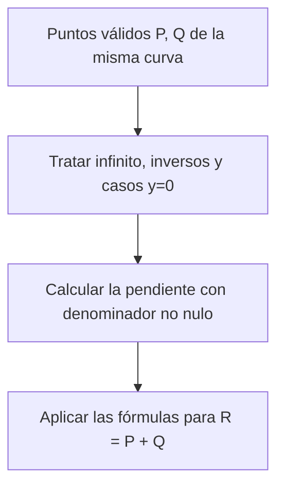
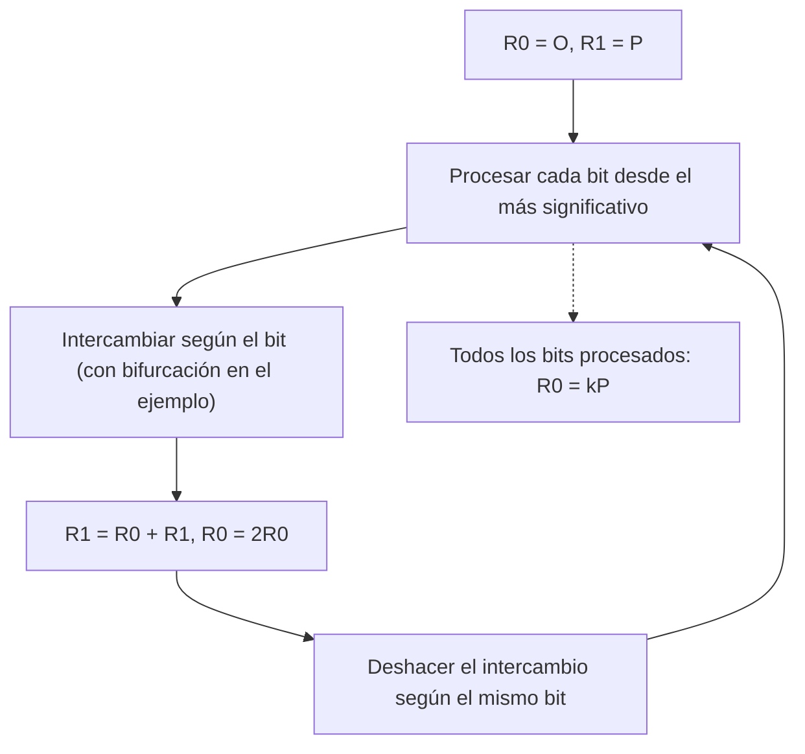
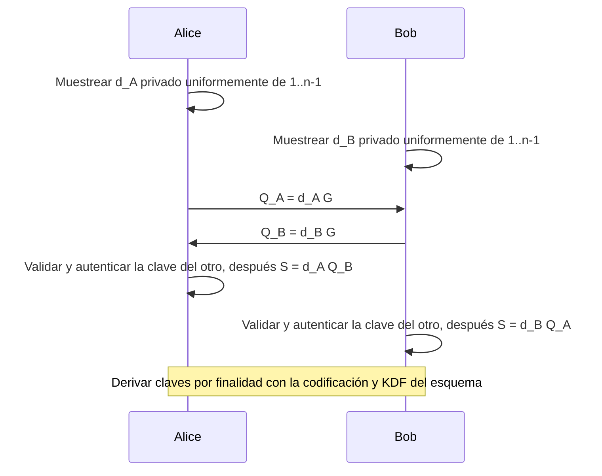

La criptografía de curva elíptica (Elliptic Curve Cryptography, ECC) es una familia de técnicas de clave pública basadas en grupos de curvas elípticas. El acuerdo de claves ECDH y las firmas como ECDSA tienen funciones distintas: ECC no es una única operación de cifrado que proporcione todas las propiedades de seguridad. Junto con el [resumen de claves públicas, hashes y firmas](/es/p/modern-cryptography-public-key-hash-signature/), este artículo explica sus condiciones matemáticas y de implementación.

El ejemplo en C++ es una **demostración matemática de tiempo variable** con parámetros públicos de secp256k1. No implementa generación de claves privadas, acuerdo de claves autenticado, firmas ni criptografía de tiempo constante. También explicamos por qué una estructura de escalera no basta para garantizar un comportamiento de tiempo constante.

## 1. Seguridad y tamaños de clave

Se elige un subgrupo de orden primo grande $n$ con generador $G$. Recuperar $d$ a partir de $Q=dG$ es el problema del logaritmo discreto en curvas elípticas (ECDLP). El escalar queda determinado módulo $n$. Una clave privada se muestrea uniformemente de $1\le d<n$ con un generador aleatorio criptográficamente seguro. Hay que distinguir el tamaño del cuerpo $p$, el orden del subgrupo $n$ y el valor de la clave privada.

Para un subgrupo adecuado de orden primo grande, un ataque clásico genérico como Pollard rho necesita aproximadamente $O(\sqrt n)$ operaciones de grupo. Esto no significa que la búsqueda exhaustiva sea el único ataque, ni que todas las curvas elípticas presenten la misma dificultad. Las estructuras especiales y los subgrupos pequeños permiten otros ataques; es necesario seleccionar apropiadamente los parámetros y el esquema.

La siguiente comparación reproduce las **resistencias máximas estimadas frente a ordenadores clásicos** de NIST SP 800-57 Part 1 Rev.5, Table 2. La columna RSA indica la longitud del módulo en bits; la columna ECC, la longitud en bits $f$ del orden $n$ del punto base, no el tamaño de la clave pública codificada.

| Resistencia estimada (bits) | Módulo RSA (bits) | ECC $f$ (bits) |
| :---: | :---: | :---: |
| Como máximo 80 (comparación histórica) | 1024 | 160–223 |
| 112 | 2048 | 224–255 |
| 128 | 3072 | 256–383 |
| 192 | 7680 | 384–511 |
| 256 | 15360 | Al menos 512 |

La fila de 80 bits no recomienda su uso en un sistema nuevo. La tabla no certifica una curva, implementación o duración de despliegue concreta, ni ofrece resistencia cuántica. Unos parámetros más cortos pueden reducir los costes de comunicación, pero ECC no es necesariamente más rápido que RSA en todas las operaciones.

## 2. Grupos y cuerpos finitos

Un grupo consta de un conjunto y una operación que satisfacen clausura, asociatividad, existencia de un elemento neutro y de inversos para todos sus elementos. Si también cumple la conmutatividad, es un grupo abeliano. Los puntos de una curva elíptica, incluido el punto en el infinito y con la ley de suma descrita abajo, forman un grupo abeliano.

Para un primo $p$, los elementos del cuerpo primo $\mathbb F_p$ se representan mediante $0,\ldots,p-1$, y la suma, resta y multiplicación se reducen módulo $p$. Un cuerpo finito también se denomina campo finito. La división $u/v$ se define como $uv^{-1}$ **solo si $v$ es distinto de cero**.

$$vv^{-1}\equiv1\pmod p$$

El inverso se puede calcular con el algoritmo extendido de Euclides o como $v^{p-2}\bmod p$ mediante el pequeño teorema de Fermat. Elegir la segunda opción no hace que una implementación sea de tiempo constante. También importan la exponenciación, multiplicación, reducción y asignación de memoria.

## 3. La curva y el punto en el infinito

Este artículo se limita a la **forma corta de Weierstrass** sobre un cuerpo primo con $p>3$. La fórmula no cubre de manera uniforme la característica dos o tres, ni los modelos de Montgomery y Edwards.

$$y^2\equiv x^3+ax+b\pmod p$$

Los coeficientes son elementos del cuerpo y la ausencia de singularidades requiere la siguiente condición dentro de él:

$$\Delta=-16(4a^3+27b^2)\not\equiv0\pmod p$$

Esta condición por sí sola no hace que una curva sea adecuada para criptografía. A los puntos finitos que satisfacen la ecuación se añade el elemento neutro, el punto en el infinito $\mathcal O$.

$$P+\mathcal O=\mathcal O+P=P$$

$$-(x,y)=(x,-y\bmod p),\qquad P+(-P)=\mathcal O$$

La imagen sobre los números reales de una recta que corta la curva y de la reflexión del punto de intersección aporta intuición sobre la ley de grupo. En un cuerpo finito calculamos con las fórmulas algebraicas correspondientes, no con una curva dibujada de forma continua.

## 4. Suma, duplicación y casos excepcionales

Sean $P=(x_1,y_1)$ y $Q=(x_2,y_2)$. Primero se trata la suma con $\mathcal O$ y el caso $Q=-P$. Este último incluye la duplicación cuando $P=Q$ y $y_1=0$; el resultado es $\mathcal O$.

Si $x_1\ne x_2$, se utiliza:

$$\lambda\equiv(y_2-y_1)(x_2-x_1)^{-1}\pmod p$$

Si $P=Q$ y $y_1\ne0$, se utiliza la fórmula de la tangente:

$$\lambda\equiv(3x_1^2+a)(2y_1)^{-1}\pmod p$$

Una vez que estas condiciones aseguran un denominador distinto de cero, el resultado se obtiene con las fórmulas comunes:

$$x_3\equiv\lambda^2-x_1-x_2\pmod p$$

$$y_3\equiv\lambda(x_1-x_3)-y_1\pmod p$$



Las coordenadas afines requieren inversiones. Las implementaciones prácticas pueden reducir su número con sistemas como las coordenadas jacobianas. Cambiar las coordenadas no garantiza por sí solo ni tiempo constante ni seguridad.

## 5. Multiplicación escalar

Para $k$ no negativo, se define $kP$ mediante sumas repetidas, con $0P=\mathcal O$. El método de duplicar y sumar (double-and-add) procesa los bits del más significativo al menos significativo: duplica el acumulador y suma $P$ si el bit es uno. Reduce el número de operaciones de grupo de $k$ sumas directas a $O(\log k)$. Esto no afirma un coste constante por operación ni un tiempo absoluto de ejecución.

El siguiente pseudocódigo conceptual no forma parte del programa C++ posterior. Contiene una bifurcación que depende de bits secretos.

```text
R = O
for bit in bits_of_k_from_most_significant:
    R = 2R
    if bit == 1:
        R = R + P
```

Una actualización de tipo escalera de Montgomery realiza una suma y una duplicación por bit. Si el prefijo procesado representa $r$, puede conservar $(R_0,R_1)=(rP,(r+1)P)$. El ejemplo posterior demuestra este invariante con puntos afines completos; no implementa X25519 ni X448 de RFC 7748.



## 6. ECDH: acuerdo y autenticación

Los parámetros públicos de dominio incluyen la curva, el cuerpo, el punto base $G$, su orden $n$ y el cofactor. Cada parte genera un escalar privado apropiado e intercambia puntos públicos.

$$Q_A=d_AG,\qquad Q_B=d_BG$$

$$S=d_AQ_B=d_BQ_A=(d_Ad_B)G$$



Calcular el valor compartido a partir de los puntos públicos es el problema computacional de Diffie–Hellman (CDH), cuya definición difiere de ECDLP. Resolver ECDLP permite calcular el valor compartido; aquí no se supone una equivalencia general en el sentido inverso.

ECDH por sí solo no autentica a la otra parte ni evita que un atacante sustituya las claves públicas. Un protocolo real vincula las claves, el intercambio y las identidades, y aplica las comprobaciones exigidas de codificación, rango de coordenadas, pertenencia a la curva, infinito y subgrupo. No se debe usar directamente el punto compartido o su coordenada x como clave AES: se sigue la codificación, la vinculación al contexto y la derivación de claves, como HKDF, especificadas por el protocolo. El diagrama no es una negociación TLS completa.

## 7. Condiciones de una implementación de tiempo constante

Las bifurcaciones, accesos a memoria, casos excepcionales y tiempos aritméticos que dependen de secretos pueden filtrar información bajo un modelo de observación apropiado. El número de observaciones y la posibilidad de recuperar toda la clave dependen de la implementación y del ataque. No existe una garantía universal de que unos miles de mediciones revelen cada bit.

Un número igual de sumas por iteración no garantiza tiempo constante si esas sumas se bifurcan según valores secretos intermedios. Un intercambio condicional con máscaras es solo parte de la defensa: también importan la representación de enteros, el compilador y la CPU objetivo. RFC 7748 §5.1 explica que una secuencia idéntica de operaciones de cuerpo no impide por sí sola todos los canales laterales.

`cpp_int` es un tipo entero de tamaño variable, y tanto `conditionalSwapDemo` como la suma de puntos siguiente contienen bifurcaciones. **Este código no es de tiempo constante y no debe manejar claves secretas en criptografía de producción.**

## 8. Demostración matemática en C++17

Se concatenan en orden los cinco bloques C++ siguientes en un archivo. Se requieren las cabeceras de Boost.Multiprecision. El programa solo utiliza parámetros fijos y valores de prueba públicos; no genera, almacena ni imprime claves secretas.

### 8.1. Aritmética del cuerpo primo

`modInverse` es específico del primo fijo $p$ utilizado aquí y rechaza el cero. La inversión de Fermat implementada mediante `powerMod` también es de tiempo variable.

```cpp
#include <cstdint>
#include <iostream>
#include <stdexcept>
#include <utility>
#include <boost/multiprecision/cpp_int.hpp>

using boost::multiprecision::cpp_int;

// Public secp256k1 parameters; this entire example is variable-time.
const cpp_int p("0xFFFFFFFFFFFFFFFFFFFFFFFFFFFFFFFFFFFFFFFFFFFFFFFFFFFFFFFEFFFFFC2F");
const cpp_int a = 0;
const cpp_int b = 7;
const cpp_int n("0xFFFFFFFFFFFFFFFFFFFFFFFFFFFFFFFEBAAEDCE6AF48A03BBFD25E8CD0364141");

cpp_int mod(cpp_int x, const cpp_int& m) {
    if (m <= 0) throw std::invalid_argument("Modulus must be positive");
    cpp_int r = x % m;
    if (r < 0) r += m;
    return r;
}

cpp_int powerMod(cpp_int base, cpp_int exp, const cpp_int& m) {
    if (m <= 1 || exp < 0) throw std::invalid_argument("Invalid powerMod input");
    cpp_int result = 1;
    base = mod(base, m);
    while (exp > 0) {
        if (exp % 2 == 1) result = mod(result * base, m);
        base = mod(base * base, m);
        exp /= 2;
    }
    return result;
}

// Inversion in the fixed prime field F_p only; zero has no inverse.
cpp_int modInverse(cpp_int value) {
    value = mod(value, p);
    if (value == 0) throw std::invalid_argument("Zero has no inverse");
    return powerMod(value, p - 2, p);
}
```

### 8.2. Puntos y suma

Un punto finito debe tener coordenadas $0\le x,y<p$ y satisfacer la ecuación de la curva. El infinito se permite en la aritmética de grupo, pero debe rechazarse por separado como clave pública ECDH de la otra parte. El cofactor de secp256k1 es uno; estas comprobaciones no sustituyen la validación de subgrupo necesaria para curvas arbitrarias.

```cpp
struct Point {
    cpp_int x = 0;
    cpp_int y = 0;
    bool isInfinity = true;

    Point() = default;
    Point(cpp_int xValue, cpp_int yValue)
        : x(std::move(xValue)), y(std::move(yValue)), isInfinity(false) {}
};

bool isOnCurve(const Point& point) {
    if (point.isInfinity) return true;
    if (point.x < 0 || point.x >= p || point.y < 0 || point.y >= p) return false;
    return mod(point.y * point.y - point.x * point.x * point.x - a * point.x - b, p) == 0;
}

Point pointAdd(const Point& P, const Point& Q) {
    if (!isOnCurve(P) || !isOnCurve(Q)) throw std::invalid_argument("Invalid curve point");
    if (P.isInfinity) return Q;
    if (Q.isInfinity) return P;
    if (P.x == Q.x && mod(P.y + Q.y, p) == 0) return Point();

    cpp_int slope;
    if (P.x == Q.x && P.y == Q.y) {
        slope = mod((3 * P.x * P.x + a) * modInverse(2 * P.y), p);
    } else {
        slope = mod((Q.y - P.y) * modInverse(Q.x - P.x), p);
    }
    cpp_int x3 = mod(slope * slope - P.x - Q.x, p);
    cpp_int y3 = mod(slope * (P.x - x3) - P.y, p);
    return Point(x3, y3);
}
```

### 8.3. Simulación de un intercambio

Esta función contiene una bifurcación, de ahí Demo en el nombre.

```cpp
// A branching simulation of conditional swap, NOT constant-time.
void conditionalSwapDemo(Point& left, Point& right, std::uint8_t bit) {
    if (bit > 1) throw std::invalid_argument("Bit must be zero or one");
    if (bit == 1) std::swap(left, right);
}
```

### 8.4. Una escalera con comprobación de rango

La demostración admite $0\le k<2^{256}$ y rechaza los valores fuera de ese rango. Este intervalo difiere del rango de claves privadas $1\le d<n$. Nunca trunca silenciosamente los bits superiores.

```cpp
// A functional ladder demonstration for 0 <= k < 2^256.
// Zero is allowed for group arithmetic, but is not a valid private key.
Point scalarMultiply(const Point& P, const cpp_int& k) {
    if (k < 0 || k >= (cpp_int(1) << 256)) throw std::invalid_argument("Scalar outside demo range");
    if (!isOnCurve(P)) throw std::invalid_argument("Invalid curve point");
    Point R0;
    Point R1 = P;
    for (int i = 255; i >= 0; --i) {
        std::uint8_t bit = boost::multiprecision::bit_test(k, i) ? 1 : 0;
        conditionalSwapDemo(R0, R1, bit);
        R1 = pointAdd(R0, R1);
        R0 = pointAdd(R0, R0);
        conditionalSwapDemo(R0, R1, bit);
    }
    return R0;
}
```

### 8.5. Comprobación con valores públicos

Se usa el generador secp256k1 de SEC 2 para comprobar $2G$ y $nG=\mathcal O$. Esta autocomprobación no demuestra por sí sola que una implementación criptográfica sea segura.

```cpp
int main() {
    const Point G(
        cpp_int("0x79BE667EF9DCBBAC55A06295CE870B07029BFCDB2DCE28D959F2815B16F81798"),
        cpp_int("0x483ADA7726A3C4655DA4FBFC0E1108A8FD17B448A68554199C47D08FFB10D4B8")
    );
    const Point doubled = scalarMultiply(G, 2);
    if (doubled.isInfinity || !isOnCurve(doubled) || !scalarMultiply(G, n).isInfinity) {
        throw std::runtime_error("Arithmetic self-check failed");
    }
    std::cout << "2G.x = " << std::hex << doubled.x << "\n";
    std::cout << "2G.y = " << std::hex << doubled.y << "\n";
    std::cout << "nG = infinity\n";
}
```

Por ejemplo, se guardan los cinco bloques como `ecc_demo.cpp` y se ejecutan en un entorno con la ruta de inclusión de Boost configurada:

```sh
g++ -std=c++17 -O2 -Wall -Wextra ecc_demo.cpp -o ecc_demo
./ecc_demo
```

## 9. Conclusión

Hay que distinguir el cuerpo, la curva, el subgrupo y el esquema criptográfico. Importan los casos excepcionales de suma, los rangos de escalares, la validación de claves públicas, la autenticación de la otra parte y la derivación de claves. La corrección aritmética de la escalera y su implementación en tiempo constante son comprobaciones distintas.

Esta demostración sirve para seguir la aritmética de grupo. El acuerdo de claves y las firmas reales requieren bibliotecas mantenidas y validadas que admitan el protocolo y la curva previstos.

### Referencias

- [RFC 6090: Fundamental Elliptic Curve Cryptography Algorithms](https://www.rfc-editor.org/rfc/rfc6090.html) (§§2–4, 10)
- [RFC 7748: Elliptic Curves for Security](https://www.rfc-editor.org/rfc/rfc7748.html) (§§5–5.1)
- [NIST SP 800-57 Part 1 Rev.5](https://nvlpubs.nist.gov/nistpubs/SpecialPublications/NIST.SP.800-57pt1r5.pdf) (§5.6.1.1, Table 2)
- [Standards for Efficient Cryptography 2 (SEC 2), version 2.0](https://www.secg.org/sec2-v2.pdf) (§2.4.1, secp256k1)
- [RFC 5869: HKDF](https://www.rfc-editor.org/rfc/rfc5869.html) (§§1, 3.2–3.3)
- [Boost.Multiprecision: cpp_int](https://www.boost.org/doc/libs/1_83_0/libs/multiprecision/doc/html/boost_multiprecision/tut/ints/cpp_int.html)


