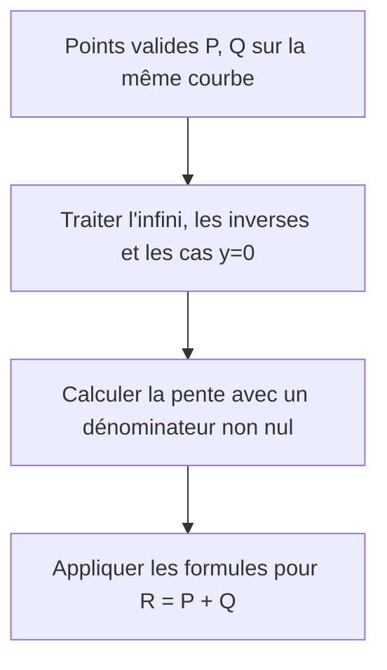
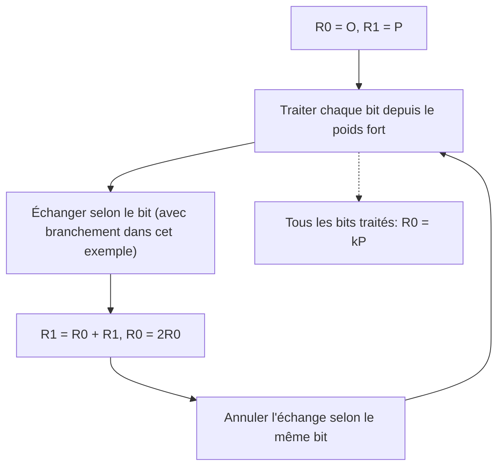
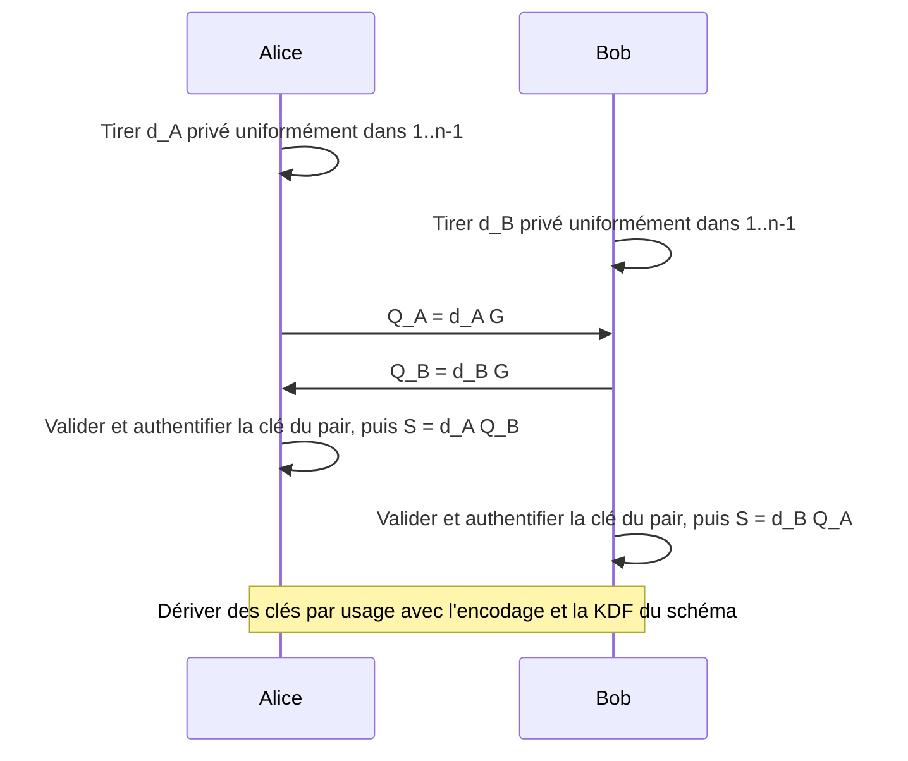

La cryptographie sur les courbes elliptiques (Elliptic Curve Cryptography, ECC) désigne une famille de techniques à clé publique fondées sur des groupes de courbes elliptiques. L'accord de clés ECDH et les signatures comme ECDSA ont des rôles distincts : ECC n'est pas une opération de chiffrement unique offrant toutes les propriétés de sécurité. En complément de la [présentation des clés publiques, du hachage et des signatures](/fr/p/modern-cryptography-public-key-hash-signature/), cet article explique les conditions mathématiques et d'implémentation.

L'exemple C++ est une **démonstration mathématique en temps variable** utilisant les paramètres publics de secp256k1. Il n'implémente ni génération de clés privées, ni accord de clés authentifié, ni signatures, ni cryptographie en temps constant. Nous expliquons aussi pourquoi une structure en échelle ne suffit pas à garantir le temps constant.

## 1. Sécurité et tailles de clé

On choisit un sous-groupe de grand ordre premier $n$, de générateur $G$. Retrouver $d$ à partir de $Q=dG$ est le problème du logarithme discret sur courbe elliptique (ECDLP). Le scalaire est déterminé modulo $n$. Une clé privée est tirée uniformément dans $1\le d<n$ à l'aide d'un générateur aléatoire cryptographiquement sûr. Il faut distinguer la taille du corps $p$, l'ordre du sous-groupe $n$ et la valeur de la clé privée.

Pour un sous-groupe convenable de grand ordre premier, une attaque classique générique comme Pollard rho demande environ $O(\sqrt n)$ opérations de groupe. Cela ne signifie ni que la recherche exhaustive soit la seule attaque, ni que toutes les courbes présentent la même difficulté. Des structures particulières ou de petits sous-groupes permettent d'autres attaques ; les paramètres et le schéma doivent être choisis correctement.

La comparaison suivante reprend les **niveaux maximaux de sécurité estimés face aux ordinateurs classiques** du NIST SP 800-57 Part 1 Rev.5, Table 2. La colonne RSA donne la longueur du module en bits ; la colonne ECC donne la longueur en bits $f$ de l'ordre $n$ du point de base, et non la taille de la clé publique encodée.

| Niveau estimé (bits) | Module RSA (bits) | ECC $f$ (bits) |
| :---: | :---: | :---: |
| Au plus 80 (comparaison historique) | 1024 | 160–223 |
| 112 | 2048 | 224–255 |
| 128 | 3072 | 256–383 |
| 192 | 7680 | 384–511 |
| 256 | 15360 | Au moins 512 |

La ligne à 80 bits n'est pas une recommandation pour un nouveau système. Ce tableau ne certifie ni une courbe, ni une implémentation, ni une durée d'utilisation particulière, et n'offre pas de résistance quantique. Des paramètres plus courts peuvent réduire les coûts de communication, mais ECC n'est pas nécessairement plus rapide que RSA pour chaque opération.

## 2. Groupes et corps finis

Un groupe est constitué d'un ensemble et d'une opération vérifiant la stabilité, l'associativité, l'existence d'un élément neutre et d'un inverse pour chaque élément. S'il vérifie aussi la commutativité, c'est un groupe abélien. Les points d'une courbe elliptique, avec le point à l'infini et la loi d'addition décrite ci-dessous, forment un groupe abélien.

Pour un nombre premier $p$, les éléments du corps premier $\mathbb F_p$ sont représentés par $0,\ldots,p-1$, et l'addition, la soustraction et la multiplication sont réduites modulo $p$. La division $u/v$ est définie comme $uv^{-1}$ **uniquement lorsque $v$ est non nul**.

$$vv^{-1}\equiv1\pmod p$$

Un inverse peut être calculé par l'algorithme d'Euclide étendu, ou comme $v^{p-2}\bmod p$ grâce au petit théorème de Fermat. Choisir cette seconde méthode ne rend pas une implémentation constante en temps. Il faut aussi examiner l'exponentiation, la multiplication, la réduction et l'allocation mémoire.

## 3. La courbe et le point à l'infini

Cet article se limite à la **forme courte de Weierstrass** sur un corps premier avec $p>3$. Cette formule ne couvre pas uniformément les caractéristiques deux ou trois, ni les modèles de Montgomery et d'Edwards.

$$y^2\equiv x^3+ax+b\pmod p$$

Les coefficients sont des éléments du corps, et l'absence de singularités impose la condition suivante dans ce corps :

$$\Delta=-16(4a^3+27b^2)\not\equiv0\pmod p$$

Cette condition seule ne rend pas la courbe adaptée à la cryptographie. Aux points finis satisfaisant l'équation, on ajoute l'élément neutre : le point à l'infini $\mathcal O$.

$$P+\mathcal O=\mathcal O+P=P$$

$$-(x,y)=(x,-y\bmod p),\qquad P+(-P)=\mathcal O$$

Sur les nombres réels, l'image d'une droite coupant la courbe, suivie de la symétrie du point d'intersection, donne une intuition de la loi de groupe. Sur un corps fini, on calcule avec les formules algébriques correspondantes plutôt qu'avec une courbe continue dessinée.

## 4. Addition, doublement et cas exceptionnels

Soient $P=(x_1,y_1)$ et $Q=(x_2,y_2)$. On traite d'abord l'addition avec $\mathcal O$ et le cas $Q=-P$. Ce dernier inclut le doublement lorsque $P=Q$ et $y_1=0$ ; le résultat est $\mathcal O$.

Si $x_1\ne x_2$, on utilise :

$$\lambda\equiv(y_2-y_1)(x_2-x_1)^{-1}\pmod p$$

Si $P=Q$ et $y_1\ne0$, on utilise la formule de la tangente :

$$\lambda\equiv(3x_1^2+a)(2y_1)^{-1}\pmod p$$

Une fois que ces conditions assurent un dénominateur non nul, on calcule le résultat avec les formules communes :

$$x_3\equiv\lambda^2-x_1-x_2\pmod p$$

$$y_3\equiv\lambda(x_1-x_3)-y_1\pmod p$$



Les coordonnées affines nécessitent des inversions. Les implémentations pratiques peuvent en réduire le nombre avec des systèmes comme les coordonnées jacobiennes. Changer de coordonnées ne garantit pas, à lui seul, le temps constant ou la sécurité.

## 5. Multiplication scalaire

Pour $k$ entier non négatif, on définit $kP$ par additions répétées, avec $0P=\mathcal O$. La méthode double-and-add traite les bits du poids fort au poids faible : elle double l'accumulateur puis ajoute $P$ si le bit vaut un. Elle réduit le nombre d'opérations de groupe de $k$ additions naïves à $O(\log k)$. Cela n'affirme ni un coût constant par opération, ni un temps d'exécution absolu.

Le pseudocode conceptuel suivant ne fait pas partie du programme C++ présenté ensuite. Il contient un branchement dépendant de bits secrets.

```text
R = O
for bit in bits_of_k_from_most_significant:
    R = 2R
    if bit == 1:
        R = R + P
```

Une mise à jour de type échelle de Montgomery effectue une addition et un doublement par bit. Si le préfixe traité représente $r$, elle peut conserver $(R_0,R_1)=(rP,(r+1)P)$. L'exemple suivant illustre cet invariant avec des points affines complets ; il n'implémente ni X25519 ni X448 du RFC 7748.



## 6. ECDH : accord et authentification

Les paramètres publics de domaine comprennent la courbe, le corps, le point de base $G$, son ordre $n$ et le cofacteur. Chaque partie génère un scalaire privé approprié et échange des points publics.

$$Q_A=d_AG,\qquad Q_B=d_BG$$

$$S=d_AQ_B=d_BQ_A=(d_Ad_B)G$$



Calculer la valeur partagée à partir des points publics est le problème calculatoire de Diffie–Hellman (CDH), dont la définition diffère de celle d'ECDLP. Résoudre ECDLP permet de calculer la valeur partagée ; on ne suppose pas ici d'équivalence générale dans le sens inverse.

ECDH seul n'authentifie pas le pair et n'empêche pas un attaquant de substituer des clés publiques. Un protocole réel lie les clés, l'échange et les identités, puis applique ses contrôles d'encodage, de plage des coordonnées, d'appartenance à la courbe, d'infini et de sous-groupe. Il ne faut pas utiliser directement le point partagé ou sa coordonnée x comme clé AES : on suit l'encodage, la liaison au contexte et la dérivation de clés, par exemple HKDF, imposés par le protocole. Le diagramme n'est pas une négociation TLS complète.

## 7. Conditions d'une implémentation en temps constant

Les branchements, accès mémoire, cas exceptionnels et durées des opérations arithmétiques dépendant de secrets peuvent divulguer des informations dans un modèle d'observation approprié. Le nombre d'observations et la possibilité de retrouver la clé entière dépendent de l'implémentation et de l'attaque. Rien ne garantit universellement que quelques milliers de mesures révèlent chaque bit.

Un nombre identique d'additions par itération ne garantit pas le temps constant si ces additions se branchent sur des valeurs secrètes intermédiaires. Un échange conditionnel masqué n'est qu'une partie de la défense : la représentation des entiers, le compilateur et le processeur cible comptent aussi. Le RFC 7748 §5.1 explique qu'une séquence identique d'opérations de corps ne suffit pas à empêcher tous les canaux auxiliaires.

`cpp_int` est un type entier de taille variable, et `conditionalSwapDemo` comme l'addition de points ci-dessous contiennent des branchements. **Ce code n'est pas en temps constant et ne doit pas traiter de clés secrètes dans un système cryptographique de production.**

## 8. Démonstration mathématique en C++17

On concatène les cinq blocs C++ suivants, dans l'ordre, dans un seul fichier. Les en-têtes de Boost.Multiprecision sont nécessaires. Le programme utilise seulement des paramètres fixes et des valeurs de test publics ; il ne génère, ne stocke et n'affiche aucune clé secrète.

### 8.1. Arithmétique du corps premier

`modInverse` est spécifique au nombre premier fixe $p$ utilisé ici et rejette zéro. L'inversion de Fermat implémentée avec `powerMod` est également en temps variable.

```cpp
#include <cstdint>
#include <iostream>
#include <stdexcept>
#include <utility>
#include <boost/multiprecision/cpp_int.hpp>

using boost::multiprecision::cpp_int;

// Public secp256k1 parameters; this entire example is variable-time.
const cpp_int p("0xFFFFFFFFFFFFFFFFFFFFFFFFFFFFFFFFFFFFFFFFFFFFFFFFFFFFFFFEFFFFFC2F");
const cpp_int a = 0;
const cpp_int b = 7;
const cpp_int n("0xFFFFFFFFFFFFFFFFFFFFFFFFFFFFFFFEBAAEDCE6AF48A03BBFD25E8CD0364141");

cpp_int mod(cpp_int x, const cpp_int& m) {
    if (m <= 0) throw std::invalid_argument("Modulus must be positive");
    cpp_int r = x % m;
    if (r < 0) r += m;
    return r;
}

cpp_int powerMod(cpp_int base, cpp_int exp, const cpp_int& m) {
    if (m <= 1 || exp < 0) throw std::invalid_argument("Invalid powerMod input");
    cpp_int result = 1;
    base = mod(base, m);
    while (exp > 0) {
        if (exp % 2 == 1) result = mod(result * base, m);
        base = mod(base * base, m);
        exp /= 2;
    }
    return result;
}

// Inversion in the fixed prime field F_p only; zero has no inverse.
cpp_int modInverse(cpp_int value) {
    value = mod(value, p);
    if (value == 0) throw std::invalid_argument("Zero has no inverse");
    return powerMod(value, p - 2, p);
}
```

### 8.2. Points et addition

Un point fini doit avoir des coordonnées $0\le x,y<p$ et satisfaire l'équation de la courbe. L'infini est permis pour l'arithmétique de groupe, mais doit être rejeté séparément comme clé publique ECDH du pair. Le cofacteur de secp256k1 vaut un ; ces contrôles ne remplacent pas la validation de sous-groupe nécessaire pour des courbes arbitraires.

```cpp
struct Point {
    cpp_int x = 0;
    cpp_int y = 0;
    bool isInfinity = true;

    Point() = default;
    Point(cpp_int xValue, cpp_int yValue)
        : x(std::move(xValue)), y(std::move(yValue)), isInfinity(false) {}
};

bool isOnCurve(const Point& point) {
    if (point.isInfinity) return true;
    if (point.x < 0 || point.x >= p || point.y < 0 || point.y >= p) return false;
    return mod(point.y * point.y - point.x * point.x * point.x - a * point.x - b, p) == 0;
}

Point pointAdd(const Point& P, const Point& Q) {
    if (!isOnCurve(P) || !isOnCurve(Q)) throw std::invalid_argument("Invalid curve point");
    if (P.isInfinity) return Q;
    if (Q.isInfinity) return P;
    if (P.x == Q.x && mod(P.y + Q.y, p) == 0) return Point();

    cpp_int slope;
    if (P.x == Q.x && P.y == Q.y) {
        slope = mod((3 * P.x * P.x + a) * modInverse(2 * P.y), p);
    } else {
        slope = mod((Q.y - P.y) * modInverse(Q.x - P.x), p);
    }
    cpp_int x3 = mod(slope * slope - P.x - Q.x, p);
    cpp_int y3 = mod(slope * (P.x - x3) - P.y, p);
    return Point(x3, y3);
}
```

### 8.3. Simulation d'un échange

Cette fonction contient un branchement, d'où Demo dans son nom.

```cpp
// A branching simulation of conditional swap, NOT constant-time.
void conditionalSwapDemo(Point& left, Point& right, std::uint8_t bit) {
    if (bit > 1) throw std::invalid_argument("Bit must be zero or one");
    if (bit == 1) std::swap(left, right);
}
```

### 8.4. Une échelle avec contrôle de plage

La démonstration accepte $0\le k<2^{256}$ et rejette les valeurs hors de cet intervalle. Celui-ci diffère de la plage des clés privées $1\le d<n$. Aucun bit de poids fort n'est tronqué silencieusement.

```cpp
// A functional ladder demonstration for 0 <= k < 2^256.
// Zero is allowed for group arithmetic, but is not a valid private key.
Point scalarMultiply(const Point& P, const cpp_int& k) {
    if (k < 0 || k >= (cpp_int(1) << 256)) throw std::invalid_argument("Scalar outside demo range");
    if (!isOnCurve(P)) throw std::invalid_argument("Invalid curve point");
    Point R0;
    Point R1 = P;
    for (int i = 255; i >= 0; --i) {
        std::uint8_t bit = boost::multiprecision::bit_test(k, i) ? 1 : 0;
        conditionalSwapDemo(R0, R1, bit);
        R1 = pointAdd(R0, R1);
        R0 = pointAdd(R0, R0);
        conditionalSwapDemo(R0, R1, bit);
    }
    return R0;
}
```

### 8.5. Vérification avec des valeurs publiques

On utilise le générateur secp256k1 de SEC 2 pour vérifier $2G$ et $nG=\mathcal O$. Ce seul autotest ne prouve pas la sécurité d'une implémentation cryptographique.

```cpp
int main() {
    const Point G(
        cpp_int("0x79BE667EF9DCBBAC55A06295CE870B07029BFCDB2DCE28D959F2815B16F81798"),
        cpp_int("0x483ADA7726A3C4655DA4FBFC0E1108A8FD17B448A68554199C47D08FFB10D4B8")
    );
    const Point doubled = scalarMultiply(G, 2);
    if (doubled.isInfinity || !isOnCurve(doubled) || !scalarMultiply(G, n).isInfinity) {
        throw std::runtime_error("Arithmetic self-check failed");
    }
    std::cout << "2G.x = " << std::hex << doubled.x << "\n";
    std::cout << "2G.y = " << std::hex << doubled.y << "\n";
    std::cout << "nG = infinity\n";
}
```

Par exemple, on enregistre les cinq blocs dans `ecc_demo.cpp`, puis on les exécute dans un environnement où le chemin d'inclusion de Boost est configuré :

```sh
g++ -std=c++17 -O2 -Wall -Wextra ecc_demo.cpp -o ecc_demo
./ecc_demo
```

## 9. Conclusion

Il faut distinguer le corps, la courbe, le sous-groupe et le schéma cryptographique. Les cas exceptionnels d'addition, les plages des scalaires, la validation des clés publiques, l'authentification du pair et la dérivation de clés sont tous importants. La correction arithmétique de l'échelle et son implémentation en temps constant sont des vérifications distinctes.

Cette démonstration sert à suivre l'arithmétique de groupe. L'accord de clés et les signatures réels nécessitent des bibliothèques maintenues et validées qui prennent en charge le protocole et la courbe visés.

### Références

- [RFC 6090: Fundamental Elliptic Curve Cryptography Algorithms](https://www.rfc-editor.org/rfc/rfc6090.html) (§§2–4, 10)
- [RFC 7748: Elliptic Curves for Security](https://www.rfc-editor.org/rfc/rfc7748.html) (§§5–5.1)
- [NIST SP 800-57 Part 1 Rev.5](https://nvlpubs.nist.gov/nistpubs/SpecialPublications/NIST.SP.800-57pt1r5.pdf) (§5.6.1.1, Table 2)
- [Standards for Efficient Cryptography 2 (SEC 2), version 2.0](https://www.secg.org/sec2-v2.pdf) (§2.4.1, secp256k1)
- [RFC 5869: HKDF](https://www.rfc-editor.org/rfc/rfc5869.html) (§§1, 3.2–3.3)
- [Boost.Multiprecision: cpp_int](https://www.boost.org/doc/libs/1_83_0/libs/multiprecision/doc/html/boost_multiprecision/tut/ints/cpp_int.html)


