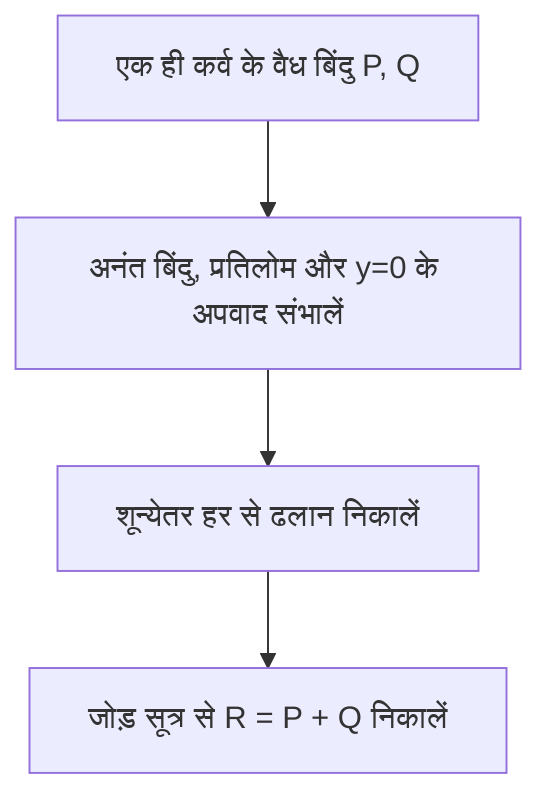
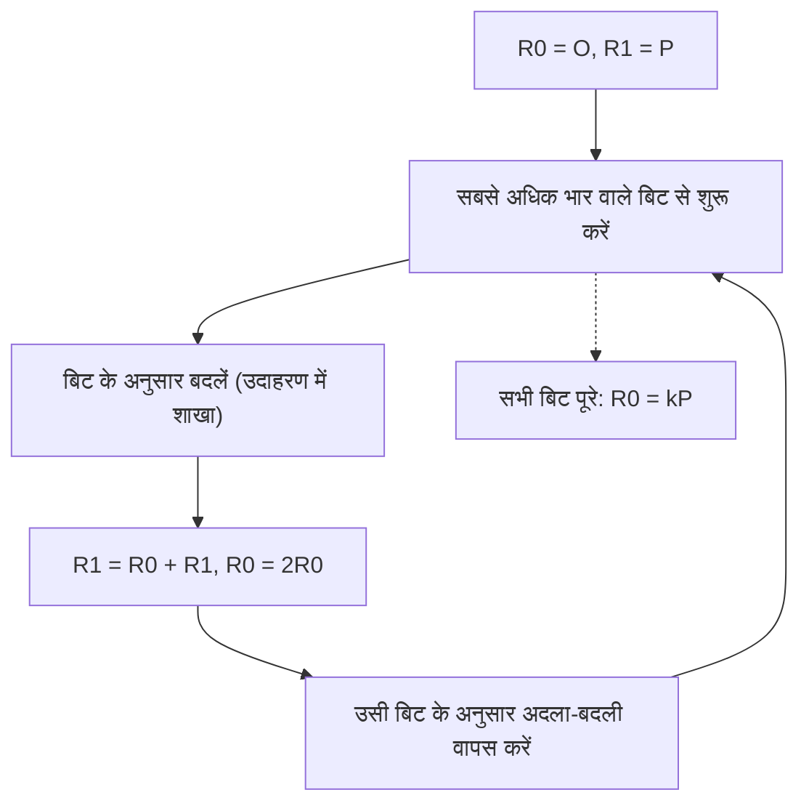
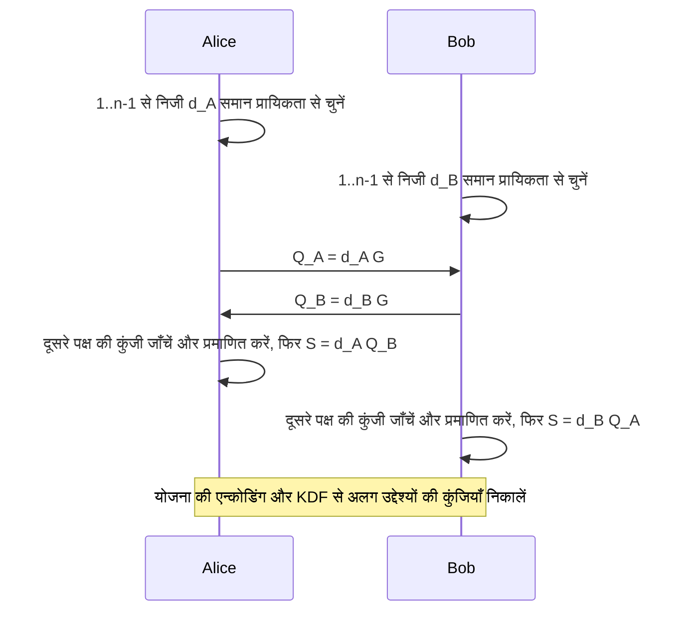

एलिप्टिक कर्व क्रिप्टोग्राफी (Elliptic Curve Cryptography, ECC) एलिप्टिक कर्व समूहों पर आधारित सार्वजनिक-कुंजी तकनीकों का परिवार है। ECDH कुंजी सहमति (key agreement) और ECDSA जैसे हस्ताक्षरों की भूमिकाएँ अलग हैं। ECC सभी सुरक्षा गुण देने वाली एक ही एन्क्रिप्शन संक्रिया नहीं है। [सार्वजनिक कुंजी, हैश और हस्ताक्षर के परिचय](/hi/p/modern-cryptography-public-key-hash-signature/) के साथ यह लेख गणित और कार्यान्वयन की शर्तें समझाता है।

C++ उदाहरण secp256k1 के सार्वजनिक पैरामीटरों वाला **परिवर्ती-समय का गणितीय शिक्षण उदाहरण** है। यह निजी कुंजी निर्माण, प्रमाणीकृत कुंजी सहमति, हस्ताक्षर या स्थिर-समय क्रिप्टोग्राफी लागू नहीं करता। केवल लैडर संरचना से स्थिर समय की गारंटी क्यों नहीं मिलती, यह भी समझाया गया है।

## 1. सुरक्षा और कुंजी का आकार

बड़ी अभाज्य कोटि $n$ वाला उपसमूह और उसका जनक $G$ चुनते हैं। $Q=dG$ से $d$ खोजना एलिप्टिक कर्व असतत लघुगणक समस्या (ECDLP) है। अदिश का मान मॉड्यूलो $n$ निर्धारित होता है। निजी कुंजी को क्रिप्टोग्राफ़िक रूप से सुरक्षित यादृच्छिक जनरेटर से $1\le d<n$ में समान प्रायिकता से चुनते हैं। क्षेत्र का आकार $p$, उपसमूह की कोटि $n$ और निजी कुंजी का मान अलग हैं।

उचित बड़ी अभाज्य कोटि वाले उपसमूह पर Pollard rho जैसे सामान्य शास्त्रीय हमले में लगभग $O(\sqrt n)$ समूह संक्रियाएँ लगती हैं। इसका अर्थ यह नहीं कि केवल संपूर्ण खोज संभव है या हर एलिप्टिक कर्व की कठिनाई समान है। विशेष संरचनाओं और छोटे उपसमूहों पर दूसरे हमले संभव हैं; पैरामीटर और योजना उचित होने चाहिए।

निम्न तुलना NIST SP 800-57 Part 1 Rev.5 की Table 2 के **शास्त्रीय कंप्यूटरों के विरुद्ध अनुमानित अधिकतम सुरक्षा स्तर** दिखाती है। RSA स्तंभ मॉड्यूलस की बिट लंबाई है। ECC स्तंभ आधार बिंदु की कोटि $n$ की बिट लंबाई $f$ है, एन्कोड की गई सार्वजनिक कुंजी का आकार नहीं।

| अनुमानित स्तर (बिट) | RSA मॉड्यूलस (बिट) | ECC का $f$ (बिट) |
| :---: | :---: | :---: |
| अधिकतम 80 (ऐतिहासिक तुलना) | 1024 | 160–223 |
| 112 | 2048 | 224–255 |
| 128 | 3072 | 256–383 |
| 192 | 7680 | 384–511 |
| 256 | 15360 | कम-से-कम 512 |

80-बिट पंक्ति नए सिस्टम के लिए सुझाव नहीं है। तालिका किसी विशेष कर्व, कार्यान्वयन या उपयोग-अवधि को प्रमाणित नहीं करती और क्वांटम प्रतिरोध नहीं देती। छोटे पैरामीटर संचार लागत घटा सकते हैं, लेकिन हर संक्रिया में ECC का RSA से तेज होना आवश्यक नहीं है।

## 2. समूह और परिमित क्षेत्र

समूह एक समुच्चय और संक्रिया से बनता है, जिसमें संवृतता, साहचर्य, तत्समक और हर अवयव का प्रतिलोम होता है। क्रमविनिमेयता भी होने पर वह एबेलियन समूह है। एलिप्टिक कर्व के बिंदु, अनंत बिंदु और नीचे दिए जोड़ नियम के साथ एबेलियन समूह बनाते हैं।

अभाज्य $p$ के लिए अभाज्य क्षेत्र $\mathbb F_p$ के अवयव $0,\ldots,p-1$ से दर्शाते हैं। जोड़, घटाव और गुणा मॉड्यूलो $p$ करते हैं। भाग $u/v$ को $uv^{-1}$ **केवल तब परिभाषित करते हैं जब $v$ शून्य न हो**।

$$vv^{-1}\equiv1\pmod p$$

प्रतिलोम विस्तारित यूक्लिड एल्गोरिदम से या फ़र्मेट के छोटे प्रमेय के अनुसार $v^{p-2}\bmod p$ से निकाल सकते हैं। दूसरा तरीका चुनने से कार्यान्वयन अपने-आप स्थिर-समय नहीं हो जाता। घात, गुणा, मॉड्यूलर रिडक्शन और मेमोरी आवंटन भी जाँचने होते हैं।

## 3. कर्व और अनंत बिंदु

यह लेख अभाज्य $p>3$ वाले क्षेत्र पर **संक्षिप्त Weierstrass रूप** तक सीमित है। यह सूत्र characteristic 2 या 3 वाले क्षेत्रों तथा Montgomery और Edwards रूपों को एक ही तरह से नहीं समेटता।

$$y^2\equiv x^3+ax+b\pmod p$$

गुणांक क्षेत्र के अवयव हैं। कर्व में singularity न होने (nonsingularity) के लिए उसी क्षेत्र में यह शर्त चाहिए:

$$\Delta=-16(4a^3+27b^2)\not\equiv0\pmod p$$

अकेली यह शर्त कर्व को क्रिप्टोग्राफी के लिए उपयुक्त नहीं बनाती। समीकरण पूरा करने वाले परिमित बिंदुओं के साथ तत्समक, यानी अनंत बिंदु $\mathcal O$, जोड़ते हैं।

$$P+\mathcal O=\mathcal O+P=P$$

$$-(x,y)=(x,-y\bmod p),\qquad P+(-P)=\mathcal O$$

वास्तविक संख्याओं के चित्र में रेखा और कर्व का प्रतिच्छेदन लेकर बिंदु को प्रतिबिंबित करना समूह नियम की सहज समझ देता है। परिमित क्षेत्र में सतत खींचे गए कर्व के बजाय संबंधित बीजगणितीय सूत्रों से गणना करते हैं।

## 4. जोड़, दोहरीकरण और अपवाद

मान लें $P=(x_1,y_1)$ और $Q=(x_2,y_2)$। पहले $\mathcal O$ से जोड़ और $Q=-P$ का मामला संभालते हैं। दूसरे मामले में $P=Q$ तथा $y_1=0$ का दोहरीकरण भी आता है; परिणाम $\mathcal O$ होता है।

$x_1\ne x_2$ पर यह सूत्र लेते हैं:

$$\lambda\equiv(y_2-y_1)(x_2-x_1)^{-1}\pmod p$$

$P=Q$ और $y_1\ne0$ पर स्पर्शरेखा का सूत्र लेते हैं:

$$\lambda\equiv(3x_1^2+a)(2y_1)^{-1}\pmod p$$

इन शर्तों से हर (denominator) के शून्य न होने की पुष्टि के बाद साझा सूत्रों से परिणाम निकालते हैं:

$$x_3\equiv\lambda^2-x_1-x_2\pmod p$$

$$y_3\equiv\lambda(x_1-x_3)-y_1\pmod p$$



एफाइन निर्देशांकों में प्रतिलोम गणना चाहिए। व्यावहारिक कार्यान्वयन Jacobian निर्देशांक जैसी प्रणालियों से उसकी संख्या घटा सकते हैं। केवल निर्देशांक बदलना स्थिर समय या सुरक्षा की गारंटी नहीं है।

## 5. अदिश गुणन

गैर-ऋणात्मक पूर्णांक $k$ के लिए बार-बार जोड़ से $kP$ परिभाषित करते हैं और $0P=\mathcal O$ रखते हैं। Double-and-add सबसे अधिक भार वाले बिट से सबसे कम भार वाले बिट तक चलता है: संचित परिणाम दोगुना करता है और बिट 1 हो तो $P$ जोड़ता है। समूह संक्रियाओं की संख्या सीधे $k$ जोड़ से घटकर $O(\log k)$ होती है। यह प्रति संक्रिया स्थिर लागत या किसी निश्चित वास्तविक समय का दावा नहीं है।

निम्न वैचारिक छद्मकोड बाद के C++ प्रोग्राम का हिस्सा नहीं है। इसमें गुप्त बिट पर निर्भर शाखा है।

```text
R = O
for bit in bits_of_k_from_most_significant:
    R = 2R
    if bit == 1:
        R = R + P
```

Montgomery लैडर जैसा अद्यतन प्रति बिट एक जोड़ और एक दोहरीकरण करता है। संसाधित बिट-उपसर्ग का मान $r$ हो तो $(R_0,R_1)=(rP,(r+1)P)$ बनाए रख सकता है। आगे का उदाहरण पूरे एफाइन बिंदुओं से यह अपरिवर्तनीय संबंध दिखाता है; यह RFC 7748 के X25519 या X448 का कार्यान्वयन नहीं है।



## 6. ECDH: सहमति और प्रमाणीकरण

सार्वजनिक डोमेन पैरामीटरों में कर्व, क्षेत्र, आधार बिंदु $G$, उसकी कोटि $n$ और सहगुणक (cofactor) शामिल हैं। दोनों पक्ष उचित निजी अदिश बनाते हैं और सार्वजनिक बिंदुओं का आदान-प्रदान करते हैं।

$$Q_A=d_AG,\qquad Q_B=d_BG$$

$$S=d_AQ_B=d_BQ_A=(d_Ad_B)G$$



सार्वजनिक बिंदुओं से साझा मान निकालना गणनात्मक Diffie–Hellman समस्या (CDH) है, जिसकी परिभाषा ECDLP से अलग है। ECDLP हल करने पर साझा मान निकाल सकते हैं; यहाँ उल्टी दिशा में सामान्य समतुल्यता नहीं मानते।

ECDH अकेले दूसरे पक्ष को प्रमाणित नहीं करता और हमलावर को सार्वजनिक कुंजियाँ बदलने से नहीं रोकता। वास्तविक प्रोटोकॉल कुंजी, वर्तमान आदान-प्रदान और पहचान को बाँधता है। वह योजना के अनुसार एन्कोडिंग, निर्देशांक सीमा, कर्व की सदस्यता, अनंत बिंदु और आवश्यक उपसमूह शर्तें जाँचता है। साझा बिंदु या उसके x-निर्देशांक को सीधे AES कुंजी न बनाएँ। प्रोटोकॉल की एन्कोडिंग, संदर्भ-बंधन और HKDF जैसी कुंजी-व्युत्पत्ति विधि अपनाएँ। यह चित्र पूरा TLS हैंडशेक नहीं है।

## 7. स्थिर-समय कार्यान्वयन की शर्तें

गुप्त मानों पर निर्भर शाखाएँ, मेमोरी पहुँच, अपवाद और अंकगणितीय समय उपयुक्त निरीक्षण मॉडल में सूचना लीक कर सकते हैं। निरीक्षण की संख्या और पूरी कुंजी मिल पाने की संभावना कार्यान्वयन तथा हमले पर निर्भर है। कुछ हज़ार मापों से हर बिट मिलने की सार्वभौमिक गारंटी नहीं है।

हर पुनरावृत्ति में जोड़ की संख्या समान होने से स्थिर समय सुनिश्चित नहीं होता, यदि जोड़ के भीतर गुप्त मध्यवर्ती मानों के अनुसार शाखा हो। मास्क वाला सशर्त स्वैप केवल बचाव का एक भाग है। पूर्णांक निरूपण, कंपाइलर और लक्षित CPU भी महत्त्वपूर्ण हैं। RFC 7748 §5.1 बताता है कि क्षेत्र संक्रियाओं का समान क्रम अकेले सभी साइड-चैनल नहीं रोकता।

`cpp_int` परिवर्ती लंबाई का पूर्णांक प्रकार है। नीचे `conditionalSwapDemo` और बिंदु जोड़ दोनों में शाखाएँ हैं। **यह कोड स्थिर-समय नहीं है और वास्तविक क्रिप्टोग्राफ़िक सिस्टम में गुप्त कुंजियों को संसाधित करने के लिए इस्तेमाल नहीं करना चाहिए।**

## 8. C++17 का गणितीय शिक्षण उदाहरण

नीचे के पाँच C++ ब्लॉक क्रम से एक फ़ाइल में जोड़ें। Boost.Multiprecision हेडर चाहिए। प्रोग्राम केवल सार्वजनिक स्थिर पैरामीटर और परीक्षण मान लेता है; गुप्त कुंजी बनाता, सहेजता या छापता नहीं है।

### 8.1. अभाज्य क्षेत्र का अंकगणित

`modInverse` यहाँ के स्थिर अभाज्य $p$ के लिए है और शून्य अस्वीकार करता है। `powerMod` से फ़र्मेट प्रतिलोम की गणना भी परिवर्ती-समय है।

```cpp
#include <cstdint>
#include <iostream>
#include <stdexcept>
#include <utility>
#include <boost/multiprecision/cpp_int.hpp>

using boost::multiprecision::cpp_int;

// Public secp256k1 parameters; this entire example is variable-time.
const cpp_int p("0xFFFFFFFFFFFFFFFFFFFFFFFFFFFFFFFFFFFFFFFFFFFFFFFFFFFFFFFEFFFFFC2F");
const cpp_int a = 0;
const cpp_int b = 7;
const cpp_int n("0xFFFFFFFFFFFFFFFFFFFFFFFFFFFFFFFEBAAEDCE6AF48A03BBFD25E8CD0364141");

cpp_int mod(cpp_int x, const cpp_int& m) {
    if (m <= 0) throw std::invalid_argument("Modulus must be positive");
    cpp_int r = x % m;
    if (r < 0) r += m;
    return r;
}

cpp_int powerMod(cpp_int base, cpp_int exp, const cpp_int& m) {
    if (m <= 1 || exp < 0) throw std::invalid_argument("Invalid powerMod input");
    cpp_int result = 1;
    base = mod(base, m);
    while (exp > 0) {
        if (exp % 2 == 1) result = mod(result * base, m);
        base = mod(base * base, m);
        exp /= 2;
    }
    return result;
}

// Inversion in the fixed prime field F_p only; zero has no inverse.
cpp_int modInverse(cpp_int value) {
    value = mod(value, p);
    if (value == 0) throw std::invalid_argument("Zero has no inverse");
    return powerMod(value, p - 2, p);
}
```

### 8.2. बिंदु और जोड़

परिमित बिंदु के निर्देशांक $0\le x,y<p$ होने चाहिए और उसे कर्व समीकरण पूरा करना चाहिए। समूह अंकगणित में अनंत बिंदु स्वीकार्य है, लेकिन ECDH के दूसरे पक्ष की सार्वजनिक कुंजी के रूप में उसे अलग से अस्वीकार करना चाहिए। secp256k1 का सहगुणक 1 है। ये जाँचें किसी भी कर्व के लिए आवश्यक उपसमूह सत्यापन का विकल्प नहीं हैं।

```cpp
struct Point {
    cpp_int x = 0;
    cpp_int y = 0;
    bool isInfinity = true;

    Point() = default;
    Point(cpp_int xValue, cpp_int yValue)
        : x(std::move(xValue)), y(std::move(yValue)), isInfinity(false) {}
};

bool isOnCurve(const Point& point) {
    if (point.isInfinity) return true;
    if (point.x < 0 || point.x >= p || point.y < 0 || point.y >= p) return false;
    return mod(point.y * point.y - point.x * point.x * point.x - a * point.x - b, p) == 0;
}

Point pointAdd(const Point& P, const Point& Q) {
    if (!isOnCurve(P) || !isOnCurve(Q)) throw std::invalid_argument("Invalid curve point");
    if (P.isInfinity) return Q;
    if (Q.isInfinity) return P;
    if (P.x == Q.x && mod(P.y + Q.y, p) == 0) return Point();

    cpp_int slope;
    if (P.x == Q.x && P.y == Q.y) {
        slope = mod((3 * P.x * P.x + a) * modInverse(2 * P.y), p);
    } else {
        slope = mod((Q.y - P.y) * modInverse(Q.x - P.x), p);
    }
    cpp_int x3 = mod(slope * slope - P.x - Q.x, p);
    cpp_int y3 = mod(slope * (P.x - x3) - P.y, p);
    return Point(x3, y3);
}
```

### 8.3. अदला-बदली का अनुकरण

इस फ़ंक्शन में शाखा है, इसलिए नाम में Demo जोड़ा गया है।

```cpp
// A branching simulation of conditional swap, NOT constant-time.
void conditionalSwapDemo(Point& left, Point& right, std::uint8_t bit) {
    if (bit > 1) throw std::invalid_argument("Bit must be zero or one");
    if (bit == 1) std::swap(left, right);
}
```

### 8.4. सीमा जाँच वाली लैडर

उदाहरण $0\le k<2^{256}$ स्वीकार करता है और सीमा से बाहर मान अस्वीकार करता है। यह निजी कुंजी की सीमा $1\le d<n$ से अलग है। ऊँचे बिट चुपचाप नहीं काटे जाते।

```cpp
// A functional ladder demonstration for 0 <= k < 2^256.
// Zero is allowed for group arithmetic, but is not a valid private key.
Point scalarMultiply(const Point& P, const cpp_int& k) {
    if (k < 0 || k >= (cpp_int(1) << 256)) throw std::invalid_argument("Scalar outside demo range");
    if (!isOnCurve(P)) throw std::invalid_argument("Invalid curve point");
    Point R0;
    Point R1 = P;
    for (int i = 255; i >= 0; --i) {
        std::uint8_t bit = boost::multiprecision::bit_test(k, i) ? 1 : 0;
        conditionalSwapDemo(R0, R1, bit);
        R1 = pointAdd(R0, R1);
        R0 = pointAdd(R0, R0);
        conditionalSwapDemo(R0, R1, bit);
    }
    return R0;
}
```

### 8.5. सार्वजनिक मानों से जाँच

SEC 2 के secp256k1 जनक से $2G$ और $nG=\mathcal O$ जाँचते हैं। केवल यह आत्म-परीक्षण क्रिप्टोग्राफ़िक कार्यान्वयन की सुरक्षा सिद्ध नहीं करता।

```cpp
int main() {
    const Point G(
        cpp_int("0x79BE667EF9DCBBAC55A06295CE870B07029BFCDB2DCE28D959F2815B16F81798"),
        cpp_int("0x483ADA7726A3C4655DA4FBFC0E1108A8FD17B448A68554199C47D08FFB10D4B8")
    );
    const Point doubled = scalarMultiply(G, 2);
    if (doubled.isInfinity || !isOnCurve(doubled) || !scalarMultiply(G, n).isInfinity) {
        throw std::runtime_error("Arithmetic self-check failed");
    }
    std::cout << "2G.x = " << std::hex << doubled.x << "\n";
    std::cout << "2G.y = " << std::hex << doubled.y << "\n";
    std::cout << "nG = infinity\n";
}
```

उदाहरण के लिए, पाँच ब्लॉक `ecc_demo.cpp` में सहेजें और Boost का include पथ निर्धारित वातावरण में चलाएँ:

```sh
g++ -std=c++17 -O2 -Wall -Wextra ecc_demo.cpp -o ecc_demo
./ecc_demo
```

## 9. निष्कर्ष

क्षेत्र, कर्व, उपसमूह और क्रिप्टोग्राफ़िक योजना अलग हैं। जोड़ के अपवाद, अदिश सीमा, सार्वजनिक कुंजी सत्यापन, दूसरे पक्ष का प्रमाणीकरण और कुंजी व्युत्पत्ति सभी महत्त्वपूर्ण हैं। लैडर की गणितीय शुद्धता और स्थिर-समय कार्यान्वयन अलग जाँच-विषय हैं।

यह उदाहरण समूह अंकगणित समझने के लिए है। वास्तविक कुंजी सहमति और हस्ताक्षरों के लिए ऐसी अनुरक्षित और सत्यापित लाइब्रेरी चाहिए जो लक्षित प्रोटोकॉल तथा कर्व का समर्थन करे।

### संदर्भ

- [RFC 6090: Fundamental Elliptic Curve Cryptography Algorithms](https://www.rfc-editor.org/rfc/rfc6090.html) (§§2–4, 10)
- [RFC 7748: Elliptic Curves for Security](https://www.rfc-editor.org/rfc/rfc7748.html) (§§5–5.1)
- [NIST SP 800-57 Part 1 Rev.5](https://nvlpubs.nist.gov/nistpubs/SpecialPublications/NIST.SP.800-57pt1r5.pdf) (§5.6.1.1, Table 2)
- [Standards for Efficient Cryptography 2 (SEC 2), version 2.0](https://www.secg.org/sec2-v2.pdf) (§2.4.1, secp256k1)
- [RFC 5869: HKDF](https://www.rfc-editor.org/rfc/rfc5869.html) (§§1, 3.2–3.3)
- [Boost.Multiprecision: cpp_int](https://www.boost.org/doc/libs/1_83_0/libs/multiprecision/doc/html/boost_multiprecision/tut/ints/cpp_int.html)


