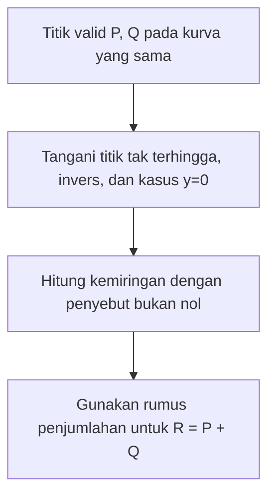
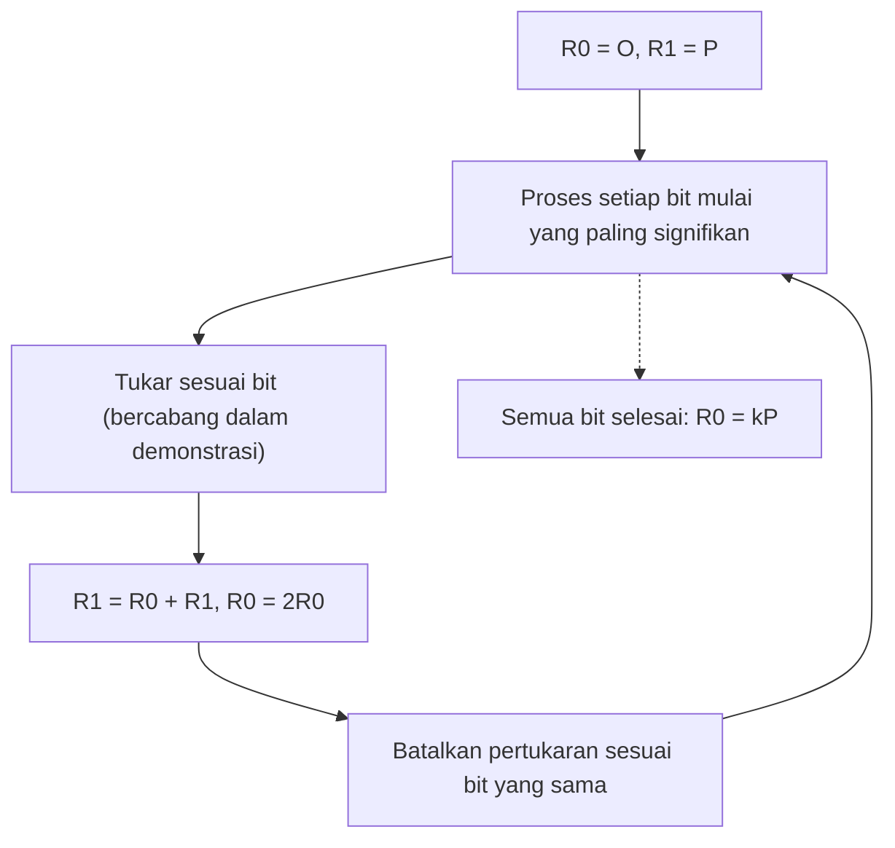
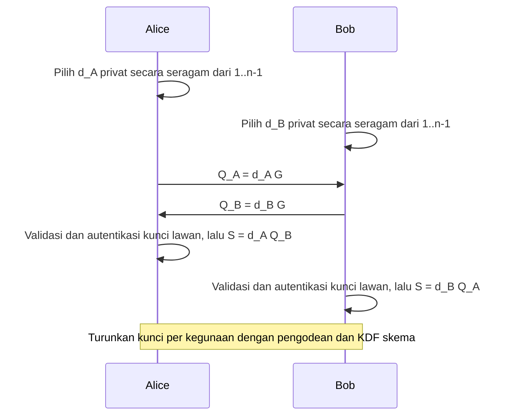

Kriptografi kurva eliptik (Elliptic Curve Cryptography, ECC) adalah keluarga teknik kunci publik yang menggunakan grup kurva eliptik. Kesepakatan kunci ECDH dan tanda tangan seperti ECDSA mempunyai peran berbeda; ECC bukan satu operasi enkripsi yang menyediakan semua sifat keamanan. Bersama [ikhtisar kunci publik, hash, dan tanda tangan](/id/p/modern-cryptography-public-key-hash-signature/), artikel ini menjelaskan syarat matematika dan implementasinya.

Contoh C++ ini merupakan **demonstrasi matematika dengan waktu eksekusi variabel**, menggunakan parameter publik secp256k1. Contoh ini tidak mengimplementasikan pembangkitan kunci privat, kesepakatan kunci terautentikasi, tanda tangan, atau kriptografi waktu konstan. Struktur tangga saja juga belum menjamin waktu konstan.

## 1. Keamanan dan ukuran kunci

Pilih subgrup berorde prima besar $n$ dengan generator $G$. Mencari $d$ dari $Q=dG$ adalah masalah logaritma diskret kurva eliptik (ECDLP). Skalar ditentukan modulo $n$. Kunci privat dipilih secara seragam dari $1\le d<n$ dengan pembangkit bilangan acak yang aman secara kriptografis. Ukuran lapangan $p$, orde subgrup $n$, dan nilai kunci privat harus dibedakan.

Untuk subgrup berorde prima besar yang sesuai, serangan klasik generik seperti Pollard rho membutuhkan kira-kira $O(\sqrt n)$ operasi grup. Ini tidak berarti pencarian menyeluruh adalah satu-satunya serangan, atau semua kurva eliptik sama sulitnya. Struktur khusus dan subgrup kecil memungkinkan serangan lain, sehingga parameter dan skema harus dipilih dengan tepat.

Perbandingan berikut mengikuti **perkiraan kekuatan keamanan maksimum terhadap komputer klasik** pada NIST SP 800-57 Part 1 Rev.5, Table 2. Kolom RSA menyatakan panjang bit modulus; kolom ECC menyatakan panjang bit $f$ dari orde titik basis $n$, bukan ukuran kunci publik yang telah dikodekan.

| Perkiraan kekuatan (bit) | Modulus RSA (bit) | ECC $f$ (bit) |
| :---: | :---: | :---: |
| Paling banyak 80 (perbandingan historis) | 1024 | 160–223 |
| 112 | 2048 | 224–255 |
| 128 | 3072 | 256–383 |
| 192 | 7680 | 384–511 |
| 256 | 15360 | Setidaknya 512 |

Baris 80 bit bukan rekomendasi untuk sistem baru. Tabel ini tidak mengesahkan kurva, implementasi, atau masa penggunaan tertentu, dan tidak memberikan ketahanan kuantum. Parameter yang lebih pendek dapat mengurangi biaya komunikasi, tetapi ECC tidak selalu lebih cepat daripada RSA untuk setiap operasi.

## 2. Grup dan lapangan berhingga

Grup terdiri atas himpunan dan operasi yang memenuhi sifat tertutup, asosiativitas, keberadaan identitas, dan invers bagi setiap elemen. Jika juga komutatif, grup tersebut disebut grup abelian. Titik-titik kurva eliptik, termasuk titik di tak terhingga dengan aturan penjumlahan di bawah, membentuk grup abelian.

Untuk bilangan prima $p$, elemen lapangan prima $\mathbb F_p$ direpresentasikan oleh $0,\ldots,p-1$, dan penjumlahan, pengurangan, serta perkalian direduksi modulo $p$. Pembagian $u/v$ didefinisikan sebagai $uv^{-1}$ **hanya jika $v$ bukan nol**.

$$vv^{-1}\equiv1\pmod p$$

Invers dapat dihitung dengan algoritma Euclid diperluas atau sebagai $v^{p-2}\bmod p$ menurut teorema kecil Fermat. Memilih cara kedua tidak otomatis menghasilkan implementasi waktu konstan. Pemangkatan, perkalian, reduksi, dan alokasi memori juga harus diperiksa.

## 3. Kurva dan titik di tak terhingga

Artikel ini dibatasi pada **bentuk pendek Weierstrass** di atas lapangan prima dengan $p>3$. Rumus ini tidak mencakup secara seragam karakteristik dua atau tiga maupun model Montgomery dan Edwards.

$$y^2\equiv x^3+ax+b\pmod p$$

Koefisien merupakan elemen lapangan, dan syarat nonsingularitas di dalam lapangan itu adalah:

$$\Delta=-16(4a^3+27b^2)\not\equiv0\pmod p$$

Syarat tersebut saja belum menjadikan kurva cocok untuk kriptografi. Pada titik-titik berhingga yang memenuhi persamaan, tambahkan elemen identitas: titik di tak terhingga $\mathcal O$.

$$P+\mathcal O=\mathcal O+P=P$$

$$-(x,y)=(x,-y\bmod p),\qquad P+(-P)=\mathcal O$$

Gambaran pada bilangan real berupa garis yang memotong kurva, lalu pencerminan titik potongnya, memberikan intuisi tentang hukum grup. Di lapangan berhingga kita menghitung dengan rumus aljabar yang sesuai, bukan kurva kontinu yang digambar.

## 4. Penjumlahan, penggandaan, dan kasus khusus

Misalkan $P=(x_1,y_1)$ dan $Q=(x_2,y_2)$. Pertama tangani penjumlahan dengan $\mathcal O$ dan kasus $Q=-P$. Kasus kedua juga mencakup penggandaan saat $P=Q$ dan $y_1=0$; hasilnya adalah $\mathcal O$.

Jika $x_1\ne x_2$, gunakan:

$$\lambda\equiv(y_2-y_1)(x_2-x_1)^{-1}\pmod p$$

Jika $P=Q$ dan $y_1\ne0$, gunakan rumus garis singgung:

$$\lambda\equiv(3x_1^2+a)(2y_1)^{-1}\pmod p$$

Setelah kondisi ini memastikan penyebut bukan nol, hitung hasilnya dengan rumus yang sama:

$$x_3\equiv\lambda^2-x_1-x_2\pmod p$$

$$y_3\equiv\lambda(x_1-x_3)-y_1\pmod p$$



Koordinat afin membutuhkan inversi. Implementasi praktis dapat mengurangi jumlahnya dengan sistem seperti koordinat Jacobian. Mengganti koordinat saja tidak menjamin waktu konstan atau keamanan.

## 5. Perkalian skalar

Untuk bilangan bulat $k$ nonnegatif, definisikan $kP$ melalui penjumlahan berulang, dengan $0P=\mathcal O$. Double-and-add memproses bit dari yang paling signifikan: gandakan akumulator dan tambahkan $P$ jika bit bernilai satu. Jumlah operasi grup turun dari $k$ penjumlahan langsung menjadi $O(\log k)$. Ini tidak menyatakan biaya tetap per operasi atau waktu eksekusi absolut.

Pseudokode konseptual berikut bukan bagian dari program C++ setelahnya. Pseudokode ini bercabang berdasarkan bit rahasia.

```text
R = O
for bit in bits_of_k_from_most_significant:
    R = 2R
    if bit == 1:
        R = R + P
```

Pembaruan bergaya tangga Montgomery melakukan satu penjumlahan dan satu penggandaan per bit. Jika prefiks yang sudah diproses menyatakan $r$, pembaruan dapat mempertahankan $(R_0,R_1)=(rP,(r+1)P)$. Contoh berikut mendemonstrasikan invarian ini dengan titik afin lengkap; bukan implementasi X25519 atau X448 dari RFC 7748.



## 6. ECDH: kesepakatan dan autentikasi

Parameter domain publik mencakup kurva, lapangan, titik basis $G$, ordenya $n$, dan kofaktor. Setiap pihak menghasilkan skalar privat yang sesuai dan bertukar titik publik.

$$Q_A=d_AG,\qquad Q_B=d_BG$$

$$S=d_AQ_B=d_BQ_A=(d_Ad_B)G$$



Menghitung nilai bersama dari titik publik adalah masalah komputasional Diffie–Hellman (CDH), yang definisinya berbeda dari ECDLP. Memecahkan ECDLP memungkinkan perhitungan nilai bersama; kita tidak mengasumsikan kesetaraan umum dalam arah sebaliknya.

ECDH saja tidak mengautentikasi lawan komunikasi atau mencegah penyerang mengganti kunci publik. Protokol nyata mengikat kunci, pertukaran, dan identitas, serta melakukan pemeriksaan pengodean, rentang koordinat, keanggotaan kurva, titik tak terhingga, dan syarat subgrup sesuai skema. Jangan gunakan titik bersama atau koordinat x-nya langsung sebagai kunci AES. Ikuti pengodean, pengikatan konteks, dan derivasi kunci seperti HKDF yang ditentukan protokol. Diagram ini bukan handshake TLS lengkap.

## 7. Syarat implementasi waktu konstan

Percabangan, akses memori, kasus khusus, dan waktu aritmetika yang bergantung pada rahasia dapat membocorkan informasi dalam model pengamatan yang sesuai. Jumlah pengamatan dan kemungkinan pemulihan seluruh kunci bergantung pada implementasi dan serangan. Tidak ada jaminan umum bahwa beberapa ribu pengukuran akan mengungkap setiap bit.

Jumlah penjumlahan yang sama per iterasi tidak menjamin waktu konstan jika penjumlahan itu bercabang berdasarkan nilai rahasia perantara. Pertukaran bersyarat dengan mask hanya bagian dari pertahanan; representasi bilangan bulat, kompilator, dan CPU target juga penting. RFC 7748 §5.1 menjelaskan bahwa urutan operasi lapangan yang sama saja tidak mencegah semua saluran samping.

`cpp_int` adalah tipe bilangan bulat berukuran variabel, sedangkan `conditionalSwapDemo` dan penjumlahan titik di bawah mengandung percabangan. **Kode ini bukan implementasi waktu konstan dan tidak boleh menangani kunci rahasia dalam kriptografi produksi.**

## 8. Demonstrasi matematika C++17

Gabungkan lima blok C++ berikut secara berurutan dalam satu berkas. Header Boost.Multiprecision diperlukan. Program hanya memakai parameter tetap dan nilai uji publik; tidak membangkitkan, menyimpan, atau mencetak kunci rahasia.

### 8.1. Aritmetika lapangan prima

`modInverse` hanya berlaku untuk bilangan prima tetap $p$ di sini dan menolak nol. Inversi Fermat dengan `powerMod` juga memiliki waktu eksekusi variabel.

```cpp
#include <cstdint>
#include <iostream>
#include <stdexcept>
#include <utility>
#include <boost/multiprecision/cpp_int.hpp>

using boost::multiprecision::cpp_int;

// Public secp256k1 parameters; this entire example is variable-time.
const cpp_int p("0xFFFFFFFFFFFFFFFFFFFFFFFFFFFFFFFFFFFFFFFFFFFFFFFFFFFFFFFEFFFFFC2F");
const cpp_int a = 0;
const cpp_int b = 7;
const cpp_int n("0xFFFFFFFFFFFFFFFFFFFFFFFFFFFFFFFEBAAEDCE6AF48A03BBFD25E8CD0364141");

cpp_int mod(cpp_int x, const cpp_int& m) {
    if (m <= 0) throw std::invalid_argument("Modulus must be positive");
    cpp_int r = x % m;
    if (r < 0) r += m;
    return r;
}

cpp_int powerMod(cpp_int base, cpp_int exp, const cpp_int& m) {
    if (m <= 1 || exp < 0) throw std::invalid_argument("Invalid powerMod input");
    cpp_int result = 1;
    base = mod(base, m);
    while (exp > 0) {
        if (exp % 2 == 1) result = mod(result * base, m);
        base = mod(base * base, m);
        exp /= 2;
    }
    return result;
}

// Inversion in the fixed prime field F_p only; zero has no inverse.
cpp_int modInverse(cpp_int value) {
    value = mod(value, p);
    if (value == 0) throw std::invalid_argument("Zero has no inverse");
    return powerMod(value, p - 2, p);
}
```

### 8.2. Titik dan penjumlahan

Titik berhingga harus mempunyai koordinat $0\le x,y<p$ dan memenuhi persamaan kurva. Titik tak terhingga diizinkan untuk aritmetika grup, tetapi harus ditolak secara terpisah sebagai kunci publik ECDH lawan komunikasi. Kofaktor secp256k1 adalah satu; pemeriksaan ini tidak menggantikan validasi subgrup yang diperlukan untuk kurva sembarang.

```cpp
struct Point {
    cpp_int x = 0;
    cpp_int y = 0;
    bool isInfinity = true;

    Point() = default;
    Point(cpp_int xValue, cpp_int yValue)
        : x(std::move(xValue)), y(std::move(yValue)), isInfinity(false) {}
};

bool isOnCurve(const Point& point) {
    if (point.isInfinity) return true;
    if (point.x < 0 || point.x >= p || point.y < 0 || point.y >= p) return false;
    return mod(point.y * point.y - point.x * point.x * point.x - a * point.x - b, p) == 0;
}

Point pointAdd(const Point& P, const Point& Q) {
    if (!isOnCurve(P) || !isOnCurve(Q)) throw std::invalid_argument("Invalid curve point");
    if (P.isInfinity) return Q;
    if (Q.isInfinity) return P;
    if (P.x == Q.x && mod(P.y + Q.y, p) == 0) return Point();

    cpp_int slope;
    if (P.x == Q.x && P.y == Q.y) {
        slope = mod((3 * P.x * P.x + a) * modInverse(2 * P.y), p);
    } else {
        slope = mod((Q.y - P.y) * modInverse(Q.x - P.x), p);
    }
    cpp_int x3 = mod(slope * slope - P.x - Q.x, p);
    cpp_int y3 = mod(slope * (P.x - x3) - P.y, p);
    return Point(x3, y3);
}
```

### 8.3. Simulasi pertukaran

Fungsi ini bercabang, sehingga namanya memakai Demo.

```cpp
// A branching simulation of conditional swap, NOT constant-time.
void conditionalSwapDemo(Point& left, Point& right, std::uint8_t bit) {
    if (bit > 1) throw std::invalid_argument("Bit must be zero or one");
    if (bit == 1) std::swap(left, right);
}
```

### 8.4. Tangga dengan pemeriksaan rentang

Demonstrasi menerima $0\le k<2^{256}$ dan menolak nilai di luar rentang itu. Ini berbeda dari rentang kunci privat $1\le d<n$. Bit tinggi tidak pernah dipotong diam-diam.

```cpp
// A functional ladder demonstration for 0 <= k < 2^256.
// Zero is allowed for group arithmetic, but is not a valid private key.
Point scalarMultiply(const Point& P, const cpp_int& k) {
    if (k < 0 || k >= (cpp_int(1) << 256)) throw std::invalid_argument("Scalar outside demo range");
    if (!isOnCurve(P)) throw std::invalid_argument("Invalid curve point");
    Point R0;
    Point R1 = P;
    for (int i = 255; i >= 0; --i) {
        std::uint8_t bit = boost::multiprecision::bit_test(k, i) ? 1 : 0;
        conditionalSwapDemo(R0, R1, bit);
        R1 = pointAdd(R0, R1);
        R0 = pointAdd(R0, R0);
        conditionalSwapDemo(R0, R1, bit);
    }
    return R0;
}
```

### 8.5. Pemeriksaan dengan nilai publik

Gunakan generator secp256k1 dari SEC 2 untuk memeriksa $2G$ dan $nG=\mathcal O$. Uji mandiri ini saja tidak membuktikan keamanan implementasi kriptografi.

```cpp
int main() {
    const Point G(
        cpp_int("0x79BE667EF9DCBBAC55A06295CE870B07029BFCDB2DCE28D959F2815B16F81798"),
        cpp_int("0x483ADA7726A3C4655DA4FBFC0E1108A8FD17B448A68554199C47D08FFB10D4B8")
    );
    const Point doubled = scalarMultiply(G, 2);
    if (doubled.isInfinity || !isOnCurve(doubled) || !scalarMultiply(G, n).isInfinity) {
        throw std::runtime_error("Arithmetic self-check failed");
    }
    std::cout << "2G.x = " << std::hex << doubled.x << "\n";
    std::cout << "2G.y = " << std::hex << doubled.y << "\n";
    std::cout << "nG = infinity\n";
}
```

Misalnya, simpan kelima blok sebagai `ecc_demo.cpp` dan jalankan di lingkungan dengan jalur penyertaan Boost yang sudah dikonfigurasi:

```sh
g++ -std=c++17 -O2 -Wall -Wextra ecc_demo.cpp -o ecc_demo
./ecc_demo
```

## 9. Kesimpulan

Bedakan lapangan, kurva, subgrup, dan skema kriptografi. Kasus khusus penjumlahan, rentang skalar, validasi kunci publik, autentikasi lawan komunikasi, dan derivasi kunci semuanya penting. Kebenaran aritmetika tangga dan implementasi waktu konstan merupakan tugas pemeriksaan yang berbeda.

Demonstrasi ini ditujukan untuk mengikuti aritmetika grup. Kesepakatan kunci dan tanda tangan nyata memerlukan pustaka yang dipelihara dan divalidasi serta mendukung protokol dan kurva yang dimaksud.

### Referensi

- [RFC 6090: Fundamental Elliptic Curve Cryptography Algorithms](https://www.rfc-editor.org/rfc/rfc6090.html) (§§2–4, 10)
- [RFC 7748: Elliptic Curves for Security](https://www.rfc-editor.org/rfc/rfc7748.html) (§§5–5.1)
- [NIST SP 800-57 Part 1 Rev.5](https://nvlpubs.nist.gov/nistpubs/SpecialPublications/NIST.SP.800-57pt1r5.pdf) (§5.6.1.1, Table 2)
- [Standards for Efficient Cryptography 2 (SEC 2), version 2.0](https://www.secg.org/sec2-v2.pdf) (§2.4.1, secp256k1)
- [RFC 5869: HKDF](https://www.rfc-editor.org/rfc/rfc5869.html) (§§1, 3.2–3.3)
- [Boost.Multiprecision: cpp_int](https://www.boost.org/doc/libs/1_83_0/libs/multiprecision/doc/html/boost_multiprecision/tut/ints/cpp_int.html)


