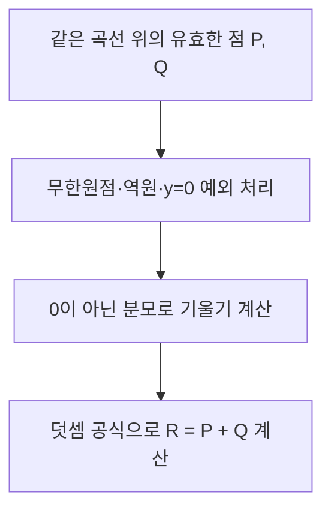
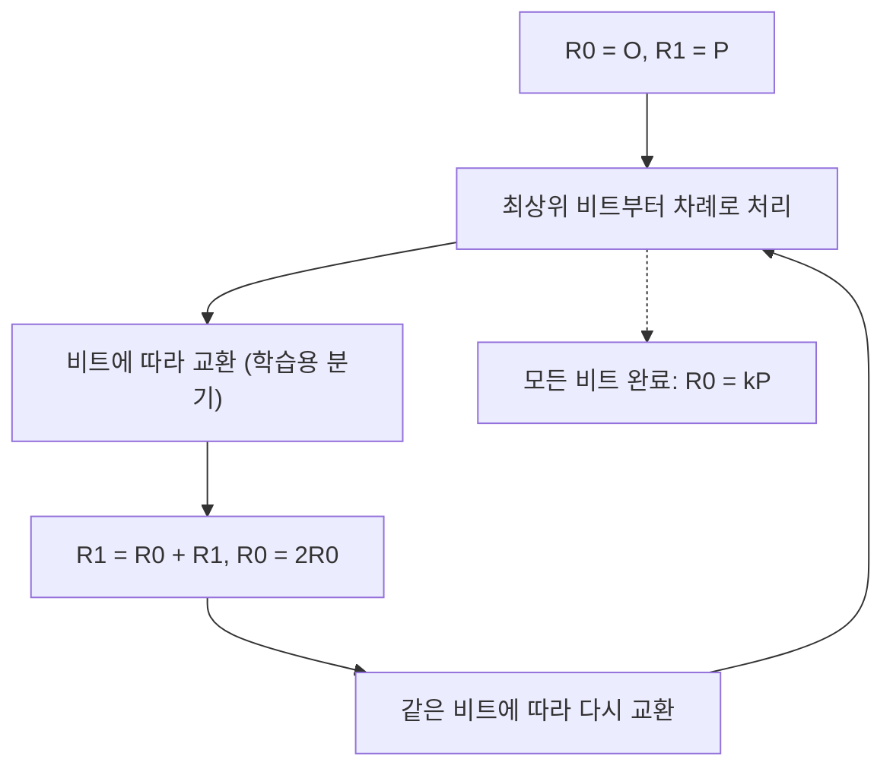
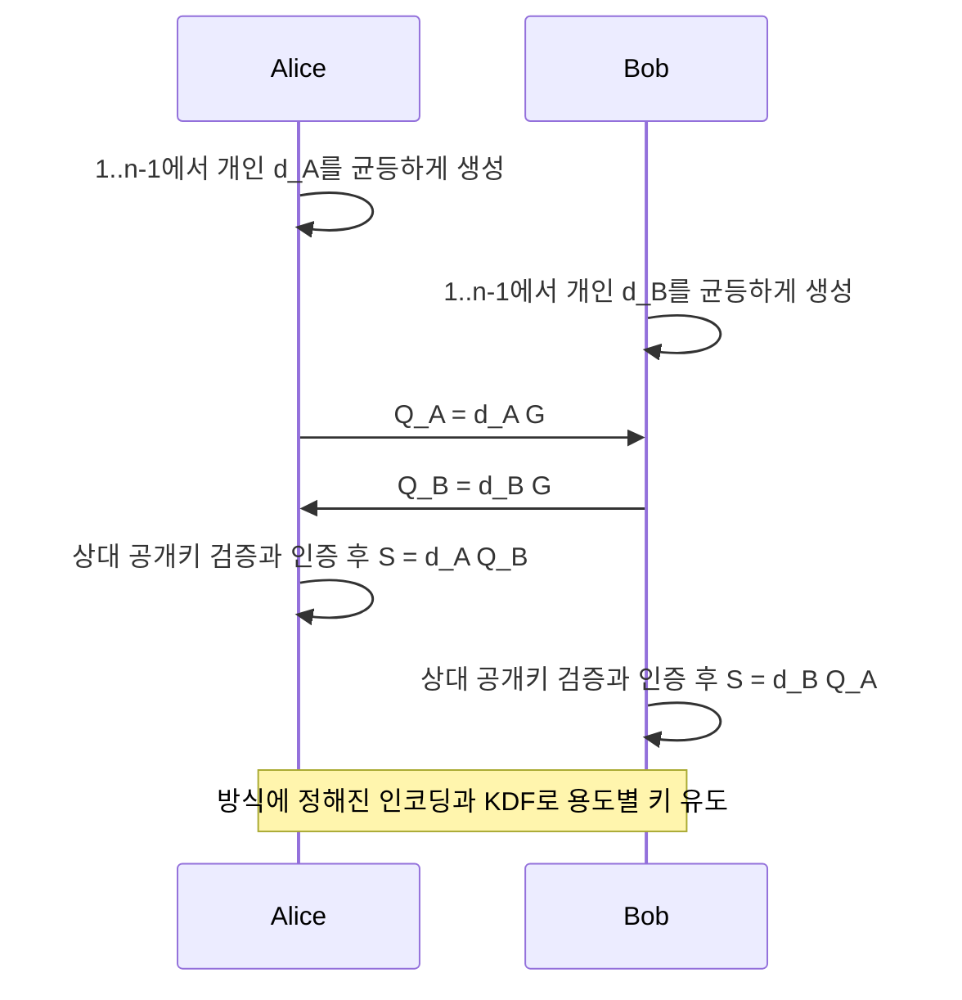

타원곡선 암호(Elliptic Curve Cryptography, ECC)는 타원곡선 군을 이용하는 공개키 기술의 한 계열입니다. ECDH 키 합의와 ECDSA 같은 서명은 역할이 다릅니다. ECC가 모든 보안 속성을 제공하는 하나의 암호화 연산인 것은 아닙니다. [공개키·해시·서명 개요](/ko/p/modern-cryptography-public-key-hash-signature/)와 함께 수학적 조건과 구현 조건을 살펴봅니다.

C++ 예제는 secp256k1의 공개 매개변수를 사용하는 **가변 시간 수학 학습용 코드**입니다. 개인키 생성, 인증된 키 합의, 서명이나 상수 시간 암호 구현을 제공하지 않습니다. 사다리 형태의 계산 구조만으로 상수 시간을 보장할 수 없는 이유도 설명합니다.

## 1. 안전성과 키 크기

큰 소수 $n$을 위수로 갖는 부분군과 생성원 $G$를 선택합니다. $Q=dG$에서 $d$를 구하는 문제가 타원곡선 이산 로그 문제(ECDLP)입니다. 스칼라는 $n$을 법으로 결정됩니다. 개인키는 암호학적으로 안전한 난수 생성기로 $1\le d<n$에서 균등하게 뽑습니다. 체의 크기 $p$, 부분군의 위수 $n$, 개인키의 값은 구분해야 합니다.

적절한 큰 소수 위수 부분군에 대한 고전적인 일반 공격인 Pollard rho는 대략 $O(\sqrt n)$회의 군 연산을 필요로 합니다. 이것은 전수조사만 가능하다거나 모든 타원곡선이 똑같이 어렵다는 뜻이 아닙니다. 특수한 곡선 구조와 작은 부분군에는 다른 공격도 가능하므로 매개변수와 방식을 적절히 선택해야 합니다.

다음 표는 NIST SP 800-57 Part 1 Rev.5의 Table 2에 따른 **고전 컴퓨터에 대한 추정 최대 보안 강도** 비교입니다. RSA 열은 모듈러스의 비트 길이이고, ECC 열은 기준점 위수 $n$의 비트 길이 $f$입니다. 인코딩된 공개키 크기를 뜻하지 않습니다.

| 추정 강도(비트) | RSA 모듈러스(비트) | ECC의 $f$(비트) |
| :---: | :---: | :---: |
| 80 이하(역사적 비교) | 1024 | 160–223 |
| 112 | 2048 | 224–255 |
| 128 | 3072 | 256–383 |
| 192 | 7680 | 384–511 |
| 256 | 15360 | 512 이상 |

80비트 행은 새 시스템에 대한 권고가 아닙니다. 이 표는 특정 곡선·구현·사용 기간의 승인을 뜻하지 않으며 양자 공격에 대한 내성도 보장하지 않습니다. 짧은 매개변수는 통신 비용을 줄일 수 있지만, 모든 연산에서 ECC가 RSA보다 빠른 것은 아닙니다.

## 2. 군과 유한체

군은 집합과 연산으로 이루어지며 닫힘, 결합 법칙, 항등원, 모든 원소에 대한 역원을 만족합니다. 교환 법칙까지 만족하면 아벨 군(가환군)입니다. 타원곡선의 점에 무한원점을 포함하고 아래의 덧셈을 정의하면 아벨 군을 이룹니다.

소수 $p$에 대한 소체 $\mathbb F_p$에서는 원소를 $0,\ldots,p-1$로 나타내고 덧셈·뺄셈·곱셈을 $p$로 나눈 나머지로 계산합니다. 나눗셈 $u/v$는 **$v$가 0이 아닐 때만** $uv^{-1}$로 정의됩니다.

$$vv^{-1}\equiv1\pmod p$$

역원은 확장 유클리드 알고리즘으로 구하거나 페르마의 소정리에 따라 $v^{p-2}\bmod p$로 계산할 수 있습니다. 후자를 선택하는 것만으로 상수 시간 구현이 되지는 않습니다. 거듭제곱, 곱셈, 모듈러 축약과 메모리 할당까지 살펴야 합니다.

## 3. 곡선과 무한원점

이 글은 소수 $p>3$인 체 위의 **짧은 바이어슈트라스 형태**로 범위를 한정합니다. 이 식으로 표수가 2나 3인 체, Montgomery 형태와 Edwards 형태를 모두 같은 방식으로 다루지는 않습니다.

$$y^2\equiv x^3+ax+b\pmod p$$

계수는 체의 원소이며, 비특이성을 위해 체 안에서 다음 조건이 필요합니다.

$$\Delta=-16(4a^3+27b^2)\not\equiv0\pmod p$$

이 조건만으로 암호학적으로 적절한 곡선이 되는 것은 아닙니다. 곡선 방정식을 만족하는 유한한 점에 항등원인 무한원점 $\mathcal O$를 추가합니다.

$$P+\mathcal O=\mathcal O+P=P$$

$$-(x,y)=(x,-y\bmod p),\qquad P+(-P)=\mathcal O$$

실수 그림에서 직선과 곡선의 교점을 구한 뒤 반사하는 설명은 군 연산에 대한 직관을 줍니다. 유한체에서는 연속적인 곡선을 그리는 대신 이에 대응하는 대수식으로 계산합니다.

## 4. 점 덧셈·두 배 연산과 예외

$P=(x_1,y_1)$, $Q=(x_2,y_2)$라고 합시다. 먼저 $\mathcal O$와의 덧셈 및 $Q=-P$인 경우를 처리합니다. 후자는 $P=Q$이고 $y_1=0$인 두 배 연산도 포함하며, 결과는 $\mathcal O$입니다.

$x_1\ne x_2$이면 다음을 사용합니다.

$$\lambda\equiv(y_2-y_1)(x_2-x_1)^{-1}\pmod p$$

$P=Q$이고 $y_1\ne0$이면 접선에 해당하는 식을 사용합니다.

$$\lambda\equiv(3x_1^2+a)(2y_1)^{-1}\pmod p$$

이 조건으로 분모가 0이 아님을 확인한 다음, 공통 식으로 결과를 구합니다.

$$x_3\equiv\lambda^2-x_1-x_2\pmod p$$

$$y_3\equiv\lambda(x_1-x_3)-y_1\pmod p$$



아핀 좌표에서는 역원 계산이 필요합니다. 실용적인 구현은 Jacobian(야코비안) 좌표 등으로 역원 계산 횟수를 줄일 수 있습니다. 좌표계를 바꾸는 것만으로 상수 시간이나 안전성이 보장되지는 않습니다.

## 5. 스칼라 곱셈

음이 아닌 정수 $k$에 대해 반복 덧셈으로 $kP$를 정의하고, $0P=\mathcal O$로 둡니다. Double-and-Add는 최상위 비트부터 최하위 비트까지 처리하면서 누적 결과를 두 배로 만들고 비트가 1이면 $P$를 더합니다. 군 연산 횟수는 단순한 $k$회 덧셈에서 $O(\log k)$로 줄어듭니다. 군 연산 한 번의 비용이나 절대 실행 시간이 일정하다는 뜻은 아닙니다.

다음은 개념을 설명하는 의사 코드로, 뒤의 C++ 프로그램에 포함하지 않습니다. 비밀 비트에 따른 분기가 있습니다.

```text
R = O
for bit in bits_of_k_from_most_significant:
    R = 2R
    if bit == 1:
        R = R + P
```

Montgomery 사다리 방식의 갱신은 비트마다 덧셈 한 번과 두 배 연산 한 번을 수행합니다. 처리한 비트 접두부의 값을 $r$이라 하면 $(R_0,R_1)=(rP,(r+1)P)$를 유지할 수 있습니다. 뒤의 예제는 전체 아핀 점으로 이 불변식을 설명하며, RFC 7748의 X25519나 X448 구현이 아닙니다.



## 6. ECDH: 공유값과 인증

공개 도메인 매개변수에는 곡선, 체, 기준점 $G$, 그 위수 $n$, 여인자 등이 포함됩니다. 양측은 적절한 개인 스칼라를 생성하고 공개 점을 교환합니다.

$$Q_A=d_AG,\qquad Q_B=d_BG$$

$$S=d_AQ_B=d_BQ_A=(d_Ad_B)G$$



공개 점으로부터 공유값을 계산하는 문제는 계산 디피–헬먼 문제(CDH)이며, ECDLP와 정의가 다릅니다. ECDLP를 풀면 공유값도 계산할 수 있지만, 여기서 역방향의 일반적인 동등성을 가정하지는 않습니다.

ECDH 자체에는 상대 인증이 없으므로 공격자의 공개키 바꿔치기를 막지 못합니다. 실제 프로토콜은 키·현재 교환·상대 신원을 결합하고, 인코딩·좌표 범위·곡선 소속·무한원점·필요한 부분군 조건을 방식에 따라 검사합니다. 공유 점이나 그 x좌표를 그대로 AES 키로 사용하면 안 됩니다. 프로토콜이 정한 인코딩, 문맥 결합과 HKDF 등의 키 유도 절차를 따라야 합니다. 이 그림은 완전한 TLS 핸드셰이크가 아닙니다.

## 7. 상수 시간 구현에 필요한 조건

비밀에 의존하는 분기, 메모리 접근, 예외 처리와 산술 실행 시간은 적절한 관측 조건에서 정보를 누설할 수 있습니다. 관측 횟수와 전체 개인키 복원 가능성은 구현과 공격 모델에 달려 있습니다. 수천 번 측정하면 반드시 모든 비트를 얻는다는 보편적인 보장은 없습니다.

매 반복에서 덧셈 횟수가 같더라도, 덧셈 내부가 비밀 중간값에 따라 분기하면 상수 시간이 아닙니다. 마스크를 쓰는 조건부 교환도 방어의 일부일 뿐이며 정수 표현, 컴파일러와 대상 CPU까지 확인해야 합니다. RFC 7748 §5.1도 동일한 체 연산열만으로 모든 부채널을 막을 수 없다고 설명합니다.

`cpp_int`는 가변 길이 정수이고, 아래의 `conditionalSwapDemo`와 점 덧셈에는 분기가 있습니다. **이 코드는 상수 시간이 아니며, 실제 암호 시스템에서 비밀키를 처리하는 데 사용하면 안 됩니다.**

## 8. C++17 수학 학습용 예제

다음 다섯 C++ 블록을 순서대로 한 파일에 이어 붙입니다. Boost.Multiprecision 헤더가 필요합니다. 공개된 고정 매개변수와 테스트 값만 사용하며 비밀키를 생성·저장·출력하지 않습니다.

### 8.1. 소체 연산

`modInverse`는 여기에 고정된 소수 $p$ 전용이며 0을 거부합니다. `powerMod`를 이용한 페르마 역원 계산도 가변 시간입니다.

```cpp
#include <cstdint>
#include <iostream>
#include <stdexcept>
#include <utility>
#include <boost/multiprecision/cpp_int.hpp>

using boost::multiprecision::cpp_int;

// Public secp256k1 parameters; this entire example is variable-time.
const cpp_int p("0xFFFFFFFFFFFFFFFFFFFFFFFFFFFFFFFFFFFFFFFFFFFFFFFFFFFFFFFEFFFFFC2F");
const cpp_int a = 0;
const cpp_int b = 7;
const cpp_int n("0xFFFFFFFFFFFFFFFFFFFFFFFFFFFFFFFEBAAEDCE6AF48A03BBFD25E8CD0364141");

cpp_int mod(cpp_int x, const cpp_int& m) {
    if (m <= 0) throw std::invalid_argument("Modulus must be positive");
    cpp_int r = x % m;
    if (r < 0) r += m;
    return r;
}

cpp_int powerMod(cpp_int base, cpp_int exp, const cpp_int& m) {
    if (m <= 1 || exp < 0) throw std::invalid_argument("Invalid powerMod input");
    cpp_int result = 1;
    base = mod(base, m);
    while (exp > 0) {
        if (exp % 2 == 1) result = mod(result * base, m);
        base = mod(base * base, m);
        exp /= 2;
    }
    return result;
}

// Inversion in the fixed prime field F_p only; zero has no inverse.
cpp_int modInverse(cpp_int value) {
    value = mod(value, p);
    if (value == 0) throw std::invalid_argument("Zero has no inverse");
    return powerMod(value, p - 2, p);
}
```

### 8.2. 점과 덧셈

유한한 점은 좌표가 $0\le x,y<p$ 범위에 있고 곡선 방정식을 만족해야 합니다. 무한원점은 군 연산에 허용하지만 ECDH 상대 공개키로는 별도로 거부해야 합니다. secp256k1의 여인자는 1입니다. 이 검사를 임의의 곡선에 필요한 부분군 검증의 대체물로 사용해서는 안 됩니다.

```cpp
struct Point {
    cpp_int x = 0;
    cpp_int y = 0;
    bool isInfinity = true;

    Point() = default;
    Point(cpp_int xValue, cpp_int yValue)
        : x(std::move(xValue)), y(std::move(yValue)), isInfinity(false) {}
};

bool isOnCurve(const Point& point) {
    if (point.isInfinity) return true;
    if (point.x < 0 || point.x >= p || point.y < 0 || point.y >= p) return false;
    return mod(point.y * point.y - point.x * point.x * point.x - a * point.x - b, p) == 0;
}

Point pointAdd(const Point& P, const Point& Q) {
    if (!isOnCurve(P) || !isOnCurve(Q)) throw std::invalid_argument("Invalid curve point");
    if (P.isInfinity) return Q;
    if (Q.isInfinity) return P;
    if (P.x == Q.x && mod(P.y + Q.y, p) == 0) return Point();

    cpp_int slope;
    if (P.x == Q.x && P.y == Q.y) {
        slope = mod((3 * P.x * P.x + a) * modInverse(2 * P.y), p);
    } else {
        slope = mod((Q.y - P.y) * modInverse(Q.x - P.x), p);
    }
    cpp_int x3 = mod(slope * slope - P.x - Q.x, p);
    cpp_int y3 = mod(slope * (P.x - x3) - P.y, p);
    return Point(x3, y3);
}
```

### 8.3. 교환 시뮬레이션

이 함수는 분기를 사용하므로 이름에도 Demo를 붙였습니다.

```cpp
// A branching simulation of conditional swap, NOT constant-time.
void conditionalSwapDemo(Point& left, Point& right, std::uint8_t bit) {
    if (bit > 1) throw std::invalid_argument("Bit must be zero or one");
    if (bit == 1) std::swap(left, right);
}
```

### 8.4. 입력 범위를 검사하는 사다리 계산

학습용 연산은 $0\le k<2^{256}$만 허용하며 범위를 벗어나면 거부합니다. 개인키의 유효 범위 $1\le d<n$과는 다릅니다. 상위 비트를 조용히 버리지 않습니다.

```cpp
// A functional ladder demonstration for 0 <= k < 2^256.
// Zero is allowed for group arithmetic, but is not a valid private key.
Point scalarMultiply(const Point& P, const cpp_int& k) {
    if (k < 0 || k >= (cpp_int(1) << 256)) throw std::invalid_argument("Scalar outside demo range");
    if (!isOnCurve(P)) throw std::invalid_argument("Invalid curve point");
    Point R0;
    Point R1 = P;
    for (int i = 255; i >= 0; --i) {
        std::uint8_t bit = boost::multiprecision::bit_test(k, i) ? 1 : 0;
        conditionalSwapDemo(R0, R1, bit);
        R1 = pointAdd(R0, R1);
        R0 = pointAdd(R0, R0);
        conditionalSwapDemo(R0, R1, bit);
    }
    return R0;
}
```

### 8.5. 공개값으로 동작 확인

SEC 2의 secp256k1 생성원을 사용해 $2G$와 $nG=\mathcal O$를 확인합니다. 이 자체 검사만으로 암호 구현의 안전성이 증명되지는 않습니다.

```cpp
int main() {
    const Point G(
        cpp_int("0x79BE667EF9DCBBAC55A06295CE870B07029BFCDB2DCE28D959F2815B16F81798"),
        cpp_int("0x483ADA7726A3C4655DA4FBFC0E1108A8FD17B448A68554199C47D08FFB10D4B8")
    );
    const Point doubled = scalarMultiply(G, 2);
    if (doubled.isInfinity || !isOnCurve(doubled) || !scalarMultiply(G, n).isInfinity) {
        throw std::runtime_error("Arithmetic self-check failed");
    }
    std::cout << "2G.x = " << std::hex << doubled.x << "\n";
    std::cout << "2G.y = " << std::hex << doubled.y << "\n";
    std::cout << "nG = infinity\n";
}
```

예를 들어 다섯 블록을 `ecc_demo.cpp`에 저장하고 Boost 헤더 검색 경로가 설정된 환경에서 실행합니다.

```sh
g++ -std=c++17 -O2 -Wall -Wextra ecc_demo.cpp -o ecc_demo
./ecc_demo
```

## 9. 요약

체·곡선·부분군·암호 방식을 구분해야 합니다. 점 덧셈의 예외, 스칼라 범위, 공개키 검증, 상대 인증과 키 유도는 모두 중요합니다. 사다리 계산의 수학적 정확성과 상수 시간 구현도 서로 다른 검증 사항입니다.

이 예제는 군 연산을 따라가기 위한 것입니다. 실제 키 합의와 서명에는 대상 프로토콜과 곡선을 지원하고 유지·검증되는 라이브러리를 사용합니다.

### 참고 자료

- [RFC 6090: Fundamental Elliptic Curve Cryptography Algorithms](https://www.rfc-editor.org/rfc/rfc6090.html) (§§2–4, 10)
- [RFC 7748: Elliptic Curves for Security](https://www.rfc-editor.org/rfc/rfc7748.html) (§§5–5.1)
- [NIST SP 800-57 Part 1 Rev.5](https://nvlpubs.nist.gov/nistpubs/SpecialPublications/NIST.SP.800-57pt1r5.pdf) (§5.6.1.1, Table 2)
- [Standards for Efficient Cryptography 2 (SEC 2), version 2.0](https://www.secg.org/sec2-v2.pdf) (§2.4.1, secp256k1)
- [RFC 5869: HKDF](https://www.rfc-editor.org/rfc/rfc5869.html) (§§1, 3.2–3.3)
- [Boost.Multiprecision: cpp_int](https://www.boost.org/doc/libs/1_83_0/libs/multiprecision/doc/html/boost_multiprecision/tut/ints/cpp_int.html)


