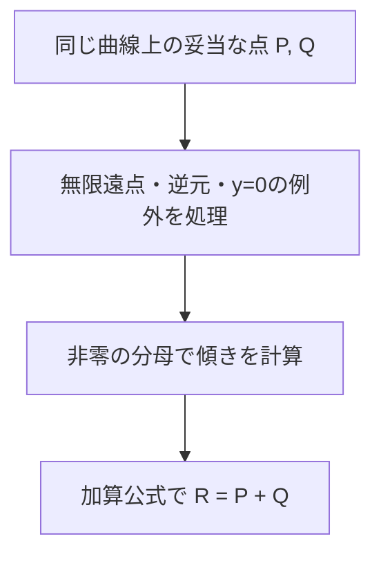
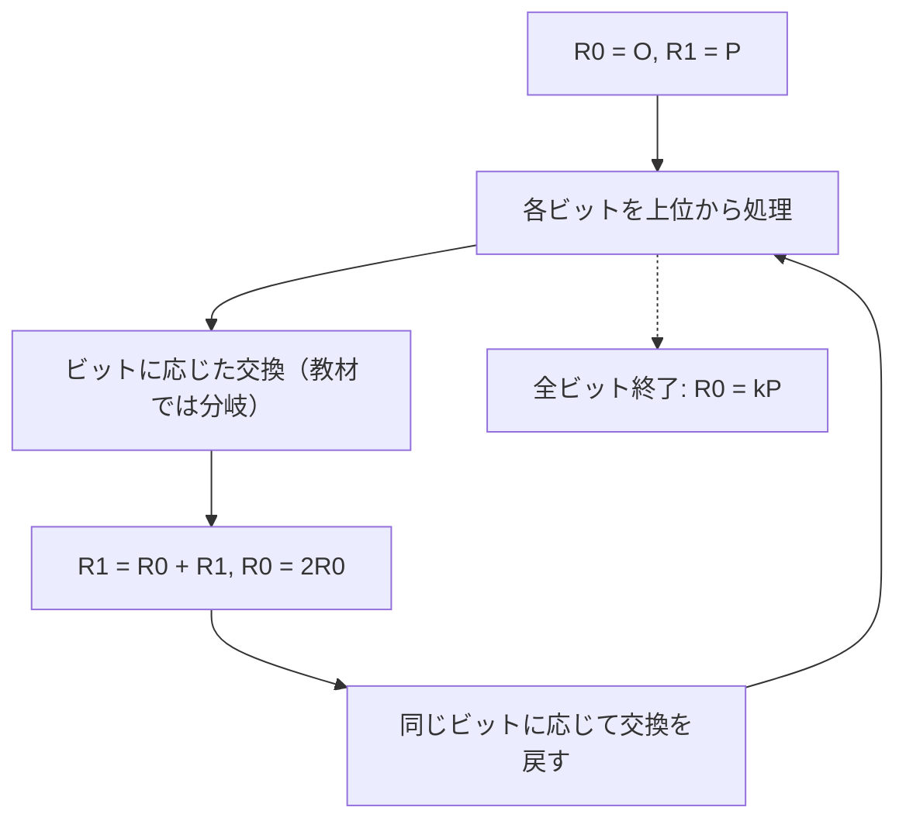
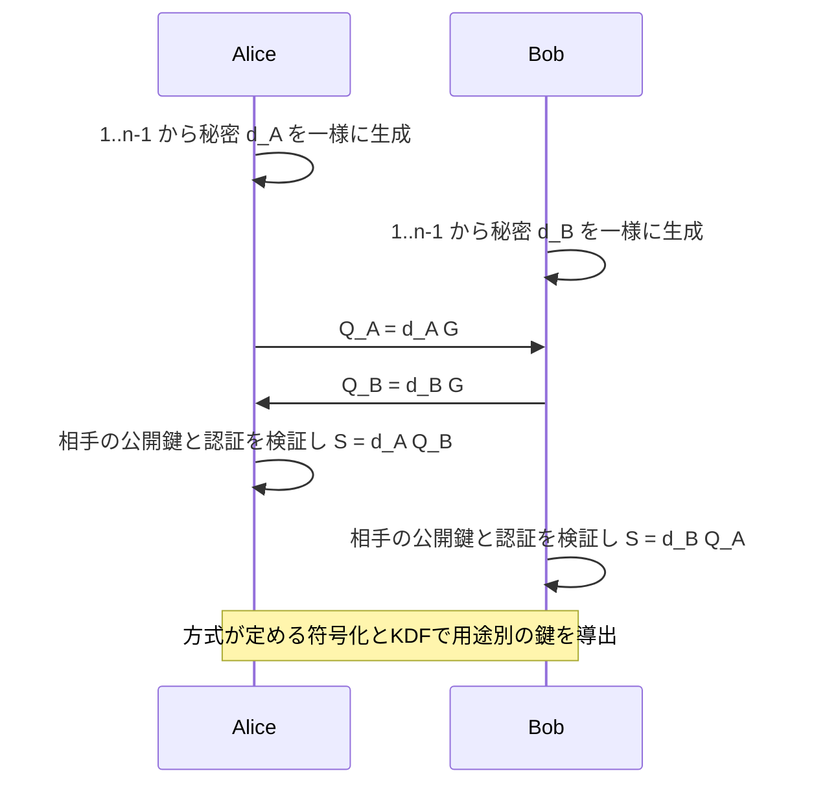

楕円曲線暗号（Elliptic Curve Cryptography: ECC）は、楕円曲線上の群を用いる公開鍵技術の総称です。ECDHによる鍵合意とECDSAなどによる署名は異なる操作であり、ECCという1つの暗号化処理がすべてを担うわけではありません。[公開鍵・ハッシュ・署名の概要](/p/modern-cryptography-public-key-hash-signature/)と合わせ、ここでは数学と実装の条件を確認します。

C++例は、secp256k1の公開パラメーターによる**可変時間の数学教材**です。秘密鍵の生成、認証付き鍵合意、署名、定数時間の暗号実装は提供しません。後半では、なぜラダーという計算構造だけでは定数時間を保証できないのかも説明します。

## 1. ECCの安全性と鍵長

大きな素数位数 $n$ の部分群と生成元 $G$ を選び、$Q=dG$ から $d$ を求める問題を楕円曲線離散対数問題（ECDLP）と呼びます。$d$ は $n$ を法として定まり、秘密鍵には暗号学的に安全な乱数で $1\le d<n$ から一様に選んだ値を使います。体の大きさ $p$、部分群の位数 $n$、秘密鍵の値は区別します。

適切な曲線の大きな素数位数部分群に対する古典的な汎用攻撃には、約 $O(\sqrt n)$ 回の群演算を要するPollard rho法があります。「総当たりしかない」「すべての曲線で同じように難しい」という意味ではありません。特別な構造を持つ曲線や小さな部分群には別の攻撃があり、実用にはパラメーターと方式の選択が必要です。

次はNIST SP 800-57 Part 1 Rev.5のTable 2による**古典計算機に対する推定最大強度の比較**です。RSA列は法のビット長、ECC列は基点の位数 $n$ のビット長 $f$ であり、公開鍵の符号化サイズではありません。

| 推定強度（ビット） | RSAの法（ビット） | ECCの $f$（ビット） |
| :---: | :---: | :---: |
| 80以下（歴史的比較） | 1024 | 160–223 |
| 112 | 2048 | 224–255 |
| 128 | 3072 | 256–383 |
| 192 | 7680 | 384–511 |
| 256 | 15360 | 512以上 |

80ビットの行を新規システムへの推奨と解釈してはいけません。この表は特定の曲線・実装・利用期間の承認や、量子攻撃への耐性を保証しません。短いパラメーターは通信量などを減らし得ますが、すべての操作でRSAより高速とは限りません。

## 2. 群と有限体

集合と演算の組が群であるためには、閉性、結合法則、単位元、各要素の逆元が必要です。さらに交換法則を満たす群をアーベル群（可換群）と呼びます。楕円曲線上の点は、後述する加法と無限遠点を含めてアーベル群を構成します。

素数 $p$ に対する素体 $\mathbb F_p$ では、値を $0,\ldots,p-1$ で表し、加算・減算・乗算を $p$ を法として計算します。除算 $u/v$ は**非零の $v$ に限り**、$uv^{-1}$ として定義します。

$$vv^{-1}\equiv1\pmod p$$

逆元は拡張ユークリッドの互除法や、フェルマーの小定理による $v^{p-2}\bmod p$ で計算できます。後者を選ぶだけで定数時間になるわけではありません。べき乗、乗算、剰余、メモリ確保を含む実装全体の性質が問題になります。

## 3. 曲線と無限遠点

この記事では素数 $p>3$ の体上の**短いワイエルシュトラス形**に限定します。標数2・3や、Montgomery形・Edwards形をこの式で一律に扱うわけではありません。

$$y^2\equiv x^3+ax+b\pmod p$$

係数は体の要素で、非特異性には体の中で次を要求します。

$$\Delta=-16(4a^3+27b^2)\not\equiv0\pmod p$$

この条件だけで暗号学的に適切な曲線になるわけではありません。曲線上の有限の点に、単位元である無限遠点 $\mathcal O$ を加えます。

$$P+\mathcal O=\mathcal O+P=P$$

$$-(x,y)=(x,-y\bmod p),\qquad P+(-P)=\mathcal O$$

実数の図で使う「直線と曲線の交点を反転する」という説明は群演算の直感です。有限体では連続した曲線を描くのではなく、対応する代数式で計算します。

## 4. 点加算・2倍算と例外

$P=(x_1,y_1)$、$Q=(x_2,y_2)$ とします。まず $\mathcal O$ との加算と $Q=-P$ を処理します。後者は $P=Q$ かつ $y_1=0$ の2倍算も含み、結果は $\mathcal O$ です。

$x_1\ne x_2$ なら、次の傾きを使います。

$$\lambda\equiv(y_2-y_1)(x_2-x_1)^{-1}\pmod p$$

$P=Q$ かつ $y_1\ne0$ なら、接線に対応する式を使います。

$$\lambda\equiv(3x_1^2+a)(2y_1)^{-1}\pmod p$$

これらの条件で分母が非零になった後、共通の式で結果を求めます。

$$x_3\equiv\lambda^2-x_1-x_2\pmod p$$

$$y_3\equiv\lambda(x_1-x_3)-y_1\pmod p$$



アフィン座標では逆元計算が必要です。実用実装ではJacobian座標などで逆元計算の回数を減らしますが、座標系を変えるだけで定数時間や安全性が保証されるわけではありません。

## 5. スカラー倍算

非負整数 $k$ に対する $kP$ は反復加算で定義し、$0P=\mathcal O$ とします。Double-and-Add法は、上位ビットから結果を2倍し、ビットが1なら $P$ を加えます。群演算の回数は、単純な $k$ 回の加算から $O(\log k)$ になります。これは群演算1回のコストや実行時間を一定とする主張ではありません。

次は概念を示す疑似コードで、後のC++プログラムには連結しません。秘密ビットによる分岐があります。

```text
R = O
for bit in bits_of_k_from_most_significant:
    R = 2R
    if bit == 1:
        R = R + P
```

Montgomery ladder型の状態更新では、各ビットで加算1回と2倍算1回を行い、処理済みビット列の値を $r$ としたとき $(R_0,R_1)=(rP,(r+1)P)$ を維持できます。後の例はこの不変条件を確認する全点・アフィン座標の教材であり、RFC 7748のX25519/X448の実装ではありません。



## 6. ECDHで一致する値と認証

公開パラメーターには曲線・体・基点 $G$・その位数 $n$・余因子などが含まれます。両者は適切な秘密スカラーを生成し、公開点を交換します。

$$Q_A=d_AG,\qquad Q_B=d_BG$$

$$S=d_AQ_B=d_BQ_A=(d_Ad_B)G$$



共有値を公開点から計算する問題（CDH）と、秘密スカラーを復元するECDLPは同じ定義ではありません。ECDLPを解ければ共有値も計算できますが、その逆の一般的な同値性をここで仮定しません。

ECDH単独には相手の認証がなく、公開鍵を置き換える中間者攻撃を防げません。実際のプロトコルは公開鍵・試行・相手の身元を結び付け、形式・座標範囲・曲線・無限遠点・必要な部分群条件を方式どおり検証します。共有点やそのx座標をそのままAES鍵にせず、プロトコルが定める符号化、文脈情報、HKDFなどの鍵導出を使います。この図は完全なTLSハンドシェイクではありません。

## 7. 定数時間という実装上の条件

秘密に依存する分岐、メモリアクセス、例外処理、算術の処理時間などは、観測条件によって情報漏えいにつながります。観測回数や秘密鍵の完全復元の成否は実装と攻撃モデルに依存し、「数千回で必ず全ビットが得られる」とは言えません。

各反復で同じ数の加算を行っても、演算内部が秘密の値で分岐すれば定数時間にはなりません。条件付き交換をマスクで書くことも対策の一部にすぎず、整数表現、コンパイラ、対象CPUまで含めて検証が必要です。RFC 7748 §5.1も、同じ体演算列だけではすべてのサイドチャネルを防げないと説明しています。

`cpp_int` は可変長整数で、以下の `conditionalSwapDemo` と点加算は分岐を含みます。**次のコードは定数時間ではなく、秘密鍵を扱う実用暗号に使用できません。**

## 8. C++17の数学教材

次の5つのC++ブロックを順番に同じファイルへ連結します。Boost.Multiprecisionのヘッダーが必要です。公開されている固定パラメーターとテスト値だけを使い、秘密鍵を生成・保存・出力しません。

### 8.1. 素体の演算

`modInverse` はここで固定した素数 $p$ 専用です。ゼロを拒否します。`powerMod` によるフェルマー逆元の計算も可変時間です。

```cpp
#include <cstdint>
#include <iostream>
#include <stdexcept>
#include <utility>
#include <boost/multiprecision/cpp_int.hpp>

using boost::multiprecision::cpp_int;

// Public secp256k1 parameters; this entire example is variable-time.
const cpp_int p("0xFFFFFFFFFFFFFFFFFFFFFFFFFFFFFFFFFFFFFFFFFFFFFFFFFFFFFFFEFFFFFC2F");
const cpp_int a = 0;
const cpp_int b = 7;
const cpp_int n("0xFFFFFFFFFFFFFFFFFFFFFFFFFFFFFFFEBAAEDCE6AF48A03BBFD25E8CD0364141");

cpp_int mod(cpp_int x, const cpp_int& m) {
    if (m <= 0) throw std::invalid_argument("Modulus must be positive");
    cpp_int r = x % m;
    if (r < 0) r += m;
    return r;
}

cpp_int powerMod(cpp_int base, cpp_int exp, const cpp_int& m) {
    if (m <= 1 || exp < 0) throw std::invalid_argument("Invalid powerMod input");
    cpp_int result = 1;
    base = mod(base, m);
    while (exp > 0) {
        if (exp % 2 == 1) result = mod(result * base, m);
        base = mod(base * base, m);
        exp /= 2;
    }
    return result;
}

// Inversion in the fixed prime field F_p only; zero has no inverse.
cpp_int modInverse(cpp_int value) {
    value = mod(value, p);
    if (value == 0) throw std::invalid_argument("Zero has no inverse");
    return powerMod(value, p - 2, p);
}
```

### 8.2. 点と加算

有限点は座標が $0\le x,y<p$ にあり、曲線式を満たすことを確認します。無限遠点は群演算に許可しますが、ECDHの相手の公開鍵としては別途拒否が必要です。secp256k1は余因子1ですが、この確認を任意の曲線の部分群検証の代用にしてはいけません。

```cpp
struct Point {
    cpp_int x = 0;
    cpp_int y = 0;
    bool isInfinity = true;

    Point() = default;
    Point(cpp_int xValue, cpp_int yValue)
        : x(std::move(xValue)), y(std::move(yValue)), isInfinity(false) {}
};

bool isOnCurve(const Point& point) {
    if (point.isInfinity) return true;
    if (point.x < 0 || point.x >= p || point.y < 0 || point.y >= p) return false;
    return mod(point.y * point.y - point.x * point.x * point.x - a * point.x - b, p) == 0;
}

Point pointAdd(const Point& P, const Point& Q) {
    if (!isOnCurve(P) || !isOnCurve(Q)) throw std::invalid_argument("Invalid curve point");
    if (P.isInfinity) return Q;
    if (Q.isInfinity) return P;
    if (P.x == Q.x && mod(P.y + Q.y, p) == 0) return Point();

    cpp_int slope;
    if (P.x == Q.x && P.y == Q.y) {
        slope = mod((3 * P.x * P.x + a) * modInverse(2 * P.y), p);
    } else {
        slope = mod((Q.y - P.y) * modInverse(Q.x - P.x), p);
    }
    cpp_int x3 = mod(slope * slope - P.x - Q.x, p);
    cpp_int y3 = mod(slope * (P.x - x3) - P.y, p);
    return Point(x3, y3);
}
```

### 8.3. 交換のシミュレーション

この関数は分岐を使うため、名前にもDemoを付けています。

```cpp
// A branching simulation of conditional swap, NOT constant-time.
void conditionalSwapDemo(Point& left, Point& right, std::uint8_t bit) {
    if (bit > 1) throw std::invalid_argument("Bit must be zero or one");
    if (bit == 1) std::swap(left, right);
}
```

### 8.4. 入力範囲を検査するラダー

教材の演算は $0\le k<2^{256}$ に限定し、範囲外を拒否します。これは秘密鍵の有効範囲 $1\le d<n$ とは異なります。上位ビットの黙った切り捨ては行いません。

```cpp
// A functional ladder demonstration for 0 <= k < 2^256.
// Zero is allowed for group arithmetic, but is not a valid private key.
Point scalarMultiply(const Point& P, const cpp_int& k) {
    if (k < 0 || k >= (cpp_int(1) << 256)) throw std::invalid_argument("Scalar outside demo range");
    if (!isOnCurve(P)) throw std::invalid_argument("Invalid curve point");
    Point R0;
    Point R1 = P;
    for (int i = 255; i >= 0; --i) {
        std::uint8_t bit = boost::multiprecision::bit_test(k, i) ? 1 : 0;
        conditionalSwapDemo(R0, R1, bit);
        R1 = pointAdd(R0, R1);
        R0 = pointAdd(R0, R0);
        conditionalSwapDemo(R0, R1, bit);
    }
    return R0;
}
```

### 8.5. 公開値による動作確認

SEC 2のsecp256k1基点を使い、$2G$ と $nG=\mathcal O$ を確認します。この自己検査だけで暗号実装の安全性を証明することはできません。

```cpp
int main() {
    const Point G(
        cpp_int("0x79BE667EF9DCBBAC55A06295CE870B07029BFCDB2DCE28D959F2815B16F81798"),
        cpp_int("0x483ADA7726A3C4655DA4FBFC0E1108A8FD17B448A68554199C47D08FFB10D4B8")
    );
    const Point doubled = scalarMultiply(G, 2);
    if (doubled.isInfinity || !isOnCurve(doubled) || !scalarMultiply(G, n).isInfinity) {
        throw std::runtime_error("Arithmetic self-check failed");
    }
    std::cout << "2G.x = " << std::hex << doubled.x << "\n";
    std::cout << "2G.y = " << std::hex << doubled.y << "\n";
    std::cout << "nG = infinity\n";
}
```

例えば、5ブロックを `ecc_demo.cpp` に保存し、Boostのインクルードパスが設定された環境で実行します。

```sh
g++ -std=c++17 -O2 -Wall -Wextra ecc_demo.cpp -o ecc_demo
./ecc_demo
```

## 9. まとめ

ECCでは体・曲線・部分群・方式を区別します。点加算の例外、スカラーの範囲、公開鍵検証、相手の認証、鍵導出はいずれも省略できません。ラダーの数学的な正しさと、定数時間の実装であることも別の検証事項です。

この教材は群演算を追うためのものです。実際の鍵合意や署名には、対象プロトコルと曲線に対応し、保守・検証されているライブラリを使います。

### 参考資料

- [RFC 6090: Fundamental Elliptic Curve Cryptography Algorithms](https://www.rfc-editor.org/rfc/rfc6090.html) (§§2–4, 10)
- [RFC 7748: Elliptic Curves for Security](https://www.rfc-editor.org/rfc/rfc7748.html) (§§5–5.1)
- [NIST SP 800-57 Part 1 Rev.5](https://nvlpubs.nist.gov/nistpubs/SpecialPublications/NIST.SP.800-57pt1r5.pdf) (§5.6.1.1, Table 2)
- [Standards for Efficient Cryptography 2 (SEC 2), version 2.0](https://www.secg.org/sec2-v2.pdf) (§2.4.1, secp256k1)
- [RFC 5869: HKDF](https://www.rfc-editor.org/rfc/rfc5869.html) (§§1, 3.2–3.3)
- [Boost.Multiprecision: cpp_int](https://www.boost.org/doc/libs/1_83_0/libs/multiprecision/doc/html/boost_multiprecision/tut/ints/cpp_int.html)

