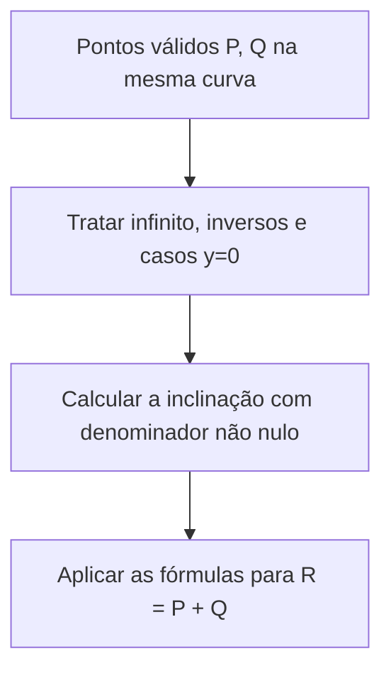
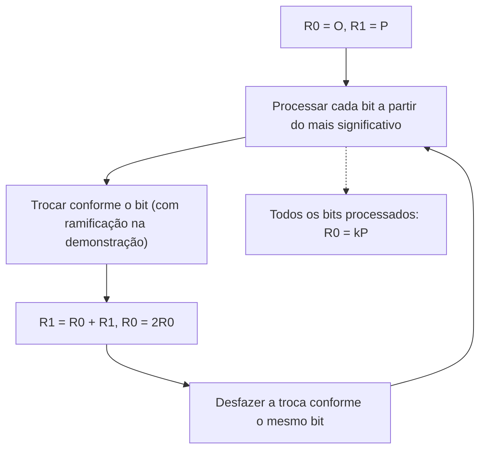
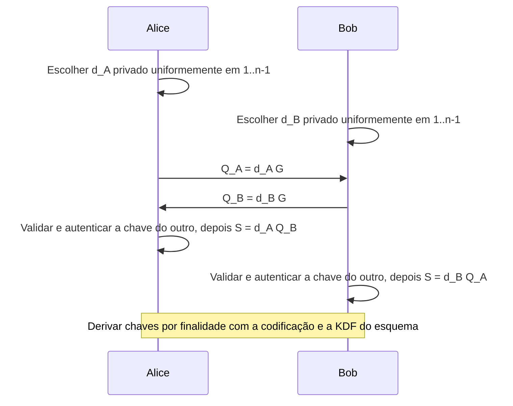

A criptografia de curva elíptica (Elliptic Curve Cryptography, ECC) é uma família de técnicas de chave pública baseadas em grupos de curvas elípticas. O acordo de chaves ECDH e assinaturas como ECDSA têm funções diferentes; ECC não é uma única operação de cifração que oferece todas as propriedades de segurança. Junto com a [visão geral de chaves públicas, hashes e assinaturas](/pt/p/modern-cryptography-public-key-hash-signature/), este artigo explica as condições matemáticas e de implementação.

O exemplo em C++ é uma **demonstração matemática de tempo variável**, com parâmetros públicos de secp256k1. Não implementa geração de chaves privadas, acordo de chaves autenticado, assinaturas nem criptografia de tempo constante. Também explicamos por que uma estrutura de escada, por si só, não garante comportamento de tempo constante.

## 1. Segurança e tamanhos de chave

Escolhe-se um subgrupo de ordem prima grande $n$ com gerador $G$. Recuperar $d$ a partir de $Q=dG$ é o problema do logaritmo discreto em curvas elípticas (ECDLP). O escalar é determinado módulo $n$. Uma chave privada é escolhida uniformemente em $1\le d<n$, com um gerador de números aleatórios criptograficamente seguro. É preciso distinguir o tamanho do corpo $p$, a ordem do subgrupo $n$ e o valor da chave privada.

Para um subgrupo adequado de ordem prima grande, um ataque clássico genérico como Pollard rho exige aproximadamente $O(\sqrt n)$ operações de grupo. Isso não significa que a busca exaustiva seja o único ataque, nem que todas as curvas elípticas apresentem a mesma dificuldade. Estruturas especiais e subgrupos pequenos permitem outros ataques; os parâmetros e o esquema precisam ser escolhidos de forma apropriada.

A comparação a seguir reproduz as **forças máximas de segurança estimadas contra computadores clássicos** do NIST SP 800-57 Part 1 Rev.5, Table 2. A coluna RSA indica o comprimento do módulo em bits; a coluna ECC indica o comprimento em bits $f$ da ordem $n$ do ponto base, não o tamanho da chave pública codificada.

| Força estimada (bits) | Módulo RSA (bits) | ECC $f$ (bits) |
| :---: | :---: | :---: |
| No máximo 80 (comparação histórica) | 1024 | 160–223 |
| 112 | 2048 | 224–255 |
| 128 | 3072 | 256–383 |
| 192 | 7680 | 384–511 |
| 256 | 15360 | Pelo menos 512 |

A linha de 80 bits não é uma recomendação para sistemas novos. A tabela não certifica uma curva, implementação ou período de uso específico, nem oferece resistência quântica. Parâmetros mais curtos podem reduzir os custos de comunicação, mas ECC não é necessariamente mais rápida que RSA em todas as operações.

## 2. Grupos e corpos finitos

Um grupo consiste em um conjunto e uma operação que satisfazem fechamento, associatividade, existência de elemento neutro e de inversos para todos os elementos. Se também satisfaz comutatividade, é um grupo abeliano. Os pontos de uma curva elíptica, incluindo o ponto no infinito e com a lei de adição descrita abaixo, formam um grupo abeliano.

Para um primo $p$, os elementos do corpo primo $\mathbb F_p$ são representados por $0,\ldots,p-1$, e a adição, subtração e multiplicação são reduzidas módulo $p$. A divisão $u/v$ é definida como $uv^{-1}$ **somente quando $v$ é diferente de zero**.

$$vv^{-1}\equiv1\pmod p$$

O inverso pode ser calculado pelo algoritmo estendido de Euclides ou como $v^{p-2}\bmod p$, pelo pequeno teorema de Fermat. Escolher a segunda opção não torna uma implementação de tempo constante. A exponenciação, multiplicação, redução e alocação de memória também precisam ser consideradas.

## 3. A curva e o ponto no infinito

Este artigo se limita à **forma curta de Weierstrass** sobre um corpo primo com $p>3$. A fórmula não abrange uniformemente corpos de característica dois ou três, nem os modelos de Montgomery e Edwards.

$$y^2\equiv x^3+ax+b\pmod p$$

Os coeficientes são elementos do corpo, e a ausência de singularidades exige a seguinte condição dentro dele:

$$\Delta=-16(4a^3+27b^2)\not\equiv0\pmod p$$

Essa condição, sozinha, não torna uma curva adequada para criptografia. Aos pontos finitos que satisfazem a equação, acrescenta-se o elemento neutro: o ponto no infinito $\mathcal O$.

$$P+\mathcal O=\mathcal O+P=P$$

$$-(x,y)=(x,-y\bmod p),\qquad P+(-P)=\mathcal O$$

A imagem nos números reais de uma reta que cruza a curva, seguida da reflexão do ponto de interseção, dá uma intuição da lei de grupo. Em um corpo finito, calculamos com as fórmulas algébricas correspondentes, não com uma curva contínua desenhada.

## 4. Adição, duplicação e casos excepcionais

Sejam $P=(x_1,y_1)$ e $Q=(x_2,y_2)$. Primeiro tratamos a adição com $\mathcal O$ e o caso $Q=-P$. Este último inclui a duplicação quando $P=Q$ e $y_1=0$; o resultado é $\mathcal O$.

Quando $x_1\ne x_2$, usamos:

$$\lambda\equiv(y_2-y_1)(x_2-x_1)^{-1}\pmod p$$

Quando $P=Q$ e $y_1\ne0$, usamos a fórmula da tangente:

$$\lambda\equiv(3x_1^2+a)(2y_1)^{-1}\pmod p$$

Depois que essas condições garantem um denominador não nulo, calculamos o resultado pelas fórmulas comuns:

$$x_3\equiv\lambda^2-x_1-x_2\pmod p$$

$$y_3\equiv\lambda(x_1-x_3)-y_1\pmod p$$



Coordenadas afins exigem inversões. Implementações práticas podem reduzir sua quantidade com sistemas como as coordenadas jacobianas. Mudar as coordenadas, por si só, não garante tempo constante nem segurança.

## 5. Multiplicação escalar

Para $k$ não negativo, definimos $kP$ por adição repetida, com $0P=\mathcal O$. O método de duplicar e somar (double-and-add) processa os bits do mais significativo ao menos significativo: duplica o acumulador e soma $P$ se o bit for um. Isso reduz o número de operações de grupo de $k$ adições diretas para $O(\log k)$. Não é uma afirmação de custo constante por operação nem de um tempo absoluto de execução.

O pseudocódigo conceitual abaixo não faz parte do programa C++ posterior. Ele contém uma ramificação que depende de bits secretos.

```text
R = O
for bit in bits_of_k_from_most_significant:
    R = 2R
    if bit == 1:
        R = R + P
```

Uma atualização do tipo escada de Montgomery executa uma adição e uma duplicação por bit. Se o prefixo processado representa $r$, pode preservar $(R_0,R_1)=(rP,(r+1)P)$. O exemplo posterior demonstra esse invariante com pontos afins completos; não implementa X25519 ou X448 do RFC 7748.



## 6. ECDH: acordo e autenticação

Os parâmetros públicos de domínio incluem a curva, o corpo, o ponto base $G$, sua ordem $n$ e o cofator. Cada parte gera um escalar privado apropriado e troca pontos públicos.

$$Q_A=d_AG,\qquad Q_B=d_BG$$

$$S=d_AQ_B=d_BQ_A=(d_Ad_B)G$$



Calcular o valor compartilhado a partir dos pontos públicos é o problema computacional de Diffie–Hellman (CDH), cuja definição difere de ECDLP. Resolver ECDLP permite calcular o valor compartilhado; aqui não se pressupõe uma equivalência geral no sentido inverso.

ECDH sozinho não autentica a outra parte nem impede a substituição de chaves públicas por um atacante. Um protocolo real vincula as chaves, a troca e as identidades, e aplica as verificações exigidas de codificação, intervalo das coordenadas, pertencimento à curva, infinito e subgrupo. Não se deve usar diretamente o ponto compartilhado ou sua coordenada x como chave AES: é preciso seguir a codificação, a vinculação ao contexto e a derivação de chaves, como HKDF, especificadas pelo protocolo. O diagrama não é um handshake TLS completo.

## 7. Condições para uma implementação de tempo constante

Ramificações, acessos à memória, casos excepcionais e tempos aritméticos que dependem de segredos podem vazar informações sob um modelo de observação apropriado. A quantidade de observações e a possibilidade de recuperar toda a chave dependem da implementação e do ataque. Não existe uma garantia universal de que alguns milhares de medições revelem todos os bits.

Um número igual de adições por iteração não garante tempo constante se essas adições se ramificam conforme valores secretos intermediários. Uma troca condicional com máscaras é apenas parte da defesa: a representação dos inteiros, o compilador e a CPU de destino também importam. O RFC 7748 §5.1 explica que uma sequência idêntica de operações de corpo não impede, por si só, todos os canais laterais.

`cpp_int` é um tipo inteiro de tamanho variável, e tanto `conditionalSwapDemo` quanto a adição de pontos abaixo contêm ramificações. **O código a seguir não é de tempo constante e não deve manipular chaves secretas na criptografia de produção.**

## 8. Demonstração matemática em C++17

Concatene os cinco blocos C++ abaixo, em ordem, em um único arquivo. São necessários os cabeçalhos de Boost.Multiprecision. O programa usa apenas parâmetros fixos e valores de teste públicos; não gera, armazena ou imprime chaves secretas.

### 8.1. Aritmética do corpo primo

`modInverse` é específico do primo fixo $p$ usado aqui e rejeita zero. A inversão de Fermat implementada com `powerMod` também é de tempo variável.

```cpp
#include <cstdint>
#include <iostream>
#include <stdexcept>
#include <utility>
#include <boost/multiprecision/cpp_int.hpp>

using boost::multiprecision::cpp_int;

// Public secp256k1 parameters; this entire example is variable-time.
const cpp_int p("0xFFFFFFFFFFFFFFFFFFFFFFFFFFFFFFFFFFFFFFFFFFFFFFFFFFFFFFFEFFFFFC2F");
const cpp_int a = 0;
const cpp_int b = 7;
const cpp_int n("0xFFFFFFFFFFFFFFFFFFFFFFFFFFFFFFFEBAAEDCE6AF48A03BBFD25E8CD0364141");

cpp_int mod(cpp_int x, const cpp_int& m) {
    if (m <= 0) throw std::invalid_argument("Modulus must be positive");
    cpp_int r = x % m;
    if (r < 0) r += m;
    return r;
}

cpp_int powerMod(cpp_int base, cpp_int exp, const cpp_int& m) {
    if (m <= 1 || exp < 0) throw std::invalid_argument("Invalid powerMod input");
    cpp_int result = 1;
    base = mod(base, m);
    while (exp > 0) {
        if (exp % 2 == 1) result = mod(result * base, m);
        base = mod(base * base, m);
        exp /= 2;
    }
    return result;
}

// Inversion in the fixed prime field F_p only; zero has no inverse.
cpp_int modInverse(cpp_int value) {
    value = mod(value, p);
    if (value == 0) throw std::invalid_argument("Zero has no inverse");
    return powerMod(value, p - 2, p);
}
```

### 8.2. Pontos e adição

Um ponto finito deve ter coordenadas $0\le x,y<p$ e satisfazer a equação da curva. O infinito é permitido na aritmética de grupo, mas precisa ser rejeitado separadamente como chave pública ECDH da outra parte. O cofator de secp256k1 é um; essas verificações não substituem a validação de subgrupo necessária para curvas arbitrárias.

```cpp
struct Point {
    cpp_int x = 0;
    cpp_int y = 0;
    bool isInfinity = true;

    Point() = default;
    Point(cpp_int xValue, cpp_int yValue)
        : x(std::move(xValue)), y(std::move(yValue)), isInfinity(false) {}
};

bool isOnCurve(const Point& point) {
    if (point.isInfinity) return true;
    if (point.x < 0 || point.x >= p || point.y < 0 || point.y >= p) return false;
    return mod(point.y * point.y - point.x * point.x * point.x - a * point.x - b, p) == 0;
}

Point pointAdd(const Point& P, const Point& Q) {
    if (!isOnCurve(P) || !isOnCurve(Q)) throw std::invalid_argument("Invalid curve point");
    if (P.isInfinity) return Q;
    if (Q.isInfinity) return P;
    if (P.x == Q.x && mod(P.y + Q.y, p) == 0) return Point();

    cpp_int slope;
    if (P.x == Q.x && P.y == Q.y) {
        slope = mod((3 * P.x * P.x + a) * modInverse(2 * P.y), p);
    } else {
        slope = mod((Q.y - P.y) * modInverse(Q.x - P.x), p);
    }
    cpp_int x3 = mod(slope * slope - P.x - Q.x, p);
    cpp_int y3 = mod(slope * (P.x - x3) - P.y, p);
    return Point(x3, y3);
}
```

### 8.3. Simulação de uma troca

Esta função contém uma ramificação, por isso tem Demo no nome.

```cpp
// A branching simulation of conditional swap, NOT constant-time.
void conditionalSwapDemo(Point& left, Point& right, std::uint8_t bit) {
    if (bit > 1) throw std::invalid_argument("Bit must be zero or one");
    if (bit == 1) std::swap(left, right);
}
```

### 8.4. Uma escada com verificação de intervalo

A demonstração aceita $0\le k<2^{256}$ e rejeita valores fora desse intervalo. Esse intervalo difere do intervalo de chaves privadas $1\le d<n$. Ela nunca descarta silenciosamente os bits superiores.

```cpp
// A functional ladder demonstration for 0 <= k < 2^256.
// Zero is allowed for group arithmetic, but is not a valid private key.
Point scalarMultiply(const Point& P, const cpp_int& k) {
    if (k < 0 || k >= (cpp_int(1) << 256)) throw std::invalid_argument("Scalar outside demo range");
    if (!isOnCurve(P)) throw std::invalid_argument("Invalid curve point");
    Point R0;
    Point R1 = P;
    for (int i = 255; i >= 0; --i) {
        std::uint8_t bit = boost::multiprecision::bit_test(k, i) ? 1 : 0;
        conditionalSwapDemo(R0, R1, bit);
        R1 = pointAdd(R0, R1);
        R0 = pointAdd(R0, R0);
        conditionalSwapDemo(R0, R1, bit);
    }
    return R0;
}
```

### 8.5. Verificação com valores públicos

Usamos o gerador secp256k1 de SEC 2 para verificar $2G$ e $nG=\mathcal O$. Essa autoverificação, sozinha, não prova a segurança de uma implementação criptográfica.

```cpp
int main() {
    const Point G(
        cpp_int("0x79BE667EF9DCBBAC55A06295CE870B07029BFCDB2DCE28D959F2815B16F81798"),
        cpp_int("0x483ADA7726A3C4655DA4FBFC0E1108A8FD17B448A68554199C47D08FFB10D4B8")
    );
    const Point doubled = scalarMultiply(G, 2);
    if (doubled.isInfinity || !isOnCurve(doubled) || !scalarMultiply(G, n).isInfinity) {
        throw std::runtime_error("Arithmetic self-check failed");
    }
    std::cout << "2G.x = " << std::hex << doubled.x << "\n";
    std::cout << "2G.y = " << std::hex << doubled.y << "\n";
    std::cout << "nG = infinity\n";
}
```

Por exemplo, salve os cinco blocos como `ecc_demo.cpp` e execute em um ambiente com o caminho de inclusão de Boost configurado:

```sh
g++ -std=c++17 -O2 -Wall -Wextra ecc_demo.cpp -o ecc_demo
./ecc_demo
```

## 9. Conclusão

É preciso distinguir o corpo, a curva, o subgrupo e o esquema criptográfico. Importam os casos excepcionais de adição, os intervalos de escalares, a validação de chaves públicas, a autenticação da outra parte e a derivação de chaves. A correção aritmética da escada e a implementação de tempo constante são verificações distintas.

Esta demonstração serve para acompanhar a aritmética de grupo. Acordos de chaves e assinaturas reais exigem bibliotecas mantidas e validadas que ofereçam suporte ao protocolo e à curva pretendidos.

### Referências

- [RFC 6090: Fundamental Elliptic Curve Cryptography Algorithms](https://www.rfc-editor.org/rfc/rfc6090.html) (§§2–4, 10)
- [RFC 7748: Elliptic Curves for Security](https://www.rfc-editor.org/rfc/rfc7748.html) (§§5–5.1)
- [NIST SP 800-57 Part 1 Rev.5](https://nvlpubs.nist.gov/nistpubs/SpecialPublications/NIST.SP.800-57pt1r5.pdf) (§5.6.1.1, Table 2)
- [Standards for Efficient Cryptography 2 (SEC 2), version 2.0](https://www.secg.org/sec2-v2.pdf) (§2.4.1, secp256k1)
- [RFC 5869: HKDF](https://www.rfc-editor.org/rfc/rfc5869.html) (§§1, 3.2–3.3)
- [Boost.Multiprecision: cpp_int](https://www.boost.org/doc/libs/1_83_0/libs/multiprecision/doc/html/boost_multiprecision/tut/ints/cpp_int.html)


