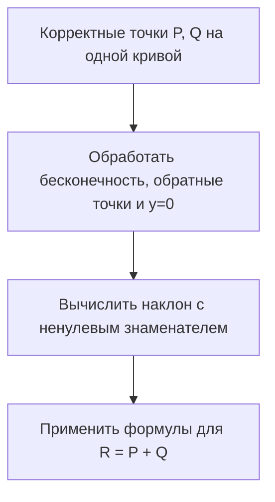
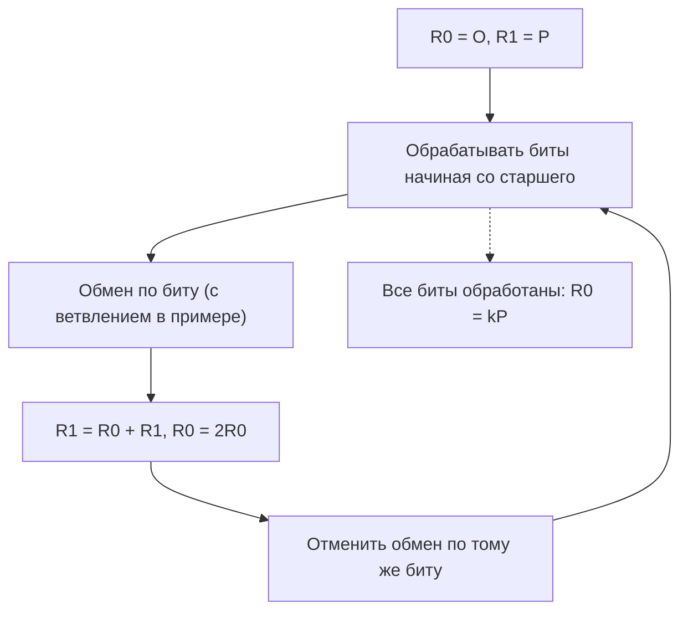
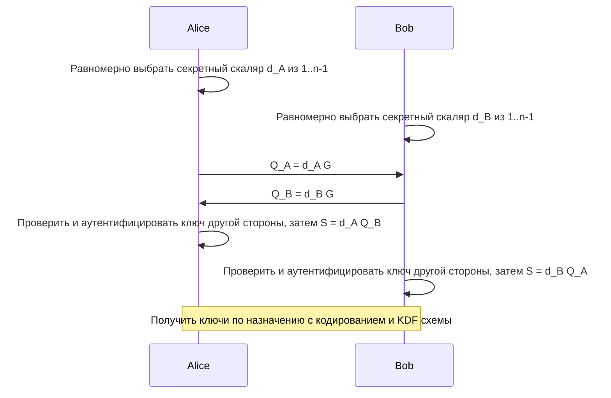

Криптография на эллиптических кривых (Elliptic Curve Cryptography, ECC) — семейство методов с открытым ключом, основанных на группах эллиптических кривых. Согласование ключей ECDH и подписи, например ECDSA, выполняют разные задачи. ECC не является одной операцией шифрования, обеспечивающей все свойства безопасности. Вместе с [обзором открытых ключей, хешей и подписей](/ru/p/modern-cryptography-public-key-hash-signature/) эта статья объясняет математические условия и требования к реализации.

Пример на C++ — **математическая демонстрация с переменным временем выполнения**, использующая открытые параметры secp256k1. Он не реализует генерацию закрытых ключей, аутентифицированное согласование ключей, подписи или криптографию с постоянным временем выполнения. Также объясняется, почему одной структуры лестницы недостаточно для постоянного времени.

## 1. Безопасность и размеры ключей

Выбирают подгруппу большого простого порядка $n$ с образующим элементом $G$. Найти $d$ по $Q=dG$ — задача дискретного логарифмирования на эллиптической кривой (ECDLP). Скаляр определяется по модулю $n$. Закрытый ключ выбирают равномерно из $1\le d<n$ с помощью криптографически стойкого генератора случайных чисел. Нужно различать размер поля $p$, порядок подгруппы $n$ и значение закрытого ключа.

Для подходящей подгруппы большого простого порядка классическая универсальная атака, например ро-метод Полларда (Pollard rho), требует примерно $O(\sqrt n)$ групповых операций. Это не означает, что возможен только полный перебор или что все эллиптические кривые одинаково сложны. Особые структуры и малые подгруппы допускают другие атаки, поэтому параметры и схему необходимо выбирать правильно.

Ниже приведено сравнение **оценок максимальной стойкости против классических компьютеров** из NIST SP 800-57 Part 1 Rev.5, Table 2. Столбец RSA задаёт битовую длину модуля, а столбец ECC — битовую длину $f$ порядка $n$ базовой точки, а не размер кодированного открытого ключа.

| Оценка стойкости (бит) | Модуль RSA (бит) | ECC $f$ (бит) |
| :---: | :---: | :---: |
| Не более 80 (историческое сравнение) | 1024 | 160–223 |
| 112 | 2048 | 224–255 |
| 128 | 3072 | 256–383 |
| 192 | 7680 | 384–511 |
| 256 | 15360 | Не менее 512 |

Строка 80 бит не является рекомендацией для новой системы. Таблица не сертифицирует конкретную кривую, реализацию или срок применения и не обеспечивает квантовую стойкость. Более короткие параметры могут уменьшить затраты на передачу данных, но ECC не обязательно быстрее RSA в каждой операции.

## 2. Группы и конечные поля

Группа состоит из множества и операции, удовлетворяющих замкнутости, ассоциативности, существованию нейтрального элемента и обратного элемента для каждого элемента. Если выполняется и коммутативность, группа называется абелевой. Точки эллиптической кривой вместе с бесконечно удалённой точкой и описанным ниже сложением образуют абелеву группу.

Для простого $p$ элементы простого поля $\mathbb F_p$ представляют числами $0,\ldots,p-1$. Сложение, вычитание и умножение выполняют по модулю $p$. Деление $u/v$ определено как $uv^{-1}$ **только при ненулевом $v$**.

$$vv^{-1}\equiv1\pmod p$$

Обратный элемент можно вычислить расширенным алгоритмом Евклида или как $v^{p-2}\bmod p$ по малой теореме Ферма. Выбор второго способа сам по себе не делает реализацию работающей за постоянное время. Нужно учитывать возведение в степень, умножение, приведение по модулю и выделение памяти.

## 3. Кривая и бесконечно удалённая точка

Статья ограничена **короткой формой Вейерштрасса** над простым полем с $p>3$. Эта формула не охватывает единообразно характеристику два или три, а также модели Монтгомери и Эдвардса.

$$y^2\equiv x^3+ax+b\pmod p$$

Коэффициенты являются элементами поля. Неособость требует следующего условия в этом поле:

$$\Delta=-16(4a^3+27b^2)\not\equiv0\pmod p$$

Одного этого условия недостаточно для криптографической пригодности кривой. К конечным точкам, удовлетворяющим уравнению, добавляют нейтральный элемент — бесконечно удалённую точку $\mathcal O$.

$$P+\mathcal O=\mathcal O+P=P$$

$$-(x,y)=(x,-y\bmod p),\qquad P+(-P)=\mathcal O$$

Картина пересечения прямой с вещественной кривой и последующего отражения точки пересечения даёт интуицию группового закона. Над конечным полем вычисляют по соответствующим алгебраическим формулам, а не по непрерывно нарисованной кривой.

## 4. Сложение, удвоение и исключительные случаи

Пусть $P=(x_1,y_1)$ и $Q=(x_2,y_2)$. Сначала обрабатывают сложение с $\mathcal O$ и случай $Q=-P$. Последний включает удвоение при $P=Q$ и $y_1=0$; результатом будет $\mathcal O$.

При $x_1\ne x_2$ используют:

$$\lambda\equiv(y_2-y_1)(x_2-x_1)^{-1}\pmod p$$

При $P=Q$ и $y_1\ne0$ используют формулу касательной:

$$\lambda\equiv(3x_1^2+a)(2y_1)^{-1}\pmod p$$

После того как эти условия обеспечили ненулевой знаменатель, результат вычисляют по общим формулам:

$$x_3\equiv\lambda^2-x_1-x_2\pmod p$$

$$y_3\equiv\lambda(x_1-x_3)-y_1\pmod p$$



Аффинные координаты требуют обращения элементов поля. Практические реализации могут уменьшать число обращений с помощью, например, якобиановых координат. Одна смена координат не гарантирует постоянное время или безопасность.

## 5. Скалярное умножение

Для неотрицательного целого $k$ определяют $kP$ повторным сложением и полагают $0P=\mathcal O$. Double-and-add обрабатывает биты от старшего к младшему: удваивает накопленный результат и прибавляет $P$, если бит равен единице. Число групповых операций уменьшается с $k$ прямых сложений до $O(\log k)$. Это не утверждение о постоянной стоимости одной операции или об абсолютном времени выполнения.

Следующий концептуальный псевдокод не входит в последующую программу C++. Он содержит ветвление по секретным битам.

```text
R = O
for bit in bits_of_k_from_most_significant:
    R = 2R
    if bit == 1:
        R = R + P
```

Обновление по типу лестницы Монтгомери выполняет одно сложение и одно удвоение на бит. Если обработанный префикс представляет $r$, можно сохранять $(R_0,R_1)=(rP,(r+1)P)$. Далее этот инвариант демонстрируется на полных аффинных точках; это не реализация X25519 или X448 из RFC 7748.



## 6. ECDH: согласование и аутентификация

Открытые параметры включают кривую, поле, базовую точку $G$, её порядок $n$ и кофактор. Каждая сторона создаёт подходящий закрытый скаляр и обменивается открытыми точками.

$$Q_A=d_AG,\qquad Q_B=d_BG$$

$$S=d_AQ_B=d_BQ_A=(d_Ad_B)G$$



Вычисление общего значения по открытым точкам — вычислительная задача Диффи–Хеллмана (CDH), определение которой отличается от ECDLP. Решение ECDLP позволяет вычислить общий результат; общей эквивалентности в обратную сторону здесь не предполагается.

ECDH сам по себе не аутентифицирует другую сторону и не предотвращает подмену открытых ключей. Реальный протокол связывает ключи, обмен и личности сторон, а также выполняет требуемые проверки кодирования, диапазонов координат, принадлежности кривой, бесконечности и подгруппы. Нельзя напрямую использовать общий результат в виде точки или её x-координаты как ключ AES. Нужно следовать предусмотренным протоколом кодированию, привязке к контексту и выработке ключей, например HKDF. Диаграмма не является полным рукопожатием TLS.

## 7. Условия постоянного времени выполнения

Зависящие от секретов ветвления, обращения к памяти, исключительные случаи и длительность арифметики могут раскрывать информацию в подходящей модели наблюдения. Число наблюдений и возможность восстановить весь ключ зависят от реализации и атаки. Универсальной гарантии, что несколько тысяч измерений раскроют каждый бит, нет.

Одинаковое число сложений на итерацию не гарантирует постоянного времени, если сами сложения ветвятся по секретным промежуточным значениям. Маскированный условный обмен — лишь часть защиты: важны представление целых чисел, компилятор и целевой процессор. RFC 7748 §5.1 объясняет, что одной одинаковой последовательности операций поля недостаточно против всех сторонних каналов.

`cpp_int` — целочисленный тип переменного размера. В `conditionalSwapDemo` и сложении точек ниже есть ветвления. **Этот код не работает за постоянное время и не должен обрабатывать секретные ключи в промышленной криптографии.**

## 8. Математическая демонстрация на C++17

Объедините следующие пять блоков C++ по порядку в один файл. Нужны заголовки Boost.Multiprecision. Программа использует только открытые фиксированные параметры и тестовые значения; она не генерирует, не сохраняет и не печатает секретных ключей.

### 8.1. Арифметика простого поля

`modInverse` предназначена только для фиксированного простого $p$ из примера и отвергает ноль. Обращение по теореме Ферма через `powerMod` также имеет переменное время выполнения.

```cpp
#include <cstdint>
#include <iostream>
#include <stdexcept>
#include <utility>
#include <boost/multiprecision/cpp_int.hpp>

using boost::multiprecision::cpp_int;

// Public secp256k1 parameters; this entire example is variable-time.
const cpp_int p("0xFFFFFFFFFFFFFFFFFFFFFFFFFFFFFFFFFFFFFFFFFFFFFFFFFFFFFFFEFFFFFC2F");
const cpp_int a = 0;
const cpp_int b = 7;
const cpp_int n("0xFFFFFFFFFFFFFFFFFFFFFFFFFFFFFFFEBAAEDCE6AF48A03BBFD25E8CD0364141");

cpp_int mod(cpp_int x, const cpp_int& m) {
    if (m <= 0) throw std::invalid_argument("Modulus must be positive");
    cpp_int r = x % m;
    if (r < 0) r += m;
    return r;
}

cpp_int powerMod(cpp_int base, cpp_int exp, const cpp_int& m) {
    if (m <= 1 || exp < 0) throw std::invalid_argument("Invalid powerMod input");
    cpp_int result = 1;
    base = mod(base, m);
    while (exp > 0) {
        if (exp % 2 == 1) result = mod(result * base, m);
        base = mod(base * base, m);
        exp /= 2;
    }
    return result;
}

// Inversion in the fixed prime field F_p only; zero has no inverse.
cpp_int modInverse(cpp_int value) {
    value = mod(value, p);
    if (value == 0) throw std::invalid_argument("Zero has no inverse");
    return powerMod(value, p - 2, p);
}
```

### 8.2. Точки и сложение

Конечная точка должна иметь координаты $0\le x,y<p$ и удовлетворять уравнению кривой. Бесконечность допустима в групповой арифметике, но должна отдельно отвергаться как открытый ECDH-ключ другой стороны. Кофактор secp256k1 равен единице. Эти проверки не заменяют проверку подгруппы, необходимую для произвольных кривых.

```cpp
struct Point {
    cpp_int x = 0;
    cpp_int y = 0;
    bool isInfinity = true;

    Point() = default;
    Point(cpp_int xValue, cpp_int yValue)
        : x(std::move(xValue)), y(std::move(yValue)), isInfinity(false) {}
};

bool isOnCurve(const Point& point) {
    if (point.isInfinity) return true;
    if (point.x < 0 || point.x >= p || point.y < 0 || point.y >= p) return false;
    return mod(point.y * point.y - point.x * point.x * point.x - a * point.x - b, p) == 0;
}

Point pointAdd(const Point& P, const Point& Q) {
    if (!isOnCurve(P) || !isOnCurve(Q)) throw std::invalid_argument("Invalid curve point");
    if (P.isInfinity) return Q;
    if (Q.isInfinity) return P;
    if (P.x == Q.x && mod(P.y + Q.y, p) == 0) return Point();

    cpp_int slope;
    if (P.x == Q.x && P.y == Q.y) {
        slope = mod((3 * P.x * P.x + a) * modInverse(2 * P.y), p);
    } else {
        slope = mod((Q.y - P.y) * modInverse(Q.x - P.x), p);
    }
    cpp_int x3 = mod(slope * slope - P.x - Q.x, p);
    cpp_int y3 = mod(slope * (P.x - x3) - P.y, p);
    return Point(x3, y3);
}
```

### 8.3. Имитация обмена

Функция содержит ветвление, поэтому в её имя включено Demo.

```cpp
// A branching simulation of conditional swap, NOT constant-time.
void conditionalSwapDemo(Point& left, Point& right, std::uint8_t bit) {
    if (bit > 1) throw std::invalid_argument("Bit must be zero or one");
    if (bit == 1) std::swap(left, right);
}
```

### 8.4. Лестница с проверкой диапазона

Демонстрация принимает $0\le k<2^{256}$ и отвергает значения вне диапазона. Он отличается от диапазона закрытых ключей $1\le d<n$. Старшие биты никогда не отбрасываются молча.

```cpp
// A functional ladder demonstration for 0 <= k < 2^256.
// Zero is allowed for group arithmetic, but is not a valid private key.
Point scalarMultiply(const Point& P, const cpp_int& k) {
    if (k < 0 || k >= (cpp_int(1) << 256)) throw std::invalid_argument("Scalar outside demo range");
    if (!isOnCurve(P)) throw std::invalid_argument("Invalid curve point");
    Point R0;
    Point R1 = P;
    for (int i = 255; i >= 0; --i) {
        std::uint8_t bit = boost::multiprecision::bit_test(k, i) ? 1 : 0;
        conditionalSwapDemo(R0, R1, bit);
        R1 = pointAdd(R0, R1);
        R0 = pointAdd(R0, R0);
        conditionalSwapDemo(R0, R1, bit);
    }
    return R0;
}
```

### 8.5. Проверка открытых значений

С помощью образующего элемента secp256k1 из SEC 2 проверяют $2G$ и $nG=\mathcal O$. Одна такая самопроверка не доказывает безопасность криптографической реализации.

```cpp
int main() {
    const Point G(
        cpp_int("0x79BE667EF9DCBBAC55A06295CE870B07029BFCDB2DCE28D959F2815B16F81798"),
        cpp_int("0x483ADA7726A3C4655DA4FBFC0E1108A8FD17B448A68554199C47D08FFB10D4B8")
    );
    const Point doubled = scalarMultiply(G, 2);
    if (doubled.isInfinity || !isOnCurve(doubled) || !scalarMultiply(G, n).isInfinity) {
        throw std::runtime_error("Arithmetic self-check failed");
    }
    std::cout << "2G.x = " << std::hex << doubled.x << "\n";
    std::cout << "2G.y = " << std::hex << doubled.y << "\n";
    std::cout << "nG = infinity\n";
}
```

Например, сохраните пять блоков в `ecc_demo.cpp` и выполните их в окружении с настроенным путём включения Boost:

```sh
g++ -std=c++17 -O2 -Wall -Wextra ecc_demo.cpp -o ecc_demo
./ecc_demo
```

## 9. Заключение

Следует различать поле, кривую, подгруппу и криптографическую схему. Важны исключительные случаи сложения, диапазоны скаляров, проверка открытых ключей, аутентификация другой стороны и выработка ключей. Арифметическая корректность лестницы и постоянное время реализации — разные предметы проверки.

Демонстрация предназначена для изучения групповой арифметики. Для реального согласования ключей и подписей нужны поддерживаемые и проверенные библиотеки, реализующие нужные протокол и кривую.

### Источники

- [RFC 6090: Fundamental Elliptic Curve Cryptography Algorithms](https://www.rfc-editor.org/rfc/rfc6090.html) (§§2–4, 10)
- [RFC 7748: Elliptic Curves for Security](https://www.rfc-editor.org/rfc/rfc7748.html) (§§5–5.1)
- [NIST SP 800-57 Part 1 Rev.5](https://nvlpubs.nist.gov/nistpubs/SpecialPublications/NIST.SP.800-57pt1r5.pdf) (§5.6.1.1, Table 2)
- [Standards for Efficient Cryptography 2 (SEC 2), version 2.0](https://www.secg.org/sec2-v2.pdf) (§2.4.1, secp256k1)
- [RFC 5869: HKDF](https://www.rfc-editor.org/rfc/rfc5869.html) (§§1, 3.2–3.3)
- [Boost.Multiprecision: cpp_int](https://www.boost.org/doc/libs/1_83_0/libs/multiprecision/doc/html/boost_multiprecision/tut/ints/cpp_int.html)


