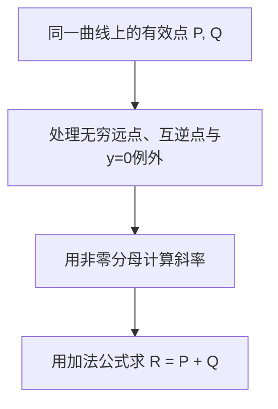
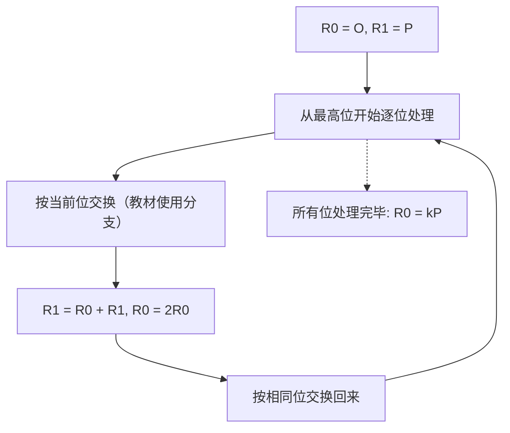
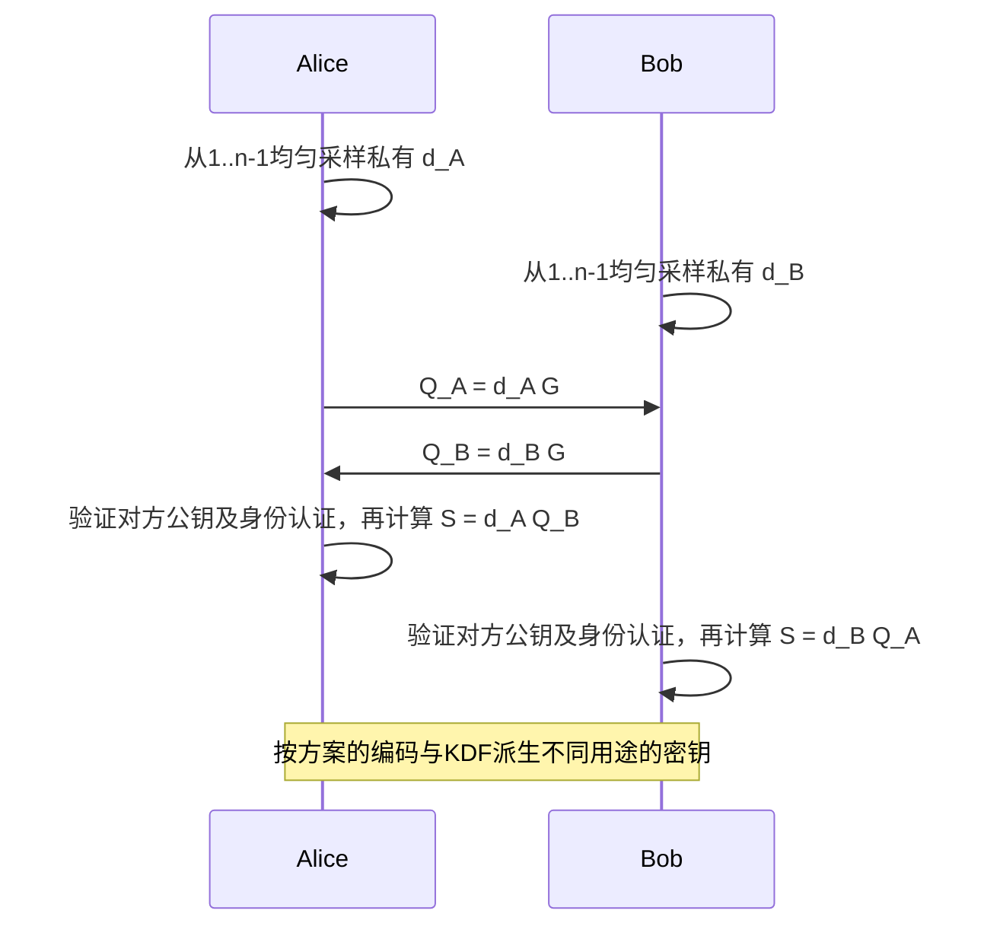

椭圆曲线密码学（Elliptic Curve Cryptography，ECC）是基于椭圆曲线群的一类公钥技术。ECDH密钥协商与ECDSA等签名方案承担不同的角色；ECC不是一种包办所有安全属性的加密操作。结合[公钥、哈希与签名概述](/zh-cn/p/modern-cryptography-public-key-hash-signature/)，本文说明其中的数学与实现条件。

C++示例是使用secp256k1公开参数的**可变时间数学教材**，不实现私钥生成、经身份认证的密钥协商、签名或恒定时间密码运算。后文也会说明，为何仅有阶梯式计算结构还不足以保证恒定时间。

## 1. 安全性与密钥长度

选择阶为大素数 $n$ 的子群及生成元 $G$。由 $Q=dG$ 求 $d$，就是椭圆曲线离散对数问题（ECDLP）。标量只在模 $n$ 的意义下确定。私钥应使用密码学安全随机数生成器，从 $1\le d<n$ 中均匀采样。有限域的大小 $p$、子群的阶 $n$ 与私钥值必须区分。

对参数适当的大素数阶子群，Pollard rho等经典通用攻击大约需要 $O(\sqrt n)$ 次群运算。这不表示攻击只有穷举，也不表示所有椭圆曲线同样难。特殊曲线结构与小子群还可能允许其他攻击，必须恰当选择参数和方案。

下表依据NIST SP 800-57 Part 1 Rev.5的Table 2，比较**针对经典计算机的估计最大安全强度**。RSA列为模数的比特长度，ECC列为基点的阶 $n$ 的比特长度 $f$，而不是公钥编码后的大小。

| 估计强度（比特） | RSA模数（比特） | ECC的 $f$（比特） |
| :---: | :---: | :---: |
| 不超过80（历史比较） | 1024 | 160–223 |
| 112 | 2048 | 224–255 |
| 128 | 3072 | 256–383 |
| 192 | 7680 | 384–511 |
| 256 | 15360 | 至少512 |

80比特这一行不是对新系统的推荐。此表不代表对特定曲线、实现或部署期限的批准，也不保证抵抗量子攻击。较短的参数可能减少通信开销，但ECC并非在每种运算中都比RSA更快。

## 2. 群与有限域

群由集合与运算组成，满足封闭性、结合律、单位元存在，以及每个元素都有逆元。还满足交换律的群称为阿贝尔群（交换群）。椭圆曲线上的点连同无穷远点，配合下述加法构成阿贝尔群。

对素数 $p$，素域 $\mathbb F_p$ 的元素用 $0,\ldots,p-1$ 表示，加、减、乘都模 $p$ 计算。除法 $u/v$ **仅在 $v$ 非零时**定义为 $uv^{-1}$。

$$vv^{-1}\equiv1\pmod p$$

逆元可以用扩展欧几里得算法求得，也可以根据费马小定理计算 $v^{p-2}\bmod p$。选择后者本身并不能让实现变成恒定时间；必须一并考察幂运算、乘法、模约减和内存分配。

## 3. 曲线与无穷远点

本文限于素数 $p>3$ 的域上的**短魏尔斯特拉斯形式**。不能用这一公式一概处理特征为2或3的域，也不能把Montgomery形式与Edwards形式混为一谈。

$$y^2\equiv x^3+ax+b\pmod p$$

系数是域元素，非奇异性要求在该域中满足：

$$\Delta=-16(4a^3+27b^2)\not\equiv0\pmod p$$

仅此条件还不足以说明曲线适合密码学。在满足曲线方程的有限点之外，加入作为单位元的无穷远点 $\mathcal O$。

$$P+\mathcal O=\mathcal O+P=P$$

$$-(x,y)=(x,-y\bmod p),\qquad P+(-P)=\mathcal O$$

实数图形中“直线与曲线求交，再反射交点”的描述为群运算提供直观解释。有限域上的计算依靠相应的代数公式，而不是连续绘制的曲线。

## 4. 点加法、倍点与例外情况

设 $P=(x_1,y_1)$、$Q=(x_2,y_2)$。首先处理与 $\mathcal O$ 相加，以及 $Q=-P$ 的情况。后者也包括 $P=Q$ 且 $y_1=0$ 的倍点，结果为 $\mathcal O$。

当 $x_1\ne x_2$ 时，使用：

$$\lambda\equiv(y_2-y_1)(x_2-x_1)^{-1}\pmod p$$

当 $P=Q$ 且 $y_1\ne0$ 时，使用切线公式：

$$\lambda\equiv(3x_1^2+a)(2y_1)^{-1}\pmod p$$

在这些条件确保分母非零之后，以共同的公式求结果：

$$x_3\equiv\lambda^2-x_1-x_2\pmod p$$

$$y_3\equiv\lambda(x_1-x_3)-y_1\pmod p$$



仿射坐标需要求逆。实际实现可以使用Jacobian（雅可比）坐标等减少求逆次数，但改变坐标系本身并不能保证恒定时间或安全性。

## 5. 标量乘法

对非负整数 $k$，以反复加法定义 $kP$，并规定 $0P=\mathcal O$。Double-and-Add从最高位到最低位处理标量：先把累积结果翻倍，若当前位是1，再加上 $P$。群运算次数从朴素的 $k$ 次加法降至 $O(\log k)$，但这不表示每次群运算开销固定，也不保证某个绝对运行时间。

以下是概念伪代码，不属于后面的C++程序，其中有依赖秘密比特的分支。

```text
R = O
for bit in bits_of_k_from_most_significant:
    R = 2R
    if bit == 1:
        R = R + P
```

Montgomery阶梯式更新在每一位上执行一次加法和一次倍点。若已处理的前缀表示 $r$，就可以保持 $(R_0,R_1)=(rP,(r+1)P)$。后面的教材以完整的仿射点演示这一不变量，并不是RFC 7748的X25519或X448实现。



## 6. ECDH：共享值与身份认证

公开的域参数包括曲线、有限域、基点 $G$、其阶 $n$ 和余因子等。双方分别生成合适的私有标量，并交换公钥点。

$$Q_A=d_AG,\qquad Q_B=d_BG$$

$$S=d_AQ_B=d_BQ_A=(d_Ad_B)G$$



从公开点计算共享值是计算型Diffie–Hellman问题（CDH），与ECDLP的定义不同。能解ECDLP就能计算共享值，但这里不假设反方向存在一般的等价关系。

ECDH本身没有对方身份认证，不能阻止攻击者替换公钥。实际协议将公钥、本次交换与对方身份绑定，并按方案检查编码、坐标范围、曲线成员关系、无穷远点及必要的子群条件。不要直接把共享点或其x坐标当作AES密钥；应遵循协议规定的编码、上下文绑定和HKDF等密钥派生方法。此图不是完整的TLS握手。

## 7. 恒定时间实现的条件

依赖秘密的分支、内存访问、例外处理和算术耗时，可能在相应的观测条件下泄露信息。观测次数与能否恢复完整私钥，取决于实现和攻击模型；不存在“几千次测量必然得到每个比特”的通用结论。

即使每轮加法次数相同，如果加法内部仍按秘密中间值分支，也不能保证恒定时间。掩码式条件交换只是防御的一部分，还必须检查整数表示、编译器和目标CPU。RFC 7748 §5.1说明，相同的有限域运算序列本身不足以阻止所有侧信道。

`cpp_int` 是可变长度整数类型，下面的 `conditionalSwapDemo` 与点加法也都包含分支。**以下代码不是恒定时间实现，不能用于生产密码系统中的秘密密钥运算。**

## 8. C++17数学示例

把以下5个C++代码块按顺序连接到同一个文件中，需要Boost.Multiprecision头文件。程序只使用公开的固定参数与测试值，不生成、存储或输出秘密密钥。

### 8.1. 素域运算

`modInverse` 仅用于这里固定的素数 $p$，并拒绝零输入。以 `powerMod` 实现的费马求逆也具有可变运行时间。

```cpp
#include <cstdint>
#include <iostream>
#include <stdexcept>
#include <utility>
#include <boost/multiprecision/cpp_int.hpp>

using boost::multiprecision::cpp_int;

// Public secp256k1 parameters; this entire example is variable-time.
const cpp_int p("0xFFFFFFFFFFFFFFFFFFFFFFFFFFFFFFFFFFFFFFFFFFFFFFFFFFFFFFFEFFFFFC2F");
const cpp_int a = 0;
const cpp_int b = 7;
const cpp_int n("0xFFFFFFFFFFFFFFFFFFFFFFFFFFFFFFFEBAAEDCE6AF48A03BBFD25E8CD0364141");

cpp_int mod(cpp_int x, const cpp_int& m) {
    if (m <= 0) throw std::invalid_argument("Modulus must be positive");
    cpp_int r = x % m;
    if (r < 0) r += m;
    return r;
}

cpp_int powerMod(cpp_int base, cpp_int exp, const cpp_int& m) {
    if (m <= 1 || exp < 0) throw std::invalid_argument("Invalid powerMod input");
    cpp_int result = 1;
    base = mod(base, m);
    while (exp > 0) {
        if (exp % 2 == 1) result = mod(result * base, m);
        base = mod(base * base, m);
        exp /= 2;
    }
    return result;
}

// Inversion in the fixed prime field F_p only; zero has no inverse.
cpp_int modInverse(cpp_int value) {
    value = mod(value, p);
    if (value == 0) throw std::invalid_argument("Zero has no inverse");
    return powerMod(value, p - 2, p);
}
```

### 8.2. 点与加法

有限点必须满足坐标 $0\le x,y<p$ 及曲线方程。群运算允许无穷远点，但作为ECDH对方的公钥时必须另行拒绝。secp256k1的余因子为1；这些检查不能替代任意曲线所需的子群验证。

```cpp
struct Point {
    cpp_int x = 0;
    cpp_int y = 0;
    bool isInfinity = true;

    Point() = default;
    Point(cpp_int xValue, cpp_int yValue)
        : x(std::move(xValue)), y(std::move(yValue)), isInfinity(false) {}
};

bool isOnCurve(const Point& point) {
    if (point.isInfinity) return true;
    if (point.x < 0 || point.x >= p || point.y < 0 || point.y >= p) return false;
    return mod(point.y * point.y - point.x * point.x * point.x - a * point.x - b, p) == 0;
}

Point pointAdd(const Point& P, const Point& Q) {
    if (!isOnCurve(P) || !isOnCurve(Q)) throw std::invalid_argument("Invalid curve point");
    if (P.isInfinity) return Q;
    if (Q.isInfinity) return P;
    if (P.x == Q.x && mod(P.y + Q.y, p) == 0) return Point();

    cpp_int slope;
    if (P.x == Q.x && P.y == Q.y) {
        slope = mod((3 * P.x * P.x + a) * modInverse(2 * P.y), p);
    } else {
        slope = mod((Q.y - P.y) * modInverse(Q.x - P.x), p);
    }
    cpp_int x3 = mod(slope * slope - P.x - Q.x, p);
    cpp_int y3 = mod(slope * (P.x - x3) - P.y, p);
    return Point(x3, y3);
}
```

### 8.3. 交换模拟

此函数使用分支，因此名称中特别标注了Demo。

```cpp
// A branching simulation of conditional swap, NOT constant-time.
void conditionalSwapDemo(Point& left, Point& right, std::uint8_t bit) {
    if (bit > 1) throw std::invalid_argument("Bit must be zero or one");
    if (bit == 1) std::swap(left, right);
}
```

### 8.4. 检查输入范围的阶梯计算

此示例只接受 $0\le k<2^{256}$，并拒绝范围外的值。这与私钥的有效范围 $1\le d<n$ 不同；它不会悄悄截去高位。

```cpp
// A functional ladder demonstration for 0 <= k < 2^256.
// Zero is allowed for group arithmetic, but is not a valid private key.
Point scalarMultiply(const Point& P, const cpp_int& k) {
    if (k < 0 || k >= (cpp_int(1) << 256)) throw std::invalid_argument("Scalar outside demo range");
    if (!isOnCurve(P)) throw std::invalid_argument("Invalid curve point");
    Point R0;
    Point R1 = P;
    for (int i = 255; i >= 0; --i) {
        std::uint8_t bit = boost::multiprecision::bit_test(k, i) ? 1 : 0;
        conditionalSwapDemo(R0, R1, bit);
        R1 = pointAdd(R0, R1);
        R0 = pointAdd(R0, R0);
        conditionalSwapDemo(R0, R1, bit);
    }
    return R0;
}
```

### 8.5. 用公开值检查运算

使用SEC 2的secp256k1基点检查 $2G$ 与 $nG=\mathcal O$。仅凭这一自检并不能证明密码实现的安全性。

```cpp
int main() {
    const Point G(
        cpp_int("0x79BE667EF9DCBBAC55A06295CE870B07029BFCDB2DCE28D959F2815B16F81798"),
        cpp_int("0x483ADA7726A3C4655DA4FBFC0E1108A8FD17B448A68554199C47D08FFB10D4B8")
    );
    const Point doubled = scalarMultiply(G, 2);
    if (doubled.isInfinity || !isOnCurve(doubled) || !scalarMultiply(G, n).isInfinity) {
        throw std::runtime_error("Arithmetic self-check failed");
    }
    std::cout << "2G.x = " << std::hex << doubled.x << "\n";
    std::cout << "2G.y = " << std::hex << doubled.y << "\n";
    std::cout << "nG = infinity\n";
}
```

例如，把5个代码块保存为 `ecc_demo.cpp`，并在已配置Boost包含路径的环境中执行：

```sh
g++ -std=c++17 -O2 -Wall -Wextra ecc_demo.cpp -o ecc_demo
./ecc_demo
```

## 9. 总结

应区分有限域、曲线、子群与密码方案。点加法的例外、标量范围、公钥验证、对方身份认证和密钥派生都不可忽略。阶梯算法的数学正确性与恒定时间实现也是不同的验证任务。

此示例用于追踪群运算。实际的密钥协商和签名，应使用支持目标协议与曲线、持续维护且经过验证的库。

### 参考资料

- [RFC 6090: Fundamental Elliptic Curve Cryptography Algorithms](https://www.rfc-editor.org/rfc/rfc6090.html) (§§2–4, 10)
- [RFC 7748: Elliptic Curves for Security](https://www.rfc-editor.org/rfc/rfc7748.html) (§§5–5.1)
- [NIST SP 800-57 Part 1 Rev.5](https://nvlpubs.nist.gov/nistpubs/SpecialPublications/NIST.SP.800-57pt1r5.pdf) (§5.6.1.1, Table 2)
- [Standards for Efficient Cryptography 2 (SEC 2), version 2.0](https://www.secg.org/sec2-v2.pdf) (§2.4.1, secp256k1)
- [RFC 5869: HKDF](https://www.rfc-editor.org/rfc/rfc5869.html) (§§1, 3.2–3.3)
- [Boost.Multiprecision: cpp_int](https://www.boost.org/doc/libs/1_83_0/libs/multiprecision/doc/html/boost_multiprecision/tut/ints/cpp_int.html)


