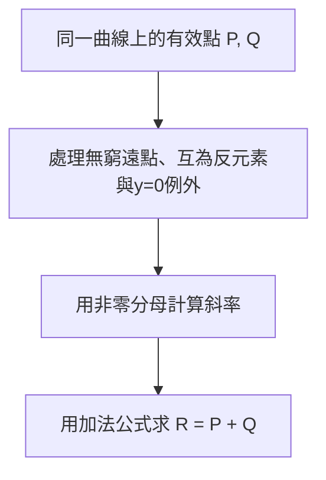
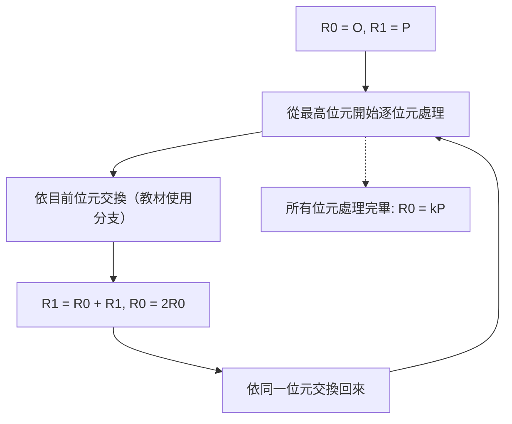
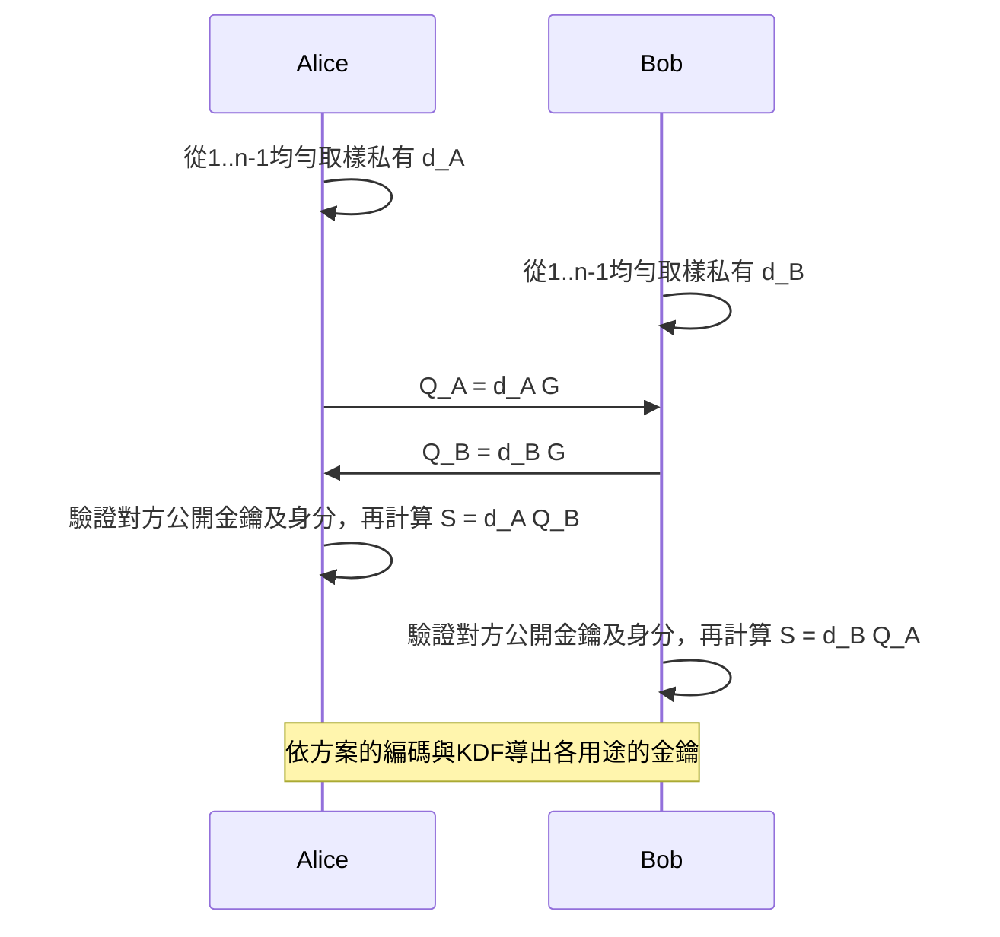

橢圓曲線密碼學（Elliptic Curve Cryptography，ECC）是運用橢圓曲線群的一類公開金鑰技術。ECDH金鑰協議與ECDSA等簽章方案的用途不同；ECC並不是一種能包辦所有安全性質的加密操作。搭配[公開金鑰、雜湊與簽章概述](/zh-tw/p/modern-cryptography-public-key-hash-signature/)，本文說明相關的數學與實作條件。

C++範例是使用secp256k1公開參數的**可變時間數學教材**，不提供私有金鑰產生、經身分驗證的金鑰協議、簽章或常數時間密碼實作。後文也會說明，為何只有階梯式計算結構，仍不足以保證常數時間。

## 1. 安全性與金鑰長度

選擇階數為大質數 $n$ 的子群及其生成元 $G$。由 $Q=dG$ 求出 $d$，就是橢圓曲線離散對數問題（ECDLP）。純量只在模 $n$ 的意義下確定。私有金鑰應以密碼學安全的亂數產生器，從 $1\le d<n$ 中均勻取樣。必須區分體的大小 $p$、子群的階數 $n$ 與私有金鑰的值。

對於參數適當的大質數階子群，Pollard rho等古典通用攻擊約需 $O(\sqrt n)$ 次群運算。這不表示只能窮舉，也不表示每條橢圓曲線都同樣困難。特殊曲線結構與小子群還可能允許其他攻擊，因此必須適當選擇參數與方案。

下表依據NIST SP 800-57 Part 1 Rev.5的Table 2，比較**針對古典電腦的估計最大安全強度**。RSA欄是模數的位元長度；ECC欄是基點階數 $n$ 的位元長度 $f$，不是公開金鑰編碼後的大小。

| 估計強度（位元） | RSA模數（位元） | ECC的 $f$（位元） |
| :---: | :---: | :---: |
| 不超過80（歷史比較） | 1024 | 160–223 |
| 112 | 2048 | 224–255 |
| 128 | 3072 | 256–383 |
| 192 | 7680 | 384–511 |
| 256 | 15360 | 至少512 |

80位元這一列不是對新系統的建議。此表不代表對特定曲線、實作或部署期限的核准，也不保證能抵抗量子攻擊。較短的參數可能減少通訊負擔，但ECC並非每種運算都比RSA更快。

## 2. 群與有限體

群是集合與運算所構成的結構，滿足封閉性、結合律、單位元素存在，以及每個元素都有反元素。若還滿足交換律，就稱為阿貝爾群（交換群）。橢圓曲線上的點連同無窮遠點，配合下述加法構成阿貝爾群。

對質數 $p$，質數體 $\mathbb F_p$ 的元素以 $0,\ldots,p-1$ 表示，加、減、乘皆模 $p$ 計算。除法 $u/v$ **只在 $v$ 非零時**定義為 $uv^{-1}$。

$$vv^{-1}\equiv1\pmod p$$

反元素可由擴展歐幾里得演算法求得，也可以根據費馬小定理計算 $v^{p-2}\bmod p$。選用後者本身不會讓實作成為常數時間；必須一起考量冪運算、乘法、模約減與記憶體配置。

## 3. 曲線與無窮遠點

本文限於質數 $p>3$ 的體上的**短魏爾斯特拉斯形式**。不能用這一公式一概處理特徵為2或3的體，也不能將Montgomery形式與Edwards形式混為一談。

$$y^2\equiv x^3+ax+b\pmod p$$

係數是體的元素，非奇異性要求在該體中滿足：

$$\Delta=-16(4a^3+27b^2)\not\equiv0\pmod p$$

這個條件本身還不足以說明曲線適合密碼學。在滿足曲線方程式的有限點之外，加入作為單位元素的無窮遠點 $\mathcal O$。

$$P+\mathcal O=\mathcal O+P=P$$

$$-(x,y)=(x,-y\bmod p),\qquad P+(-P)=\mathcal O$$

在實數圖形中，「直線與曲線求交，再將交點反射」可提供群運算的直覺。有限體中的計算則依據相應的代數公式，而非連續繪製的曲線。

## 4. 點加法、倍點與例外情況

設 $P=(x_1,y_1)$、$Q=(x_2,y_2)$。首先處理與 $\mathcal O$ 相加，以及 $Q=-P$ 的情況。後者也包含 $P=Q$ 且 $y_1=0$ 的倍點，結果為 $\mathcal O$。

當 $x_1\ne x_2$ 時，使用：

$$\lambda\equiv(y_2-y_1)(x_2-x_1)^{-1}\pmod p$$

當 $P=Q$ 且 $y_1\ne0$ 時，使用切線公式：

$$\lambda\equiv(3x_1^2+a)(2y_1)^{-1}\pmod p$$

在這些條件確保分母非零之後，以共同的公式求出結果：

$$x_3\equiv\lambda^2-x_1-x_2\pmod p$$

$$y_3\equiv\lambda(x_1-x_3)-y_1\pmod p$$



仿射座標需要計算反元素。實用實作可以使用Jacobian（雅可比）座標等減少計算反元素的次數，但改變座標系本身不能保證常數時間或安全性。

## 5. 純量乘法

對非負整數 $k$，以反覆加法定義 $kP$，並令 $0P=\mathcal O$。Double-and-Add從最高位元到最低位元依序處理：先將累積結果加倍，若目前位元是1，再加上 $P$。群運算次數從直接進行 $k$ 次加法降為 $O(\log k)$，但這不表示每次群運算成本固定，也不保證某個絕對執行時間。

以下為概念性的虛擬碼，不屬於後面的C++程式，其中含有依賴秘密位元的分支。

```text
R = O
for bit in bits_of_k_from_most_significant:
    R = 2R
    if bit == 1:
        R = R + P
```

Montgomery階梯式更新在每個位元執行一次加法與一次倍點。如果已處理的前綴表示 $r$，就可維持 $(R_0,R_1)=(rP,(r+1)P)$。後面的教材使用完整的仿射點展示這個不變量，並不是RFC 7748的X25519或X448實作。



## 6. ECDH：共享值與身分驗證

公開的領域參數包括曲線、體、基點 $G$、其階數 $n$ 與餘因子等。雙方分別產生合適的私有純量，並交換公開金鑰點。

$$Q_A=d_AG,\qquad Q_B=d_BG$$

$$S=d_AQ_B=d_BQ_A=(d_Ad_B)G$$



從公開點計算共享值是計算型Diffie–Hellman問題（CDH），與ECDLP的定義不同。能解ECDLP就能計算共享值，但這裡不假設反方向具有一般性的等價關係。

ECDH本身不驗證對方身分，無法阻止攻擊者替換公開金鑰。實際協定將金鑰、本次交換與對方身分綁定，並依方案檢查編碼、座標範圍、曲線成員關係、無窮遠點及必要的子群條件。不可直接將共享點或其x座標當成AES金鑰；應遵循協定指定的編碼、情境綁定，以及HKDF等金鑰導出方法。此圖不是完整的TLS交握。

## 7. 常數時間實作的條件

依賴秘密的分支、記憶體存取、例外處理與算術耗時，可能在相應的觀測條件下洩漏資訊。觀測次數與能否復原完整私有金鑰，取決於實作與攻擊模型；不存在「幾千次量測必定得到每個位元」的通用結論。

即使每輪加法次數相同，如果加法內部仍依秘密中間值分支，也無法保證常數時間。使用遮罩的條件式交換只是防禦的一部分，還必須檢查整數表示、編譯器與目標CPU。RFC 7748 §5.1說明，相同的體運算序列本身不足以防止所有旁通道。

`cpp_int` 是可變長度整數型別，以下的 `conditionalSwapDemo` 與點加法也都包含分支。**下列程式碼不是常數時間實作，不能用於正式密碼系統中的秘密金鑰運算。**

## 8. C++17數學範例

將以下5個C++區塊依序串接在同一個檔案中，需要Boost.Multiprecision標頭檔。程式僅使用公開的固定參數與測試值，不產生、儲存或輸出秘密金鑰。

### 8.1. 質數體運算

`modInverse` 只用於此處固定的質數 $p$，並拒絕零輸入。使用 `powerMod` 的費馬反元素計算也具有可變執行時間。

```cpp
#include <cstdint>
#include <iostream>
#include <stdexcept>
#include <utility>
#include <boost/multiprecision/cpp_int.hpp>

using boost::multiprecision::cpp_int;

// Public secp256k1 parameters; this entire example is variable-time.
const cpp_int p("0xFFFFFFFFFFFFFFFFFFFFFFFFFFFFFFFFFFFFFFFFFFFFFFFFFFFFFFFEFFFFFC2F");
const cpp_int a = 0;
const cpp_int b = 7;
const cpp_int n("0xFFFFFFFFFFFFFFFFFFFFFFFFFFFFFFFEBAAEDCE6AF48A03BBFD25E8CD0364141");

cpp_int mod(cpp_int x, const cpp_int& m) {
    if (m <= 0) throw std::invalid_argument("Modulus must be positive");
    cpp_int r = x % m;
    if (r < 0) r += m;
    return r;
}

cpp_int powerMod(cpp_int base, cpp_int exp, const cpp_int& m) {
    if (m <= 1 || exp < 0) throw std::invalid_argument("Invalid powerMod input");
    cpp_int result = 1;
    base = mod(base, m);
    while (exp > 0) {
        if (exp % 2 == 1) result = mod(result * base, m);
        base = mod(base * base, m);
        exp /= 2;
    }
    return result;
}

// Inversion in the fixed prime field F_p only; zero has no inverse.
cpp_int modInverse(cpp_int value) {
    value = mod(value, p);
    if (value == 0) throw std::invalid_argument("Zero has no inverse");
    return powerMod(value, p - 2, p);
}
```

### 8.2. 點與加法

有限點必須滿足座標 $0\le x,y<p$ 與曲線方程式。群運算允許無窮遠點，但作為ECDH對方的公開金鑰時，必須另外拒絕。secp256k1的餘因子為1；這些檢查不能取代任意曲線所需的子群驗證。

```cpp
struct Point {
    cpp_int x = 0;
    cpp_int y = 0;
    bool isInfinity = true;

    Point() = default;
    Point(cpp_int xValue, cpp_int yValue)
        : x(std::move(xValue)), y(std::move(yValue)), isInfinity(false) {}
};

bool isOnCurve(const Point& point) {
    if (point.isInfinity) return true;
    if (point.x < 0 || point.x >= p || point.y < 0 || point.y >= p) return false;
    return mod(point.y * point.y - point.x * point.x * point.x - a * point.x - b, p) == 0;
}

Point pointAdd(const Point& P, const Point& Q) {
    if (!isOnCurve(P) || !isOnCurve(Q)) throw std::invalid_argument("Invalid curve point");
    if (P.isInfinity) return Q;
    if (Q.isInfinity) return P;
    if (P.x == Q.x && mod(P.y + Q.y, p) == 0) return Point();

    cpp_int slope;
    if (P.x == Q.x && P.y == Q.y) {
        slope = mod((3 * P.x * P.x + a) * modInverse(2 * P.y), p);
    } else {
        slope = mod((Q.y - P.y) * modInverse(Q.x - P.x), p);
    }
    cpp_int x3 = mod(slope * slope - P.x - Q.x, p);
    cpp_int y3 = mod(slope * (P.x - x3) - P.y, p);
    return Point(x3, y3);
}
```

### 8.3. 交換模擬

這個函式使用分支，因此名稱特別標示Demo。

```cpp
// A branching simulation of conditional swap, NOT constant-time.
void conditionalSwapDemo(Point& left, Point& right, std::uint8_t bit) {
    if (bit > 1) throw std::invalid_argument("Bit must be zero or one");
    if (bit == 1) std::swap(left, right);
}
```

### 8.4. 檢查輸入範圍的階梯計算

此教材僅接受 $0\le k<2^{256}$，並拒絕範圍外的值。這與私有金鑰的有效範圍 $1\le d<n$ 不同；不會默默捨棄高位元。

```cpp
// A functional ladder demonstration for 0 <= k < 2^256.
// Zero is allowed for group arithmetic, but is not a valid private key.
Point scalarMultiply(const Point& P, const cpp_int& k) {
    if (k < 0 || k >= (cpp_int(1) << 256)) throw std::invalid_argument("Scalar outside demo range");
    if (!isOnCurve(P)) throw std::invalid_argument("Invalid curve point");
    Point R0;
    Point R1 = P;
    for (int i = 255; i >= 0; --i) {
        std::uint8_t bit = boost::multiprecision::bit_test(k, i) ? 1 : 0;
        conditionalSwapDemo(R0, R1, bit);
        R1 = pointAdd(R0, R1);
        R0 = pointAdd(R0, R0);
        conditionalSwapDemo(R0, R1, bit);
    }
    return R0;
}
```

### 8.5. 用公開值檢查運算

使用SEC 2的secp256k1基點檢查 $2G$ 與 $nG=\mathcal O$。只有這個自我檢查，並不能證明密碼實作的安全性。

```cpp
int main() {
    const Point G(
        cpp_int("0x79BE667EF9DCBBAC55A06295CE870B07029BFCDB2DCE28D959F2815B16F81798"),
        cpp_int("0x483ADA7726A3C4655DA4FBFC0E1108A8FD17B448A68554199C47D08FFB10D4B8")
    );
    const Point doubled = scalarMultiply(G, 2);
    if (doubled.isInfinity || !isOnCurve(doubled) || !scalarMultiply(G, n).isInfinity) {
        throw std::runtime_error("Arithmetic self-check failed");
    }
    std::cout << "2G.x = " << std::hex << doubled.x << "\n";
    std::cout << "2G.y = " << std::hex << doubled.y << "\n";
    std::cout << "nG = infinity\n";
}
```

例如，將5個區塊儲存為 `ecc_demo.cpp`，在已設定Boost標頭檔搜尋路徑的環境中執行：

```sh
g++ -std=c++17 -O2 -Wall -Wextra ecc_demo.cpp -o ecc_demo
./ecc_demo
```

## 9. 總結

必須區分體、曲線、子群與密碼方案。點加法的例外、純量範圍、公開金鑰驗證、對方身分驗證與金鑰導出都不可忽略。階梯演算法的數學正確性與常數時間實作，也是不同的驗證工作。

此教材用來追蹤群運算。實際的金鑰協議與簽章，應使用支援目標協定與曲線、持續維護且經過驗證的函式庫。

### 參考資料

- [RFC 6090: Fundamental Elliptic Curve Cryptography Algorithms](https://www.rfc-editor.org/rfc/rfc6090.html) (§§2–4, 10)
- [RFC 7748: Elliptic Curves for Security](https://www.rfc-editor.org/rfc/rfc7748.html) (§§5–5.1)
- [NIST SP 800-57 Part 1 Rev.5](https://nvlpubs.nist.gov/nistpubs/SpecialPublications/NIST.SP.800-57pt1r5.pdf) (§5.6.1.1, Table 2)
- [Standards for Efficient Cryptography 2 (SEC 2), version 2.0](https://www.secg.org/sec2-v2.pdf) (§2.4.1, secp256k1)
- [RFC 5869: HKDF](https://www.rfc-editor.org/rfc/rfc5869.html) (§§1, 3.2–3.3)
- [Boost.Multiprecision: cpp_int](https://www.boost.org/doc/libs/1_83_0/libs/multiprecision/doc/html/boost_multiprecision/tut/ints/cpp_int.html)


