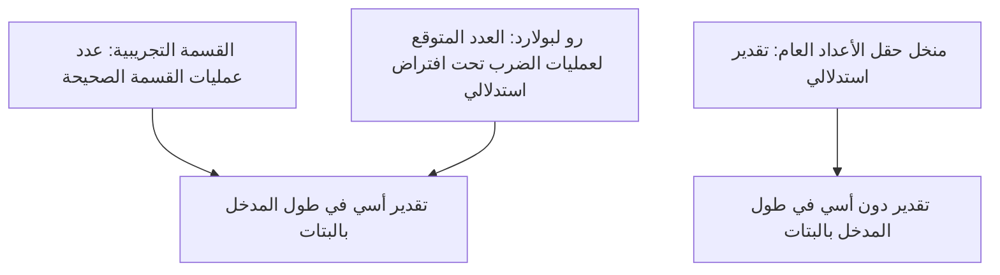

## 1. مقدمة: أين تكمن صعوبة التحليل إلى عوامل أولية؟

تحليل عدد صغير إلى عوامله الأولية مسألة مألوفة في الحساب المدرسي. أما استعادة عوامل حاصل ضرب عددين أوليين كبيرين فقد تتطلب موارد حوسبة كلاسيكية هائلة. وهذا التفاوت جزء من الخلفية الرياضية لـ[التشفير بالمفتاح العام، بما فيه RSA](https://kenji.blog/ar/p/modern-cryptography-public-key-hash-signature/).

لا يعني ذلك أن تحليل كل عدد صحيح كبير صعب، ولا أنه ثبت استحالة وجود خوارزمية كلاسيكية سريعة. فقد يسهل تحليل أعداد هائلة لها عوامل صغيرة، مثل الأعداد الزوجية. كما أن تقديرات تعقيد الخوارزميات الآتية ليست حدودًا سفلية للمسألة نفسها. ويتطلب تقييم الأمان فحص مفاتيح مولّدة بطريقة ملائمة في ضوء الموارد المتاحة للمهاجم المفترض.

سنوضح تدوين بيغ أو وحجم المدخل، ثم نقارن القسمة التجريبية وطريقة فيرما وخوارزمية رو لبولارد والمنخل التربيعي ومنخل حقل الأعداد العام. وبعد ذلك نتناول علاقتها بمسألة P مقابل NP والحوسبة الكمية. ويجب إبقاء تقديرات التعقيد منفصلة عن براهين الأمان وعن الزمن المقاس بالثواني.

## 2. التعقيد وتدوين بيغ أو

يتأثر الزمن الفعلي بالمعالج والذاكرة والتنفيذ والتوازي وغير ذلك. لذلك يجب أن يحدد وصف التعقيد حجم المدخل وما يُعد عملية أساسية. فاحتساب ضرب عددين صحيحين كبيرين عملية واحدة يختلف عن احتساب عمليات البت التي يتكون منها هذا الضرب.

### حد علوي تقاربي

لدوال غير سالبة عندما يكون المدخل كبيرًا بما يكفي، تعني العبارة $f(n)=\mathcal{O}(g(n))$ ما يلي:

$$
\exists c>0,\ \exists n_0,\ \forall n\ge n_0:\quad 0\le f(n)\le c\,g(n).
$$

لا يعتمد الثابتان $c$ و$n_0$ على المدخل $n$. وهذا تعريف لحد علوي، ولا يعني في ذاته «أسوأ حالة». بل يجب تحديد ما إذا كانت الدالة تصف زمن أسوأ حالة أو الزمن المتوسط أو الزمن المتوقع لخوارزمية عشوائية.

نستخدم $\Theta$ عندما تتطابق رتب الحدين العلوي والسفلي، و$\Omega$ للحد السفلي. فحتى الدالة $f(n)=1$ تنتمي إلى $\mathcal{O}(2^n)$. ولا يترتب على هذا الحد وحده تضاعف الزمن تمامًا كلما زاد المدخل واحدًا. كما أن التدوين لا يصف مباشرة نسب الأزمنة المقاسة. ويميّز [تعريف NIST](https://xlinux.nist.gov/dads/HTML/bigOnotation.html) أيضًا بين الحد العلوي والحد المحكم.

### رتب نمو نموذجية

في الجدول التالي، يرمز $n$ إلى عدد عناصر البيانات، وتُحتسب عمليات مثل المقارنة والوصول إلى العناصر.

| الرتبة | مثال وشروطه |
| --- | --- |
| $\mathcal{O}(1)$ | الوصول إلى عنصر مصفوفة بواسطة فهرسه في نموذج الوصول العشوائي |
| $\mathcal{O}(\log n)$ | عدد المقارنات في البحث الثنائي داخل مصفوفة مرتبة |
| $\mathcal{O}(n)$ | عدد المقارنات في أسوأ حالة للبحث الخطي |
| $\mathcal{O}(n\log n)$ | فرز الدمج في أسوأ حالة، أو الفرز السريع في الحالة المتوسطة تحت افتراضات مناسبة |
| $\mathcal{O}(n^2)$ | عدد المقارنات في أسوأ حالة لفرز الإدراج، مثلًا |
| $\mathcal{O}(2^n)$ | عدد جميع المجموعات الجزئية لمجموعة من $n$ عناصر؛ ولمعالجة كل مرشح تكلفة مستقلة |
| $\mathcal{O}(n!)$ | عدد جميع تبديلات $n$ عناصر متميزة؛ ولمعالجة كل مرشح تكلفة مستقلة |

إذا كان الزمن محدودًا بـ$\mathcal{O}(n^k)$ لثابت $k$، فهو زمن كثير الحدود. ومع ذلك، قد يجعل الأس أو الثابت الكبير الخوارزمية غير عملية، بينما قد تفيد طريقة أسية مع مدخلات صغيرة. يصنف الرسم التالي تقديرات نموذجية بحسب طول المدخل بالبتات؛ وليس برهانًا على الصعوبة ولا رسمًا للزمن الفعلي.

## 3. RSA: قيمة العدد الصحيح مقابل طول المدخل

ليكن $N\ge2$ العدد الصحيح المراد تحليله، و$b$ طول تمثيله الثنائي. وهذا يختلف عن عدد العناصر $n$ في الجدول السابق.

$$
b=\lfloor\log_2 N\rfloor+1,\qquad 2^{b-1}\le N<2^b.
$$

مثلًا، طول تمثيل $15$ أربعة بتات، لكن $2^4=16$ وليس $15$. وقد يكون الحد الكثير الحدود في قيمة $N$ أسيًا في طول المدخل $b$. وللعمليات على الأعداد الصحيحة الكبيرة نفسها تكاليف تعتمد على $b$.

في RSA الأساسي ذي العاملين الأوليين، نختار عددين أوليين فرديين مختلفين $p,q$ ونحسب $N=pq$. إذا كان طول كل منهما 1024 بتًا، فإن طول حاصل الضرب إما 2047 أو 2048 بتًا، وليس دائمًا 2048. يشمل المفتاح العام $N,e$، ويشمل المفتاح الخاص الأس الخاص $d$ وربما قيمًا أخرى. وتكفي الشروط التالية، مثلًا، لاختيار $d$:

$$
\varphi(N)=(p-1)(q-1),\quad 1<e<\varphi(N),\quad
\gcd(e,\varphi(N))=1,\quad ed\equiv1\pmod{\varphi(N)}.
$$

يعرّف [RFC 8017](https://www.rfc-editor.org/rfc/rfc8017.html) المفاتيح بصورة أعم باستخدام $\lambda(N)=\operatorname{lcm}(p-1,q-1)$. تتيح معرفة العوامل حساب أس خاص. لكن لم يُثبت عمومًا تكافؤ مسألة عكس عملية RSA مع التحليل إلى عوامل، وليست كل هجمات RSA بحاجة إلى تحليل العدد.

ولا تشكل عملية رفع الأعداد الصحيحة إلى قوى وحدها مخطط تشفير آمنًا. فالاستخدام الفعلي يتطلب مخططات تشفير تتضمن OAEP ومخططات توقيع مثل PSS، مع مراعاة توليد المفاتيح والتنفيذ والبروتوكول المحيط. ولا ينبغي اعتبار التفاوت بين الضرب واستعادة العوامل برهان أمان غير مشروط.

## 4. خمس خوارزميات للتحليل إلى عوامل

### 4.1 القسمة التجريبية

لكل عدد صحيح مؤلف $N$ عامل أولي واحد على الأقل لا يتجاوز $\sqrt N$. لذلك يكشف اختبار القواسم الصغيرة حتى $\lfloor\sqrt N\rfloor$ عاملًا. ولا تقول هذه الخاصية إن أكبر عامل أولي لا يتجاوز الجذر التربيعي؛ فأكبر عامل أولي للعدد $15=3\cdot5$ هو $5$، وهو أكبر من $\sqrt{15}$.

في الطريقة البسيطة التي تختبر كل عدد صحيح مرشح، يبلغ عدد عمليات القسمة في أسوأ حالة $\mathcal{O}(\sqrt N)$. وتعطي متباينة طول التمثيل الثنائي أيضًا حدًا علويًا مقداره $\mathcal{O}(2^{b/2})$. وهذا يحتسب كل قسمة متعددة الدقة عملية واحدة، ولا يمثل العدد الكلي لعمليات البت. وقد يسمح وجود عامل صغير بالتوقف مبكرًا.

### 4.2 طريقة فيرما: أهمية الفارق بين العاملين

لعدد صحيح فردي مؤلف، نبحث عن تمثيل على صورة فرق مربعين:

$$
N=x^2-y^2=(x-y)(x+y).
$$

نبدأ من $x=\lceil\sqrt N\rceil$، ثم نزيد $x$ حتى يصبح $x^2-N$ مربعًا. وإذا كان $N=pq$ فرديًا و$p\le q$، فإن $x=(p+q)/2$ و$y=(q-p)/2$ يعطيان حلًا. ويكون عدد المرشحين حتى هذا الحل كما يلي؛ وإذا وُجد حل أسبق، أمكن التوقف عنده.

$$
\frac{p+q}{2}-\lceil\sqrt N\rceil+1.
$$

مع العاملين المتقاربين $1009\cdot1013$ ينجح المرشح الأول. أما $3\cdot104729=314187$ فيحتاج إلى 51806 مرشحين. وبوجه خاص، عند تثبيت $p=3$ وزيادة العدد الأولي $q$، يصبح عدد المرشحين $\Theta(N)$. لذلك لا يصح إسناد رتبة الجذر التربيعي نفسها إلى طريقة فيرما والقسمة التجريبية في جميع الحالات. وللمدخلات الزوجية، تُزال عوامل العدد اثنين أولًا.

### 4.3 خوارزمية رو لبولارد

تكرر هذه الطريقة تطبيق دالة مثل $x\mapsto x^2+c\pmod N$، وتحسب القاسم المشترك الأكبر بين $N$ والفرق بين موضعين في المتتالية. وقد يؤدي تصادم بترديد عامل أولي مجهول $p$ إلى فرق يقبل القسمة على $p$، فينكشف عامل. يحتفظ كشف الدورات بطريقة فلويد بعدد ثابت من البواقي. لكن كل باقٍ يحتاج إلى $\mathcal{O}(b)$ بت، فلا يعني ذلك ذاكرة ثابتة مقاسة بالبتات.

وفق نموذج استدلالي يعامل الدالة كدالة عشوائية، يُقدّر العدد المتوقع لعمليات الضرب بترديد $N$ اللازمة لإيجاد عامل $p$ بـ$\mathcal{O}(\sqrt p)$. وعندما يكون $p$ من رتبة $\sqrt N$، يصبح التقدير $\mathcal{O}(N^{1/4})$، ومن ثم $\mathcal{O}(2^{b/4})$. وليس هذا ضمانًا غير مشروط لأسوأ حالة؛ بل يجب أيضًا احتساب تكلفة الضرب وحساب القاسم المشترك الأكبر على مستوى البتات.

لا يمثل القاسم المشترك الأكبر $d$ نجاحًا إلا إذا كان $1<d<N$. نواصل عندما يكون $d=1$، ونعيد المحاولة بقيمة ابتدائية أو دالة مختلفة، مثلًا، عندما يكون $d=N$. مع $N=21$ والقيمة الابتدائية 2 والدالة $f(x)=x^2+1$، تقارن أول خطوة لفلويد بين 5 و5، فيكون القاسم المشترك الأكبر 21 نفسه. كذلك قد يكون العامل غير التافه مؤلفًا ويحتاج إلى تحليل إضافي.

### 4.4 المنخل التربيعي وMPQS

يجمع المنخل التربيعي قيمًا ملساء، أي قيمًا تتحلل بالكامل إلى أعداد أولية صغيرة، لبناء تطابق بين مربعين بترديد $N$. في صورته الأساسية، نضع $m=\lfloor\sqrt N\rfloor$ وننخل القيم التالية ضمن مجال من قيم $x$ الصغيرة:

$$
Q(x)=(m+x)^2-N.
$$

نسجل الأسس بالنسبة إلى قاعدة عوامل تشمل الإشارة $-1$ وأعدادًا أولية صغيرة مختارة. ويجمع الجبر الخطي فوق الحقل الثنائي زوجية هذه الأسس لإيجاد حواصل ضرب مربعة. أما الاكتفاء بوصف قيم ملساء عشوائية من $x^2\bmod N$ فلا يبيّن اعتماد المنخل التربيعي على قيم صغيرة لكثيرة حدود.

MPQS هو المنخل التربيعي الذي يستخدم عدة كثيرات حدود تربيعية مناسبة. ويعتمد الأداء على التنفيذ والمدخل والموارد المتاحة. فلا توجد قاعدة عامة تقول إن طريقة تتفوق على أخرى عند 100 رقم بالضبط.

يأخذ التطابق المستهدف واستخراج العامل الصورة التالية:

$$
X^2\equiv Y^2\pmod N,\qquad d=\gcd(X-Y,N).
$$

إذا كان $d=1$ أو $d=N$، نجرب علاقة أخرى. وإذا كان كل من $X,Y$ أوليًا نسبيًا مع $N$ وكان $X\not\equiv\pm Y\pmod N$، حصلنا على عامل غير تافه، لكنه ليس بالضرورة أوليًا. مثلًا، عند $N=1155$ و$X=76$ و$Y=1$ يتطابق المربعان بترديد $N$، لكن $\gcd(75,1155)=15$ و$\gcd(77,1155)=77$ كلاهما عدد مؤلف.

### 4.5 منخل حقل الأعداد العام (GNFS)

يُستخدم منخل حقل الأعداد العام لتحليل أعداد صحيحة كبيرة لا تتخذ شكلًا خاصًا. وتتمثل خطوطه العامة فيما يلي:

1. اختيار كثيرات حدود ذات معاملات صحيحة ومعلمات مرتبطة بها، بحيث يكون لها جذر مشترك بترديد $N$، وإعداد البنية المناسبة لحقل الأعداد.
2. البحث بالغربلة عن علاقات تستوفي شروط التحليل بعوامل من أعداد أولية صغيرة أو مثاليات أولية (prime ideals)، على الجانبين النسبي وجانب حقل الأعداد.
3. حل نظام تمثله مصفوفة متناثرة كبيرة تصف زوجية الأسس والشروط المرتبطة بها، لدمج العلاقات التي تسمح باستخراج مربعات.
4. حساب الجذور التربيعية على الجانبين، والحصول على تطابق بين مربعين صحيحين، ثم استخدام القاسم المشترك الأكبر لاستخراج عامل غير تافه. وتُعاد المحاولة عند عدم نجاح العلاقات.

هذا عرض عام، وليس خطوات تنفيذية لحساب الجذور التربيعية في حقل الأعداد أو لشروطها الإضافية. كذلك ليست $\mathbb Z[\alpha]$، حيث $\alpha$ جذر لكثيرة حدود، دائمًا حلقة الأعداد الصحيحة الكاملة لحقل الأعداد. فمثلًا، عند $\alpha=\sqrt5$، يحقق $\beta=(1+\sqrt5)/2$ المعادلة $\beta^2-\beta-1=0$، ولذلك فهو عدد صحيح جبري، لكنه لا ينتمي إلى $\mathbb Z[\sqrt5]$.

نعرّف تدوين L باستخدام اللوغاريتم الطبيعي $\ln$، حيث $c>0$ و$0\le\alpha\le1$:

$$
L_N[\alpha,c]=\exp\!\left((c+o(1))(\ln N)^\alpha(\ln\ln N)^{1-\alpha}\right).
$$

هنا يقترب $o(1)$ من الصفر عندما $N\to\infty$. وعند طرفي المجال، نحصل على $L_N[0,c]=(\ln N)^{c+o(1)}$ و$L_N[1,c]=N^{c+o(1)}$. ولا يصح حذف الحد التقاربي واستبداله بمساواة دقيقة أو بحد علوي ذي درجة ثابتة.

يُعبَّر عن تقدير زمن تشغيل GNFS الاستدلالي المعتاد كما يلي:

$$
L_N\!\left[\frac13,\left(\frac{64}{9}\right)^{1/3}\right]
=\exp\!\left(\left(\left(\frac{64}{9}\right)^{1/3}+o(1)\right)(\ln N)^{1/3}(\ln\ln N)^{2/3}\right).
$$

قيمة الثابت نحو 1.923. وللتحويل إلى طول المدخل بالبتات نستخدم $\ln N=b\ln2+\mathcal{O}(1)$، فيتغير الثابت الرئيس في الأس:

$$
\exp\!\left(\left(\left(\frac{64\ln2}{9}\right)^{1/3}+o(1)\right)b^{1/3}(\ln b)^{2/3}\right).
$$

قيمة هذا الثابت نحو 1.702. وهذا تقدير دون أسي (subexponential) في طول المدخل بالبتات: ينمو أسرع من أي كثيرة حدود، وأبطأ من $2^{\varepsilon b}$ لكل ثابت $\varepsilon>0$. وليس مبرهنة غير مشروطة لأسوأ حالة على جميع المدخلات، ولا تنبؤًا بالزمن الفعلي لحجم معين.

كمثال مؤرخ، يذكر [إعلان تحليل RSA-250 في 28 فبراير 2020](https://caramba.loria.fr/rsa250.txt) تحليل عدد من 250 رقمًا، أي 829 بتًا، باستخدام NFS وبعمل إجمالي يقارب 2700 سنة-نواة. وهذا مقياس للعمل الحاسوبي، ولا يعني بالضرورة 2700 آلة متزامنة أو 2700 سنة من الزمن المنقضي. ولا نقدمه هنا بوصفه الرقم القياسي العالمي الحالي أو تكلفة تحليل كل عدد بهذا الطول.

## 5. مسألة P مقابل NP والحوسبة الكمية

### اختبار الأولية مقابل إيجاد العوامل

تحديد ما إذا كان عدد ما أوليًا يختلف عن إيجاد عوامل عدد مؤلف. أثبتت [ورقة AKS](https://annals.math.princeton.edu/2004/160-2/p12) إمكان اختبار الأولية بخوارزمية حتمية في زمن كثير الحدود دون افتراضات غير مثبتة. ولم تثبت النتيجة نفسها للتحليل إلى عوامل.

الفئات P وNP وcoNP هي أساسًا فئات لمسائل قرار تكون إجابتها نعم أو لا. أما التحليل إلى عوامل فهو مسألة بحث تُخرج العوامل، ولذلك لا توضح عبارة «التحليل إلى عوامل في NP» وحدها نوع المسألة. لننظر مثلًا إلى مسألة القرار التالية: عند إعطاء $N\ge2$ و$2\le K<N$، هل يوجد قاسم يحقق $1<d\le K$ و$d\mid N$؟

لإجابة نعم، يكون القاسم $d$ شهادة يمكن التحقق منها بالقسمة. ولإجابة لا، يمكن استخدام التحليل الكامل إلى عوامل أولية شهادةً: إذ يمكن التحقق في زمن كثير الحدود من حاصل الضرب، وأولية كل عامل، وتجاوز جميع العوامل الأولية $K$. لذلك تنتمي مسألة القرار هذه إلى كل من NP وcoNP. ولو أمكن إجراء البحث في زمن كثير الحدود، لأمكن حل مسألة القرار. وبالعكس، تتيح خوارزمية قرار بزمن كثير الحدود الحصول على التحليل بواسطة البحث الثنائي على $K$ وتكرار استخراج العوامل.

ولا يثبت هذا التصنيف أن المسألة NP-كاملة أو أنه لا توجد خوارزمية كلاسيكية بزمن كثير الحدود. فلو كانت مسألة تنتمي إلى كل من NP وcoNP مسألة NP-كاملة وفق الاختزالات المعتادة كثيرة الحدود، للزم NP=coNP. وما زالت [مسألة P مقابل NP مفتوحة](https://www.claymath.org/millennium/p-vs-np/). وحتى افتراض P≠NP لا يكفي وحده لإثبات أن التحليل إلى عوامل خارج P.

### خوارزمية شور تغيّر نموذج الحوسبة

تحلل [خوارزمية شور](https://arxiv.org/abs/quant-ph/9508027) الأعداد الصحيحة بعدد خطوات كثير الحدود في طول المدخل بالبتات، ضمن نموذج تتوافر فيه موارد حوسبة كمية كافية. يستخرج الجزء الكمي معلومات عن الدورات، وتتبعه عملية القياس والمعالجة اللاحقة الكلاسيكية، مع إعادة المحاولة عند الحاجة. ولا يكشف تحويل فورييه الكمي فورًا أجوبة جميع المرشحين.

ولا يحدد عدد الخطوات النظري مباشرة ما إذا كانت أجهزة فعلية ستحتاج إلى ساعات أو أيام. فذلك يتطلب افتراضات حول البوابات وتصحيح الأخطاء والدوائر الحسابية وعدد البتات الكمية المتاحة وغيرها. يغيّر السهم الأخير في الرسم التالي نموذج الحوسبة، ولا يثبت حدًا لقدرات الحواسيب الكلاسيكية.

الاستعداد لمثل هذه الهجمات المستقبلية أحد دوافع التشفير ما بعد الكمي (PQC). وكما يوضح [RFC 9794](https://www.rfc-editor.org/rfc/rfc9794.html)، يشير المصطلح إلى تشفير مصمم لمقاومة مهاجمين يمتلكون حواسيب كمية، ولا يضمن استحالة كسره. ويجب تقييم الافتراضات الرياضية، وكذلك خيارات التنفيذ والتشغيل.

## 6. خاتمة

تبدأ مقارنة تعقيد التحليل إلى عوامل بالفصل بين قيمة العدد الصحيح $N$ وطول المدخل بالبتات $b$، وبين عدد العمليات وتكلفتها بالبتات، وبين زمن أسوأ حالة والزمن المتوقع. تستفيد القسمة التجريبية وطريقة فيرما ورو من بنى مختلفة، بينما يبني المنخل التربيعي وGNFS تطابقات بين مربعات انطلاقًا من علاقات كثيرة.

ولا يمكن استنتاج الأمان التشفيري من حد علوي واحد أو من مظهر عدد كبير. بل يتطلب تقييم الخوارزميات المعروفة وتوليد المدخلات ونماذج الهجوم والتنفيذ معًا. ويجب أن يوضح العرض الدقيق، بما فيه النتائج النظرية للحوسبة الكمية، ما ثبت وما يعتمد على افتراضات أو تقديرات للموارد.

### المراجع

- [NIST DADS: تدوين بيغ أو](https://xlinux.nist.gov/dads/HTML/bigOnotation.html)
- [Handbook of Applied Cryptography، الفصل 2: تعريفات التعقيد](https://cacr.uwaterloo.ca/hac/about/chap2.pdf)
- [الفصل 3: التحليل إلى عوامل ومسألة RSA](https://cacr.uwaterloo.ca/hac/about/chap3.pdf) (مرجع من عام 1996؛ يجب فصل سجلاته وحالة اختبار الأولية فيه عن التطورات اللاحقة)
- [RFC 8017: مفاتيح RSA ومخططاته](https://www.rfc-editor.org/rfc/rfc8017.html)
- [إعلان المؤلفين عن RSA-250، عام 2020](https://caramba.loria.fr/rsa250.txt)
- [Agrawal–Kayal–Saxena: PRIMES is in P](https://annals.math.princeton.edu/2004/160-2/p12)
- [معهد كلاي للرياضيات: P مقابل NP](https://www.claymath.org/millennium/p-vs-np/)
- [شور: خوارزميات بزمن كثير الحدود للتحليل إلى عوامل أولية واللوغاريتمات المتقطعة](https://arxiv.org/abs/quant-ph/9508027)
- [RFC 9794: مصطلحات التشفير ما بعد الكمي](https://www.rfc-editor.org/rfc/rfc9794.html)
