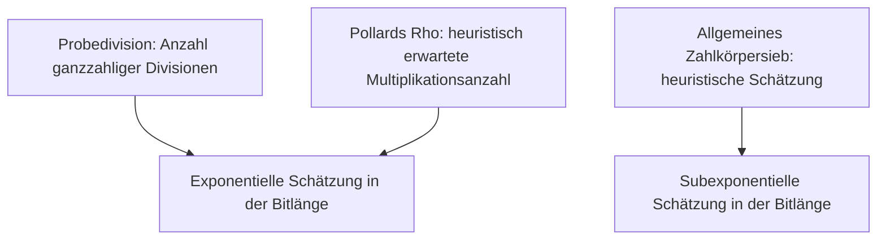

## 1. Einführung: Was ist an der Faktorisierung schwierig?

Eine kleine ganze Zahl in Primfaktoren zu zerlegen, ist eine vertraute Schulaufgabe. Aus dem Produkt großer Primzahlen die Faktoren zurückzugewinnen, kann auf klassischen Computern jedoch enorme Rechenressourcen erfordern. Diese Asymmetrie gehört zum Hintergrund der [Kryptographie mit öffentlichen Schlüsseln, einschließlich RSA](https://kenji.blog/de/p/modern-cryptography-public-key-hash-signature/).

Das bedeutet weder, dass jede große ganze Zahl schwer zu faktorisieren ist, noch, dass die Unmöglichkeit eines schnellen klassischen Algorithmus bewiesen wäre. Riesige Zahlen mit kleinen Faktoren, etwa gerade Zahlen, können leicht zu behandeln sein. Auch die Komplexitäten der folgenden Algorithmen sind keine unteren Schranken für das Problem selbst. Kryptographische Sicherheit erfordert eine Bewertung korrekt erzeugter Schlüssel gegenüber den angenommenen Ressourcen eines Angreifers.

Wir klären zunächst Big-O-Notation und Eingabegröße und vergleichen dann Probedivision, Fermats Methode, Pollards Rho-Methode, das quadratische Sieb und das allgemeine Zahlkörpersieb. Abschließend betrachten wir den Zusammenhang mit P versus NP und dem Quantenrechnen. Komplexitätsschätzungen, Sicherheitsbeweise und verstrichene Sekunden sind dabei auseinanderzuhalten.

## 2. Komplexität und Big-O-Notation

Die tatsächliche Laufzeit hängt von Prozessor, Speicher, Implementierung, Parallelisierung und weiteren Bedingungen ab. Eine Komplexitätsangabe muss die Eingabegröße und die gezählten Grundoperationen festlegen. Eine Multiplikation großer ganzer Zahlen als eine Operation zu zählen, ist etwas anderes, als die darin enthaltenen Bitoperationen zu zählen.

### Eine asymptotische obere Schranke

Für Funktionen, die bei hinreichend großen Eingaben nichtnegativ sind, bedeutet $f(n)=\mathcal{O}(g(n))$:

$$
\exists c>0,\ \exists n_0,\ \forall n\ge n_0:\quad 0\le f(n)\le c\,g(n).
$$

Die Konstanten $c$ und $n_0$ hängen nicht von der Eingabe $n$ ab. Dies definiert eine obere Schranke und bedeutet für sich genommen nicht „schlimmster Fall“. Es muss gesondert angegeben werden, ob die Funktion die schlechteste oder durchschnittliche Laufzeit oder die erwartete Laufzeit eines randomisierten Algorithmus beschreibt.

Für übereinstimmende obere und untere Größenordnungen verwendet man $\Theta$, für eine untere Schranke $\Omega$. Beispielsweise gehört sogar $f(n)=1$ zu $\mathcal{O}(2^n)$. Aus dieser oberen Schranke folgt daher nicht, dass sich die Laufzeit bei einer um eins größeren Eingabe genau verdoppelt. Die Notation beschreibt auch nicht unmittelbar das Verhältnis gemessener Zeiten. Die [Definition des NIST](https://xlinux.nist.gov/dads/HTML/bigOnotation.html) unterscheidet ebenfalls zwischen einer oberen und einer asymptotisch scharfen Schranke.

### Typische Wachstumsformen

In der folgenden Tabelle bezeichnet $n$ die Anzahl der Datenelemente. Gezählt werden beispielsweise Vergleiche und Elementzugriffe.

| Größenordnung | Beispiel und Bedingungen |
| --- | --- |
| $\mathcal{O}(1)$ | Zugriff auf ein Arrayelement über seinen Index in einem Modell mit wahlfreiem Zugriff |
| $\mathcal{O}(\log n)$ | Vergleiche bei der binären Suche in einem sortierten Array |
| $\mathcal{O}(n)$ | Vergleiche der linearen Suche im schlimmsten Fall |
| $\mathcal{O}(n\log n)$ | Mergesort im schlimmsten Fall oder Quicksort im Durchschnitt unter geeigneten Annahmen |
| $\mathcal{O}(n^2)$ | Beispielsweise Vergleiche von Insertionsort im schlimmsten Fall |
| $\mathcal{O}(2^n)$ | Anzahl aller Teilmengen von $n$ Elementen; die Verarbeitung jedes Kandidaten kostet zusätzlich Zeit |
| $\mathcal{O}(n!)$ | Anzahl aller Permutationen von $n$ verschiedenen Elementen; die Verarbeitung jedes Kandidaten kostet zusätzlich Zeit |

Eine Laufzeit, die für eine feste Konstante $k$ durch $\mathcal{O}(n^k)$ beschränkt ist, heißt polynomiell. Ein großer Exponent oder eine große Konstante kann sie dennoch unpraktisch machen; umgekehrt kann ein exponentielles Verfahren bei kleinen Eingaben nützlich sein. Die folgende Grafik ordnet typische Schätzungen nach der Bitlänge der Eingabe ein. Sie ist weder ein Schwierigkeitsbeweis noch ein Diagramm gemessener Laufzeiten.

## 3. RSA: Zahlenwert und Eingabelänge

Sei $N\ge2$ die zu faktorisierende ganze Zahl und $b$ die Länge ihrer Binärdarstellung. Dies ist nicht die Elementanzahl $n$ aus der vorigen Tabelle.

$$
b=\lfloor\log_2 N\rfloor+1,\qquad 2^{b-1}\le N<2^b.
$$

Beispielsweise hat $15$ vier Bits, aber $2^4=16$ und nicht $15$. Eine im Zahlenwert $N$ polynomielle Schranke kann in der Eingabelänge $b$ exponentiell sein. Auch die Operationen auf großen ganzen Zahlen selbst haben Kosten, die von $b$ abhängen.

Im grundlegenden RSA-Fall mit zwei Primzahlen bildet man $N=pq$ aus verschiedenen ungeraden Primzahlen $p,q$. Haben beide jeweils 1024 Bits, ist ihr Produkt 2047 oder 2048 Bits lang, nicht stets 2048. Der öffentliche Schlüssel umfasst $N,e$; der private Schlüssel enthält den privaten Exponenten $d$ und gegebenenfalls weitere Werte. Beispielsweise reichen folgende Bedingungen zur Wahl von $d$ aus:

$$
\varphi(N)=(p-1)(q-1),\quad 1<e<\varphi(N),\quad
\gcd(e,\varphi(N))=1,\quad ed\equiv1\pmod{\varphi(N)}.
$$

[RFC 8017](https://www.rfc-editor.org/rfc/rfc8017.html) definiert die Schlüssel allgemeiner mithilfe von $\lambda(N)=\operatorname{lcm}(p-1,q-1)$. Kennt man die Faktoren, kann man einen privaten Exponenten berechnen. Es ist jedoch nicht allgemein bewiesen, dass die RSA-Inversion zur Faktorisierung äquivalent ist, und nicht jeder Angriff auf RSA erfordert eine Faktorisierung des Moduls.

Die bloße Grundoperation der modularen Potenzierung bildet noch kein sicheres Verschlüsselungsverfahren. In der Praxis braucht man Verschlüsselungsverfahren mit OAEP, Signaturverfahren wie PSS und eine Betrachtung von Schlüsselerzeugung, Implementierungen und vollständigem Protokoll. Die Asymmetrie zwischen Multiplikation und Wiedergewinnung der Faktoren ist kein unbedingter Sicherheitsbeweis.

## 4. Fünf Faktorisierungsalgorithmen

### 4.1 Probedivision

Eine zusammengesetzte ganze Zahl $N$ hat mindestens einen Primfaktor, der höchstens $\sqrt N$ beträgt. Kleine Teiler bis $\lfloor\sqrt N\rfloor$ durchzuprobieren liefert daher einen Faktor. Dies besagt nicht, dass der größte Primfaktor kleiner als die Quadratwurzel ist: Der größte Primfaktor von $15=3\cdot5$ ist $5$ und damit größer als $\sqrt{15}$.

Beim einfachen Verfahren, das jeden ganzzahligen Kandidaten testet, lässt sich die Zahl der Divisionen im schlimmsten Fall durch $\mathcal{O}(\sqrt N)$ abschätzen. Aus der Ungleichung für die Bitlänge folgt auch die obere Schranke $\mathcal{O}(2^{b/2})$. Gezählt wird jede Mehrpräzisionsdivision als eine Operation, nicht die Gesamtzahl der Bitoperationen. Ein kleiner Faktor ermöglicht einen frühen Abbruch.

### 4.2 Fermats Methode: Der Abstand der Faktoren ist wichtig

Für eine ungerade zusammengesetzte Zahl sucht man eine Differenz von Quadraten:

$$
N=x^2-y^2=(x-y)(x+y).
$$

Man beginnt bei $x=\lceil\sqrt N\rceil$ und erhöht $x$, bis $x^2-N$ eine Quadratzahl ist. Für $N=pq$ mit ungeraden $p\le q$ ist $x=(p+q)/2$, $y=(q-p)/2$ eine Lösung. Die Anzahl der Kandidaten bis zu dieser Lösung lautet wie folgt; tritt vorher eine andere Lösung auf, kann man früher aufhören.

$$
\frac{p+q}{2}-\lceil\sqrt N\rceil+1.
$$

Bei den nah beieinanderliegenden Faktoren von $1009\cdot1013$ genügt der erste Kandidat. Dagegen benötigt $3\cdot104729=314187$ insgesamt 51806 Kandidaten. Fixiert man insbesondere $p=3$ und vergrößert die Primzahl $q$, ergibt sich eine Kandidatenanzahl von $\Theta(N)$. Fermats Methode pauschal dieselbe Quadratwurzelordnung wie der Probedivision zuzuschreiben, ist deshalb falsch. Bei geraden Eingaben entfernt man zuerst die Faktoren 2.

### 4.3 Pollards Rho-Methode

Man iteriert eine Funktion wie $x\mapsto x^2+c\pmod N$ und berechnet den größten gemeinsamen Teiler von $N$ und der Differenz zweier Positionen der Folge. Eine Kollision modulo einem unbekannten Primfaktor $p$ kann eine durch $p$ teilbare Differenz erzeugen und einen Faktor offenlegen. Floyds Zyklensuche speichert eine konstante Anzahl von Restwerten. Jeder Restwert benötigt jedoch $\mathcal{O}(b)$ Bits; in Bits gemessen ist dies kein konstanter Speicherbedarf.

Unter einem heuristischen Modell einer zufälligen Funktion schätzt man die erwartete Anzahl modularer Multiplikationen zum Finden eines Faktors $p$ auf $\mathcal{O}(\sqrt p)$. Liegt $p$ in der Größenordnung von $\sqrt N$, erhält man $\mathcal{O}(N^{1/4})$ und damit $\mathcal{O}(2^{b/4})$. Dies ist keine unbedingte Garantie für den schlimmsten Fall; die Bitkosten der Multiplikation und der ggT-Berechnung sind zusätzlich zu berücksichtigen.

Ein ggT $d$ bedeutet nur dann Erfolg, wenn $1<d<N$ gilt. Bei $d=1$ fährt man fort; bei $d=N$ versucht man es beispielsweise mit einem anderen Startwert oder einer anderen Funktion erneut. Für $N=21$, Startwert 2 und $f(x)=x^2+1$ vergleicht Floyd im ersten Schritt 5 mit 5, sodass der ggT die Zahl 21 selbst ist. Auch ein nichttrivialer Faktor kann zusammengesetzt sein und weitere Faktorisierung erfordern.

### 4.4 Quadratisches Sieb und MPQS

Das quadratische Sieb sammelt glatte Werte, die sich vollständig über kleinen Primzahlen faktorisieren lassen, um eine Quadratkongruenz zu bilden. In der Grundform setzt man $m=\lfloor\sqrt N\rfloor$ und siebt folgende Werte für einen Bereich kleiner $x$:

$$
Q(x)=(m+x)^2-N.
$$

Man zeichnet die Exponenten über einer Faktorbasis auf, die das Vorzeichen $-1$ und ausgewählte kleine Primzahlen enthält. Lineare Algebra über dem Körper mit zwei Elementen kombiniert die Exponentenparitäten, um Produkte zu finden, die Quadrate sind. Lediglich zufällige glatte Werte von $x^2\bmod N$ zu beschreiben, lässt die für das quadratische Sieb charakteristische Nutzung kleiner Polynomwerte aus.

MPQS, das quadratische Sieb mit mehreren Polynomen, ist eine Variante mit mehreren geeigneten quadratischen Polynomen. Die Leistung hängt von Implementierung, Eingabe und verfügbaren Ressourcen ab. Es gibt keine universelle Regel, nach der ein Verfahren ein anderes bei genau 100 Dezimalstellen überholt.

Die gesuchte Kongruenz und die Gewinnung eines Faktors haben die Form:

$$
X^2\equiv Y^2\pmod N,\qquad d=\gcd(X-Y,N).
$$

Bei $d=1$ oder $d=N$ probiert man eine andere Relation. Sind $X,Y$ jeweils teilerfremd zu $N$ und gilt $X\not\equiv\pm Y\pmod N$, erhält man einen nichttrivialen Faktor, der nicht unbedingt prim ist. Für $N=1155$, $X=76$, $Y=1$ sind die Quadrate beispielsweise kongruent, aber $\gcd(75,1155)=15$ und $\gcd(77,1155)=77$ sind beide zusammengesetzt.

### 4.5 Allgemeines Zahlkörpersieb (GNFS)

Das allgemeine Zahlkörpersieb wird zur Faktorisierung großer ganzer Zahlen ohne besondere Form verwendet. Der grobe Ablauf ist:

1. Ganzzahlige Polynome und zugehörige Parameter mit einer gemeinsamen Nullstelle modulo $N$ wählen und den entsprechenden Zahlkörper vorbereiten.
2. Auf der rationalen Seite und der Zahlkörperseite Relationen sieben, die Faktorisierungsbedingungen bezüglich kleiner Primzahlen oder Primideale erfüllen.
3. Eine große dünnbesetzte Matrix lösen, die Exponentenparitäten und zusätzliche Bedingungen beschreibt, um Relationen zu kombinieren, aus denen Quadrate gewonnen werden können.
4. Auf beiden Seiten Quadratwurzeln berechnen, eine ganzzahlige Quadratkongruenz erhalten und per ggT einen nichttrivialen Faktor gewinnen. Bei erfolglosen Relationen erneut versuchen.

Dies ist ein Überblick, keine Implementierungsanleitung für die Quadratwurzeln auf der Zahlkörperseite und deren Zusatzbedingungen. Außerdem ist $\mathbb Z[\alpha]$, gebildet aus einer Nullstelle $\alpha$ eines Polynoms, nicht immer der gesamte Ganzheitsring des Zahlkörpers. Für $\alpha=\sqrt5$ erfüllt etwa $\beta=(1+\sqrt5)/2$ die Gleichung $\beta^2-\beta-1=0$ und ist daher algebraisch ganz, gehört aber nicht zu $\mathbb Z[\sqrt5]$.

Wir definieren die L-Notation mit natürlichen Logarithmen $\ln$ für $c>0$ und $0\le\alpha\le1$:

$$
L_N[\alpha,c]=\exp\!\left((c+o(1))(\ln N)^\alpha(\ln\ln N)^{1-\alpha}\right).
$$

Hier strebt $o(1)$ für $N\to\infty$ gegen null. Die Endpunkte sind $L_N[0,c]=(\ln N)^{c+o(1)}$ und $L_N[1,c]=N^{c+o(1)}$. Den asymptotischen Term darf man nicht einfach weglassen und durch eine exakte Gleichheit oder eine obere Schranke festen Grades ersetzen.

Die übliche heuristische Laufzeitschätzung für GNFS lautet:

$$
L_N\!\left[\frac13,\left(\frac{64}{9}\right)^{1/3}\right]
=\exp\!\left(\left(\left(\frac{64}{9}\right)^{1/3}+o(1)\right)(\ln N)^{1/3}(\ln\ln N)^{2/3}\right).
$$

Die Konstante beträgt ungefähr 1,923. Bei der Umrechnung in die Bitlänge der Eingabe gilt $\ln N=b\ln2+\mathcal{O}(1)$, weshalb sich auch die führende Konstante im Exponenten ändert:

$$
\exp\!\left(\left(\left(\frac{64\ln2}{9}\right)^{1/3}+o(1)\right)b^{1/3}(\ln b)^{2/3}\right).
$$

Diese Konstante beträgt ungefähr 1,702. Die Schätzung ist subexponentiell in der Bitlänge: Sie wächst schneller als jedes Polynom, aber langsamer als $2^{\varepsilon b}$ für jedes feste $\varepsilon>0$. Sie ist weder ein unbedingter Satz für den schlimmsten Fall aller Eingaben noch eine Vorhersage der Laufzeit für eine bestimmte Größe.

Als datiertes Beispiel berichtet die [Mitteilung zur Faktorisierung von RSA-250 vom 28. Februar 2020](https://caramba.loria.fr/rsa250.txt) von der NFS-Zerlegung einer Zahl mit 250 Dezimalstellen und 829 Bits bei einem Arbeitsaufwand von ungefähr 2700 Kernjahren (core-years). Das misst Rechenarbeit, nicht notwendigerweise 2700 gleichzeitig eingesetzte Rechner oder 2700 verstrichene Jahre. Hier wird es weder als aktueller Weltrekord noch als Aufwand für jede Zahl dieser Länge dargestellt.

## 5. P versus NP und Quantenrechnen

### Primzahltest und Faktorsuche

Zu entscheiden, ob eine Zahl prim ist, unterscheidet sich davon, Faktoren einer zusammengesetzten Zahl zu finden. Die [AKS-Arbeit](https://annals.math.princeton.edu/2004/160-2/p12) zeigte einen unbedingten deterministischen Primzahltest in polynomieller Zeit. Sie zeigte nicht dasselbe für die Faktorisierung.

P, NP und coNP sind grundsätzlich Klassen von Entscheidungsproblemen mit Ja/Nein-Antworten. Die Primfaktorzerlegung selbst ist ein Suchproblem, das Faktoren ausgibt. Die bloße Aussage, Faktorisierung liege in NP, lässt deshalb die Problemart unklar. Beispielsweise kann man für $N\ge2$ und $2\le K<N$ fragen, ob es einen Teiler mit $1<d\le K$ und $d\mid N$ gibt.

Eine Ja-Antwort hat den Teiler $d$ als Zertifikat, prüfbar durch Division. Eine Nein-Antwort kann mit einer vollständigen Primfaktorzerlegung zertifiziert werden: Produkt, Primzahleigenschaft jedes Faktors und die Bedingung, dass alle Primfaktoren größer als $K$ sind, lassen sich in polynomieller Zeit prüfen. Dieses Entscheidungsproblem liegt daher sowohl in NP als auch in coNP. Eine polynomielle Suche würde die Entscheidung lösen. Umgekehrt würde ein polynomieller Entscheidungsalgorithmus durch binäre Suche nach $K$ und wiederholte Faktorgewinnung die Primfaktorzerlegung liefern.

Diese Einordnung beweist weder NP-Vollständigkeit noch die Nichtexistenz eines klassischen polynomiellen Algorithmus. Wäre ein Problem in NP und coNP unter den üblichen polynomiellen Reduktionen NP-vollständig, folgte daraus NP=coNP. [P versus NP ist weiterhin offen](https://www.claymath.org/millennium/p-vs-np/). Selbst P≠NP als Annahme würde allein nicht beweisen, dass Faktorisierung außerhalb von P liegt.

### Shors Algorithmus ändert das Rechenmodell

[Shors Algorithmus](https://arxiv.org/abs/quant-ph/9508027) faktorisiert ganze Zahlen in einer in der Eingabebitlänge polynomiellen Schrittzahl in einem Modell mit ausreichenden Quantenressourcen. Der Quantenteil liefert Informationen über Perioden; Messungen und klassische Nachverarbeitung folgen, nötigenfalls mit Wiederholungen. Die Quanten-Fourier-Transformation liest nicht augenblicklich die Antworten aller Kandidaten aus.

Aus dieser theoretischen Schrittzahl folgt nicht direkt, ob reale Hardware Stunden oder Tage benötigen würde. Solche Schätzungen brauchen Annahmen über Quantengatter, Fehlerkorrektur, arithmetische Schaltungen, verfügbare Qubits und weitere Ressourcen. Der letzte Pfeil im Diagramm ändert das Rechenmodell; er beweist keine Grenze klassischer Computer.

Die Vorbereitung auf solche zukünftigen Angriffe ist ein Motiv der Post-Quanten-Kryptographie (PQC). Wie [RFC 9794](https://www.rfc-editor.org/rfc/rfc9794.html) erklärt, bezeichnet dies Kryptographie, die Angreifern mit Quantencomputern standhalten soll; der Begriff garantiert nicht, dass ein Verfahren niemals gebrochen werden kann. Sowohl mathematische Annahmen als auch Implementierung und Betrieb sind zu bewerten.

## 6. Fazit

Um Faktorisierungskomplexitäten zu vergleichen, muss man den Zahlenwert $N$ von der Eingabebitlänge $b$, Operationsanzahlen von Bitkosten und schlechteste von erwarteten Laufzeiten unterscheiden. Probedivision, Fermats Methode und Rho nutzen verschiedene Strukturen; das quadratische Sieb und GNFS bilden aus vielen Relationen Quadratkongruenzen.

Kryptographische Sicherheit folgt weder aus einer einzelnen oberen Schranke noch daraus, dass eine ganze Zahl groß aussieht. Bekannte Algorithmen, Eingabeerzeugung, Angriffsmodelle und Implementierung müssen gemeinsam betrachtet werden. Auch bei theoretischen Ergebnissen des Quantenrechnens muss klar sein, was bewiesen ist und was auf Annahmen oder Ressourcenschätzungen beruht.

### Quellen

- [NIST DADS: big-O notation](https://xlinux.nist.gov/dads/HTML/bigOnotation.html)
- [Handbook of Applied Cryptography, Kapitel 2: Komplexitätsdefinitionen](https://cacr.uwaterloo.ca/hac/about/chap2.pdf)
- [Kapitel 3: Faktorisierung und RSA-Problem](https://cacr.uwaterloo.ca/hac/about/chap3.pdf) (Quelle von 1996; damalige Rekorde und Primzahltestkenntnisse von späteren Entwicklungen unterscheiden)
- [RFC 8017: RSA-Schlüssel und Verfahren](https://www.rfc-editor.org/rfc/rfc8017.html)
- [Mitteilung der Autoren zu RSA-250 (2020)](https://caramba.loria.fr/rsa250.txt)
- [Agrawal–Kayal–Saxena: PRIMES is in P](https://annals.math.princeton.edu/2004/160-2/p12)
- [Clay Mathematics Institute: P vs NP](https://www.claymath.org/millennium/p-vs-np/)
- [Shor: polynomielle Faktorisierungs- und Diskreter-Logarithmus-Algorithmen auf einem Quantencomputer](https://arxiv.org/abs/quant-ph/9508027)
- [RFC 9794: Begriffe der Post-Quanten-Kryptographie](https://www.rfc-editor.org/rfc/rfc9794.html)
