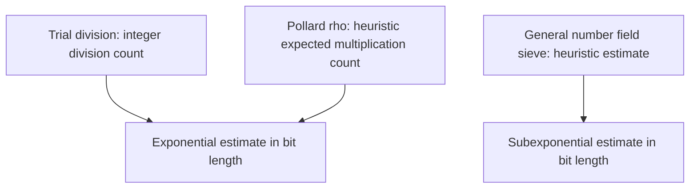
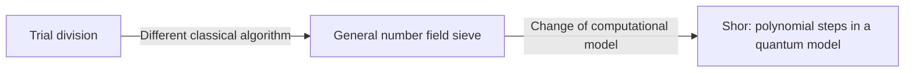

## 1. Introduction: What Is Difficult About Factoring?

Factoring a small number into primes is familiar school arithmetic. Recovering the factors of a product of large primes, however, can require enormous classical computing resources. This asymmetry provides part of the background to [public-key cryptography, including RSA](https://kenji.blog/en/p/modern-cryptography-public-key-hash-signature/).

This does not mean that every large integer is difficult to factor, or that it has been proved that no fast classical algorithm can exist. Enormous numbers with small factors, such as even numbers, can be easy. Nor are the complexities of the algorithms described below lower bounds on the problem itself. Cryptographic security requires assessing properly generated keys against the resources available to the assumed attacker.

We will clarify Big O notation and input size, then compare trial division, Fermat's method, Pollard's rho, the quadratic sieve, and the general number field sieve. Finally, we will examine their relationship to P versus NP and quantum computing. Keep complexity estimates separate from security proofs and elapsed seconds throughout.

## 2. Complexity and Big O Notation

Elapsed time depends on the CPU, memory, implementation, parallelism, and other conditions. A complexity statement must specify input size and what counts as an elementary operation. Counting a multiplication of large integers as one operation differs from counting the bit operations inside it.

### An Asymptotic Upper Bound

For functions that are nonnegative on sufficiently large inputs, $f(n)=\mathcal{O}(g(n))$ means:

$$
\exists c>0,\ \exists n_0,\ \forall n\ge n_0:\quad 0\le f(n)\le c\,g(n).
$$

The constants $c$ and $n_0$ do not depend on the input $n$. This defines an upper bound; it does not itself mean "worst case." We must separately identify whether the function describes worst-case time, average time, or the expected time of a randomized algorithm.

We use $\Theta$ for matching upper and lower orders, and $\Omega$ for a lower bound. For example, even $f(n)=1$ belongs to $\mathcal{O}(2^n)$. That upper bound alone does not imply that time doubles exactly when the input increases by one. Nor does the notation directly describe ratios of measured times. [NIST's definition](https://xlinux.nist.gov/dads/HTML/bigOnotation.html) likewise distinguishes an upper bound from a tight bound.

### Representative Growth Rates

In this table, $n$ is the number of data items, and operations such as comparisons and element accesses are counted.

| Order | Example and conditions |
| --- | --- |
| $\mathcal{O}(1)$ | Accessing an array element by index in a random-access model |
| $\mathcal{O}(\log n)$ | Comparisons in binary search on a sorted array |
| $\mathcal{O}(n)$ | Worst-case comparisons in linear search |
| $\mathcal{O}(n\log n)$ | Worst-case merge sort, or average-case quicksort under suitable assumptions |
| $\mathcal{O}(n^2)$ | Worst-case comparisons in insertion sort, for example |
| $\mathcal{O}(2^n)$ | The number of all subsets of $n$ items; processing each candidate has a separate cost |
| $\mathcal{O}(n!)$ | The number of all permutations of $n$ distinct items; processing each candidate has a separate cost |

Time bounded by $\mathcal{O}(n^k)$ for a fixed constant $k$ is polynomial time. A large exponent or constant can still make it impractical, while an exponential method can be useful on small inputs. The following diagram classifies representative estimates by input bit length. It is neither a proof of hardness nor a graph of elapsed time.

## 3. RSA: Integer Value Versus Input Length

Let $N\ge2$ be the integer to factor and $b$ the length of its binary representation. This differs from the item count $n$ in the previous table.

$$
b=\lfloor\log_2 N\rfloor+1,\qquad 2^{b-1}\le N<2^b.
$$

For example, $15$ has four bits, but $2^4=16$, not $15$. A bound polynomial in the value $N$ can be exponential in the input length $b$. Operations on large integers themselves also have costs that depend on $b$.

In basic two-prime RSA, distinct odd primes $p,q$ produce $N=pq$. If each prime has 1024 bits, the product has either 2047 or 2048 bits, not always 2048. The public key includes $N,e$, and the private key includes the private exponent $d$ and possibly other values. For example, the following conditions suffice for choosing $d$:

$$
\varphi(N)=(p-1)(q-1),\quad 1<e<\varphi(N),\quad
\gcd(e,\varphi(N))=1,\quad ed\equiv1\pmod{\varphi(N)}.
$$

[RFC 8017](https://www.rfc-editor.org/rfc/rfc8017.html) defines keys more generally using $\lambda(N)=\operatorname{lcm}(p-1,q-1)$. Knowing the factors lets us compute a private exponent. However, RSA inversion has not generally been proved equivalent to factoring, and not every RSA attack requires factoring.

The basic integer exponentiation operation alone does not constitute a secure encryption scheme. Real use requires encryption schemes incorporating OAEP, signature schemes such as PSS, and consideration of key generation, implementations, and the surrounding protocol. The asymmetry between multiplication and factor recovery must not be mistaken for an unconditional security proof.

## 4. Five Factoring Algorithms

### 4.1 Trial Division

A composite integer $N$ has at least one prime factor at most $\sqrt N$. Trying small divisors through $\lfloor\sqrt N\rfloor$ will therefore find a factor. The claim is not that the largest prime factor is at most the square root: the largest prime factor of $15=3\cdot5$ is $5$, greater than $\sqrt{15}$.

For the simple method that tests every integer candidate, the worst-case number of divisions is $\mathcal{O}(\sqrt N)$. The bit-length inequality also gives an upper bound of $\mathcal{O}(2^{b/2})$. This counts multiprecision divisions as individual operations; it is not the total number of bit operations. A small factor allows an early exit.

### 4.2 Fermat's Method: The Gap Between Factors Matters

For an odd composite integer, we search for a difference of squares:

$$
N=x^2-y^2=(x-y)(x+y).
$$

Starting at $x=\lceil\sqrt N\rceil$, we increase $x$ until $x^2-N$ is a square. For odd $N=pq$ with $p\le q$, one solution is $x=(p+q)/2$, $y=(q-p)/2$. The number of candidates through this solution is the following. An earlier solution, if present, permits an earlier exit.

$$
\frac{p+q}{2}-\lceil\sqrt N\rceil+1.
$$

With the close factors $1009\cdot1013$, the first candidate succeeds. In contrast, $3\cdot104729=314187$ requires 51806 candidates. In particular, fixing $p=3$ and increasing the prime $q$ gives $\Theta(N)$ candidates. Assigning Fermat's method the same square-root order as trial division in all cases is incorrect. For even inputs, remove factors of two first.

### 4.3 Pollard's Rho

This method iterates a function such as $x\mapsto x^2+c\pmod N$ and takes the greatest common divisor of $N$ and the difference between two positions in the sequence. A collision modulo an unknown prime factor $p$ can produce a difference divisible by $p$ and expose a factor. Floyd's cycle detection keeps a constant number of residues. Each residue requires $\mathcal{O}(b)$ bits, however, so this does not mean constant memory measured in bits.

Under a heuristic random-function model, the expected number of modular multiplications to find a factor $p$ is estimated as $\mathcal{O}(\sqrt p)$. When $p$ is on the scale of $\sqrt N$, this becomes $\mathcal{O}(N^{1/4})$, and hence $\mathcal{O}(2^{b/4})$. This is not an unconditional worst-case guarantee; the bit costs of multiplication and greatest-common-divisor computation must also be considered.

A greatest common divisor $d$ represents success only if $1<d<N$. Continue when $d=1$; when $d=N$, retry with a different starting value or function, for example. With $N=21$, starting value 2, and $f(x)=x^2+1$, the first Floyd comparison is between 5 and 5, giving 21 itself as the greatest common divisor. A nontrivial factor can also be composite and require further factoring.

### 4.4 The Quadratic Sieve and MPQS

The quadratic sieve collects smooth values, which factor entirely over small primes, to construct a congruence of squares. In its basic form, set $m=\lfloor\sqrt N\rfloor$ and sieve the following values for a range of small $x$:

$$
Q(x)=(m+x)^2-N.
$$

Record exponents over a factor base containing the sign $-1$ and selected small primes. Linear algebra over the binary field combines exponent parities to find products that are squares. Merely describing random smooth values of $x^2\bmod N$ misses the quadratic sieve's use of small polynomial values.

MPQS, the multiple polynomial quadratic sieve, is a variant using several suitable quadratic polynomials. Performance depends on the implementation, input, and available resources. There is no universal rule that one method overtakes another at exactly 100 digits.

The target congruence and factor extraction have the form:

$$
X^2\equiv Y^2\pmod N,\qquad d=\gcd(X-Y,N).
$$

If $d=1$ or $d=N$, try a different relation. If $X,Y$ are coprime to $N$ and $X\not\equiv\pm Y\pmod N$, we obtain a nontrivial factor, which need not be prime. For example, with $N=1155$, $X=76$, $Y=1$, the squares are congruent, but $\gcd(75,1155)=15$ and $\gcd(77,1155)=77$ are both composite.

### 4.5 The General Number Field Sieve (GNFS)

The general number field sieve is used to factor large integers without a special form. Its broad outline is:

1. Select integer polynomials and related parameters with a common root modulo $N$, and prepare the associated number-field setting.
2. Sieve for relations satisfying factorization conditions involving small primes or prime ideals on the rational and number-field sides.
3. Solve a large sparse matrix describing exponent parities and related conditions to combine relations from which squares can be extracted.
4. Compute square roots on both sides, obtain an integer congruence of squares, and use a greatest common divisor to extract a nontrivial factor. Retry unsuccessful relations.

This is an outline, not an implementation procedure for number-field square roots or their additional conditions. Also, $\mathbb Z[\alpha]$, formed from a polynomial root $\alpha$, is not always the entire ring of integers of the number field. For $\alpha=\sqrt5$, for example, $\beta=(1+\sqrt5)/2$ satisfies $\beta^2-\beta-1=0$, so it is an algebraic integer, yet it does not belong to $\mathbb Z[\sqrt5]$.

Define L notation using natural logarithms $\ln$, with $c>0$ and $0\le\alpha\le1$:

$$
L_N[\alpha,c]=\exp\!\left((c+o(1))(\ln N)^\alpha(\ln\ln N)^{1-\alpha}\right).
$$

Here $o(1)$ tends to zero as $N\to\infty$. The endpoints are $L_N[0,c]=(\ln N)^{c+o(1)}$ and $L_N[1,c]=N^{c+o(1)}$. Do not discard the asymptotic term and substitute an exact equality or a fixed-degree upper bound.

The standard heuristic running-time estimate for GNFS is expressed as:

$$
L_N\!\left[\frac13,\left(\frac{64}{9}\right)^{1/3}\right]
=\exp\!\left(\left(\left(\frac{64}{9}\right)^{1/3}+o(1)\right)(\ln N)^{1/3}(\ln\ln N)^{2/3}\right).
$$

The constant is approximately 1.923. Conversion to input bit length uses $\ln N=b\ln2+\mathcal{O}(1)$ and therefore changes the leading constant in the exponent:

$$
\exp\!\left(\left(\left(\frac{64\ln2}{9}\right)^{1/3}+o(1)\right)b^{1/3}(\ln b)^{2/3}\right).
$$

This constant is approximately 1.702. The estimate is subexponential in bit length: it grows faster than any polynomial but slower than $2^{\varepsilon b}$ for every fixed $\varepsilon>0$. It is neither an unconditional worst-case theorem for all inputs nor an elapsed-time prediction for a particular size.

As a dated example, the [RSA-250 factoring announcement of February 28, 2020](https://caramba.loria.fr/rsa250.txt) reports factoring a 250-digit, 829-bit integer using NFS with approximately 2700 core-years of work. This measures computational work, not necessarily 2700 simultaneous machines or 2700 years of elapsed time. It is not presented here as the current world record or the cost for every integer of that length.

## 5. P Versus NP and Quantum Computing

### Primality Testing Versus Finding Factors

Deciding whether a number is prime differs from finding factors of a composite. The [AKS paper](https://annals.math.princeton.edu/2004/160-2/p12) established unconditional deterministic polynomial-time primality testing. It did not establish the same result for factoring.

P, NP, and coNP are fundamentally classes of decision problems with Yes/No answers. Factoring itself is a search problem that outputs factors, so simply saying "factoring is in NP" leaves the problem type unclear. For example, given $N\ge2$ and $2\le K<N$, consider the decision problem: does a divisor satisfy $1<d\le K$ and $d\mid N$?

A Yes answer has the divisor $d$ as a certificate, verified by division. A No answer can be certified by a complete prime factorization: its product, each factor's primality, and the fact that all prime factors exceed $K$ can be checked in polynomial time. Thus this decision problem is in both NP and coNP. Polynomial-time search would solve the decision problem. Conversely, a polynomial-time decision algorithm would yield a factorization by binary search on $K$ and repeated factor extraction.

This classification proves neither NP-completeness nor the absence of a classical polynomial-time algorithm. If a problem in both NP and coNP were NP-complete under the usual polynomial-time reductions, it would imply NP=coNP. [P versus NP remains open](https://www.claymath.org/millennium/p-vs-np/). Even assuming P≠NP would not by itself establish that factoring lies outside P.

### Shor's Algorithm Changes the Computational Model

[Shor's algorithm](https://arxiv.org/abs/quant-ph/9508027) factors integers in a number of steps polynomial in input bit length in a model with sufficient quantum computing resources. Its quantum part obtains information about periods, followed by measurement and classical postprocessing, with retries as needed. The quantum Fourier transform does not instantly reveal the answers for every candidate.

This theoretical step count does not directly determine whether real hardware would need hours or days. Such estimates require assumptions about gates, error correction, arithmetic circuits, available qubits, and more. The final arrow below changes the computational model; it does not prove a limit on classical computers.

Preparing for such future attacks is one motivation for post-quantum cryptography (PQC). As [RFC 9794](https://www.rfc-editor.org/rfc/rfc9794.html) explains, PQC refers to cryptography designed to resist attackers with quantum computers; the term does not guarantee that a scheme cannot be broken. Both mathematical assumptions and implementation and operational choices need evaluation.

## 6. Conclusion

Comparing factoring complexities begins by separating integer value $N$ from input bit length $b$, operation counts from bit costs, and worst-case time from expected time. Trial division, Fermat's method, and rho exploit different structures; the quadratic sieve and GNFS build congruences of squares from many relations.

Cryptographic security cannot be inferred from a single upper bound or the appearance of a large integer. It requires considering known algorithms, input generation, attack models, and implementation together. Including quantum computing's theoretical results, an accurate account must state what is proved and what depends on assumptions or resource estimates.

### References

- [NIST DADS: big-O notation](https://xlinux.nist.gov/dads/HTML/bigOnotation.html)
- [Handbook of Applied Cryptography, Chapter 2: complexity definitions](https://cacr.uwaterloo.ca/hac/about/chap2.pdf)
- [Chapter 3: factoring and the RSA problem](https://cacr.uwaterloo.ca/hac/about/chap3.pdf) (a 1996 source; distinguish its records and primality-testing status from subsequent developments)
- [RFC 8017: RSA keys and schemes](https://www.rfc-editor.org/rfc/rfc8017.html)
- [The authors' RSA-250 announcement (2020)](https://caramba.loria.fr/rsa250.txt)
- [Agrawal–Kayal–Saxena: PRIMES is in P](https://annals.math.princeton.edu/2004/160-2/p12)
- [Clay Mathematics Institute: P vs NP](https://www.claymath.org/millennium/p-vs-np/)
- [Shor: Polynomial-Time Algorithms for Prime Factorization and Discrete Logarithms](https://arxiv.org/abs/quant-ph/9508027)
- [RFC 9794: post-quantum terminology](https://www.rfc-editor.org/rfc/rfc9794.html)
