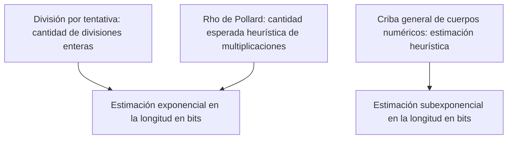
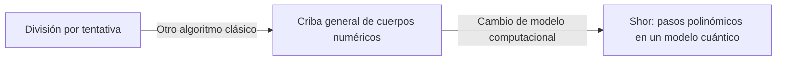

## 1. Introducción: ¿qué tiene de difícil factorizar?

Descomponer un entero pequeño en factores primos es una operación escolar familiar. Sin embargo, recuperar los factores de un producto de primos grandes puede exigir enormes recursos de cómputo clásico. Esta asimetría forma parte del contexto de la [criptografía de clave pública, incluido RSA](https://kenji.blog/es/p/modern-cryptography-public-key-hash-signature/).

Esto no significa que todo entero grande sea difícil de factorizar, ni que se haya demostrado que ningún algoritmo clásico rápido puede existir. Un entero enorme con factores pequeños, como un número par, puede ser fácil de tratar. Tampoco las complejidades de los algoritmos siguientes son cotas inferiores del problema en sí. La seguridad criptográfica exige evaluar claves generadas correctamente frente a los recursos del atacante supuesto.

Primero aclararemos la notación Big O y el tamaño de entrada; después compararemos la división por tentativa, el método de Fermat, rho de Pollard, la criba cuadrática y la criba general de cuerpos numéricos. Finalmente, examinaremos su relación con P frente a NP y la computación cuántica. Conviene distinguir las estimaciones de complejidad, las pruebas de seguridad y los segundos de ejecución.

## 2. Complejidad y notación Big O

El tiempo transcurrido depende de la CPU, la memoria, la implementación, la paralelización y otras condiciones. Una afirmación de complejidad debe especificar el tamaño de entrada y qué se cuenta como operación elemental. Contar una multiplicación de enteros grandes como una operación es distinto de contar las operaciones de bits que contiene.

### Una cota superior asintótica

Para funciones no negativas en entradas suficientemente grandes, $f(n)=\mathcal{O}(g(n))$ significa:

$$
\exists c>0,\ \exists n_0,\ \forall n\ge n_0:\quad 0\le f(n)\le c\,g(n).
$$

Las constantes $c$ y $n_0$ no dependen de la entrada $n$. Esta es la definición de una cota superior; por sí sola no significa «peor caso». Hay que precisar si la función describe el peor tiempo, el tiempo promedio o el tiempo esperado de un algoritmo aleatorizado.

Usamos $\Theta$ cuando las cotas superior e inferior tienen el mismo orden, y $\Omega$ para una cota inferior. Por ejemplo, incluso $f(n)=1$ pertenece a $\mathcal{O}(2^n)$. Por tanto, esa cota no implica que el tiempo se duplique exactamente al aumentar la entrada en uno. La notación tampoco expresa directamente proporciones entre tiempos medidos. La [definición del NIST](https://xlinux.nist.gov/dads/HTML/bigOnotation.html) también distingue una cota superior de una cota ajustada.

### Formas representativas de crecimiento

En esta tabla, $n$ es el número de elementos de datos, y se cuentan operaciones como comparaciones y accesos a elementos.

| Orden | Ejemplo y condiciones |
| --- | --- |
| $\mathcal{O}(1)$ | Acceder a un elemento de un arreglo por su índice en un modelo de acceso aleatorio |
| $\mathcal{O}(\log n)$ | Comparaciones de una búsqueda binaria en un arreglo ordenado |
| $\mathcal{O}(n)$ | Comparaciones de una búsqueda lineal en el peor caso |
| $\mathcal{O}(n\log n)$ | Ordenamiento por mezcla en el peor caso, o quicksort en promedio bajo supuestos adecuados |
| $\mathcal{O}(n^2)$ | Por ejemplo, comparaciones del ordenamiento por inserción en el peor caso |
| $\mathcal{O}(2^n)$ | Cantidad de todos los subconjuntos de $n$ elementos; el procesamiento de cada candidato tiene un costo adicional |
| $\mathcal{O}(n!)$ | Cantidad de todas las permutaciones de $n$ elementos distintos; el procesamiento de cada candidato tiene un costo adicional |

Un tiempo acotado por $\mathcal{O}(n^k)$ para una constante fija $k$ es polinómico. Un exponente o una constante grandes pueden hacerlo poco práctico, mientras que un método exponencial puede ser útil con entradas pequeñas. El siguiente diagrama clasifica estimaciones representativas según la longitud de entrada en bits. No es una prueba de dificultad ni una gráfica del tiempo transcurrido.

## 3. RSA: valor del entero y longitud de entrada

Sea $N\ge2$ el entero que queremos factorizar y $b$ la longitud de su representación binaria. No es el número de elementos $n$ de la tabla anterior.

$$
b=\lfloor\log_2 N\rfloor+1,\qquad 2^{b-1}\le N<2^b.
$$

Por ejemplo, $15$ tiene cuatro bits, pero $2^4=16$, no $15$. Una cota polinómica en el valor $N$ puede ser exponencial en la longitud de entrada $b$. Las propias operaciones con enteros grandes también tienen costos que dependen de $b$.

En el caso básico de RSA con dos primos, usamos primos impares distintos $p,q$ para formar $N=pq$. Si cada primo tiene 1024 bits, el producto tiene 2047 o 2048 bits, no siempre 2048. La clave pública incluye $N,e$, y la privada incluye el exponente privado $d$ y posiblemente otros valores. Por ejemplo, las siguientes condiciones son suficientes para elegir $d$:

$$
\varphi(N)=(p-1)(q-1),\quad 1<e<\varphi(N),\quad
\gcd(e,\varphi(N))=1,\quad ed\equiv1\pmod{\varphi(N)}.
$$

El [RFC 8017](https://www.rfc-editor.org/rfc/rfc8017.html) define las claves de forma más general mediante $\lambda(N)=\operatorname{lcm}(p-1,q-1)$. Conocer los factores permite calcular un exponente privado. Sin embargo, no se ha demostrado en general que invertir RSA sea equivalente a factorizar, y no todos los ataques contra RSA requieren factorizar el módulo.

La operación básica de exponenciación modular de enteros no constituye por sí sola un esquema de cifrado seguro. El uso real exige esquemas de cifrado que incorporen OAEP, esquemas de firma como PSS y considerar la generación de claves, las implementaciones y el protocolo completo. La asimetría entre multiplicar y recuperar factores no es una prueba incondicional de seguridad.

## 4. Cinco algoritmos de factorización

### 4.1 División por tentativa

Un entero compuesto $N$ tiene al menos un factor primo que no supera $\sqrt N$. Por eso, probar divisores pequeños hasta $\lfloor\sqrt N\rfloor$ permite encontrar un factor. No se afirma que el factor primo más grande sea menor que la raíz cuadrada: el mayor factor primo de $15=3\cdot5$ es $5$, superior a $\sqrt{15}$.

Para el método simple que prueba todos los candidatos enteros, el número de divisiones en el peor caso se puede estimar como $\mathcal{O}(\sqrt N)$. La desigualdad de la longitud en bits también proporciona la cota $\mathcal{O}(2^{b/2})$. Se cuenta cada división de precisión múltiple como una operación, no el total de operaciones de bits. Un factor pequeño permite terminar antes.

### 4.2 Método de Fermat: importa la distancia entre factores

Para un entero compuesto impar, buscamos una diferencia de cuadrados:

$$
N=x^2-y^2=(x-y)(x+y).
$$

Empezamos en $x=\lceil\sqrt N\rceil$ y aumentamos $x$ hasta que $x^2-N$ sea un cuadrado perfecto. Si $N=pq$ con $p\le q$ impares, una solución es $x=(p+q)/2$, $y=(q-p)/2$. La cantidad de candidatos hasta esa solución es la siguiente; si aparece otra solución antes, podemos terminar antes.

$$
\frac{p+q}{2}-\lceil\sqrt N\rceil+1.
$$

Con los factores cercanos de $1009\cdot1013$, el primer candidato funciona. En cambio, $3\cdot104729=314187$ requiere 51806 candidatos. En particular, fijar $p=3$ y aumentar el primo $q$ produce $\Theta(N)$ candidatos. No es correcto asignar siempre al método de Fermat el mismo orden de raíz cuadrada que a la división por tentativa. Para entradas pares, primero se retiran los factores de dos.

### 4.3 Rho de Pollard

Se itera una función como $x\mapsto x^2+c\pmod N$ y se calcula el máximo común divisor de $N$ y la diferencia entre dos posiciones de la secuencia. Una colisión módulo un factor primo desconocido $p$ puede producir una diferencia divisible por $p$ y revelar un factor. La detección de ciclos de Floyd conserva una cantidad constante de residuos. Cada residuo requiere $\mathcal{O}(b)$ bits, por lo que esto no significa memoria constante medida en bits.

Bajo un modelo heurístico de función aleatoria, la cantidad esperada de multiplicaciones modulares para encontrar un factor $p$ se estima como $\mathcal{O}(\sqrt p)$. Cuando $p$ es del orden de $\sqrt N$, resulta $\mathcal{O}(N^{1/4})$ y, por tanto, $\mathcal{O}(2^{b/4})$. No es una garantía incondicional del peor tiempo; también hay que considerar los costos en bits de la multiplicación y del máximo común divisor.

Un máximo común divisor $d$ solo representa un éxito si $1<d<N$. Si $d=1$, se continúa; si $d=N$, se reintenta con otro valor inicial o función, por ejemplo. Con $N=21$, valor inicial 2 y $f(x)=x^2+1$, la primera comparación de Floyd es entre 5 y 5, y el máximo común divisor es el propio 21. Un factor no trivial también puede ser compuesto y requerir más factorización.

### 4.4 Criba cuadrática y MPQS

La criba cuadrática reúne valores lisos, que se factorizan por completo sobre primos pequeños, para construir una congruencia de cuadrados. En su forma básica, se toma $m=\lfloor\sqrt N\rfloor$ y se criban los siguientes valores para un intervalo de $x$ pequeños:

$$
Q(x)=(m+x)^2-N.
$$

Se registran exponentes sobre una base de factores que incluye el signo $-1$ y primos pequeños seleccionados. El álgebra lineal sobre el cuerpo binario combina las paridades de los exponentes para encontrar productos que sean cuadrados. Describir solo valores lisos aleatorios de $x^2\bmod N$ omite el uso de valores pequeños de un polinomio que caracteriza a la criba cuadrática.

MPQS, la criba cuadrática de polinomios múltiples, es una variante que usa varios polinomios cuadráticos adecuados. El rendimiento depende de la implementación, la entrada y los recursos disponibles. No hay una regla universal según la cual un método supere a otro exactamente a partir de 100 dígitos.

La congruencia buscada y la extracción del factor tienen la forma:

$$
X^2\equiv Y^2\pmod N,\qquad d=\gcd(X-Y,N).
$$

Si $d=1$ o $d=N$, se prueba otra relación. Si $X,Y$ son coprimos con $N$ y $X\not\equiv\pm Y\pmod N$, obtenemos un factor no trivial, que no tiene por qué ser primo. Por ejemplo, con $N=1155$, $X=76$, $Y=1$, los cuadrados son congruentes, pero $\gcd(75,1155)=15$ y $\gcd(77,1155)=77$ son ambos compuestos.

### 4.5 Criba general de cuerpos numéricos (GNFS)

La criba general de cuerpos numéricos se utiliza para factorizar enteros grandes sin una forma especial. Su esquema general es:

1. Elegir polinomios enteros y parámetros relacionados con una raíz común módulo $N$, y preparar el cuerpo numérico asociado.
2. Cribar relaciones que cumplan condiciones de factorización con primos pequeños o ideales primos, tanto del lado racional como del lado del cuerpo numérico.
3. Resolver una gran matriz dispersa que describe las paridades de exponentes y otras condiciones para combinar relaciones de las que puedan extraerse cuadrados.
4. Calcular raíces cuadradas en ambos lados, obtener una congruencia de cuadrados entre enteros y usar un máximo común divisor para extraer un factor no trivial. Reintentar las relaciones que no funcionen.

Es un esquema, no un procedimiento de implementación de las raíces cuadradas del lado del cuerpo numérico ni de sus condiciones adicionales. Además, $\mathbb Z[\alpha]$, formado a partir de una raíz $\alpha$ de un polinomio, no siempre es todo el anillo de enteros del cuerpo numérico. Por ejemplo, para $\alpha=\sqrt5$, $\beta=(1+\sqrt5)/2$ satisface $\beta^2-\beta-1=0$, de modo que es un entero algebraico, pero no pertenece a $\mathbb Z[\sqrt5]$.

Definimos la notación L con logaritmos naturales $\ln$, para $c>0$ y $0\le\alpha\le1$:

$$
L_N[\alpha,c]=\exp\!\left((c+o(1))(\ln N)^\alpha(\ln\ln N)^{1-\alpha}\right).
$$

Aquí $o(1)$ tiende a cero cuando $N\to\infty$. Los extremos son $L_N[0,c]=(\ln N)^{c+o(1)}$ y $L_N[1,c]=N^{c+o(1)}$. No se debe eliminar el término asintótico y sustituirlo por una igualdad exacta o una cota superior de grado fijo.

La estimación heurística estándar del tiempo de GNFS se expresa como:

$$
L_N\!\left[\frac13,\left(\frac{64}{9}\right)^{1/3}\right]
=\exp\!\left(\left(\left(\frac{64}{9}\right)^{1/3}+o(1)\right)(\ln N)^{1/3}(\ln\ln N)^{2/3}\right).
$$

La constante es aproximadamente 1.923. La conversión a la longitud de entrada en bits utiliza $\ln N=b\ln2+\mathcal{O}(1)$, por lo que también cambia la constante principal del exponente:

$$
\exp\!\left(\left(\left(\frac{64\ln2}{9}\right)^{1/3}+o(1)\right)b^{1/3}(\ln b)^{2/3}\right).
$$

Esta constante es aproximadamente 1.702. La estimación es subexponencial en la longitud en bits: crece más rápido que cualquier polinomio, pero más lentamente que $2^{\varepsilon b}$ para cada $\varepsilon>0$ fijo. No es un teorema incondicional del peor caso para todas las entradas ni una predicción de segundos para un tamaño concreto.

Como ejemplo fechado, el [anuncio de factorización de RSA-250 del 28 de febrero de 2020](https://caramba.loria.fr/rsa250.txt) informa de la factorización mediante NFS de un entero de 250 dígitos y 829 bits, con aproximadamente 2700 años-núcleo de trabajo (core-years). Es una medida del trabajo computacional, no necesariamente 2700 máquinas simultáneas ni 2700 años transcurridos. Aquí no se presenta como el récord mundial actual ni como el costo para todo entero de esa longitud.

## 5. P frente a NP y computación cuántica

### Decidir la primalidad y encontrar factores

Decidir si un número es primo no es lo mismo que encontrar factores de un compuesto. El [artículo de AKS](https://annals.math.princeton.edu/2004/160-2/p12) estableció que la primalidad puede decidirse en tiempo polinómico determinista e incondicional. No estableció el mismo resultado para la factorización.

P, NP y coNP son fundamentalmente clases de problemas de decisión con respuestas Sí/No. La factorización es un problema de búsqueda que produce factores, por lo que decir simplemente «la factorización está en NP» deja ambiguo el tipo de problema. Por ejemplo, dados $N\ge2$ y $2\le K<N$, consideremos esta decisión: ¿existe un divisor que satisfaga $1<d\le K$ y $d\mid N$?

Una respuesta Sí tiene como certificado el divisor $d$, verificable mediante división. Una respuesta No puede certificarse con una factorización completa en primos: su producto, la primalidad de cada factor y que todos los factores primos superen $K$ pueden comprobarse en tiempo polinómico. Por tanto, este problema de decisión pertenece tanto a NP como a coNP. Una búsqueda en tiempo polinómico resolvería la decisión. A la inversa, un algoritmo de decisión polinómico permitiría obtener la factorización mediante búsqueda binaria sobre $K$ y extracción repetida de factores.

Esta clasificación no demuestra NP-completitud ni la inexistencia de un algoritmo clásico polinómico. Si un problema de NP y coNP fuera NP-completo bajo las reducciones polinómicas habituales, implicaría NP=coNP. [P frente a NP sigue sin resolverse](https://www.claymath.org/millennium/p-vs-np/). Incluso suponer P≠NP no demostraría por sí solo que la factorización está fuera de P.

### El algoritmo de Shor cambia el modelo computacional

El [algoritmo de Shor](https://arxiv.org/abs/quant-ph/9508027) factoriza enteros en una cantidad de pasos polinómica en la longitud de entrada en bits, en un modelo con suficientes recursos de computación cuántica. Su parte cuántica obtiene información sobre períodos, seguida de medición y procesamiento clásico posterior, con reintentos cuando hace falta. La transformada cuántica de Fourier no revela instantáneamente las respuestas para todos los candidatos.

Este número teórico de pasos no determina directamente si una máquina real necesitaría horas o días. Esas estimaciones requieren supuestos sobre puertas cuánticas, corrección de errores, circuitos aritméticos, qubits disponibles y otros recursos. La última flecha del diagrama cambia el modelo computacional; no demuestra un límite de las computadoras clásicas.

Prepararse para esos ataques futuros es una motivación de la criptografía poscuántica (PQC). Como explica el [RFC 9794](https://www.rfc-editor.org/rfc/rfc9794.html), el término se refiere a criptografía diseñada para resistir a atacantes con computadoras cuánticas; no garantiza que un esquema no pueda romperse. Hay que evaluar tanto los supuestos matemáticos como la implementación y las decisiones operativas.

## 6. Conclusión

Comparar complejidades de factorización empieza por separar el valor entero $N$ de la longitud de entrada $b$, las cantidades de operaciones de sus costos en bits, y el peor tiempo del tiempo esperado. La división por tentativa, Fermat y rho aprovechan estructuras diferentes; la criba cuadrática y GNFS construyen congruencias de cuadrados a partir de muchas relaciones.

La seguridad criptográfica no puede deducirse de una sola cota superior ni de que un entero parezca grande. Exige considerar conjuntamente los algoritmos conocidos, la generación de entradas, los modelos de ataque y la implementación. También para los resultados teóricos cuánticos, una explicación precisa debe indicar qué está demostrado y qué depende de supuestos o estimaciones de recursos.

### Referencias

- [NIST DADS: big-O notation](https://xlinux.nist.gov/dads/HTML/bigOnotation.html)
- [Handbook of Applied Cryptography, capítulo 2: definiciones de complejidad](https://cacr.uwaterloo.ca/hac/about/chap2.pdf)
- [Capítulo 3: factorización y problema RSA](https://cacr.uwaterloo.ca/hac/about/chap3.pdf) (fuente de 1996; sus récords y la situación de la primalidad deben distinguirse de los avances posteriores)
- [RFC 8017: claves y esquemas RSA](https://www.rfc-editor.org/rfc/rfc8017.html)
- [Anuncio de los autores sobre RSA-250 (2020)](https://caramba.loria.fr/rsa250.txt)
- [Agrawal–Kayal–Saxena: PRIMES is in P](https://annals.math.princeton.edu/2004/160-2/p12)
- [Clay Mathematics Institute: P vs NP](https://www.claymath.org/millennium/p-vs-np/)
- [Shor: algoritmos polinómicos para factorizar y calcular logaritmos discretos en una computadora cuántica](https://arxiv.org/abs/quant-ph/9508027)
- [RFC 9794: terminología poscuántica](https://www.rfc-editor.org/rfc/rfc9794.html)
