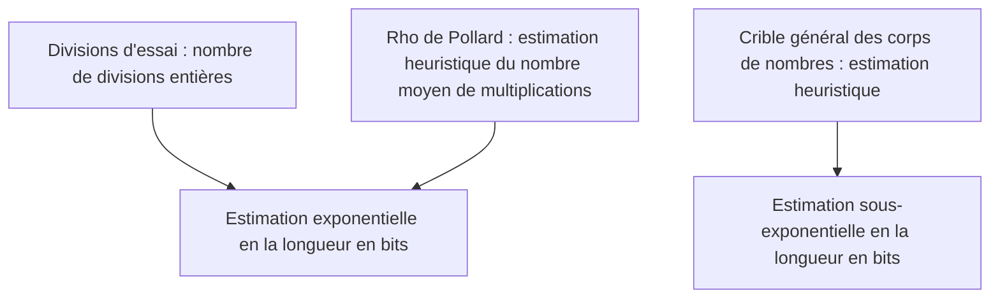
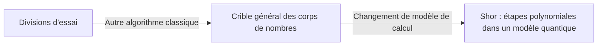

## 1. Introduction : qu'est-ce qui rend la factorisation difficile ?

Décomposer un petit entier en facteurs premiers est un calcul familier depuis l'école. Retrouver les facteurs d'un produit de grands nombres premiers peut toutefois demander des ressources considérables sur un ordinateur classique. Cette asymétrie fait partie du contexte de la [cryptographie à clé publique, notamment RSA](https://kenji.blog/fr/p/modern-cryptography-public-key-hash-signature/).

Cela ne signifie ni que tout grand entier est difficile à factoriser, ni que l'impossibilité d'un algorithme classique rapide a été démontrée. Un immense entier possédant de petits facteurs, comme un nombre pair, peut être facile à traiter. Les complexités des algorithmes présentés ci-dessous ne sont pas non plus des bornes inférieures du problème lui-même. La sécurité cryptographique exige d'évaluer des clés correctement générées face aux ressources de l'attaquant considéré.

Nous préciserons la notation grand O et la taille de l'entrée, puis comparerons les divisions d'essai, la méthode de Fermat, rho de Pollard, le crible quadratique et le crible général des corps de nombres. Enfin, nous examinerons leur rapport avec P contre NP et le calcul quantique. Il faut distinguer estimations de complexité, preuves de sécurité et secondes d'exécution.

## 2. Complexité et notation grand O

Le temps écoulé dépend du processeur, de la mémoire, de l'implémentation, de la parallélisation et d'autres conditions. Une affirmation de complexité doit préciser la taille de l'entrée et ce qui compte comme opération élémentaire. Compter une multiplication de grands entiers comme une opération diffère du décompte des opérations sur les bits qu'elle nécessite.

### Une borne supérieure asymptotique

Pour des fonctions non négatives sur les entrées suffisamment grandes, $f(n)=\mathcal{O}(g(n))$ signifie :

$$
\exists c>0,\ \exists n_0,\ \forall n\ge n_0:\quad 0\le f(n)\le c\,g(n).
$$

Les constantes $c$ et $n_0$ ne dépendent pas de l'entrée $n$. C'est la définition d'une borne supérieure ; elle ne signifie pas, à elle seule, « pire cas ». Il faut préciser séparément si la fonction décrit le temps dans le pire cas, le temps moyen ou l'espérance du temps d'un algorithme aléatoire.

On emploie $\Theta$ lorsque les bornes supérieure et inférieure ont le même ordre, et $\Omega$ pour une borne inférieure. Par exemple, même $f(n)=1$ appartient à $\mathcal{O}(2^n)$. Cette borne ne permet donc pas d'affirmer que le temps double exactement lorsque l'entrée augmente d'une unité. La notation ne donne pas directement les rapports entre temps mesurés. La [définition du NIST](https://xlinux.nist.gov/dads/HTML/bigOnotation.html) distingue également une borne supérieure d'une estimation asymptotiquement serrée.

### Quelques formes de croissance

Dans le tableau suivant, $n$ désigne le nombre d'éléments de données ; on compte des opérations comme les comparaisons et les accès aux éléments.

| Ordre | Exemple et conditions |
| --- | --- |
| $\mathcal{O}(1)$ | Accès à un élément de tableau par son indice dans un modèle à accès aléatoire |
| $\mathcal{O}(\log n)$ | Comparaisons d'une recherche dichotomique dans un tableau trié |
| $\mathcal{O}(n)$ | Comparaisons d'une recherche linéaire dans le pire cas |
| $\mathcal{O}(n\log n)$ | Tri fusion dans le pire cas, ou tri rapide en moyenne sous des hypothèses appropriées |
| $\mathcal{O}(n^2)$ | Par exemple, comparaisons du tri par insertion dans le pire cas |
| $\mathcal{O}(2^n)$ | Nombre de tous les sous-ensembles de $n$ éléments ; le traitement de chaque candidat a un coût distinct |
| $\mathcal{O}(n!)$ | Nombre de toutes les permutations de $n$ éléments distincts ; le traitement de chaque candidat a un coût distinct |

Un temps borné par $\mathcal{O}(n^k)$ pour une constante fixe $k$ est polynomial. Un grand exposant ou une grande constante peut néanmoins le rendre peu pratique ; inversement, une méthode exponentielle peut être utile pour de petites entrées. Le schéma suivant classe des estimations représentatives selon la longueur de l'entrée en bits. Ce n'est ni une preuve de difficulté ni un graphique du temps écoulé.

## 3. RSA : valeur de l'entier et longueur de l'entrée

Notons $N\ge2$ l'entier à factoriser et $b$ la longueur de sa représentation binaire. Ce n'est pas le nombre d'éléments $n$ du tableau précédent.

$$
b=\lfloor\log_2 N\rfloor+1,\qquad 2^{b-1}\le N<2^b.
$$

Par exemple, $15$ s'écrit sur quatre bits, mais $2^4=16$, et non $15$. Une borne polynomiale en la valeur $N$ peut être exponentielle en la longueur d'entrée $b$. Les opérations sur de grands entiers ont elles-mêmes des coûts qui dépendent de $b$.

Dans le cas élémentaire de RSA à deux nombres premiers, on choisit des nombres premiers impairs distincts $p,q$ et on forme $N=pq$. S'ils ont chacun 1024 bits, leur produit a 2047 ou 2048 bits, et non systématiquement 2048. La clé publique comprend $N,e$ ; la clé privée comprend l'exposant privé $d$ et éventuellement d'autres valeurs. Par exemple, les conditions suivantes suffisent pour choisir $d$ :

$$
\varphi(N)=(p-1)(q-1),\quad 1<e<\varphi(N),\quad
\gcd(e,\varphi(N))=1,\quad ed\equiv1\pmod{\varphi(N)}.
$$

La [RFC 8017](https://www.rfc-editor.org/rfc/rfc8017.html) définit plus généralement les clés à l'aide de $\lambda(N)=\operatorname{lcm}(p-1,q-1)$. Connaître les facteurs permet de calculer un exposant privé. Toutefois, il n'a pas été démontré en général que l'inversion de RSA soit équivalente à la factorisation, et toutes les attaques contre RSA ne nécessitent pas de factoriser le module.

La seule opération élémentaire d'exponentiation modulaire ne constitue pas un schéma de chiffrement sûr. En pratique, il faut des schémas de chiffrement intégrant OAEP, des schémas de signature comme PSS, et une analyse de la génération des clés, des implémentations et du protocole complet. L'asymétrie entre multiplication et récupération des facteurs n'est pas une preuve inconditionnelle de sécurité.

## 4. Cinq algorithmes de factorisation

### 4.1 Divisions d'essai

Un entier composé $N$ possède au moins un facteur premier inférieur ou égal à $\sqrt N$. Essayer de petits diviseurs jusqu'à $\lfloor\sqrt N\rfloor$ permet donc de trouver un facteur. Cela ne signifie pas que le plus grand facteur premier soit inférieur à la racine carrée : le plus grand facteur premier de $15=3\cdot5$ est $5$, supérieur à $\sqrt{15}$.

Pour la méthode simple qui teste tous les candidats entiers, le nombre de divisions dans le pire cas est estimé par $\mathcal{O}(\sqrt N)$. L'inégalité sur la longueur en bits donne aussi la borne $\mathcal{O}(2^{b/2})$. On compte ici chaque division en précision multiple comme une opération, et non le nombre total d'opérations sur les bits. Un petit facteur permet de terminer plus tôt.

### 4.2 Méthode de Fermat : l'écart entre les facteurs compte

Pour un entier composé impair, on cherche une différence de carrés :

$$
N=x^2-y^2=(x-y)(x+y).
$$

On part de $x=\lceil\sqrt N\rceil$ et on augmente $x$ jusqu'à ce que $x^2-N$ soit un carré parfait. Pour $N=pq$ avec $p\le q$ impairs, une solution est $x=(p+q)/2$, $y=(q-p)/2$. Le nombre de candidats jusqu'à cette solution est le suivant ; une solution antérieure, s'il en existe une, permet de s'arrêter plus tôt.

$$
\frac{p+q}{2}-\lceil\sqrt N\rceil+1.
$$

Avec les facteurs proches de $1009\cdot1013$, le premier candidat réussit. À l'inverse, $3\cdot104729=314187$ nécessite 51806 candidats. En particulier, fixer $p=3$ et augmenter le nombre premier $q$ donne $\Theta(N)$ candidats. Il est incorrect d'attribuer systématiquement à Fermat le même ordre en racine carrée qu'aux divisions d'essai. Pour une entrée paire, on retire d'abord les facteurs 2.

### 4.3 Rho de Pollard

On itère une fonction telle que $x\mapsto x^2+c\pmod N$ et on calcule le plus grand commun diviseur de $N$ et de la différence entre deux positions de la suite. Une collision modulo un facteur premier inconnu $p$ peut produire une différence divisible par $p$ et révéler un facteur. La détection de cycle de Floyd conserve un nombre constant de résidus. Chaque résidu demande toutefois $\mathcal{O}(b)$ bits : la mémoire n'est donc pas constante si on la mesure en bits.

Dans un modèle heuristique de fonction aléatoire, le nombre espéré de multiplications modulaires pour trouver un facteur $p$ est estimé par $\mathcal{O}(\sqrt p)$. Lorsque $p$ est de l'ordre de $\sqrt N$, on obtient $\mathcal{O}(N^{1/4})$, donc $\mathcal{O}(2^{b/4})$. Ce n'est pas une garantie inconditionnelle dans le pire cas ; les coûts en bits des multiplications et des calculs de PGCD doivent aussi être pris en compte.

Un PGCD $d$ représente un succès seulement si $1<d<N$. Si $d=1$, on continue ; si $d=N$, on réessaie, par exemple en changeant la valeur initiale ou la fonction. Avec $N=21$, la valeur initiale 2 et $f(x)=x^2+1$, la première comparaison de Floyd porte sur 5 et 5, donnant 21 lui-même comme PGCD. Un facteur non trivial peut aussi être composé et nécessiter une factorisation supplémentaire.

### 4.4 Crible quadratique et MPQS

Le crible quadratique rassemble des valeurs friables, dont la décomposition ne fait intervenir que de petits nombres premiers, pour construire une congruence de carrés. Dans sa forme de base, on pose $m=\lfloor\sqrt N\rfloor$ et on crible les valeurs suivantes pour un intervalle de petits $x$ :

$$
Q(x)=(m+x)^2-N.
$$

On enregistre les exposants sur une base de facteurs comprenant le signe $-1$ et de petits nombres premiers choisis. L'algèbre linéaire sur le corps à deux éléments combine les parités des exposants pour trouver des produits qui sont des carrés. Se contenter de décrire des valeurs friables aléatoires de $x^2\bmod N$ masque l'utilisation de petites valeurs polynomiales propre au crible quadratique.

Le MPQS, crible quadratique à polynômes multiples, est une variante utilisant plusieurs polynômes quadratiques appropriés. Les performances dépendent de l'implémentation, de l'entrée et des ressources disponibles. Il n'existe pas de règle universelle selon laquelle une méthode en dépasse une autre à exactement 100 chiffres.

La congruence recherchée et l'extraction du facteur prennent la forme :

$$
X^2\equiv Y^2\pmod N,\qquad d=\gcd(X-Y,N).
$$

Si $d=1$ ou $d=N$, on essaie une autre relation. Si $X,Y$ sont premiers avec $N$ et $X\not\equiv\pm Y\pmod N$, on obtient un facteur non trivial, pas nécessairement premier. Par exemple, pour $N=1155$, $X=76$, $Y=1$, les carrés sont congrus, mais $\gcd(75,1155)=15$ et $\gcd(77,1155)=77$ sont tous deux composés.

### 4.5 Crible général des corps de nombres (GNFS)

Le crible général des corps de nombres sert à factoriser de grands entiers sans forme particulière. Son déroulement général est le suivant :

1. Choisir des polynômes entiers et des paramètres associés ayant une racine commune modulo $N$, et préparer le corps de nombres correspondant.
2. Cribler des relations satisfaisant des conditions de factorisation faisant intervenir de petits nombres premiers ou des idéaux premiers, du côté rationnel et du côté du corps de nombres.
3. Résoudre une grande matrice creuse décrivant les parités des exposants et des conditions supplémentaires pour combiner des relations dont on pourra extraire des carrés.
4. Calculer des racines carrées des deux côtés, obtenir une congruence de carrés entre entiers et utiliser un PGCD pour extraire un facteur non trivial. Réessayer avec d'autres relations en cas d'échec.

C'est un aperçu, pas une procédure d'implémentation des racines carrées du côté du corps de nombres ni de leurs conditions supplémentaires. De plus, $\mathbb Z[\alpha]$, formé à partir d'une racine $\alpha$ d'un polynôme, ne coïncide pas toujours avec l'anneau des entiers du corps de nombres. Par exemple, pour $\alpha=\sqrt5$, $\beta=(1+\sqrt5)/2$ satisfait $\beta^2-\beta-1=0$ : c'est un entier algébrique, mais il n'appartient pas à $\mathbb Z[\sqrt5]$.

Définissons la notation L avec les logarithmes naturels $\ln$, pour $c>0$ et $0\le\alpha\le1$ :

$$
L_N[\alpha,c]=\exp\!\left((c+o(1))(\ln N)^\alpha(\ln\ln N)^{1-\alpha}\right).
$$

Ici, $o(1)$ tend vers zéro lorsque $N\to\infty$. Les extrémités sont $L_N[0,c]=(\ln N)^{c+o(1)}$ et $L_N[1,c]=N^{c+o(1)}$. Il ne faut pas supprimer le terme asymptotique pour le remplacer par une égalité exacte ou une borne supérieure de degré fixe.

L'estimation heuristique habituelle du temps de GNFS s'écrit :

$$
L_N\!\left[\frac13,\left(\frac{64}{9}\right)^{1/3}\right]
=\exp\!\left(\left(\left(\frac{64}{9}\right)^{1/3}+o(1)\right)(\ln N)^{1/3}(\ln\ln N)^{2/3}\right).
$$

La constante vaut environ 1,923. Le passage à la longueur de l'entrée en bits utilise $\ln N=b\ln2+\mathcal{O}(1)$, ce qui change aussi la constante principale de l'exposant :

$$
\exp\!\left(\left(\left(\frac{64\ln2}{9}\right)^{1/3}+o(1)\right)b^{1/3}(\ln b)^{2/3}\right).
$$

Cette constante vaut environ 1,702. L'estimation est sous-exponentielle en la longueur en bits : elle croît plus vite que tout polynôme, mais plus lentement que $2^{\varepsilon b}$ pour tout $\varepsilon>0$ fixé. Ce n'est ni un théorème inconditionnel du pire cas pour toutes les entrées, ni une prévision du temps écoulé pour une taille donnée.

À titre d'exemple daté, l'[annonce de factorisation de RSA-250 du 28 février 2020](https://caramba.loria.fr/rsa250.txt) rapporte la factorisation par NFS d'un entier de 250 chiffres et 829 bits, pour environ 2700 années-cœur de travail (core-years). Il s'agit d'une mesure du travail de calcul, pas nécessairement de 2700 machines simultanées ni de 2700 années écoulées. Cet exemple n'est présenté ni comme le record mondial actuel ni comme le coût pour tout entier de cette longueur.

## 5. P contre NP et calcul quantique

### Tester la primalité et trouver des facteurs

Déterminer si un nombre est premier diffère de la recherche de facteurs d'un composé. L'[article AKS](https://annals.math.princeton.edu/2004/160-2/p12) a établi un test de primalité déterministe et inconditionnel en temps polynomial. Il n'a pas établi le même résultat pour la factorisation.

P, NP et coNP sont fondamentalement des classes de problèmes de décision à réponse Oui/Non. La factorisation elle-même est un problème de recherche qui produit des facteurs ; dire seulement qu'elle est dans NP laisse donc le type de problème ambigu. Par exemple, étant donnés $N\ge2$ et $2\le K<N$, demandons s'il existe un diviseur satisfaisant $1<d\le K$ et $d\mid N$.

Une réponse Oui admet le diviseur $d$ comme certificat, vérifiable par division. Une réponse Non peut être certifiée par une factorisation complète en nombres premiers : on vérifie en temps polynomial le produit, la primalité de chaque facteur et le fait que tous les facteurs premiers dépassent $K$. Ce problème de décision appartient donc à NP et à coNP. Une recherche polynomiale résoudrait la décision. Réciproquement, un algorithme de décision polynomial permettrait d'obtenir la factorisation par recherche dichotomique sur $K$ et extraction répétée de facteurs.

Ce classement ne démontre ni la NP-complétude ni l'absence d'algorithme classique polynomial. Si un problème de NP et de coNP était NP-complet pour les réductions polynomiales usuelles, cela impliquerait NP=coNP. [P contre NP reste ouvert](https://www.claymath.org/millennium/p-vs-np/). Même supposer P≠NP ne suffirait pas à démontrer que la factorisation est hors de P.

### L'algorithme de Shor change de modèle de calcul

L'[algorithme de Shor](https://arxiv.org/abs/quant-ph/9508027) factorise des entiers en un nombre d'étapes polynomial en la longueur de l'entrée en bits, dans un modèle disposant de ressources quantiques suffisantes. Sa partie quantique fournit des informations sur les périodes, suivies d'une mesure et d'un traitement classique, avec de nouvelles tentatives si nécessaire. La transformée de Fourier quantique ne révèle pas instantanément les réponses de tous les candidats.

Ce nombre théorique d'étapes ne détermine pas directement si une machine réelle aurait besoin d'heures ou de jours. Une telle estimation nécessite des hypothèses sur les portes quantiques, la correction d'erreurs, les circuits arithmétiques, les qubits disponibles et d'autres ressources. La dernière flèche du schéma change de modèle de calcul ; elle ne prouve pas une limite des ordinateurs classiques.

Se préparer à ces attaques futures est une motivation de la cryptographie post-quantique (PQC). Comme l'explique la [RFC 9794](https://www.rfc-editor.org/rfc/rfc9794.html), le terme désigne une cryptographie conçue pour résister à des attaquants dotés d'ordinateurs quantiques ; il ne garantit pas qu'un schéma ne puisse jamais être cassé. Il faut évaluer tant les hypothèses mathématiques que l'implémentation et les choix opérationnels.

## 6. Conclusion

Comparer les complexités de factorisation commence par distinguer la valeur entière $N$ de la longueur d'entrée $b$, les nombres d'opérations de leurs coûts en bits, et le pire temps du temps espéré. Les divisions d'essai, Fermat et rho exploitent des structures différentes ; le crible quadratique et GNFS construisent des congruences de carrés à partir de nombreuses relations.

La sécurité cryptographique ne se déduit ni d'une seule borne supérieure ni de l'apparence d'un grand entier. Elle demande de considérer ensemble les algorithmes connus, la génération des entrées, les modèles d'attaque et l'implémentation. Pour les résultats théoriques quantiques aussi, une explication précise doit indiquer ce qui est démontré et ce qui dépend d'hypothèses ou d'estimations de ressources.

### Références

- [NIST DADS : big-O notation](https://xlinux.nist.gov/dads/HTML/bigOnotation.html)
- [Handbook of Applied Cryptography, chapitre 2 : définitions de complexité](https://cacr.uwaterloo.ca/hac/about/chap2.pdf)
- [Chapitre 3 : factorisation et problème RSA](https://cacr.uwaterloo.ca/hac/about/chap3.pdf) (source de 1996 ; distinguer ses records et l'état de la primalité des avancées ultérieures)
- [RFC 8017 : clés et schémas RSA](https://www.rfc-editor.org/rfc/rfc8017.html)
- [Annonce des auteurs concernant RSA-250 (2020)](https://caramba.loria.fr/rsa250.txt)
- [Agrawal–Kayal–Saxena : PRIMES is in P](https://annals.math.princeton.edu/2004/160-2/p12)
- [Clay Mathematics Institute : P vs NP](https://www.claymath.org/millennium/p-vs-np/)
- [Shor : algorithmes polynomiaux de factorisation et de logarithme discret sur un ordinateur quantique](https://arxiv.org/abs/quant-ph/9508027)
- [RFC 9794 : terminologie post-quantique](https://www.rfc-editor.org/rfc/rfc9794.html)
