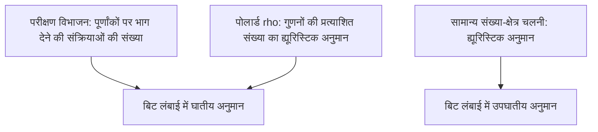

## 1. परिचय: गुणनखंडन में कठिनाई क्या है?

छोटे पूर्णांक को अभाज्य संख्याओं के गुणनफल में लिखना स्कूल में सीखा जाने वाला परिचित गणित है। लेकिन बड़ी अभाज्य संख्याओं के गुणनफल से उनके गुणनखंड वापस निकालने में शास्त्रीय कंप्यूटर पर बहुत अधिक संसाधन लग सकते हैं। यह असममिति [RSA सहित सार्वजनिक-कुंजी क्रिप्टोग्राफी](https://kenji.blog/hi/p/modern-cryptography-public-key-hash-signature/) की पृष्ठभूमि का एक हिस्सा है।

इसका अर्थ यह नहीं कि हर बड़ा पूर्णांक कठिन है, या यह सिद्ध हो चुका है कि कोई तेज़ शास्त्रीय एल्गोरिदम हो ही नहीं सकता। छोटे गुणनखंड वाली बहुत बड़ी संख्या, जैसे सम संख्या, आसानी से संसाधित हो सकती है। नीचे दिए गए एल्गोरिदमों की जटिलताएँ भी समस्या की अपनी निचली सीमाएँ नहीं हैं। क्रिप्टोग्राफिक सुरक्षा का मूल्यांकन सही ढंग से बनाई गई कुंजियों और माने गए हमलावर के संसाधनों के संदर्भ में करना होता है।

हम पहले बिग ओ संकेतन और इनपुट आकार स्पष्ट करेंगे, फिर परीक्षण विभाजन, फ़र्मेट विधि, पोलार्ड की rho विधि, द्विघातीय चलनी और सामान्य संख्या-क्षेत्र चलनी की तुलना करेंगे। अंत में P बनाम NP तथा क्वांटम गणना से उनका संबंध देखेंगे। जटिलता के अनुमान, सुरक्षा के प्रमाण और वास्तविक सेकंडों को अलग समझें।

## 2. जटिलता और बिग ओ संकेतन

वास्तविक समय CPU, मेमोरी, कार्यान्वयन, समांतरकरण और अन्य परिस्थितियों पर निर्भर करता है। जटिलता बताते समय इनपुट आकार और गिनी जाने वाली मूल संक्रिया तय करनी पड़ती है। बड़े पूर्णांकों के गुणन को एक संक्रिया गिनना, उसके अंदर की बिट संक्रियाएँ गिनने से अलग है।

### स्पर्शोन्मुख ऊपरी परिबंध

पर्याप्त बड़े इनपुट पर गैरऋणात्मक फलनों के लिए $f(n)=\mathcal{O}(g(n))$ का अर्थ है:

$$
\exists c>0,\ \exists n_0,\ \forall n\ge n_0:\quad 0\le f(n)\le c\,g(n).
$$

स्थिरांक $c$ और $n_0$ इनपुट $n$ पर निर्भर नहीं करते। यह ऊपरी परिबंध (upper bound) की परिभाषा है; अपने आप में इसका अर्थ सबसे खराब स्थिति नहीं है। अलग से बताना होता है कि फलन सबसे खराब समय, औसत समय, या यादृच्छिक एल्गोरिदम के समय का प्रत्याशित मान दर्शाता है।

ऊपरी और निचले परिबंधों की कोटि समान होने पर $\Theta$, और निचले परिबंध के लिए $\Omega$ उपयोग होता है। उदाहरण के लिए $f(n)=1$ भी $\mathcal{O}(2^n)$ में आता है। इसलिए केवल इस ऊपरी परिबंध से यह नहीं निकलता कि इनपुट एक बढ़ने पर समय ठीक दोगुना होगा। यह संकेतन मापे गए समयों का अनुपात भी सीधे नहीं बताता। [NIST की परिभाषा](https://xlinux.nist.gov/dads/HTML/bigOnotation.html) भी ऊपरी परिबंध और स्पर्शोन्मुख रूप से सटीक परिबंध में अंतर करती है।

### वृद्धि के सामान्य रूप

अगली सारणी में $n$ डेटा अवयवों की संख्या है। तुलना और अवयव तक पहुँच जैसी मूल संक्रियाएँ गिनी जाती हैं।

| कोटि | उदाहरण और शर्तें |
| --- | --- |
| $\mathcal{O}(1)$ | यादृच्छिक पहुँच मॉडल में सूचकांक से सरणी के अवयव तक पहुँचना |
| $\mathcal{O}(\log n)$ | क्रमबद्ध सरणी में द्विआधारी खोज की तुलनाएँ |
| $\mathcal{O}(n)$ | रैखिक खोज की सबसे खराब स्थिति में तुलनाएँ |
| $\mathcal{O}(n\log n)$ | मर्ज सॉर्ट की सबसे खराब स्थिति, या उचित धारणाओं के अंतर्गत क्विक सॉर्ट का औसत |
| $\mathcal{O}(n^2)$ | उदाहरण के लिए इन्सर्शन सॉर्ट की सबसे खराब स्थिति में तुलनाएँ |
| $\mathcal{O}(2^n)$ | $n$ अवयवों के सभी उपसमुच्चयों की संख्या; प्रत्येक प्रत्याशी को संसाधित करने का खर्च अलग है |
| $\mathcal{O}(n!)$ | $n$ भिन्न अवयवों के सभी क्रमपरिवर्तनों की संख्या; प्रत्येक प्रत्याशी का प्रसंस्करण खर्च अलग है |

निश्चित स्थिरांक $k$ के लिए $\mathcal{O}(n^k)$ से सीमित समय बहुपदीय कहलाता है। बड़ा घातांक या स्थिरांक उसे अव्यावहारिक बना सकता है; दूसरी ओर घातीय विधि छोटे इनपुट पर उपयोगी हो सकती है। अगला आरेख इनपुट की बिट लंबाई के सापेक्ष प्रतिनिधि अनुमानों को वर्गीकृत करता है। यह कठिनाई का प्रमाण या वास्तविक समय का ग्राफ नहीं है।

## 3. RSA: पूर्णांक का मान और इनपुट की लंबाई

गुणनखंडित किए जाने वाले पूर्णांक को $N\ge2$ और उसके द्विआधारी निरूपण की लंबाई को $b$ मानें। यह पिछली सारणी के अवयवों की संख्या $n$ से अलग है।

$$
b=\lfloor\log_2 N\rfloor+1,\qquad 2^{b-1}\le N<2^b.
$$

उदाहरण के लिए $15$ चार बिट का है, लेकिन $2^4=16$ है, $15$ नहीं। मान $N$ में बहुपदीय परिबंध भी इनपुट लंबाई $b$ में घातीय हो सकता है। बड़े पूर्णांकों की संक्रियाओं का अपना खर्च भी $b$ पर निर्भर करता है।

दो अभाज्य संख्याओं वाले मूल RSA में भिन्न विषम अभाज्य संख्याएँ $p,q$ लेकर $N=pq$ बनाया जाता है। प्रत्येक 1024 बिट की हो तो गुणनफल 2047 या 2048 बिट का होता है, हमेशा 2048 का नहीं। सार्वजनिक कुंजी में $N,e$ होते हैं; निजी कुंजी में निजी घातांक $d$ तथा संभवतः अन्य मान होते हैं। उदाहरण के लिए $d$ चुनने की पर्याप्त शर्तें हैं:

$$
\varphi(N)=(p-1)(q-1),\quad 1<e<\varphi(N),\quad
\gcd(e,\varphi(N))=1,\quad ed\equiv1\pmod{\varphi(N)}.
$$

[RFC 8017](https://www.rfc-editor.org/rfc/rfc8017.html) अधिक सामान्य रूप से $\lambda(N)=\operatorname{lcm}(p-1,q-1)$ से कुंजियों को परिभाषित करता है। गुणनखंड पता हों तो निजी घातांक निकाला जा सकता है। लेकिन सामान्य रूप से RSA प्रतिलोमन और गुणनखंडन की समतुल्यता सिद्ध नहीं है, और हर RSA हमले के लिए मॉड्यूलस का गुणनखंडन ज़रूरी नहीं होता।

केवल पूर्णांक का मॉड्यूलर घात निकालने की मूल संक्रिया सुरक्षित एन्क्रिप्शन योजना नहीं बनाती। वास्तविक उपयोग में OAEP वाली एन्क्रिप्शन योजनाएँ, PSS जैसी हस्ताक्षर योजनाएँ, कुंजी निर्माण, कार्यान्वयन और पूरे प्रोटोकॉल का विचार आवश्यक है। गुणन और गुणनखंड वापस पाने की असममिति को बिना शर्त सुरक्षा-प्रमाण न समझें।

## 4. गुणनखंडन के पाँच एल्गोरिदम

### 4.1 परीक्षण विभाजन

भाज्य (composite) पूर्णांक $N$ का कम से कम एक अभाज्य गुणनखंड $\sqrt N$ से बड़ा नहीं होता। इसलिए छोटे भाजकों को $\lfloor\sqrt N\rfloor$ तक आज़माने से एक गुणनखंड मिल जाता है। इसका अर्थ सबसे बड़े अभाज्य गुणनखंड का वर्गमूल से छोटा होना नहीं है: $15=3\cdot5$ का सबसे बड़ा अभाज्य गुणनखंड $5$, $\sqrt{15}$ से बड़ा है।

हर पूर्णांक प्रत्याशी को जाँचने वाली सरल विधि में सबसे खराब स्थिति में भाग देने की संक्रियाओं की संख्या का परिबंध $\mathcal{O}(\sqrt N)$ है। बिट लंबाई की असमानता से $\mathcal{O}(2^{b/2})$ भी ऊपरी परिबंध है। यह मल्टीप्रिसिजन पूर्णांकों पर भाग देने की प्रत्येक संक्रिया को एक बार गिनता है, सभी बिट संक्रियाओं की कुल संख्या नहीं। छोटा गुणनखंड मिलने पर प्रक्रिया जल्दी समाप्त होती है।

### 4.2 फ़र्मेट विधि: गुणनखंडों का अंतर महत्वपूर्ण है

विषम भाज्य पूर्णांक के लिए वर्गों का अंतर खोजा जाता है:

$$
N=x^2-y^2=(x-y)(x+y).
$$

$x=\lceil\sqrt N\rceil$ से शुरू करके $x$ बढ़ाते हैं और देखते हैं कि $x^2-N$ पूर्ण वर्ग है या नहीं। विषम $p\le q$ के लिए $N=pq$ हो, तो $x=(p+q)/2$, $y=(q-p)/2$ एक हल है। इस हल तक प्रत्याशियों की संख्या निम्न है; उससे पहले कोई और हल मिले तो पहले रुक सकते हैं।

$$
\frac{p+q}{2}-\lceil\sqrt N\rceil+1.
$$

पास-पास के गुणनखंडों वाले $1009\cdot1013$ में पहला प्रत्याशी सफल होता है। दूसरी ओर $3\cdot104729=314187$ में 51806 प्रत्याशी जाँचने पड़ते हैं। विशेष रूप से $p=3$ निश्चित रखकर अभाज्य $q$ बढ़ाने पर प्रत्याशियों की संख्या $\Theta(N)$ होती है। इसलिए फ़र्मेट विधि को हमेशा परीक्षण विभाजन जैसी वर्गमूल कोटि देना सही नहीं है। सम इनपुट से पहले गुणनखंड 2 निकालते हैं।

### 4.3 पोलार्ड की rho विधि

$x\mapsto x^2+c\pmod N$ जैसे फलन को दोहराकर अनुक्रम बनाते हैं और दो स्थानों के अंतर तथा $N$ का महत्तम समापवर्तक निकालते हैं। अज्ञात अभाज्य गुणनखंड $p$ के मॉड्यूलो में टकराव होने पर अंतर $p$ का गुणज बन सकता है और कोई गुणनखंड मिल सकता है। फ़्लॉयड का चक्र-पहचान तरीका शेषफलों की एक निश्चित संख्या रखता है। हर मान के लिए $\mathcal{O}(b)$ बिट चाहिए, इसलिए बिटों में मापी गई स्मृति स्थिर नहीं है।

यादृच्छिक फलन जैसा व्यवहार मानने वाले ह्यूरिस्टिक मॉडल में गुणनखंड $p$ पाने के लिए मॉड्यूलर गुणनों की प्रत्याशित संख्या $\mathcal{O}(\sqrt p)$ आँकी जाती है। $p$ की कोटि $\sqrt N$ हो तो यह $\mathcal{O}(N^{1/4})$, और इसलिए $\mathcal{O}(2^{b/4})$ होती है। यह सबसे खराब समय की बिना शर्त गारंटी नहीं है; गुणन और महत्तम समापवर्तक के बिट खर्च भी अलग गिनने होते हैं।

प्राप्त महत्तम समापवर्तक $d$ तभी सफलता है जब $1<d<N$ हो। $d=1$ हो तो जारी रखते हैं; $d=N$ हो तो शुरुआती मान या फलन बदलकर फिर कोशिश की जा सकती है। उदाहरण के लिए $N=21$, शुरुआती मान 2 और $f(x)=x^2+1$ में फ़्लॉयड की पहली तुलना 5 और 5 की होती है, जिससे महत्तम समापवर्तक स्वयं 21 है। गैरतुच्छ गुणनखंड भी भाज्य हो सकता है और आगे गुणनखंडन माँग सकता है।

### 4.4 द्विघातीय चलनी और MPQS

द्विघातीय चलनी केवल छोटी अभाज्य संख्याओं में टूटने वाले स्मूथ मान इकट्ठे करके वर्गों की सर्वांगसमता बनाती है। मूल रूप में $m=\lfloor\sqrt N\rfloor$ रखकर छोटे $x$ के एक दायरे में निम्न मानों को छाना जाता है:

$$
Q(x)=(m+x)^2-N.
$$

चिह्न $-1$ और चुनी हुई छोटी अभाज्य संख्याओं के कारक आधार पर घातांक दर्ज करते हैं। दो अवयवों वाले क्षेत्र पर रैखिक बीजगणित से घातांकों की सम-विषमता को मिलाकर ऐसे गुणनफल खोजते हैं जो वर्ग हों। केवल यादृच्छिक $x^2\bmod N$ की स्मूथनेस जाँचने का वर्णन, छोटे बहुपद मानों के उपयोग वाली द्विघातीय चलनी की खासियत नहीं बताता।

MPQS, अनेक बहुपदों वाली द्विघातीय चलनी, कई उपयुक्त द्विघात बहुपद इस्तेमाल करने वाला रूपांतर है। प्रदर्शन कार्यान्वयन, इनपुट और संसाधनों पर निर्भर करता है। ठीक 100 अंकों पर कोई विधि दूसरी से अवश्य तेज़ हो जाएगी, ऐसी सार्वभौमिक सीमा नहीं है।

वांछित सर्वांगसमता और गुणनखंड निकालने की संक्रिया का रूप है:

$$
X^2\equiv Y^2\pmod N,\qquad d=\gcd(X-Y,N).
$$

$d=1$ या $d=N$ हो तो दूसरा संबंध आज़माते हैं। $X,Y$ दोनों $N$ के साथ सह-अभाज्य हों और $X\not\equiv\pm Y\pmod N$ हो, तो गैरतुच्छ गुणनखंड मिलता है, लेकिन वह आवश्यक रूप से अभाज्य नहीं है। उदाहरण के लिए $N=1155$, $X=76$, $Y=1$ में दोनों वर्ग सर्वांगसम हैं, पर $\gcd(75,1155)=15$ और $\gcd(77,1155)=77$ दोनों भाज्य हैं।

### 4.5 सामान्य संख्या-क्षेत्र चलनी (GNFS)

सामान्य संख्या-क्षेत्र चलनी का उपयोग विशेष रूप के बिना बड़े पूर्णांकों का गुणनखंडन करने में होता है। मोटे तौर पर चरण हैं:

1. $N$ के मॉड्यूलो में साझा मूल वाले पूर्णांक गुणांकों के बहुपद और संबंधित पैरामीटर चुनकर संबंधित संख्या क्षेत्र तैयार करना।
2. परिमेय पक्ष और संख्या-क्षेत्र पक्ष पर छोटी अभाज्य संख्याओं या अभाज्य आइडियल (prime ideals) से संबंधित गुणनखंडन शर्तें पूरी करने वाले संबंध छानना।
3. घातांकों की सम-विषमता और अतिरिक्त शर्तें बताने वाला बड़ा विरल आव्यूह हल करके ऐसे संबंध मिलाना जिनसे वर्ग निकाले जा सकें।
4. दोनों पक्षों के वर्गमूल निकालकर पूर्णांकों की वर्ग-सर्वांगसमता प्राप्त करना और महत्तम समापवर्तक से गैरतुच्छ गुणनखंड निकालना। असफल संबंधों के लिए फिर कोशिश करना।

यह रूपरेखा है, संख्या-क्षेत्र पक्ष के वर्गमूल और अतिरिक्त शर्तों के कार्यान्वयन की विधि नहीं। बहुपद के मूल $\alpha$ से बना $\mathbb Z[\alpha]$ भी हमेशा संख्या क्षेत्र के पूर्णांकों का पूरा वलय नहीं होता। उदाहरण के लिए $\alpha=\sqrt5$ पर $\beta=(1+\sqrt5)/2$, $\beta^2-\beta-1=0$ को संतुष्ट करता है, इसलिए बीजीय पूर्णांक है, लेकिन $\mathbb Z[\sqrt5]$ का अवयव नहीं है।

प्राकृतिक लघुगणक $\ln$ से L संकेतन परिभाषित करें, जहाँ $c>0$ और $0\le\alpha\le1$ हैं:

$$
L_N[\alpha,c]=\exp\!\left((c+o(1))(\ln N)^\alpha(\ln\ln N)^{1-\alpha}\right).
$$

$N\to\infty$ पर $o(1)$ शून्य की ओर जाता है। सिरों पर $L_N[0,c]=(\ln N)^{c+o(1)}$ और $L_N[1,c]=N^{c+o(1)}$ हैं। स्पर्शोन्मुख पद हटाकर उसकी जगह सटीक समानता या निश्चित घात का ऊपरी परिबंध नहीं रखा जा सकता।

GNFS के समय का मानक ह्यूरिस्टिक अनुमान है:

$$
L_N\!\left[\frac13,\left(\frac{64}{9}\right)^{1/3}\right]
=\exp\!\left(\left(\left(\frac{64}{9}\right)^{1/3}+o(1)\right)(\ln N)^{1/3}(\ln\ln N)^{2/3}\right).
$$

स्थिरांक लगभग 1.923 है। इनपुट की बिट लंबाई में बदलने पर $\ln N=b\ln2+\mathcal{O}(1)$ है, इसलिए घातांक का प्रमुख स्थिरांक भी बदलता है:

$$
\exp\!\left(\left(\left(\frac{64\ln2}{9}\right)^{1/3}+o(1)\right)b^{1/3}(\ln b)^{2/3}\right).
$$

यह स्थिरांक लगभग 1.702 है। यह बिट लंबाई में उपघातीय अनुमान है: हर बहुपद से तेज़ बढ़ता है, लेकिन प्रत्येक निश्चित $\varepsilon>0$ के लिए $2^{\varepsilon b}$ से धीमा। यह सभी इनपुट के सबसे खराब समय का बिना शर्त प्रमेय या किसी आकार के वास्तविक समय का पूर्वानुमान नहीं है।

दिनांकित उदाहरण के रूप में, [28 फ़रवरी 2020 की RSA-250 घोषणा](https://caramba.loria.fr/rsa250.txt) बताती है कि 250 अंकों और 829 बिट के पूर्णांक को NFS से गुणनखंडित करने में लगभग 2700 core-years का कार्य लगा। यह गणना के कार्यभार का माप है, न कि आवश्यक रूप से एक साथ 2700 कंप्यूटर या वास्तव में बीते 2700 वर्ष। इसे वर्तमान विश्व रिकॉर्ड या समान लंबाई के हर पूर्णांक का खर्च नहीं बताया जा रहा।

## 5. P बनाम NP और क्वांटम गणना

### अभाज्यता जाँचना और गुणनखंड खोजना

किसी संख्या का अभाज्य होना तय करना और भाज्य संख्या के गुणनखंड खोजना अलग हैं। [AKS लेख](https://annals.math.princeton.edu/2004/160-2/p12) ने बिना शर्त नियतात्मक बहुपदीय समय में अभाज्यता परीक्षण स्थापित किया। उसने गुणनखंडन के लिए वही परिणाम स्थापित नहीं किया।

P, NP और coNP मूल रूप से हाँ/नहीं वाले निर्णय प्रश्नों के वर्ग हैं। अभाज्य गुणनखंडन स्वयं गुणनखंड देने वाली खोज समस्या है, इसलिए केवल इसे NP में बताने से समस्या का प्रकार अस्पष्ट रहता है। उदाहरण के लिए $N\ge2$ और $2\le K<N$ दिए हों तो पूछा जा सकता है कि क्या $1<d\le K$ और $d\mid N$ वाला भाजक है।

हाँ के लिए भाजक $d$ प्रमाणपत्र है, जिसे भाग देकर जाँचा जा सकता है। नहीं के लिए पूरा अभाज्य गुणनखंडन प्रमाणपत्र हो सकता है: उसका गुणनफल, हर गुणनखंड की अभाज्यता और सभी अभाज्य गुणनखंडों का $K$ से बड़ा होना बहुपदीय समय में जाँचा जा सकता है। इसलिए यह निर्णय समस्या NP और coNP दोनों में है। बहुपदीय खोज से निर्णय भी मिल जाएगा। उलटे, बहुपदीय निर्णय एल्गोरिदम हो तो $K$ पर द्विआधारी खोज और गुणनखंडों की बार-बार निकासी से अभाज्य गुणनखंडन मिल जाता है।

यह वर्गीकरण न NP-पूर्णता सिद्ध करता है, न शास्त्रीय बहुपदीय एल्गोरिदम का अभाव। NP और coNP दोनों की समस्या सामान्य बहुपदीय न्यूनीकरणों में NP-पूर्ण हो तो NP=coNP होगा। [P बनाम NP अभी खुला है](https://www.claymath.org/millennium/p-vs-np/)। P≠NP मानने से भी अकेले यह सिद्ध नहीं होता कि गुणनखंडन P के बाहर है।

### शोर का एल्गोरिदम गणना मॉडल बदलता है

[शोर का एल्गोरिदम](https://arxiv.org/abs/quant-ph/9508027) पर्याप्त क्वांटम संसाधनों वाले मॉडल में इनपुट की बिट लंबाई के सापेक्ष बहुपदीय चरणों में पूर्णांकों का गुणनखंडन करता है। क्वांटम भाग आवर्त के बारे में जानकारी देता है; उसके बाद मापन, शास्त्रीय पश्च-प्रसंस्करण और आवश्यक होने पर पुनः प्रयास होते हैं। क्वांटम फ़ूरियर रूपांतरण सभी प्रत्याशियों के उत्तर तुरंत पढ़ नहीं लेता।

इस सैद्धांतिक चरण-संख्या से सीधे यह तय नहीं होता कि वास्तविक हार्डवेयर को घंटे लगेंगे या दिन। ऐसे अनुमान के लिए क्वांटम गेट, त्रुटि-सुधार, अंकगणितीय परिपथ, उपलब्ध क्यूबिट और अन्य संसाधनों की धारणाएँ चाहिए। आरेख का अंतिम तीर गणना मॉडल बदलता है; वह शास्त्रीय कंप्यूटर की सीमा का प्रमाण नहीं है।

भविष्य के ऐसे हमलों की तैयारी पोस्ट-क्वांटम क्रिप्टोग्राफी (PQC) की एक प्रेरणा है। [RFC 9794](https://www.rfc-editor.org/rfc/rfc9794.html) के अनुसार यह उन क्रिप्टोग्राफिक विधियों का नाम है जिन्हें क्वांटम कंप्यूटर वाले हमलावरों का सामना करने के लिए बनाया गया है; यह कभी न टूटने की गारंटी नहीं है। गणितीय धारणाओं के साथ कार्यान्वयन और संचालन के निर्णय भी जाँचना ज़रूरी है।

## 6. निष्कर्ष

गुणनखंडन की जटिलताओं की तुलना पूर्णांक के मान $N$ और इनपुट लंबाई $b$, मूल संक्रियाओं की संख्या और बिट खर्च, तथा सबसे खराब समय और प्रत्याशित समय को अलग करने से शुरू होती है। परीक्षण विभाजन, फ़र्मेट और rho अलग संरचनाओं का उपयोग करते हैं; द्विघातीय चलनी और GNFS कई संबंधों से वर्गों की सर्वांगसमता बनाते हैं।

क्रिप्टोग्राफिक सुरक्षा केवल एक ऊपरी परिबंध या पूर्णांक बड़ा दिखने से नहीं निकलती। ज्ञात एल्गोरिदम, इनपुट निर्माण, हमले का मॉडल और कार्यान्वयन साथ देखने होते हैं। क्वांटम गणना के सैद्धांतिक परिणामों में भी स्पष्ट होना चाहिए कि क्या सिद्ध है और क्या धारणाओं या संसाधन-अनुमानों पर निर्भर है।

### संदर्भ

- [NIST DADS: big-O notation](https://xlinux.nist.gov/dads/HTML/bigOnotation.html)
- [Handbook of Applied Cryptography, अध्याय 2: जटिलता की परिभाषाएँ](https://cacr.uwaterloo.ca/hac/about/chap2.pdf)
- [अध्याय 3: गुणनखंडन और RSA समस्या](https://cacr.uwaterloo.ca/hac/about/chap3.pdf) (1996 का स्रोत; उसके रिकॉर्ड और अभाज्यता परीक्षण की स्थिति को बाद की प्रगति से अलग समझें)
- [RFC 8017: RSA कुंजियाँ और योजनाएँ](https://www.rfc-editor.org/rfc/rfc8017.html)
- [लेखकों की RSA-250 घोषणा (2020)](https://caramba.loria.fr/rsa250.txt)
- [Agrawal–Kayal–Saxena: PRIMES is in P](https://annals.math.princeton.edu/2004/160-2/p12)
- [Clay Mathematics Institute: P vs NP](https://www.claymath.org/millennium/p-vs-np/)
- [Shor: क्वांटम कंप्यूटर पर बहुपदीय गुणनखंडन और विविक्त लघुगणक एल्गोरिदम](https://arxiv.org/abs/quant-ph/9508027)
- [RFC 9794: पोस्ट-क्वांटम शब्दावली](https://www.rfc-editor.org/rfc/rfc9794.html)
