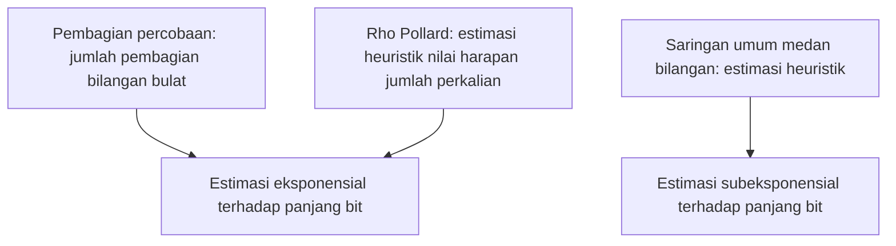
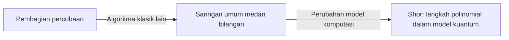

## 1. Pendahuluan: apa yang sulit dalam faktorisasi?

Menguraikan bilangan bulat kecil menjadi faktor-faktor prima merupakan perhitungan yang dikenal sejak sekolah. Namun, menemukan kembali faktor dari hasil kali bilangan prima besar dapat memerlukan sumber daya komputasi klasik yang sangat besar. Ketidaksimetrian ini menjadi bagian dari latar belakang [kriptografi kunci publik, termasuk RSA](https://kenji.blog/id/p/modern-cryptography-public-key-hash-signature/).

Ini tidak berarti bahwa setiap bilangan bulat besar sulit difaktorkan, atau bahwa ketidakmungkinan algoritma klasik yang cepat sudah dibuktikan. Bilangan sangat besar yang memiliki faktor kecil, seperti bilangan genap, dapat mudah ditangani. Kompleksitas algoritma di bawah ini juga bukan batas bawah bagi masalah itu sendiri. Keamanan kriptografi perlu dinilai untuk kunci yang dibuat dengan benar serta sumber daya penyerang yang diasumsikan.

Kita akan menjelaskan notasi Big O dan ukuran masukan, lalu membandingkan pembagian percobaan, metode Fermat, rho Pollard, saringan kuadrat, dan saringan umum medan bilangan. Terakhir, kita membahas hubungannya dengan P versus NP dan komputasi kuantum. Bedakan estimasi kompleksitas, bukti keamanan, dan waktu eksekusi dalam detik.

## 2. Kompleksitas dan notasi Big O

Waktu yang berlalu dipengaruhi CPU, memori, implementasi, paralelisasi, dan kondisi lain. Pernyataan kompleksitas harus menetapkan ukuran masukan dan apa yang dihitung sebagai satu operasi dasar. Menghitung perkalian bilangan bulat besar sebagai satu operasi berbeda dari menghitung operasi bit di dalamnya.

### Batas atas asimtotik

Untuk fungsi yang tidak negatif pada masukan yang cukup besar, $f(n)=\mathcal{O}(g(n))$ berarti:

$$
\exists c>0,\ \exists n_0,\ \forall n\ge n_0:\quad 0\le f(n)\le c\,g(n).
$$

Konstanta $c$ dan $n_0$ tidak bergantung pada masukan $n$. Ini adalah definisi batas atas, bukan dengan sendirinya definisi kasus terburuk. Harus dijelaskan apakah fungsi tersebut menyatakan waktu terburuk, waktu rata-rata, atau nilai harapan waktu algoritma acak.

Kita menggunakan $\Theta$ jika batas atas dan bawah memiliki orde yang sama, serta $\Omega$ untuk batas bawah. Contohnya, bahkan $f(n)=1$ termasuk dalam $\mathcal{O}(2^n)$. Jadi, batas atas itu saja tidak berarti waktu tepat berlipat dua ketika masukan bertambah satu. Notasi ini juga tidak langsung menyatakan perbandingan waktu hasil pengukuran. [Definisi NIST](https://xlinux.nist.gov/dads/HTML/bigOnotation.html) juga membedakan batas atas dari batas yang ketat secara asimtotik.

### Bentuk pertumbuhan yang umum

Dalam tabel berikut, $n$ menyatakan jumlah elemen data. Operasi seperti perbandingan dan akses elemen dihitung sebagai operasi dasar.

| Orde | Contoh dan syarat |
| --- | --- |
| $\mathcal{O}(1)$ | Mengakses elemen larik melalui indeks dalam model akses acak |
| $\mathcal{O}(\log n)$ | Jumlah perbandingan pencarian biner pada larik terurut |
| $\mathcal{O}(n)$ | Jumlah perbandingan pencarian linear pada kasus terburuk |
| $\mathcal{O}(n\log n)$ | Merge sort pada kasus terburuk, atau quicksort secara rata-rata dengan asumsi yang sesuai |
| $\mathcal{O}(n^2)$ | Misalnya, jumlah perbandingan pengurutan sisip pada kasus terburuk |
| $\mathcal{O}(2^n)$ | Jumlah semua himpunan bagian dari $n$ elemen; biaya memproses setiap kandidat dihitung terpisah |
| $\mathcal{O}(n!)$ | Jumlah semua permutasi dari $n$ elemen berbeda; biaya memproses setiap kandidat dihitung terpisah |

Waktu yang dibatasi oleh $\mathcal{O}(n^k)$ untuk konstanta tetap $k$ disebut polinomial. Eksponen atau konstanta yang besar tetap dapat membuatnya tidak praktis; sebaliknya, metode eksponensial dapat berguna untuk masukan kecil. Diagram berikut mengelompokkan estimasi berdasarkan panjang masukan dalam bit. Ini bukan bukti kesulitan ataupun grafik waktu yang terukur.

## 3. RSA: nilai bilangan bulat dan panjang masukan

Misalkan $N\ge2$ adalah bilangan bulat yang akan difaktorkan dan $b$ adalah panjang representasi binernya. Ini berbeda dari jumlah elemen $n$ pada tabel sebelumnya.

$$
b=\lfloor\log_2 N\rfloor+1,\qquad 2^{b-1}\le N<2^b.
$$

Contohnya, $15$ memiliki panjang empat bit, tetapi $2^4=16$, bukan $15$. Batas yang polinomial terhadap nilai $N$ dapat bersifat eksponensial terhadap panjang masukan $b$. Operasi bilangan bulat besar itu sendiri juga memiliki biaya yang bergantung pada $b$.

Pada bentuk dasar RSA dengan dua prima, bilangan prima ganjil berbeda $p,q$ digunakan untuk membentuk $N=pq$. Jika masing-masing panjangnya 1024 bit, hasil kalinya memiliki 2047 atau 2048 bit, tidak selalu 2048. Kunci publik mencakup $N,e$, sedangkan kunci privat mencakup eksponen privat $d$ dan mungkin nilai lain. Contohnya, berikut adalah syarat cukup untuk memilih $d$:

$$
\varphi(N)=(p-1)(q-1),\quad 1<e<\varphi(N),\quad
\gcd(e,\varphi(N))=1,\quad ed\equiv1\pmod{\varphi(N)}.
$$

[RFC 8017](https://www.rfc-editor.org/rfc/rfc8017.html) menetapkan kunci secara lebih umum menggunakan $\lambda(N)=\operatorname{lcm}(p-1,q-1)$. Mengetahui faktor-faktornya memungkinkan perhitungan eksponen privat. Namun, belum dibuktikan secara umum bahwa inversi RSA setara dengan faktorisasi, dan tidak semua serangan terhadap RSA memerlukan faktorisasi modulus.

Operasi dasar perpangkatan modular bilangan bulat saja bukan skema enkripsi yang aman. Penggunaan nyata memerlukan skema enkripsi yang mencakup OAEP, skema tanda tangan seperti PSS, serta penilaian pembuatan kunci, implementasi, dan protokol secara keseluruhan. Ketidaksimetrian antara perkalian dan pemulihan faktor bukan bukti keamanan tanpa syarat.

## 4. Lima algoritma faktorisasi

### 4.1 Pembagian percobaan

Bilangan komposit $N$ memiliki setidaknya satu faktor prima yang tidak melebihi $\sqrt N$. Karena itu, mencoba pembagi kecil sampai $\lfloor\sqrt N\rfloor$ akan menemukan faktor. Ini tidak berarti faktor prima terbesar berada di bawah akar kuadrat: faktor prima terbesar dari $15=3\cdot5$ adalah $5$, lebih besar dari $\sqrt{15}$.

Untuk metode sederhana yang mencoba semua kandidat bilangan bulat, jumlah pembagian pada kasus terburuk dapat diperkirakan sebagai $\mathcal{O}(\sqrt N)$. Ketaksamaan panjang bit juga memberikan batas atas $\mathcal{O}(2^{b/2})$. Ini menghitung setiap pembagian bilangan bulat multipresisi sebagai satu operasi, bukan jumlah seluruh operasi bit. Faktor kecil memungkinkan proses berakhir lebih awal.

### 4.2 Metode Fermat: jarak antarfaktor penting

Untuk bilangan komposit ganjil, dicari selisih kuadrat:

$$
N=x^2-y^2=(x-y)(x+y).
$$

Mulai dari $x=\lceil\sqrt N\rceil$, kita menaikkan $x$ sampai $x^2-N$ menjadi kuadrat sempurna. Jika $N=pq$ dengan $p\le q$ ganjil, salah satu solusinya adalah $x=(p+q)/2$, $y=(q-p)/2$. Jumlah kandidat sampai solusi ini adalah sebagai berikut; jika solusi lain ditemukan sebelumnya, proses dapat berhenti lebih awal.

$$
\frac{p+q}{2}-\lceil\sqrt N\rceil+1.
$$

Untuk faktor yang berdekatan pada $1009\cdot1013$, kandidat pertama langsung berhasil. Sebaliknya, $3\cdot104729=314187$ memerlukan 51806 kandidat. Khususnya, jika $p=3$ tetap dan bilangan prima $q$ diperbesar, jumlah kandidat menjadi $\Theta(N)$. Jadi, tidak tepat selalu memberikan orde akar kuadrat yang sama dengan pembagian percobaan kepada metode Fermat. Untuk masukan genap, faktor 2 dikeluarkan terlebih dahulu.

### 4.3 Rho Pollard

Kita mengiterasikan fungsi seperti $x\mapsto x^2+c\pmod N$ dan menghitung faktor persekutuan terbesar (FPB) dari $N$ dan selisih dua posisi dalam barisan. Tabrakan modulo faktor prima tak diketahui $p$ dapat menghasilkan selisih yang habis dibagi $p$, sehingga suatu faktor dapat ditemukan. Deteksi siklus Floyd menyimpan sejumlah tetap nilai sisa. Namun, setiap nilai memerlukan $\mathcal{O}(b)$ bit, sehingga memorinya bukan konstan jika diukur dalam bit.

Dengan model heuristik fungsi acak, nilai harapan jumlah perkalian modular untuk menemukan faktor $p$ diperkirakan sebagai $\mathcal{O}(\sqrt p)$. Jika $p$ berorde $\sqrt N$, diperoleh $\mathcal{O}(N^{1/4})$ dan karena itu $\mathcal{O}(2^{b/4})$. Ini bukan jaminan kasus terburuk tanpa syarat; biaya bit perkalian dan perhitungan FPB juga harus diperhitungkan.

FPB $d$ hanya menunjukkan keberhasilan jika $1<d<N$. Jika $d=1$, proses dilanjutkan; jika $d=N$, proses diulang, misalnya dengan nilai awal atau fungsi lain. Untuk $N=21$, nilai awal 2, dan $f(x)=x^2+1$, perbandingan pertama Floyd adalah antara 5 dan 5, sehingga FPB-nya adalah 21 sendiri. Faktor nontrivial juga dapat berupa bilangan komposit dan perlu difaktorkan lagi.

### 4.4 Saringan kuadrat dan MPQS

Saringan kuadrat mengumpulkan nilai mulus, yang terurai hanya atas bilangan prima kecil, untuk membentuk kongruensi kuadrat. Dalam bentuk dasarnya, ambil $m=\lfloor\sqrt N\rfloor$ dan saring nilai berikut untuk suatu rentang $x$ kecil:

$$
Q(x)=(m+x)^2-N.
$$

Eksponen dicatat terhadap basis faktor yang memuat tanda $-1$ dan bilangan prima kecil yang dipilih. Aljabar linear atas medan dengan dua elemen menggabungkan paritas eksponen untuk mencari hasil kali yang berupa kuadrat. Sekadar menjelaskan nilai mulus acak dari $x^2\bmod N$ tidak memperlihatkan penggunaan nilai polinomial kecil yang menjadi ciri saringan kuadrat.

MPQS, saringan kuadrat dengan banyak polinomial, adalah varian yang memakai beberapa polinomial kuadrat yang sesuai. Kinerja bergantung pada implementasi, masukan, dan sumber daya yang tersedia. Tidak ada aturan universal bahwa suatu metode pasti mengungguli metode lain tepat pada 100 digit.

Kongruensi yang dituju dan pengambilan faktor berbentuk:

$$
X^2\equiv Y^2\pmod N,\qquad d=\gcd(X-Y,N).
$$

Jika $d=1$ atau $d=N$, coba relasi lain. Jika $X,Y$ masing-masing relatif prima terhadap $N$ dan $X\not\equiv\pm Y\pmod N$, diperoleh faktor nontrivial yang belum tentu prima. Contohnya, untuk $N=1155$, $X=76$, $Y=1$, kedua kuadrat kongruen, tetapi $\gcd(75,1155)=15$ dan $\gcd(77,1155)=77$ sama-sama komposit.

### 4.5 Saringan umum medan bilangan (GNFS)

Saringan umum medan bilangan digunakan untuk memfaktorkan bilangan bulat besar tanpa bentuk khusus. Secara garis besar, langkahnya adalah:

1. Memilih polinomial berkoefisien bulat dan parameter terkait yang memiliki akar bersama modulo $N$, lalu menyiapkan medan bilangan yang sesuai.
2. Menyaring relasi yang memenuhi syarat faktorisasi terkait bilangan prima kecil atau ideal prima pada sisi rasional dan sisi medan bilangan.
3. Menyelesaikan matriks jarang besar yang menyatakan paritas eksponen dan syarat tambahan, untuk menggabungkan relasi yang dapat menghasilkan kuadrat.
4. Menghitung akar kuadrat pada kedua sisi, memperoleh kongruensi kuadrat bilangan bulat, lalu menggunakan FPB untuk mengambil faktor nontrivial. Relasi yang gagal memerlukan percobaan lain.

Ini hanya gambaran umum, bukan prosedur implementasi akar kuadrat pada sisi medan bilangan beserta syarat tambahannya. Selain itu, $\mathbb Z[\alpha]$, yang dibentuk dari akar $\alpha$ suatu polinomial, tidak selalu merupakan seluruh gelanggang bilangan bulat dari medan bilangan tersebut. Contohnya, untuk $\alpha=\sqrt5$, $\beta=(1+\sqrt5)/2$ memenuhi $\beta^2-\beta-1=0$, sehingga merupakan bilangan bulat aljabar, tetapi tidak termasuk dalam $\mathbb Z[\sqrt5]$.

Kita mendefinisikan notasi L dengan logaritma natural $\ln$, untuk $c>0$ dan $0\le\alpha\le1$:

$$
L_N[\alpha,c]=\exp\!\left((c+o(1))(\ln N)^\alpha(\ln\ln N)^{1-\alpha}\right).
$$

Di sini, $o(1)$ menuju nol ketika $N\to\infty$. Kedua ujungnya adalah $L_N[0,c]=(\ln N)^{c+o(1)}$ dan $L_N[1,c]=N^{c+o(1)}$. Suku asimtotik tidak boleh dihapus lalu diganti dengan persamaan eksak atau batas atas berderajat tetap.

Estimasi heuristik standar waktu GNFS dinyatakan sebagai:

$$
L_N\!\left[\frac13,\left(\frac{64}{9}\right)^{1/3}\right]
=\exp\!\left(\left(\left(\frac{64}{9}\right)^{1/3}+o(1)\right)(\ln N)^{1/3}(\ln\ln N)^{2/3}\right).
$$

Konstantanya kira-kira 1,923. Konversi ke panjang masukan dalam bit menggunakan $\ln N=b\ln2+\mathcal{O}(1)$, sehingga konstanta utama dalam eksponen juga berubah:

$$
\exp\!\left(\left(\left(\frac{64\ln2}{9}\right)^{1/3}+o(1)\right)b^{1/3}(\ln b)^{2/3}\right).
$$

Konstanta ini kira-kira 1,702. Estimasi tersebut subeksponensial terhadap panjang bit: pertumbuhannya lebih cepat daripada polinomial mana pun, tetapi lebih lambat daripada $2^{\varepsilon b}$ untuk setiap $\varepsilon>0$ tetap. Ini bukan teorema kasus terburuk tanpa syarat untuk semua masukan ataupun perkiraan detik eksekusi untuk ukuran tertentu.

Sebagai contoh bertanggal, [pengumuman faktorisasi RSA-250 pada 28 Februari 2020](https://caramba.loria.fr/rsa250.txt) melaporkan faktorisasi bilangan 250 digit dan 829 bit dengan NFS, dengan beban komputasi sekitar 2700 tahun-inti (core-years). Ini adalah ukuran kerja komputasi, bukan berarti 2700 komputer berjalan bersamaan atau 2700 tahun telah berlalu. Contoh ini tidak disajikan sebagai rekor dunia terkini atau biaya untuk setiap bilangan dengan panjang yang sama.

## 5. P versus NP dan komputasi kuantum

### Menguji keprimaan dan mencari faktor

Menentukan apakah suatu bilangan merupakan bilangan prima berbeda dari mencari faktor bilangan komposit. [Makalah AKS](https://annals.math.princeton.edu/2004/160-2/p12) membuktikan pengujian keprimaan deterministik tanpa syarat dalam waktu polinomial. Makalah itu tidak membuktikan hasil yang sama untuk faktorisasi.

P, NP, dan coNP pada dasarnya adalah kelas masalah keputusan dengan jawaban Ya/Tidak. Faktorisasi itu sendiri merupakan masalah pencarian yang menghasilkan faktor, sehingga pernyataan bahwa faktorisasi termasuk NP saja belum memperjelas jenis masalahnya. Contohnya, diberikan $N\ge2$ dan $2\le K<N$, apakah ada pembagi yang memenuhi $1<d\le K$ dan $d\mid N$?

Jawaban Ya memiliki pembagi $d$ sebagai sertifikat yang dapat diperiksa melalui pembagian. Jawaban Tidak dapat disertifikasi dengan faktorisasi prima lengkap: hasil kalinya, keprimaan setiap faktor, serta bahwa semua faktor prima lebih besar dari $K$ dapat diperiksa dalam waktu polinomial. Jadi, masalah keputusan ini termasuk NP maupun coNP. Pencarian dalam waktu polinomial akan menyelesaikan keputusan. Sebaliknya, algoritma keputusan polinomial memungkinkan faktorisasi melalui pencarian biner terhadap $K$ dan pengambilan faktor berulang.

Pengelompokan ini tidak membuktikan bahwa masalah tersebut NP-lengkap, ataupun bahwa algoritma klasik polinomial tidak ada. Jika suatu masalah dalam NP dan coNP adalah NP-lengkap dengan reduksi polinomial yang biasa, maka NP=coNP. [P versus NP masih terbuka](https://www.claymath.org/millennium/p-vs-np/). Bahkan asumsi P≠NP saja tidak membuktikan bahwa faktorisasi berada di luar P.

### Algoritma Shor mengubah model komputasi

[Algoritma Shor](https://arxiv.org/abs/quant-ph/9508027) memfaktorkan bilangan bulat dengan jumlah langkah polinomial terhadap panjang masukan dalam bit, dalam model dengan sumber daya kuantum yang memadai. Bagian kuantumnya memperoleh informasi tentang periode, diikuti pengukuran dan pascapemrosesan klasik, dengan percobaan ulang jika diperlukan. Transformasi Fourier kuantum tidak langsung membaca semua jawaban untuk seluruh kandidat.

Jumlah langkah teoretis ini tidak langsung menentukan apakah perangkat keras nyata memerlukan jam atau hari. Estimasi semacam itu memerlukan asumsi tentang gerbang kuantum, koreksi kesalahan, rangkaian aritmetika, qubit yang tersedia, dan sumber daya lain. Panah terakhir pada diagram menunjukkan perubahan model komputasi, bukan bukti batas komputer klasik.

Persiapan menghadapi serangan masa depan ini menjadi salah satu motivasi kriptografi pascakuantum (PQC). Seperti dijelaskan [RFC 9794](https://www.rfc-editor.org/rfc/rfc9794.html), istilah itu merujuk pada kriptografi yang dirancang untuk menahan penyerang dengan komputer kuantum, bukan jaminan bahwa suatu skema tidak akan pernah dapat dipecahkan. Asumsi matematis, implementasi, dan pilihan operasional semuanya perlu dievaluasi.

## 6. Kesimpulan

Membandingkan kompleksitas faktorisasi dimulai dengan membedakan nilai bilangan bulat $N$ dari panjang masukan $b$, jumlah operasi dari biaya bit, serta waktu terburuk dari nilai harapan waktu. Pembagian percobaan, Fermat, dan rho memanfaatkan struktur berbeda; saringan kuadrat dan GNFS membentuk kongruensi kuadrat dari banyak relasi.

Keamanan kriptografi tidak dapat disimpulkan dari satu batas atas atau karena bilangan bulat terlihat besar. Algoritma yang diketahui, pembuatan masukan, model serangan, dan implementasi perlu dipertimbangkan bersama. Untuk hasil teoretis kuantum pun, penjelasan yang tepat perlu menyebutkan apa yang telah dibuktikan dan apa yang bergantung pada asumsi atau estimasi sumber daya.

### Referensi

- [NIST DADS: big-O notation](https://xlinux.nist.gov/dads/HTML/bigOnotation.html)
- [Handbook of Applied Cryptography, bab 2: definisi kompleksitas](https://cacr.uwaterloo.ca/hac/about/chap2.pdf)
- [Bab 3: faktorisasi dan masalah RSA](https://cacr.uwaterloo.ca/hac/about/chap3.pdf) (sumber tahun 1996; bedakan rekor dan pengetahuan pengujian keprimaannya dari perkembangan berikutnya)
- [RFC 8017: kunci dan skema RSA](https://www.rfc-editor.org/rfc/rfc8017.html)
- [Pengumuman penulis tentang RSA-250 (2020)](https://caramba.loria.fr/rsa250.txt)
- [Agrawal–Kayal–Saxena: PRIMES is in P](https://annals.math.princeton.edu/2004/160-2/p12)
- [Clay Mathematics Institute: P vs NP](https://www.claymath.org/millennium/p-vs-np/)
- [Shor: algoritma polinomial untuk faktorisasi dan logaritma diskret pada komputer kuantum](https://arxiv.org/abs/quant-ph/9508027)
- [RFC 9794: istilah pascakuantum](https://www.rfc-editor.org/rfc/rfc9794.html)
