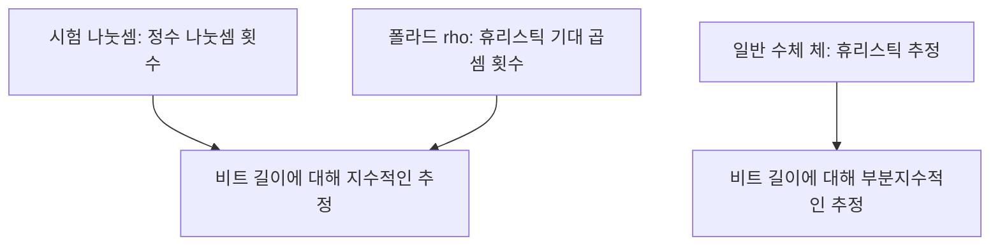

## 1. 들어가며: 소인수분해의 무엇이 어려운가

작은 정수를 소수의 곱으로 분해하는 것은 학교에서도 배우는 계산입니다. 그러나 큰 소수들의 곱에서 원래 인수를 찾아내는 일에는 고전 컴퓨터의 막대한 계산 자원이 필요할 수 있습니다. 이러한 비대칭성은 [RSA를 포함한 공개키 암호](https://kenji.blog/ko/p/modern-cryptography-public-key-hash-signature/)의 배경 중 하나입니다.

그렇다고 모든 큰 정수의 분해가 어렵다거나, 빠른 고전 알고리즘은 존재할 수 없다고 증명되었다는 뜻은 아닙니다. 짝수처럼 작은 인수가 있는 거대한 정수는 쉽게 처리할 수 있습니다. 아래에서 설명하는 알고리즘의 계산량 역시 문제 자체의 하한은 아닙니다. 암호의 안전성을 판단하려면 적절히 생성한 키와 가정한 공격자의 자원을 함께 평가해야 합니다.

이 글에서는 빅오 표기법과 입력 크기를 정리한 뒤 시험 나눗셈법, 페르마법, 폴라드의 rho 알고리즘, 이차 체, 일반 수체 체를 비교합니다. 마지막으로 P 대 NP 문제 및 양자 계산과의 관계를 설명합니다. 계산량 추정, 안전성 증명, 실제 실행 시간을 구분하며 읽어 주세요.

## 2. 계산량과 빅오 표기법

실제 실행 시간은 CPU, 메모리, 구현, 병렬화 등에 따라 달라집니다. 계산량을 말할 때는 입력 크기와 무엇을 기본 연산 한 번으로 셀 것인지 정해야 합니다. 큰 정수의 곱셈을 한 번으로 세는 것과 그 내부의 비트 연산까지 세는 것은 다릅니다.

### 점근적 상한

충분히 큰 입력에서 음이 아닌 함수에 대해 $f(n)=\mathcal{O}(g(n))$은 다음을 뜻합니다.

$$
\exists c>0,\ \exists n_0,\ \forall n\ge n_0:\quad 0\le f(n)\le c\,g(n).
$$

상수 $c$와 $n_0$는 입력 $n$에 의존하지 않습니다. 이는 상한의 정의이지, 그 자체로 최악의 경우를 뜻하는 것은 아닙니다. 최악 시간, 평균 시간, 무작위 알고리즘의 기대 시간 중 어떤 함수를 나타내는지 따로 밝혀야 합니다.

상한과 하한의 차수가 같을 때는 $\Theta$, 하한에는 $\Omega$를 씁니다. 예를 들어 $f(n)=1$도 $\mathcal{O}(2^n)$에 속합니다. 따라서 이 상한만으로 입력이 하나 늘 때 시간이 정확히 두 배가 된다고 결론 내릴 수 없습니다. 실측 시간의 비율을 그대로 나타내는 표기법도 아닙니다. [NIST의 정의](https://xlinux.nist.gov/dads/HTML/bigOnotation.html) 역시 상한과 타이트한 경계를 구분합니다.

### 대표적인 증가 형태

다음 표에서 $n$은 데이터 원소의 개수이며, 비교나 원소 접근 등을 기본 연산으로 셉니다.

| 차수 | 예와 조건 |
| --- | --- |
| $\mathcal{O}(1)$ | 임의 접근 모델에서 인덱스로 배열 원소에 접근 |
| $\mathcal{O}(\log n)$ | 정렬된 배열에서 이진 탐색을 할 때의 비교 횟수 |
| $\mathcal{O}(n)$ | 선형 탐색의 최악 비교 횟수 |
| $\mathcal{O}(n\log n)$ | 병합 정렬의 최악 경우 또는 적절한 가정 아래 퀵 정렬의 평균 경우 |
| $\mathcal{O}(n^2)$ | 예를 들어 삽입 정렬의 최악 비교 횟수 |
| $\mathcal{O}(2^n)$ | 원소 $n$개의 모든 부분집합의 수. 각 후보의 처리 비용은 별도로 계산 |
| $\mathcal{O}(n!)$ | 서로 다른 원소 $n$개의 모든 순열의 수. 각 후보의 처리 비용은 별도로 계산 |

고정된 상수 $k$에 대해 시간이 $\mathcal{O}(n^k)$로 제한되면 다항식 시간이라고 합니다. 지수나 상수가 크면 실용적이지 않을 수 있고, 지수 시간 방법도 작은 입력에는 유용할 수 있습니다. 다음 그림은 입력 비트 길이에 따른 대표적인 추정을 분류한 것으로, 어려움의 증명이나 실제 실행 시간 그래프가 아닙니다.

## 3. RSA: 정수의 값과 입력 길이

분해할 정수를 $N\ge2$, 그 이진 표현의 길이를 $b$라고 하겠습니다. 앞 표의 원소 개수 $n$과는 구분합니다.

$$
b=\lfloor\log_2 N\rfloor+1,\qquad 2^{b-1}\le N<2^b.
$$

예를 들어 $15$는 4비트이지만 $2^4=16$이지 $15$가 아닙니다. 값 $N$에 대해 다항식인 상한도 입력 길이 $b$에 대해서는 지수적일 수 있습니다. 큰 정수의 연산 자체에도 $b$에 따른 비용이 듭니다.

기본적인 두 소수 RSA에서는 서로 다른 홀수 소수 $p,q$로 $N=pq$를 만듭니다. 각각 1024비트라면 곱은 2047비트 또는 2048비트이며, 항상 2048비트는 아닙니다. 공개키는 $N,e$를 포함하고, 비밀키는 비밀 지수 $d$ 등을 포함합니다. 예를 들어 다음은 $d$를 선택하기 위한 충분조건입니다.

$$
\varphi(N)=(p-1)(q-1),\quad 1<e<\varphi(N),\quad
\gcd(e,\varphi(N))=1,\quad ed\equiv1\pmod{\varphi(N)}.
$$

[RFC 8017](https://www.rfc-editor.org/rfc/rfc8017.html)은 더 일반적으로 $\lambda(N)=\operatorname{lcm}(p-1,q-1)$을 사용하여 키를 규정합니다. 인수를 알면 비밀 지수를 계산할 수 있습니다. 그러나 RSA 역산 문제와 소인수분해가 일반적으로 동치라고 증명된 것은 아니며, 모든 RSA 공격에 인수분해가 필요한 것도 아닙니다.

정수의 모듈러 거듭제곱이라는 기본 연산만으로 안전한 암호화 방식이 되지는 않습니다. 실제로는 OAEP를 포함한 암호화 방식, PSS 같은 서명 방식, 키 생성과 구현 및 프로토콜 전체를 고려해야 합니다. 곱셈과 인수 복원 사이의 비대칭성을 무조건적인 안전성 증명으로 받아들여서는 안 됩니다.

## 4. 다섯 가지 인수분해 알고리즘

### 4.1 시험 나눗셈법

합성수 $N$에는 $\sqrt N$ 이하의 소인수가 적어도 하나 있습니다. 따라서 작은 후보부터 $\lfloor\sqrt N\rfloor$까지 나누어 보면 인수를 찾을 수 있습니다. 가장 큰 소인수가 제곱근 이하라는 뜻은 아닙니다. 예를 들어 $15=3\cdot5$의 가장 큰 소인수 $5$는 $\sqrt{15}$보다 큽니다.

모든 정수 후보를 시험하는 단순한 방법에서는 최악의 나눗셈 횟수를 $\mathcal{O}(\sqrt N)$으로 추정할 수 있습니다. 비트 길이의 부등식으로부터 $\mathcal{O}(2^{b/2})$라는 상한도 얻습니다. 이는 다중 정밀도 나눗셈 한 번을 단위로 센 횟수이지 비트 연산의 총수가 아닙니다. 작은 인수가 있으면 일찍 끝납니다.

### 4.2 페르마법: 인수 사이의 간격이 중요하다

홀수 합성수에 대해 제곱의 차를 찾습니다.

$$
N=x^2-y^2=(x-y)(x+y).
$$

$x=\lceil\sqrt N\rceil$부터 늘려 가며 $x^2-N$이 완전제곱수인지 확인합니다. $N=pq$이고 $p\le q$가 홀수라면 $x=(p+q)/2$, $y=(q-p)/2$가 한 해입니다. 이 해까지 확인하는 후보의 수는 다음과 같습니다. 그보다 앞서 다른 해가 나오면 일찍 끝낼 수 있습니다.

$$
\frac{p+q}{2}-\lceil\sqrt N\rceil+1.
$$

인수가 가까운 $1009\cdot1013$에서는 첫 후보로 성공합니다. 반면 $3\cdot104729=314187$에서는 후보 51806개를 확인합니다. 특히 $p=3$을 고정하고 소수 $q$를 키우면 후보의 수는 $\Theta(N)$입니다. 페르마법이 언제나 시험 나눗셈과 같은 제곱근 차수라고 평가하는 것은 옳지 않습니다. 짝수에서는 먼저 인수 2를 제거합니다.

### 4.3 폴라드의 rho 알고리즘

$x\mapsto x^2+c\pmod N$ 같은 함수를 반복하여 수열을 만들고, 두 위치의 차와 $N$의 최대공약수를 구합니다. 미지의 소인수 $p$를 법으로 한 수열에 충돌이 생기면, $p$의 배수인 차로부터 인수를 찾을 수 있습니다. 플로이드 순환 검출법은 일정 개수의 나머지 값을 유지합니다. 각 값에는 $\mathcal{O}(b)$비트가 필요하므로 비트 단위에서도 상수 메모리라는 뜻은 아닙니다.

무작위 함수와 비슷한 동작을 가정하는 휴리스틱 분석에서는 인수 $p$를 찾는 기대 모듈러 곱셈 횟수를 $\mathcal{O}(\sqrt p)$로 추정합니다. $p$가 $\sqrt N$ 정도이면 $\mathcal{O}(N^{1/4})$, 따라서 $\mathcal{O}(2^{b/4})$로 나타낼 수 있습니다. 무조건적인 최악 시간 보장은 아니며, 곱셈과 최대공약수 계산의 비트 비용도 따로 고려해야 합니다.

얻은 최대공약수 $d$가 성공을 뜻하는 것은 $1<d<N$일 때입니다. $d=1$이면 계속하고, $d=N$이면 초기값이나 함수를 바꾸는 등의 방법으로 재시도합니다. 예를 들어 $N=21$, 초기값 2, $f(x)=x^2+1$에서는 첫 플로이드 비교가 5와 5가 되어 최대공약수는 21 자체입니다. 얻은 비자명한 인수가 합성수라면 추가로 분해해야 합니다.

### 4.4 이차 체와 MPQS

이차 체는 작은 소수들로만 분해되는 매끄러운 값(smooth value)을 모아 제곱 합동식을 만듭니다. 기본적인 형태에서는 $m=\lfloor\sqrt N\rfloor$로 놓고 작은 $x$의 범위에서 다음 값을 체질합니다.

$$
Q(x)=(m+x)^2-N.
$$

부호 $-1$과 선택한 작은 소수들로 이루어진 인수 기저에 대해 지수를 기록합니다. 원소가 둘인 체 위의 선형대수로 지수의 홀짝을 조합하여 곱이 제곱이 되는 관계를 찾습니다. 무작위 $x^2\bmod N$이 매끄러운지만 검사한다고 설명하면, 작은 다항식 값을 이용하는 이차 체의 특징이 빠집니다.

MPQS(다중 다항식 이차 체)는 여러 적절한 이차 다항식을 쓰는 변형입니다. 성능은 구현, 입력, 자원에 따라 달라지므로 정확히 100자리에서 어느 방법이 반드시 더 빠르다는 보편적인 경계는 없습니다.

목표인 합동식과 인수 추출은 다음 형태입니다.

$$
X^2\equiv Y^2\pmod N,\qquad d=\gcd(X-Y,N).
$$

$d=1$ 또는 $d=N$이면 다른 관계를 시도합니다. $X,Y$가 각각 $N$과 서로소이고 $X\not\equiv\pm Y\pmod N$이면 비자명한 인수를 얻지만, 반드시 소수인 것은 아닙니다. 예를 들어 $N=1155$, $X=76$, $Y=1$에서는 두 제곱이 합동이고, $\gcd(75,1155)=15$, $\gcd(77,1155)=77$은 모두 합성수입니다.

### 4.5 일반 수체 체(GNFS)

일반 수체 체는 특별한 형태가 없는 큰 정수의 분해에 쓰입니다. 대략적인 과정은 다음과 같습니다.

1. $N$을 법으로 공통 근을 갖는 정수 다항식과 관련 매개변수를 선택하고, 대응하는 수체를 사용할 준비를 합니다.
2. 유리수 쪽과 수체 쪽에서 작은 소수나 소 아이디얼에 관한 분해 조건을 만족하는 관계를 체질로 모읍니다.
3. 지수의 홀짝과 추가 조건을 나타내는 큰 희소 행렬을 풀어 제곱을 추출할 수 있는 관계를 조합합니다.
4. 양쪽에서 제곱근을 구해 정수의 제곱 합동식으로 옮긴 뒤 최대공약수로 비자명한 인수를 얻습니다. 실패한 관계에서는 재시도합니다.

이는 개요이지 수체 쪽 제곱근과 추가 조건의 구현 절차가 아닙니다. 다항식의 근 $\alpha$로 만드는 $\mathbb Z[\alpha]$도 언제나 수체의 정수환 전체인 것은 아닙니다. 예를 들어 $\alpha=\sqrt5$일 때 $\beta=(1+\sqrt5)/2$는 $\beta^2-\beta-1=0$을 만족하는 대수적 정수이지만 $\mathbb Z[\sqrt5]$의 원소는 아닙니다.

자연로그 $\ln$으로 L 표기법을 정의합니다. 여기서는 $c>0$, $0\le\alpha\le1$입니다.

$$
L_N[\alpha,c]=\exp\!\left((c+o(1))(\ln N)^\alpha(\ln\ln N)^{1-\alpha}\right).
$$

$N\to\infty$일 때 $o(1)$은 0으로 갑니다. 양 끝에서는 $L_N[0,c]=(\ln N)^{c+o(1)}$, $L_N[1,c]=N^{c+o(1)}$입니다. 점근항을 없애고 정확한 등식이나 고정 차수의 상한으로 바꾸면 안 됩니다.

GNFS의 표준적인 휴리스틱 실행 시간 추정은 다음과 같습니다.

$$
L_N\!\left[\frac13,\left(\frac{64}{9}\right)^{1/3}\right]
=\exp\!\left(\left(\left(\frac{64}{9}\right)^{1/3}+o(1)\right)(\ln N)^{1/3}(\ln\ln N)^{2/3}\right).
$$

상수는 약 1.923입니다. 입력 비트 길이로 바꾸면 $\ln N=b\ln2+\mathcal{O}(1)$이므로 지수의 선도 상수도 변환해야 합니다.

$$
\exp\!\left(\left(\left(\frac{64\ln2}{9}\right)^{1/3}+o(1)\right)b^{1/3}(\ln b)^{2/3}\right).
$$

이쪽 상수는 약 1.702입니다. 이는 비트 길이에 대해 부분지수(subexponential)적인 추정으로, 모든 다항식보다 빠르게 증가하지만 임의의 고정된 $\varepsilon>0$에 대한 $2^{\varepsilon b}$보다는 느리게 증가합니다. 모든 입력에 대한 무조건적인 최악 시간 정리도, 특정 크기의 실행 시간 예측도 아닙니다.

날짜가 명확한 사례로, [2020년 2월 28일 RSA-250 분해 발표](https://caramba.loria.fr/rsa250.txt)는 250자리, 829비트 정수를 NFS로 분해하는 데 약 2700 코어년(core-years)의 작업량이 들었다고 보고합니다. 이는 계산 작업량의 척도이지, 동시에 2700대가 동작했다거나 실제로 2700년이 지났다는 뜻이 아닙니다. 여기서는 현재 세계 기록이나 같은 길이의 모든 정수에 드는 비용으로 제시하지 않습니다.

## 5. P 대 NP 문제와 양자 계산

### 소수 판정과 인수를 찾는 문제

소수인지 판정하는 것과 합성수의 인수를 찾는 것은 다른 문제입니다. [AKS 논문](https://annals.math.princeton.edu/2004/160-2/p12)은 소수 판정이 무조건적인 결정론적 다항식 시간에 가능함을 보였습니다. 소인수분해에도 같은 결과가 성립한다는 뜻은 아닙니다.

P, NP, coNP는 기본적으로 예/아니요로 답하는 결정 문제의 클래스입니다. 소인수분해 자체는 인수를 출력하는 탐색 문제이므로 단순히 소인수분해가 NP에 속한다고만 하면 문제 유형이 모호합니다. 예를 들어 $N\ge2$, $2\le K<N$에 대해 $1<d\le K$이고 $d\mid N$인 인수가 존재하는지 묻는 결정 문제를 생각할 수 있습니다.

예라면 인수 $d$가 증거이며 나눗셈으로 검증할 수 있습니다. 아니라면 완전한 소인수분해를 증거로 제시하고, 그 곱, 각 인수의 소수성, 모든 소인수가 $K$보다 크다는 것을 다항식 시간에 확인할 수 있습니다. 따라서 이 결정 문제는 NP와 coNP 모두에 속합니다. 탐색을 다항식 시간에 해결하면 결정도 해결할 수 있습니다. 반대로 이 결정을 다항식 시간에 해결하면 $K$에 대한 이진 탐색과 반복적인 인수 추출로 소인수분해를 얻습니다.

이 분류가 NP-완전성이나 고전 다항식 시간 알고리즘의 부재를 증명하지는 않습니다. NP와 coNP에 모두 속하는 문제가 통상적인 다항식 시간 환원에서 NP-완전하다면 NP=coNP를 함의합니다. [P 대 NP 문제는 미해결](https://www.claymath.org/millennium/p-vs-np/)입니다. P≠NP를 가정해도 그것만으로 소인수분해가 P 밖에 있다고 결론 낼 수 없습니다.

### 쇼어 알고리즘이 바꾸는 계산 모델

[쇼어 알고리즘](https://arxiv.org/abs/quant-ph/9508027)은 충분한 양자 계산 자원을 갖춘 모델에서 입력 비트 길이에 대한 다항식 단계 수로 정수를 분해합니다. 양자 부분에서 주기에 관한 정보를 얻고, 측정 결과와 고전적인 후처리를 사용하며 필요하면 재시도합니다. 양자 푸리에 변환이 모든 후보의 답을 순간적으로 읽어 내는 방식이 아닙니다.

이론적인 단계 수만으로 실제 하드웨어에서 몇 시간 또는 며칠이 걸릴지 결정되지는 않습니다. 양자 게이트, 오류 정정, 산술 회로, 사용 가능한 큐비트 등의 조건이 필요합니다. 아래 그림의 마지막 화살표는 계산 모델의 변화를 나타내며 고전 컴퓨터의 한계를 증명하지 않습니다.

이러한 미래 공격에 대비하는 것은 양자 내성 암호(PQC)의 동기 중 하나입니다. [RFC 9794](https://www.rfc-editor.org/rfc/rfc9794.html)가 설명하듯, PQC는 양자 컴퓨터를 가진 공격자에게도 견디도록 설계된 암호를 뜻하며 절대로 깨지지 않는다는 보장은 아닙니다. 수학적 가정과 구현 및 운영 방식을 모두 평가해야 합니다.

## 6. 정리

소인수분해의 계산량을 비교하려면 정수의 값 $N$과 입력 비트 길이 $b$, 기본 연산 횟수와 비트 비용, 최악 시간과 기대 시간을 구분하는 것부터 시작해야 합니다. 시험 나눗셈, 페르마법, rho는 서로 다른 구조를 이용하고, 이차 체와 GNFS는 많은 관계로부터 제곱 합동식을 만듭니다.

암호의 안전성은 하나의 상한이나 정수가 커 보인다는 이유만으로 판단할 수 없습니다. 알려진 알고리즘, 입력 생성 방법, 공격 모델, 구현을 함께 고려해야 합니다. 양자 계산의 이론적 결과에서도 무엇이 증명되었고 무엇이 가정이나 자원 추정에 의존하는지 밝혀야 정확히 이해할 수 있습니다.

### 참고 자료

- [NIST DADS: big-O notation](https://xlinux.nist.gov/dads/HTML/bigOnotation.html)
- [Handbook of Applied Cryptography, 2장: 계산량 정의](https://cacr.uwaterloo.ca/hac/about/chap2.pdf)
- [3장: 소인수분해와 RSA 문제](https://cacr.uwaterloo.ca/hac/about/chap3.pdf) (1996년 자료로, 이후의 분해 기록 및 소수 판정의 발전과 구분)
- [RFC 8017: RSA 키와 방식](https://www.rfc-editor.org/rfc/rfc8017.html)
- [저자들의 RSA-250 발표(2020년)](https://caramba.loria.fr/rsa250.txt)
- [Agrawal–Kayal–Saxena: PRIMES is in P](https://annals.math.princeton.edu/2004/160-2/p12)
- [Clay Mathematics Institute: P vs NP](https://www.claymath.org/millennium/p-vs-np/)
- [Shor: 양자 컴퓨터에서 다항식 시간 소인수분해와 이산로그 알고리즘](https://arxiv.org/abs/quant-ph/9508027)
- [RFC 9794: 양자 내성 암호 용어](https://www.rfc-editor.org/rfc/rfc9794.html)
