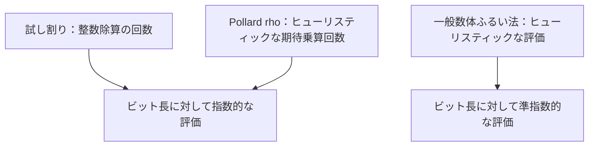

## 1. はじめに：素因数分解の何が「難しい」のか

小さい数を素数の積に分解するのは、学校でも習う計算です。しかし、大きな素数同士の積からその因数を取り出す問題は、古典計算機では非常に大きな計算資源を要することがあります。この非対称性が、[RSAを含む公開鍵暗号](https://kenji.blog/p/modern-cryptography-public-key-hash-signature/)の背景にあります。

ただし、「大きい整数なら必ず難しい」「どんな古典アルゴリズムでも高速には解けないことが証明されている」という意味ではありません。偶数のように小さい因数を持つ巨大な数は簡単に処理できます。また、以下で紹介するアルゴリズムの計算量は、問題そのものの下界ではありません。暗号で必要なのは、適切に生成した鍵と想定する攻撃資源に対する安全性の評価です。

この記事では、ビッグオー表記と入力サイズを整理し、試し割り、Fermat法、Pollardのrho法、二次ふるい法、一般数体ふるい法を比較します。最後にP対NP問題や量子計算との関係を説明します。計算量の見積もりと、安全性の証明や実行秒数を区別して読み進めてください。

## 2. 計算量とビッグオー表記

実行秒数はCPU、メモリ、実装、並列化などに左右されます。計算量を述べるときは、入力サイズと、何を1回の操作として数えるかを決めます。多倍長整数の乗算を1回と数える場合と、その内部のビット操作まで数える場合では意味が違います。

### 漸近的な上界

十分大きい入力で非負の関数について、$f(n)=\mathcal{O}(g(n))$ は次を意味します。

$$
\exists c>0,\ \exists n_0,\ \forall n\ge n_0:\quad 0\le f(n)\le c\,g(n).
$$

定数 $c$ と $n_0$ は入力 $n$ に依存しません。これは上界の定義であり、それ自体が「最悪の場合」を意味するわけではありません。最悪時間、平均時間、乱択アルゴリズムの期待時間の、どの関数に適用した記法なのかを別に示します。

上下の同じオーダーの評価には $\Theta$、下界には $\Omega$ を使います。例えば、$f(n)=1$ も $\mathcal{O}(2^n)$ です。この上界だけから「入力が1増えると時間が正確に2倍」とは結論できません。実測値の比率をそのまま表す記法でもありません。[NISTの定義](https://xlinux.nist.gov/dads/HTML/bigOnotation.html)も、上界とタイトな評価を区別しています。

### 代表的な増え方

次の表では $n$ をデータの要素数とし、比較や要素へのアクセスなどを基本操作とします。

| オーダー | 例と条件 |
| --- | --- |
| $\mathcal{O}(1)$ | ランダムアクセスモデルで、添字を指定した配列要素へのアクセス |
| $\mathcal{O}(\log n)$ | ソート済み配列の二分探索における比較回数 |
| $\mathcal{O}(n)$ | 線形探索の最悪の場合の比較回数 |
| $\mathcal{O}(n\log n)$ | マージソートの最悪の場合、適切な仮定でのクイックソートの平均の場合 |
| $\mathcal{O}(n^2)$ | 挿入ソートなどの最悪の場合の比較回数 |
| $\mathcal{O}(2^n)$ | $n$ 個の要素の全ての部分集合の数。各候補の処理費用は別に数える |
| $\mathcal{O}(n!)$ | $n$ 個の異なる要素の全ての順列の数。各候補の処理費用は別に数える |

固定した定数 $k$ に対して $\mathcal{O}(n^k)$ で抑えられる時間を多項式時間と呼びます。大きな指数や定数があれば実用的とは限らず、指数的な手法でも小さい入力には役立ちます。以下の図は、入力のビット長に対する代表的な評価を整理したもので、困難性の証明や処理時間のグラフではありません。

## 3. RSAと、整数の値・入力の長さの違い

因数分解する整数を $N\ge2$、その二進表現の長さを $b$ とします。先ほどの表の要素数 $n$ とは区別します。

$$
b=\lfloor\log_2 N\rfloor+1,\qquad 2^{b-1}\le N<2^b.
$$

例えば $15$ は4ビットですが、$2^4=16$ であり $15$ ではありません。値 $N$ に関して多項式でも、入力の長さ $b$ に関しては指数的になり得ます。大きい整数の演算自体にも $b$ に応じた費用がかかります。

RSAの基本的な二素数の場合、異なる奇素数 $p,q$ から $N=pq$ を作ります。それぞれ1024ビットなら積は2047ビットまたは2048ビットであり、常に2048ビットになるわけではありません。公開鍵は $N,e$ を含み、秘密鍵には秘密指数 $d$ などを持ちます。例えば次は $d$ を選ぶための十分条件です。

$$
\varphi(N)=(p-1)(q-1),\quad 1<e<\varphi(N),\quad
\gcd(e,\varphi(N))=1,\quad ed\equiv1\pmod{\varphi(N)}.
$$

[RFC 8017](https://www.rfc-editor.org/rfc/rfc8017.html)は、より一般に $\lambda(N)=\operatorname{lcm}(p-1,q-1)$ を用いて鍵を規定します。因数が分かれば秘密指数を計算できます。しかし、RSAの反転問題と因数分解が同値だと一般に証明されているわけではなく、全てのRSA攻撃が因数分解を必要とするわけでもありません。

整数のべき乗という基本演算だけでは安全な暗号方式にはなりません。実際にはOAEPなどを含む暗号化方式やPSSなどの署名方式、鍵生成・実装・プロトコル全体の検討が必要です。掛け算と因数の回復の非対称性を、無条件の安全性の証明と取り違えないようにしましょう。

## 4. 五つの因数分解アルゴリズム

### 4.1 試し割り法

合成数 $N$ は、少なくとも一つ、$\sqrt N$ 以下の素因数を持ちます。小さい候補から $\lfloor\sqrt N\rfloor$ まで割っていけば因数が見つかります。「最大の素因数が平方根以下」ではありません。例えば $15=3\cdot5$ の最大素因数は $\sqrt{15}$ より大きい $5$ です。

全ての整数候補を試す単純な方法では、最悪の場合の除算回数を $\mathcal{O}(\sqrt N)$ と評価できます。ビット長の不等式から、これは $\mathcal{O}(2^{b/2})$ という上界にもなります。ただし、多倍長の除算1回を単位とする回数の評価であり、ビット演算の総数そのものではありません。小さい因数があれば早く終了します。

### 4.2 Fermat法：因数の隔たりが効く

奇数の合成数について、平方の差を探します。

$$
N=x^2-y^2=(x-y)(x+y).
$$

$x=\lceil\sqrt N\rceil$ から順に増やし、$x^2-N$ が平方数か調べます。$N=pq$、$p\le q$ が奇数なら、$x=(p+q)/2$、$y=(q-p)/2$ が一つの解です。この解までの候補数は次になります。それ以前に別の解があれば、そこで終了できます。

$$
\frac{p+q}{2}-\lceil\sqrt N\rceil+1.
$$

因数が近い $1009\cdot1013$ では最初の候補で成功します。一方、$3\cdot104729=314187$ では51806候補を調べます。特に $p=3$ を固定して素数 $q$ を大きくすると候補数は $\Theta(N)$ になります。試し割りと常に同じ平方根のオーダーとする評価は適切ではありません。偶数は先に因数2を取り除きます。

### 4.3 Pollardのrho法

$x\mapsto x^2+c\pmod N$ などの反復列を作り、二つの位置の差と $N$ の最大公約数を調べます。未知の素因数 $p$ を法とした列が衝突すると、$p$ の倍数の差から因数を見つけられることがあります。Floydの周期検出は、一定個数の剰余値を保持する方法です。各値は $\mathcal{O}(b)$ ビットを要するので、これはビット単位でも定数メモリという意味ではありません。

ランダム関数に似た振る舞いを仮定したヒューリスティックな解析では、因数 $p$ を見つける期待剰余乗算回数は $\mathcal{O}(\sqrt p)$ と見積もられます。$p$ が $\sqrt N$ 程度のときは $\mathcal{O}(N^{1/4})$、したがって $\mathcal{O}(2^{b/4})$ という評価です。無条件の最悪時間の保証ではなく、乗算や最大公約数計算のビット費用も別に考えます。

得られた最大公約数 $d$ が成功を意味するのは $1<d<N$ の場合です。$d=1$ なら続け、$d=N$ なら初期値や関数を変えるなどして再試行します。例えば $N=21$、初期値2、$f(x)=x^2+1$ では、最初のFloyd比較が5と5になり、最大公約数は21自身です。得た非自明な因数が合成数なら、さらに分解する必要があります。

### 4.4 二次ふるい法とMPQS

二次ふるい法は、小さい素数だけに分解できる値、すなわちスムーズな値を集め、平方の合同式を作ります。基本的な形では、$m=\lfloor\sqrt N\rfloor$ として、$x$ が小さい範囲で次の値をふるいにかけます。

$$
Q(x)=(m+x)^2-N.
$$

符号の $-1$ と選んだ小さい素数からなる因子基底上で、これらの値の指数を記録します。指数の偶奇を二元体上の線形代数で組み合わせ、積が平方になる関係を探します。単に無作為な $x^2\bmod N$ のスムーズさを調べる説明では、二次ふるいが小さい多項式値を利用する特徴が伝わりません。

MPQS（多重多項式二次ふるい法）は、複数の適切な二次多項式を使う変種です。性能は実装、入力、資源に依存するため、「必ず100桁で別の手法より速くなる」といった普遍的な境界は置けません。

目的の合同式と因数を取り出す操作は次の形です。

$$
X^2\equiv Y^2\pmod N,\qquad d=\gcd(X-Y,N).
$$

$d=1$ または $d=N$ なら別の関係を試します。$X,Y$ が $N$ と互いに素で、$X\not\equiv\pm Y\pmod N$ なら非自明な因数を得られますが、素数とは限りません。例えば $N=1155$、$X=76$、$Y=1$ では二つの平方が合同で、$\gcd(75,1155)=15$、$\gcd(77,1155)=77$ はどちらも合成数です。

### 4.5 一般数体ふるい法（GNFS）

一般数体ふるい法は、大きく特別な形を持たない整数の分解に用いられる方法です。大まかな流れは次の通りです。

1. $N$ を法として共通の根を持つ整数多項式などを選び、対応する数体を使う準備をします。
2. 有理数側と数体側で、小さい素数や素イデアルに関する分解条件を満たす関係をふるいで集めます。
3. 指数の偶奇などを表す大きな疎行列を解き、平方を取り出せる関係を組み合わせます。
4. 両側で平方根を求めて整数の合同平方へ移し、最大公約数から非自明な因数を取り出します。失敗した関係では再試行します。

これは概要であり、数体側の平方根や追加条件を実装する手順書ではありません。多項式の根 $\alpha$ から作る $\mathbb Z[\alpha]$ を、常に数体の整数環全体と呼ぶこともできません。例えば $\alpha=\sqrt5$ では、$\beta=(1+\sqrt5)/2$ は $\beta^2-\beta-1=0$ を満たす代数的整数ですが、$\mathbb Z[\sqrt5]$ の元ではありません。

自然対数 $\ln$ を使ってL記法を定義します。ここでは $c>0$、$0\le\alpha\le1$ とします。

$$
L_N[\alpha,c]=\exp\!\left((c+o(1))(\ln N)^\alpha(\ln\ln N)^{1-\alpha}\right).
$$

$N\to\infty$ で $o(1)$ は0に近づきます。端点は $L_N[0,c]=(\ln N)^{c+o(1)}$ と $L_N[1,c]=N^{c+o(1)}$ です。漸近項を消して、厳密な等式や固定した次数の上界に置き換えてはいけません。

GNFSの標準的なヒューリスティックな時間評価は、次の形で述べられます。

$$
L_N\!\left[\frac13,\left(\frac{64}{9}\right)^{1/3}\right]
=\exp\!\left(\left(\left(\frac{64}{9}\right)^{1/3}+o(1)\right)(\ln N)^{1/3}(\ln\ln N)^{2/3}\right).
$$

定数は約1.923です。入力のビット長に直すと $\ln N=b\ln2+\mathcal{O}(1)$ なので、指数の先頭定数にも換算が必要です。

$$
\exp\!\left(\left(\left(\frac{64\ln2}{9}\right)^{1/3}+o(1)\right)b^{1/3}(\ln b)^{2/3}\right).
$$

こちらの定数は約1.702です。これはビット長に対して、多項式より速く増え、$2^{\varepsilon b}$（固定した任意の $\varepsilon>0$）より遅く増える準指数的な評価です。全ての入力に対する無条件の最悪時間の定理でも、特定サイズの計算秒数でもありません。

実績の例として、[2020年2月28日のRSA-250分解の発表](https://caramba.loria.fr/rsa250.txt)では、250桁・829ビットの整数をNFSで分解し、約2700 core-yearsを要したと報告しています。これは計算仕事量の尺度であり、「2700台を同時に使った」や「経過時間が2700年だった」とは違います。この日付のある記録を、現在の世界記録や同じ長さの全ての整数の費用とは扱いません。

## 5. P対NP問題と量子計算

### 素数判定と因数を見つける問題

素数かどうかを答えることと、合成数の因数を見つけることは異なります。[AKSの論文](https://annals.math.princeton.edu/2004/160-2/p12)は、素数判定が無条件の決定的多項式時間でできることを示しました。これは因数分解も同じ時間でできるという結果ではありません。

P、NP、coNPは基本的にはYes/Noを答える決定問題のクラスです。素因数分解そのものは因数を出力する探索問題なので、単に「素因数分解はNPに属する」とだけ書くと問題の種類が曖昧になります。例えば、入力 $N\ge2$、$2\le K<N$ に対して、「$1<d\le K$ かつ $d\mid N$ となる因数が存在するか」という決定問題を考えられます。

Yesならその因数 $d$ を証拠として、割り算で確認できます。Noなら、完全な素因数分解を証拠として示し、その積・各因数の素数性・全ての素因数が $K$ を超えることを多項式時間で確認できます。したがって、この決定問題はNPにもcoNPにも属します。探索を多項式時間で解ければ決定も解けます。逆に、この決定問題を多項式時間で解ければ、$K$ に関する二分探索と反復で因数分解を得られます。

この位置付けから、NP完全性も、古典計算機での多項式時間アルゴリズムの不存在も証明されるわけではありません。NPとcoNPの両方に属する問題が通常の多項式時間帰着でNP完全なら、NP=coNPを含意します。[P対NP問題は未解決](https://www.claymath.org/millennium/p-vs-np/)です。P≠NPを仮定しても、それだけで因数分解がPの外にあるとはいえません。

### Shorのアルゴリズムが変える計算モデル

[Shorのアルゴリズム](https://arxiv.org/abs/quant-ph/9508027)は、十分な量子計算資源を備えたモデルでは、入力のビット長に対して多項式ステップで因数分解を行います。量子部分で周期に関する情報を得て、測定結果と古典的な後処理を使います。必要に応じて再試行します。量子フーリエ変換が全ての候補の答えを瞬時に読み出す、という仕組みではありません。

この理論的なステップ数から、実機での「数時間」「数日」といった所要時間は直接決まりません。ゲート、誤り訂正、算術回路、利用できる量子ビットなどの条件が必要です。次の図の最後の矢印は計算モデルの変更を示し、古典計算機の限界の証明ではありません。

こうした将来の攻撃への備えが、耐量子暗号（PQC）の動機の一つです。[RFC 9794](https://www.rfc-editor.org/rfc/rfc9794.html)が説明するように、PQCは量子計算機を持つ攻撃者にも耐えるよう設計された暗号を指す用語で、絶対に破られないという保証ではありません。方式の数学的仮定と実装・運用の両方を評価する必要があります。

## 6. まとめ

因数分解の計算量を比較するには、整数の値 $N$ と入力のビット長 $b$、基本操作の回数とビット費用、最悪時間と期待時間を分けることが出発点です。試し割り、Fermat法、rho法は異なる構造を利用し、二次ふるいやGNFSは多数の関係から合同平方を作ります。

暗号の安全性は、単一の上界や大きな整数という見た目からは決まりません。既知のアルゴリズム、入力の生成方法、攻撃モデル、実装を合わせて判断します。量子計算の理論的結果も含め、何が証明され、何が仮定や資源見積もりなのかを明示することが、正確な理解につながります。

### 参考資料

- [NIST DADS：big-O notation](https://xlinux.nist.gov/dads/HTML/bigOnotation.html)
- [Handbook of Applied Cryptography、第2章：計算量の定義](https://cacr.uwaterloo.ca/hac/about/chap2.pdf)
- [同書、第3章：因数分解・RSA問題](https://cacr.uwaterloo.ca/hac/about/chap3.pdf)（1996年の資料。現在の記録や素数判定の状況とは区別）
- [RFC 8017：RSAの鍵と方式](https://www.rfc-editor.org/rfc/rfc8017.html)
- [RSA-250分解の著者発表（2020年）](https://caramba.loria.fr/rsa250.txt)
- [Agrawal–Kayal–Saxena：PRIMES is in P](https://annals.math.princeton.edu/2004/160-2/p12)
- [Clay Mathematics Institute：P vs NP](https://www.claymath.org/millennium/p-vs-np/)
- [Shor：量子計算による因数分解と離散対数](https://arxiv.org/abs/quant-ph/9508027)
- [RFC 9794：耐量子暗号に関する用語](https://www.rfc-editor.org/rfc/rfc9794.html)
