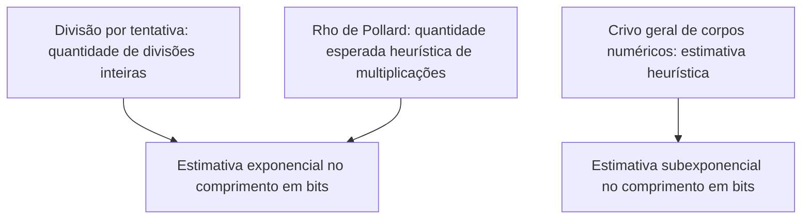

## 1. Introdução: o que é difícil na fatoração?

Decompor um inteiro pequeno em fatores primos é um cálculo conhecido da escola. No entanto, recuperar os fatores de um produto de primos grandes pode exigir enormes recursos de computação clássica. Essa assimetria faz parte do contexto da [criptografia de chave pública, incluindo RSA](https://kenji.blog/pt/p/modern-cryptography-public-key-hash-signature/).

Isso não significa que todo inteiro grande seja difícil de fatorar, nem que se tenha provado a impossibilidade de um algoritmo clássico rápido. Inteiros enormes com fatores pequenos, como números pares, podem ser fáceis de tratar. As complexidades dos algoritmos a seguir também não são limites inferiores do problema em si. A segurança criptográfica exige avaliar chaves geradas corretamente diante dos recursos do atacante considerado.

Primeiro, vamos esclarecer a notação Big O e o tamanho da entrada. Depois, compararemos divisão por tentativa, método de Fermat, rho de Pollard, crivo quadrático e crivo geral de corpos numéricos. Por fim, veremos sua relação com P versus NP e a computação quântica. É preciso distinguir estimativas de complexidade, provas de segurança e segundos de execução.

## 2. Complexidade e notação Big O

O tempo decorrido depende de CPU, memória, implementação, paralelização e outras condições. Uma afirmação de complexidade deve especificar o tamanho da entrada e o que conta como operação elementar. Contar uma multiplicação de inteiros grandes como uma operação é diferente de contar as operações de bits que ela contém.

### Um limite superior assintótico

Para funções não negativas em entradas suficientemente grandes, $f(n)=\mathcal{O}(g(n))$ significa:

$$
\exists c>0,\ \exists n_0,\ \forall n\ge n_0:\quad 0\le f(n)\le c\,g(n).
$$

As constantes $c$ e $n_0$ não dependem da entrada $n$. Essa é uma definição de limite superior, não de pior caso. É necessário dizer separadamente se a função representa o pior tempo, o tempo médio ou o tempo esperado de um algoritmo aleatorizado.

Usamos $\Theta$ quando os limites superior e inferior têm a mesma ordem, e $\Omega$ para um limite inferior. Por exemplo, até $f(n)=1$ pertence a $\mathcal{O}(2^n)$. Portanto, esse limite, sozinho, não implica que o tempo dobre exatamente quando a entrada aumenta em uma unidade. A notação também não expressa diretamente razões entre tempos medidos. A [definição do NIST](https://xlinux.nist.gov/dads/HTML/bigOnotation.html) igualmente distingue um limite superior de um limite assintoticamente justo.

### Formas representativas de crescimento

Nesta tabela, $n$ é a quantidade de elementos de dados, e contamos operações como comparações e acessos a elementos.

| Ordem | Exemplo e condições |
| --- | --- |
| $\mathcal{O}(1)$ | Acesso a um elemento de um vetor pelo índice em um modelo de acesso aleatório |
| $\mathcal{O}(\log n)$ | Comparações da busca binária em um vetor ordenado |
| $\mathcal{O}(n)$ | Comparações da busca linear no pior caso |
| $\mathcal{O}(n\log n)$ | Merge sort no pior caso, ou quicksort em média sob hipóteses adequadas |
| $\mathcal{O}(n^2)$ | Por exemplo, comparações da ordenação por inserção no pior caso |
| $\mathcal{O}(2^n)$ | Quantidade de todos os subconjuntos de $n$ elementos; o processamento de cada candidato tem custo separado |
| $\mathcal{O}(n!)$ | Quantidade de todas as permutações de $n$ elementos distintos; o processamento de cada candidato tem custo separado |

Um tempo limitado por $\mathcal{O}(n^k)$ para uma constante fixa $k$ é polinomial. Um expoente ou uma constante grande ainda pode torná-lo impraticável; um método exponencial pode ser útil para entradas pequenas. O diagrama abaixo organiza estimativas representativas em função do comprimento da entrada em bits. Não é uma prova de dificuldade nem um gráfico de tempo decorrido.

## 3. RSA: valor do inteiro e comprimento da entrada

Seja $N\ge2$ o inteiro a fatorar e $b$ o comprimento de sua representação binária. Não é a quantidade de elementos $n$ da tabela anterior.

$$
b=\lfloor\log_2 N\rfloor+1,\qquad 2^{b-1}\le N<2^b.
$$

Por exemplo, $15$ tem quatro bits, mas $2^4=16$, não $15$. Um limite polinomial no valor $N$ pode ser exponencial no comprimento da entrada $b$. As próprias operações com inteiros grandes também têm custos que dependem de $b$.

No caso básico do RSA com dois primos, usamos primos ímpares distintos $p,q$ para formar $N=pq$. Se cada primo tem 1024 bits, o produto tem 2047 ou 2048 bits, não necessariamente 2048. A chave pública inclui $N,e$, e a privada inclui o expoente privado $d$, entre outros valores possíveis. Por exemplo, as condições a seguir são suficientes para escolher $d$:

$$
\varphi(N)=(p-1)(q-1),\quad 1<e<\varphi(N),\quad
\gcd(e,\varphi(N))=1,\quad ed\equiv1\pmod{\varphi(N)}.
$$

A [RFC 8017](https://www.rfc-editor.org/rfc/rfc8017.html) define as chaves de modo mais geral usando $\lambda(N)=\operatorname{lcm}(p-1,q-1)$. Conhecer os fatores permite calcular um expoente privado. Porém, não foi demonstrado em geral que inverter RSA seja equivalente a fatorar, e nem todo ataque contra RSA exige fatorar o módulo.

A operação básica de exponenciação modular de inteiros não constitui, sozinha, um esquema de cifração seguro. O uso real exige esquemas de cifração que incorporem OAEP, esquemas de assinatura como PSS e a análise da geração de chaves, das implementações e do protocolo completo. A assimetria entre multiplicar e recuperar fatores não é uma prova incondicional de segurança.

## 4. Cinco algoritmos de fatoração

### 4.1 Divisão por tentativa

Um inteiro composto $N$ tem pelo menos um fator primo que não ultrapassa $\sqrt N$. Portanto, testar divisores pequenos até $\lfloor\sqrt N\rfloor$ permite encontrar um fator. Isso não afirma que o maior fator primo seja menor que a raiz quadrada: o maior fator primo de $15=3\cdot5$ é $5$, maior que $\sqrt{15}$.

No método simples que testa todos os candidatos inteiros, a quantidade de divisões no pior caso pode ser estimada como $\mathcal{O}(\sqrt N)$. A desigualdade do comprimento em bits também fornece o limite $\mathcal{O}(2^{b/2})$. Trata-se de contar cada divisão de precisão múltipla como uma operação, não o total de operações de bits. Um fator pequeno permite encerrar mais cedo.

### 4.2 Método de Fermat: a distância entre fatores importa

Para um inteiro composto ímpar, procuramos uma diferença de quadrados:

$$
N=x^2-y^2=(x-y)(x+y).
$$

Começamos em $x=\lceil\sqrt N\rceil$ e aumentamos $x$ até que $x^2-N$ seja um quadrado perfeito. Se $N=pq$ com $p\le q$ ímpares, uma solução é $x=(p+q)/2$, $y=(q-p)/2$. A quantidade de candidatos até essa solução é a seguinte; se outra solução aparecer antes, podemos encerrar antes.

$$
\frac{p+q}{2}-\lceil\sqrt N\rceil+1.
$$

Com os fatores próximos de $1009\cdot1013$, o primeiro candidato funciona. Em contraste, $3\cdot104729=314187$ exige 51806 candidatos. Em particular, fixar $p=3$ e aumentar o primo $q$ produz $\Theta(N)$ candidatos. Não é correto atribuir sempre ao método de Fermat a mesma ordem de raiz quadrada da divisão por tentativa. Para entradas pares, retiram-se primeiro os fatores de dois.

### 4.3 Rho de Pollard

Iteramos uma função como $x\mapsto x^2+c\pmod N$ e calculamos o máximo divisor comum de $N$ e da diferença entre duas posições da sequência. Uma colisão módulo um fator primo desconhecido $p$ pode produzir uma diferença divisível por $p$ e revelar um fator. A detecção de ciclos de Floyd mantém uma quantidade constante de resíduos. Cada resíduo exige $\mathcal{O}(b)$ bits, portanto isso não significa memória constante medida em bits.

Sob um modelo heurístico de função aleatória, a quantidade esperada de multiplicações modulares para encontrar um fator $p$ é estimada como $\mathcal{O}(\sqrt p)$. Quando $p$ está na escala de $\sqrt N$, obtemos $\mathcal{O}(N^{1/4})$ e, portanto, $\mathcal{O}(2^{b/4})$. Não é uma garantia incondicional de pior tempo; também se devem considerar os custos em bits da multiplicação e do máximo divisor comum.

Um máximo divisor comum $d$ só representa sucesso quando $1<d<N$. Se $d=1$, continuamos; se $d=N$, tentamos novamente com outro valor inicial ou função, por exemplo. Com $N=21$, valor inicial 2 e $f(x)=x^2+1$, a primeira comparação de Floyd é entre 5 e 5, e o máximo divisor comum é o próprio 21. Um fator não trivial também pode ser composto e precisar de mais fatoração.

### 4.4 Crivo quadrático e MPQS

O crivo quadrático reúne valores suaves, que se decompõem inteiramente sobre primos pequenos, para construir uma congruência de quadrados. Na forma básica, tomamos $m=\lfloor\sqrt N\rfloor$ e crivamos os valores a seguir para um intervalo de $x$ pequenos:

$$
Q(x)=(m+x)^2-N.
$$

Registramos expoentes sobre uma base de fatores que inclui o sinal $-1$ e primos pequenos selecionados. A álgebra linear sobre o corpo binário combina as paridades dos expoentes para encontrar produtos que sejam quadrados. Descrever apenas valores suaves aleatórios de $x^2\bmod N$ omite o uso de valores pequenos de um polinômio, característico do crivo quadrático.

MPQS, o crivo quadrático de múltiplos polinômios, é uma variante que usa vários polinômios quadráticos adequados. O desempenho depende da implementação, da entrada e dos recursos disponíveis. Não há uma regra universal segundo a qual um método supera outro exatamente a partir de 100 dígitos.

A congruência desejada e a extração do fator têm a forma:

$$
X^2\equiv Y^2\pmod N,\qquad d=\gcd(X-Y,N).
$$

Se $d=1$ ou $d=N$, tentamos outra relação. Se $X,Y$ são coprimos com $N$ e $X\not\equiv\pm Y\pmod N$, obtemos um fator não trivial, que não precisa ser primo. Por exemplo, para $N=1155$, $X=76$, $Y=1$, os quadrados são congruentes, mas $\gcd(75,1155)=15$ e $\gcd(77,1155)=77$ são ambos compostos.

### 4.5 Crivo geral de corpos numéricos (GNFS)

O crivo geral de corpos numéricos é usado para fatorar inteiros grandes sem uma forma especial. Seu esquema geral é:

1. Escolher polinômios inteiros e parâmetros relacionados que tenham uma raiz comum módulo $N$, preparando o corpo numérico associado.
2. Crivar relações que satisfaçam condições de fatoração envolvendo primos pequenos ou ideais primos, tanto do lado racional quanto do lado do corpo numérico.
3. Resolver uma grande matriz esparsa que descreve paridades de expoentes e condições adicionais, combinando relações das quais se possam extrair quadrados.
4. Calcular raízes quadradas dos dois lados, obter uma congruência de quadrados entre inteiros e usar um máximo divisor comum para extrair um fator não trivial. Repetir com outras relações quando houver falha.

Esse é um esquema, não um procedimento de implementação das raízes quadradas do lado do corpo numérico ou de suas condições adicionais. Além disso, $\mathbb Z[\alpha]$, formado a partir de uma raiz $\alpha$ de um polinômio, nem sempre é todo o anel de inteiros do corpo numérico. Por exemplo, para $\alpha=\sqrt5$, $\beta=(1+\sqrt5)/2$ satisfaz $\beta^2-\beta-1=0$, sendo um inteiro algébrico, mas não pertence a $\mathbb Z[\sqrt5]$.

Definimos a notação L com logaritmos naturais $\ln$, para $c>0$ e $0\le\alpha\le1$:

$$
L_N[\alpha,c]=\exp\!\left((c+o(1))(\ln N)^\alpha(\ln\ln N)^{1-\alpha}\right).
$$

Aqui $o(1)$ tende a zero quando $N\to\infty$. Os extremos são $L_N[0,c]=(\ln N)^{c+o(1)}$ e $L_N[1,c]=N^{c+o(1)}$. Não se deve eliminar o termo assintótico e substituí-lo por uma igualdade exata ou um limite superior de grau fixo.

A estimativa heurística padrão do tempo do GNFS é expressa por:

$$
L_N\!\left[\frac13,\left(\frac{64}{9}\right)^{1/3}\right]
=\exp\!\left(\left(\left(\frac{64}{9}\right)^{1/3}+o(1)\right)(\ln N)^{1/3}(\ln\ln N)^{2/3}\right).
$$

A constante é aproximadamente 1.923. A conversão para o comprimento da entrada em bits usa $\ln N=b\ln2+\mathcal{O}(1)$, por isso a constante principal do expoente também muda:

$$
\exp\!\left(\left(\left(\frac{64\ln2}{9}\right)^{1/3}+o(1)\right)b^{1/3}(\ln b)^{2/3}\right).
$$

Essa constante é aproximadamente 1.702. A estimativa é subexponencial no comprimento em bits: cresce mais rápido que qualquer polinômio, mas mais devagar que $2^{\varepsilon b}$ para todo $\varepsilon>0$ fixo. Não é um teorema incondicional de pior caso para todas as entradas nem uma previsão de segundos para um tamanho específico.

Como exemplo datado, o [anúncio da fatoração do RSA-250 de 28 de fevereiro de 2020](https://caramba.loria.fr/rsa250.txt) relata a fatoração por NFS de um inteiro de 250 dígitos e 829 bits, com aproximadamente 2700 anos-núcleo de trabalho (core-years). Essa é uma medida de trabalho computacional, não necessariamente 2700 máquinas simultâneas nem 2700 anos decorridos. Aqui ela não é apresentada como o recorde mundial atual nem como o custo para todo inteiro desse comprimento.

## 5. P versus NP e computação quântica

### Decidir a primalidade e encontrar fatores

Decidir se um número é primo é diferente de encontrar fatores de um composto. O [artigo de AKS](https://annals.math.princeton.edu/2004/160-2/p12) estabeleceu que a primalidade pode ser decidida em tempo polinomial determinístico e incondicional. Não estabeleceu o mesmo resultado para a fatoração.

P, NP e coNP são fundamentalmente classes de problemas de decisão com respostas Sim/Não. A fatoração é um problema de busca que produz fatores, portanto dizer apenas que a fatoração está em NP deixa ambíguo o tipo de problema. Por exemplo, dados $N\ge2$ e $2\le K<N$, consideremos esta decisão: existe um divisor que satisfaça $1<d\le K$ e $d\mid N$?

Uma resposta Sim tem como certificado o divisor $d$, verificável por divisão. Uma resposta Não pode ser certificada por uma fatoração completa em primos: seu produto, a primalidade de cada fator e o fato de todos os fatores primos excederem $K$ podem ser verificados em tempo polinomial. Assim, esse problema de decisão pertence tanto a NP quanto a coNP. Uma busca polinomial resolveria a decisão. Inversamente, um algoritmo de decisão polinomial permitiria obter a fatoração por busca binária sobre $K$ e extração repetida de fatores.

Essa classificação não demonstra NP-completude nem a inexistência de um algoritmo clássico polinomial. Se um problema de NP e coNP fosse NP-completo sob as reduções polinomiais usuais, isso implicaria NP=coNP. [P versus NP continua em aberto](https://www.claymath.org/millennium/p-vs-np/). Mesmo supor P≠NP não demonstraria, por si só, que a fatoração está fora de P.

### O algoritmo de Shor muda o modelo computacional

O [algoritmo de Shor](https://arxiv.org/abs/quant-ph/9508027) fatora inteiros em uma quantidade de passos polinomial no comprimento da entrada em bits, em um modelo com recursos quânticos suficientes. Sua parte quântica obtém informações sobre períodos, seguida de medição e pós-processamento clássico, com novas tentativas quando necessário. A transformada quântica de Fourier não revela instantaneamente as respostas para todos os candidatos.

Essa contagem teórica de passos não determina diretamente se uma máquina real precisaria de horas ou dias. Tais estimativas exigem hipóteses sobre portas quânticas, correção de erros, circuitos aritméticos, qubits disponíveis e outros recursos. A última seta do diagrama muda o modelo computacional; não demonstra um limite dos computadores clássicos.

Preparar-se para esses ataques futuros é uma motivação da criptografia pós-quântica (PQC). Como explica a [RFC 9794](https://www.rfc-editor.org/rfc/rfc9794.html), o termo se refere à criptografia projetada para resistir a atacantes com computadores quânticos; não garante que um esquema não possa ser quebrado. É preciso avaliar tanto as hipóteses matemáticas quanto a implementação e as decisões operacionais.

## 6. Conclusão

Comparar complexidades de fatoração começa por separar o valor inteiro $N$ do comprimento da entrada $b$, a quantidade de operações de seus custos em bits, e o pior tempo do tempo esperado. Divisão por tentativa, Fermat e rho aproveitam estruturas diferentes; o crivo quadrático e o GNFS constroem congruências de quadrados a partir de muitas relações.

A segurança criptográfica não pode ser deduzida de um único limite superior nem da aparência de um inteiro grande. Exige considerar em conjunto os algoritmos conhecidos, a geração das entradas, os modelos de ataque e a implementação. Também para os resultados teóricos quânticos, uma explicação precisa deve indicar o que está provado e o que depende de hipóteses ou estimativas de recursos.

### Referências

- [NIST DADS: big-O notation](https://xlinux.nist.gov/dads/HTML/bigOnotation.html)
- [Handbook of Applied Cryptography, capítulo 2: definições de complexidade](https://cacr.uwaterloo.ca/hac/about/chap2.pdf)
- [Capítulo 3: fatoração e problema RSA](https://cacr.uwaterloo.ca/hac/about/chap3.pdf) (fonte de 1996; seus recordes e a situação da primalidade devem ser distinguidos dos avanços posteriores)
- [RFC 8017: chaves e esquemas RSA](https://www.rfc-editor.org/rfc/rfc8017.html)
- [Anúncio dos autores sobre RSA-250 (2020)](https://caramba.loria.fr/rsa250.txt)
- [Agrawal–Kayal–Saxena: PRIMES is in P](https://annals.math.princeton.edu/2004/160-2/p12)
- [Clay Mathematics Institute: P vs NP](https://www.claymath.org/millennium/p-vs-np/)
- [Shor: algoritmos polinomiais para fatoração e logaritmos discretos em um computador quântico](https://arxiv.org/abs/quant-ph/9508027)
- [RFC 9794: terminologia pós-quântica](https://www.rfc-editor.org/rfc/rfc9794.html)
