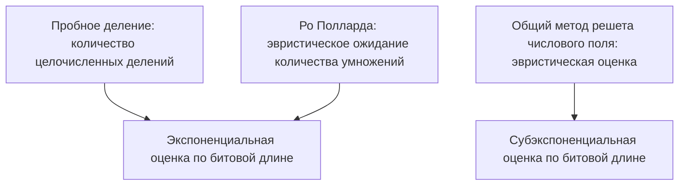

## 1. Введение: что трудно в факторизации?

Разложение небольшого целого числа на простые множители знакомо со школы. Однако восстановление множителей произведения больших простых чисел может требовать огромных ресурсов классического компьютера. Эта асимметрия составляет часть основы [криптографии с открытым ключом, включая RSA](https://kenji.blog/ru/p/modern-cryptography-public-key-hash-signature/).

Это не означает, что любое большое целое число трудно разложить или что невозможность быстрого классического алгоритма уже доказана. Огромные числа с малыми множителями, например чётные, могут обрабатываться легко. Сложности приведённых ниже алгоритмов также не являются нижними оценками самой задачи. Криптографическую безопасность нужно оценивать для правильно сгенерированных ключей и предполагаемых ресурсов противника.

Сначала мы уточним смысл нотации «О-большое» и размера входа, затем сравним пробное деление, метод Ферма, ро-алгоритм Полларда, квадратичное решето и общий метод решета числового поля. В конце рассмотрим связь с P против NP и квантовыми вычислениями. Важно различать оценки сложности, доказательства безопасности и фактическое время в секундах.

## 2. Сложность и нотация «О-большое»

Фактическое время зависит от процессора, памяти, реализации, распараллеливания и других условий. Указывая сложность, нужно определить размер входа и то, что считается одной элементарной операцией. Считать умножение больших целых чисел одной операцией — не то же самое, что считать битовые операции внутри него.

### Асимптотическая верхняя оценка

Для функций, неотрицательных на достаточно больших входах, $f(n)=\mathcal{O}(g(n))$ означает:

$$
\exists c>0,\ \exists n_0,\ \forall n\ge n_0:\quad 0\le f(n)\le c\,g(n).
$$

Константы $c$ и $n_0$ не зависят от входа $n$. Это определение верхней оценки, а не худшего случая как такового. Отдельно нужно указать, описывает ли функция худшее время, среднее время или математическое ожидание времени рандомизированного алгоритма.

Для совпадающих порядков верхней и нижней оценок используют $\Theta$, а для нижней оценки — $\Omega$. Например, даже $f(n)=1$ принадлежит $\mathcal{O}(2^n)$. Поэтому из одной этой верхней оценки не следует, что время точно удваивается при увеличении входа на единицу. Нотация также не выражает непосредственно отношение измеренных времён. [Определение NIST](https://xlinux.nist.gov/dads/HTML/bigOnotation.html) тоже различает верхнюю и асимптотически точную оценку.

### Типичные формы роста

В таблице $n$ означает количество элементов данных. Считаются такие операции, как сравнения и обращения к элементам.

| Порядок | Пример и условия |
| --- | --- |
| $\mathcal{O}(1)$ | Обращение к элементу массива по индексу в модели с произвольным доступом |
| $\mathcal{O}(\log n)$ | Сравнения бинарного поиска в отсортированном массиве |
| $\mathcal{O}(n)$ | Сравнения линейного поиска в худшем случае |
| $\mathcal{O}(n\log n)$ | Сортировка слиянием в худшем случае или быстрая сортировка в среднем при подходящих предположениях |
| $\mathcal{O}(n^2)$ | Например, сравнения сортировки вставками в худшем случае |
| $\mathcal{O}(2^n)$ | Количество всех подмножеств $n$ элементов; обработка каждого кандидата имеет отдельную стоимость |
| $\mathcal{O}(n!)$ | Количество всех перестановок $n$ различных элементов; обработка каждого кандидата имеет отдельную стоимость |

Время, ограниченное $\mathcal{O}(n^k)$ для фиксированной константы $k$, называют полиномиальным. Большой показатель или константа всё же могут сделать метод непрактичным; напротив, экспоненциальный метод бывает полезен для малых входов. Следующая схема классифицирует типичные оценки по битовой длине входа. Это не доказательство трудности и не график измеренного времени.

## 3. RSA: значение числа и длина входа

Пусть $N\ge2$ — целое число, которое требуется разложить, а $b$ — длина его двоичной записи. Это не количество элементов $n$ из предыдущей таблицы.

$$
b=\lfloor\log_2 N\rfloor+1,\qquad 2^{b-1}\le N<2^b.
$$

Например, $15$ занимает четыре бита, но $2^4=16$, а не $15$. Полиномиальная по значению $N$ оценка может быть экспоненциальной по длине входа $b$. Сами операции с большими целыми числами также имеют стоимость, зависящую от $b$.

В базовом случае RSA с двумя простыми числами из различных нечётных простых $p,q$ получают $N=pq$. Если каждое имеет длину 1024 бита, произведение содержит 2047 или 2048 бит, а не обязательно 2048. Открытый ключ включает $N,e$, а закрытый — секретный показатель $d$ и, возможно, другие значения. Например, для выбора $d$ достаточно следующих условий:

$$
\varphi(N)=(p-1)(q-1),\quad 1<e<\varphi(N),\quad
\gcd(e,\varphi(N))=1,\quad ed\equiv1\pmod{\varphi(N)}.
$$

[RFC 8017](https://www.rfc-editor.org/rfc/rfc8017.html) определяет ключи более общим образом через $\lambda(N)=\operatorname{lcm}(p-1,q-1)$. Знание множителей позволяет вычислить секретный показатель. Однако эквивалентность задачи обращения RSA и факторизации в общем случае не доказана, и не каждая атака на RSA требует разложения модуля.

Одна базовая операция модульного возведения в степень ещё не образует безопасную схему шифрования. На практике нужны схемы шифрования с OAEP, схемы подписи вроде PSS и анализ генерации ключей, реализаций и всего протокола. Асимметрия между умножением и восстановлением множителей не является безусловным доказательством безопасности.

## 4. Пять алгоритмов факторизации

### 4.1 Пробное деление

У составного целого числа $N$ есть хотя бы один простой множитель, не превышающий $\sqrt N$. Поэтому проверка малых делителей до $\lfloor\sqrt N\rfloor$ позволяет найти множитель. Это не утверждение о том, что наибольший простой множитель меньше квадратного корня: наибольший простой множитель числа $15=3\cdot5$ равен $5$ и больше $\sqrt{15}$.

Для простого метода, проверяющего всех целочисленных кандидатов, количество делений в худшем случае оценивается как $\mathcal{O}(\sqrt N)$. Неравенство для битовой длины даёт также верхнюю оценку $\mathcal{O}(2^{b/2})$. Здесь каждое деление больших целых чисел считается одной операцией; это не суммарное количество битовых операций. Малый множитель позволяет завершить поиск раньше.

### 4.2 Метод Ферма: расстояние между множителями важно

Для нечётного составного числа ищут разность квадратов:

$$
N=x^2-y^2=(x-y)(x+y).
$$

Начиная с $x=\lceil\sqrt N\rceil$, увеличивают $x$, пока $x^2-N$ не станет полным квадратом. Для $N=pq$ с нечётными $p\le q$ одно решение имеет вид $x=(p+q)/2$, $y=(q-p)/2$. Количество кандидатов до этого решения равно следующему выражению; если раньше встретится другое решение, можно остановиться раньше.

$$
\frac{p+q}{2}-\lceil\sqrt N\rceil+1.
$$

При близких множителях числа $1009\cdot1013$ подходит первый кандидат. Напротив, для $3\cdot104729=314187$ нужно 51806 кандидатов. В частности, при фиксированном $p=3$ и растущем простом $q$ количество кандидатов имеет порядок $\Theta(N)$. Поэтому нельзя всегда приписывать методу Ферма тот же порядок квадратного корня, что и пробному делению. У чётных входов сначала удаляют множители 2.

### 4.3 Ро-алгоритм Полларда

Итерируют функцию вроде $x\mapsto x^2+c\pmod N$ и вычисляют наибольший общий делитель числа $N$ и разности двух позиций последовательности. Коллизия по модулю неизвестного простого множителя $p$ может дать разность, кратную $p$, и раскрыть множитель. Поиск цикла по Флойду хранит постоянное количество остатков. Однако каждый остаток требует $\mathcal{O}(b)$ бит, поэтому память не постоянна при измерении в битах.

В эвристической модели случайной функции математическое ожидание количества модульных умножений для нахождения множителя $p$ оценивают как $\mathcal{O}(\sqrt p)$. Когда $p$ имеет порядок $\sqrt N$, получается $\mathcal{O}(N^{1/4})$, а значит, $\mathcal{O}(2^{b/4})$. Это не безусловная гарантия худшего времени; битовые стоимости умножения и вычисления НОД нужно учитывать отдельно.

НОД $d$ означает успех только при $1<d<N$. При $d=1$ продолжают, а при $d=N$ пробуют снова, например с другим начальным значением или функцией. Для $N=21$, начального значения 2 и $f(x)=x^2+1$ первое сравнение Флойда сопоставляет 5 и 5, поэтому НОД равен самому 21. Нетривиальный множитель также может быть составным и требовать дальнейшего разложения.

### 4.4 Квадратичное решето и MPQS

Квадратичное решето собирает гладкие значения, полностью разлагающиеся по малым простым числам, для построения сравнения квадратов. В базовой форме берут $m=\lfloor\sqrt N\rfloor$ и просеивают следующие значения в диапазоне малых $x$:

$$
Q(x)=(m+x)^2-N.
$$

Показатели записывают по факторной базе, включающей знак $-1$ и выбранные малые простые числа. Линейная алгебра над полем из двух элементов комбинирует чётности показателей для поиска произведений, являющихся квадратами. Описание только случайных гладких значений $x^2\bmod N$ упускает характерное для квадратичного решета использование малых значений многочлена.

MPQS — вариант квадратичного решета с несколькими подходящими квадратичными многочленами. Производительность зависит от реализации, входа и доступных ресурсов. Нет универсального правила, по которому один метод обязательно обгоняет другой ровно на 100 десятичных цифрах.

Искомое сравнение и извлечение множителя имеют вид:

$$
X^2\equiv Y^2\pmod N,\qquad d=\gcd(X-Y,N).
$$

Если $d=1$ или $d=N$, пробуют другое соотношение. Если $X,Y$ взаимно просты с $N$ и $X\not\equiv\pm Y\pmod N$, получается нетривиальный множитель, не обязательно простой. Например, для $N=1155$, $X=76$, $Y=1$ квадраты сравнимы, но $\gcd(75,1155)=15$ и $\gcd(77,1155)=77$ оба составные.

### 4.5 Общий метод решета числового поля (GNFS)

Общий метод решета числового поля применяют к большим целым числам без специальной формы. Общая схема такова:

1. Выбрать многочлены с целыми коэффициентами и связанные параметры с общим корнем по модулю $N$, подготовив соответствующее числовое поле.
2. Просеивать соотношения, удовлетворяющие условиям разложения по малым простым числам или простым идеалам на рациональной стороне и стороне числового поля.
3. Решить большую разреженную матричную систему, описывающую чётности показателей и дополнительные условия, чтобы совместить соотношения, из которых можно получить квадраты.
4. Вычислить квадратные корни на обеих сторонах, получить целочисленное сравнение квадратов и извлечь нетривиальный множитель через НОД. При неудаче использовать другие соотношения.

Это обзор, а не инструкция по реализации квадратных корней на стороне числового поля и их дополнительных условий. Кроме того, $\mathbb Z[\alpha]$, образованное из корня $\alpha$ многочлена, не всегда совпадает со всем кольцом целых чисел числового поля. Например, при $\alpha=\sqrt5$ элемент $\beta=(1+\sqrt5)/2$ удовлетворяет $\beta^2-\beta-1=0$, поэтому является целым алгебраическим числом, но не принадлежит $\mathbb Z[\sqrt5]$.

Определим L-нотацию через натуральные логарифмы $\ln$ для $c>0$ и $0\le\alpha\le1$:

$$
L_N[\alpha,c]=\exp\!\left((c+o(1))(\ln N)^\alpha(\ln\ln N)^{1-\alpha}\right).
$$

Здесь $o(1)$ стремится к нулю при $N\to\infty$. Крайние случаи: $L_N[0,c]=(\ln N)^{c+o(1)}$ и $L_N[1,c]=N^{c+o(1)}$. Нельзя просто убрать асимптотический член и заменить выражение точным равенством или верхней оценкой фиксированной степени.

Стандартная эвристическая оценка времени GNFS записывается так:

$$
L_N\!\left[\frac13,\left(\frac{64}{9}\right)^{1/3}\right]
=\exp\!\left(\left(\left(\frac{64}{9}\right)^{1/3}+o(1)\right)(\ln N)^{1/3}(\ln\ln N)^{2/3}\right).
$$

Константа равна примерно 1,923. При переходе к битовой длине входа используется $\ln N=b\ln2+\mathcal{O}(1)$, поэтому меняется и ведущая константа в показателе:

$$
\exp\!\left(\left(\left(\frac{64\ln2}{9}\right)^{1/3}+o(1)\right)b^{1/3}(\ln b)^{2/3}\right).
$$

Эта константа равна примерно 1,702. Оценка субэкспоненциальна по битовой длине: растёт быстрее любого полинома, но медленнее $2^{\varepsilon b}$ для каждого фиксированного $\varepsilon>0$. Это не безусловная теорема о худшем случае для всех входов и не прогноз времени для конкретного размера.

Как датированный пример, [объявление о факторизации RSA-250 от 28 февраля 2020 года](https://caramba.loria.fr/rsa250.txt) сообщает о разложении с помощью NFS целого числа из 250 десятичных цифр и 829 бит при затратах около 2700 ядро-лет работы (core-years). Это мера вычислительной работы, а не обязательно 2700 одновременно работающих машин или 2700 прошедших лет. Здесь этот результат не представлен ни как текущий мировой рекорд, ни как стоимость разложения любого числа такой длины.

## 5. P против NP и квантовые вычисления

### Проверка простоты и поиск множителей

Определить, является ли число простым, — не то же самое, что найти множители составного числа. [Работа AKS](https://annals.math.princeton.edu/2004/160-2/p12) установила безусловный детерминированный полиномиальный тест простоты. Для факторизации такой результат в ней не установлен.

P, NP и coNP — прежде всего классы задач распознавания с ответами Да/Нет. Сама факторизация — поисковая задача, выдающая множители, поэтому фраза «факторизация принадлежит NP» без уточнения оставляет тип задачи неясным. Например, для данных $N\ge2$ и $2\le K<N$ можно спросить, существует ли делитель с $1<d\le K$ и $d\mid N$.

Ответ Да имеет сертификат в виде делителя $d$, проверяемого делением. Ответ Нет можно подтвердить полным разложением на простые множители: произведение, простота каждого множителя и условие, что все простые множители больше $K$, проверяются за полиномиальное время. Поэтому эта задача распознавания принадлежит и NP, и coNP. Полиномиальный поиск решил бы задачу распознавания. Обратно, полиномиальный алгоритм распознавания позволил бы получить факторизацию бинарным поиском по $K$ и последовательным извлечением множителей.

Такая классификация не доказывает ни NP-полноту, ни отсутствие классического полиномиального алгоритма. Если задача из NP и coNP была бы NP-полной относительно обычных полиномиальных сведений, следовало бы NP=coNP. [P против NP остаётся открытым вопросом](https://www.claymath.org/millennium/p-vs-np/). Даже предположение P≠NP само по себе не доказывает, что факторизация находится вне P.

### Алгоритм Шора меняет вычислительную модель

[Алгоритм Шора](https://arxiv.org/abs/quant-ph/9508027) раскладывает целые числа за количество шагов, полиномиальное по битовой длине входа, в модели с достаточными квантовыми ресурсами. Квантовая часть получает информацию о периодах; затем следуют измерение и классическая постобработка, при необходимости с повторными попытками. Квантовое преобразование Фурье не считывает мгновенно ответы для всех кандидатов.

Из этого теоретического числа шагов нельзя напрямую определить, потребуются ли реальному оборудованию часы или дни. Такие оценки требуют предположений о квантовых вентилях, коррекции ошибок, арифметических схемах, доступных кубитах и других ресурсах. Последняя стрелка на схеме меняет вычислительную модель, а не доказывает предел классических компьютеров.

Подготовка к таким будущим атакам — одна из причин развития постквантовой криптографии (PQC). Как объясняет [RFC 9794](https://www.rfc-editor.org/rfc/rfc9794.html), термин обозначает криптографию, спроектированную для противодействия атакующим с квантовыми компьютерами; он не гарантирует, что схему невозможно взломать. Оценивать нужно и математические предположения, и реализацию, и эксплуатационные решения.

## 6. Заключение

Сравнение сложностей факторизации начинается с различения значения целого числа $N$ и длины входа $b$, количества операций и битовых затрат, худшего и ожидаемого времени. Пробное деление, Ферма и rho используют разные структуры; квадратичное решето и GNFS строят сравнения квадратов по многим соотношениям.

Криптографическая безопасность не следует из одной верхней оценки или из того, что число выглядит большим. Известные алгоритмы, генерацию входов, модели атак и реализацию нужно рассматривать вместе. В теоретических результатах квантовых вычислений также следует указывать, что доказано, а что зависит от предположений или оценок ресурсов.

### Источники

- [NIST DADS: big-O notation](https://xlinux.nist.gov/dads/HTML/bigOnotation.html)
- [Handbook of Applied Cryptography, глава 2: определения сложности](https://cacr.uwaterloo.ca/hac/about/chap2.pdf)
- [Глава 3: факторизация и задача RSA](https://cacr.uwaterloo.ca/hac/about/chap3.pdf) (источник 1996 года; его рекорды и состояние проверки простоты следует отличать от последующих достижений)
- [RFC 8017: ключи и схемы RSA](https://www.rfc-editor.org/rfc/rfc8017.html)
- [Объявление авторов о RSA-250 (2020)](https://caramba.loria.fr/rsa250.txt)
- [Agrawal–Kayal–Saxena: PRIMES is in P](https://annals.math.princeton.edu/2004/160-2/p12)
- [Clay Mathematics Institute: P vs NP](https://www.claymath.org/millennium/p-vs-np/)
- [Shor: полиномиальные алгоритмы факторизации и дискретного логарифмирования на квантовом компьютере](https://arxiv.org/abs/quant-ph/9508027)
- [RFC 9794: постквантовая терминология](https://www.rfc-editor.org/rfc/rfc9794.html)
