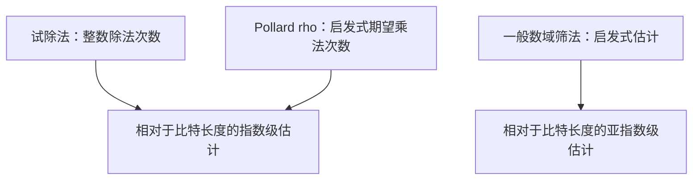

## 1. 引言：整数分解的难点在哪里

把小整数分解成素数的乘积，是学校里常见的计算。然而，从大素数的乘积中找回因数，在经典计算机上可能需要极大的计算资源。这种不对称性是[RSA等公钥密码](https://kenji.blog/zh-cn/p/modern-cryptography-public-key-hash-signature/)的背景之一。

这并不意味着每个大整数都难以分解，也不意味着人们已经证明任何经典算法都不可能快速完成分解。偶数等含有小因数的巨大整数可能很容易处理。下文中各算法的复杂度，也不是整数分解问题本身的下界。密码安全性需要针对正确生成的密钥，以及假定攻击者可用的资源进行评估。

本文先说明大O表示法和输入规模，再比较试除法、费马法、Pollard的rho算法、二次筛法和一般数域筛法，最后讨论P与NP问题及量子计算。阅读时，请区分复杂度估计、安全性证明和实际运行的秒数。

## 2. 复杂度与大O表示法

实际耗时受CPU、内存、实现和并行化等条件影响。讨论复杂度时，需要明确输入规模，以及什么算作一次基本操作。把多精度整数乘法算作一次操作，与统计其内部的比特操作，含义并不相同。

### 渐近上界

对于在充分大的输入上非负的函数，$f(n)=\mathcal{O}(g(n))$ 表示：

$$
\exists c>0,\ \exists n_0,\ \forall n\ge n_0:\quad 0\le f(n)\le c\,g(n).
$$

常数 $c$ 和 $n_0$ 不依赖输入 $n$。这定义的是上界，本身不代表“最坏情况”。还必须说明被估计的函数是最坏时间、平均时间，还是随机算法的期望时间。

上下界具有相同数量级时用 $\Theta$，下界用 $\Omega$。例如，$f(n)=1$ 也属于 $\mathcal{O}(2^n)$。因此，仅凭这个上界，不能断言输入增加1时耗时恰好翻倍。这种记法也不直接表达实测时间之比。[NIST的定义](https://xlinux.nist.gov/dads/HTML/bigOnotation.html)同样区分上界和紧确界。

### 常见的增长形式

下表以 $n$ 表示数据元素的个数，统计比较、元素访问等基本操作。

| 数量级 | 例子和条件 |
| --- | --- |
| $\mathcal{O}(1)$ | 在随机访问模型中，按下标访问数组元素 |
| $\mathcal{O}(\log n)$ | 在有序数组中进行二分查找的比较次数 |
| $\mathcal{O}(n)$ | 线性查找在最坏情况下的比较次数 |
| $\mathcal{O}(n\log n)$ | 归并排序的最坏情况，或适当假设下快速排序的平均情况 |
| $\mathcal{O}(n^2)$ | 例如插入排序在最坏情况下的比较次数 |
| $\mathcal{O}(2^n)$ | $n$ 个元素的全部子集的数量；每个候选的处理成本另计 |
| $\mathcal{O}(n!)$ | $n$ 个不同元素的全部排列的数量；每个候选的处理成本另计 |

对于固定常数 $k$，时间能被 $\mathcal{O}(n^k)$ 限制时，称为多项式时间。较大的指数或常数仍可能使它不实用；指数级方法也可能适合小规模输入。下图整理的是相对于输入比特长度的代表性估计，并不是困难性证明或实际耗时曲线。

## 3. RSA：整数的值与输入长度

用 $N\ge2$ 表示待分解的整数，用 $b$ 表示其二进制表示的长度。这与前一张表中的元素个数 $n$ 不同。

$$
b=\lfloor\log_2 N\rfloor+1,\qquad 2^{b-1}\le N<2^b.
$$

例如，$15$ 的比特长度是4，但 $2^4=16$，并不是 $15$。关于数值 $N$ 的多项式界，可能是关于输入长度 $b$ 的指数级界。大整数运算本身的成本也会随 $b$ 改变。

在基本的双素数RSA中，用不同的奇素数 $p,q$ 构造 $N=pq$。若两个素数各有1024比特，乘积可能是2047比特或2048比特，并不总是2048比特。公钥包含 $N,e$，私钥包含私钥指数 $d$ 等信息。例如，以下是选取 $d$ 的一组充分条件：

$$
\varphi(N)=(p-1)(q-1),\quad 1<e<\varphi(N),\quad
\gcd(e,\varphi(N))=1,\quad ed\equiv1\pmod{\varphi(N)}.
$$

[RFC 8017](https://www.rfc-editor.org/rfc/rfc8017.html)更一般地使用 $\lambda(N)=\operatorname{lcm}(p-1,q-1)$ 规定密钥。知道因数后，可以计算私钥指数。然而，RSA求逆问题与整数分解一般是否等价，并没有得到证明；也不是所有针对RSA的攻击都需要分解模数。

仅有整数模幂运算，并不构成安全的加密方案。实际使用还需要包含OAEP的加密方案或PSS等签名方案，并考虑密钥生成、实现和整个协议。不能把乘法与找回因数之间的不对称性，当作无条件的安全性证明。

## 4. 五种整数分解算法

### 4.1 试除法

合数 $N$ 至少有一个不超过 $\sqrt N$ 的素因数。因此，从小的候选因数一直试到 $\lfloor\sqrt N\rfloor$，就能找到因数。这里不是说“最大的素因数不超过平方根”：例如，$15=3\cdot5$ 的最大素因数是 $5$，大于 $\sqrt{15}$。

对于逐一测试所有整数候选的简单方法，最坏情况下的除法次数可以估计为 $\mathcal{O}(\sqrt N)$。由比特长度的不等式，也可得到 $\mathcal{O}(2^{b/2})$ 的上界。这以一次多精度除法为单位计数，并非比特操作的总次数。如果存在小因数，就能提前结束。

### 4.2 费马法：因数之间的距离很重要

对于奇合数，寻找平方差：

$$
N=x^2-y^2=(x-y)(x+y).
$$

从 $x=\lceil\sqrt N\rceil$ 开始递增，检查 $x^2-N$ 是否是完全平方数。若 $N=pq$ 且 $p\le q$ 均为奇数，则 $x=(p+q)/2$、$y=(q-p)/2$ 是一组解。检查到这组解为止的候选数量如下；如果更早遇到另一组解，就可以提前结束。

$$
\frac{p+q}{2}-\lceil\sqrt N\rceil+1.
$$

对于因数接近的 $1009\cdot1013$，第一个候选就能成功。相比之下，$3\cdot104729=314187$ 需要检查51806个候选。特别是固定 $p=3$、增大素数 $q$ 时，候选数量为 $\Theta(N)$。因此，不能一概把费马法归为与试除法相同的平方根数量级。偶数应先除去因数2。

### 4.3 Pollard的rho算法

对 $x\mapsto x^2+c\pmod N$ 等函数反复迭代，计算序列中两个位置的差与 $N$ 的最大公约数。如果序列在未知素因数 $p$ 的模意义下发生碰撞，差值就是 $p$ 的倍数，有时可以由此找出因数。Floyd判圈法只保留常数个剩余值，但每个值需要 $\mathcal{O}(b)$ 比特，因此并不是以比特计量的常数空间。

在假定序列行为类似随机函数的启发式分析中，找到因数 $p$ 所需的期望模乘次数估计为 $\mathcal{O}(\sqrt p)$。当 $p$ 与 $\sqrt N$ 同一数量级时，可写为 $\mathcal{O}(N^{1/4})$，进而得到 $\mathcal{O}(2^{b/4})$。这不是无条件的最坏时间保证；乘法和最大公约数运算的比特成本也需要另行考虑。

所得最大公约数 $d$ 只有在 $1<d<N$ 时才意味着成功。$d=1$ 时继续；$d=N$ 时可改变初值或函数后重试。例如，$N=21$、初值为2、$f(x)=x^2+1$ 时，第一次Floyd比较得到5和5，最大公约数是21本身。非平凡因数也可能是合数，需要继续分解。

### 4.4 二次筛法与MPQS

二次筛法收集仅由小素数相乘得到的光滑值，构造平方同余式。基本形式中，取 $m=\lfloor\sqrt N\rfloor$，在较小的 $x$ 的范围内筛选下列值：

$$
Q(x)=(m+x)^2-N.
$$

以符号 $-1$ 和选定的小素数组成因子基，记录这些值的指数。在二元域上线性组合指数的奇偶性，寻找乘积为平方数的关系。仅描述随机取 $x^2\bmod N$ 并检查其光滑性，不能体现二次筛法利用较小多项式值的特点。

MPQS（多重多项式二次筛法）是使用多个适当二次多项式的变种。性能依赖实现、输入和可用资源，因此不能给出“恰好100位时某种方法必然更快”的通用分界。

目标同余式与提取因数的操作如下：

$$
X^2\equiv Y^2\pmod N,\qquad d=\gcd(X-Y,N).
$$

如果 $d=1$ 或 $d=N$，应尝试其他关系。若 $X,Y$ 均与 $N$ 互素，且 $X\not\equiv\pm Y\pmod N$，就能得到非平凡因数，但不一定是素数。例如，$N=1155$、$X=76$、$Y=1$ 时，两个平方同余，而 $\gcd(75,1155)=15$、$\gcd(77,1155)=77$ 都是合数。

### 4.5 一般数域筛法（GNFS）

一般数域筛法用于分解不具有特殊形式的大整数。大致过程如下：

1. 选择模 $N$ 下具有公共根的整数多项式等参数，建立相应的数域环境。
2. 在有理数侧和数域侧，通过筛选收集满足关于小素数或素理想的分解条件的关系。
3. 求解表示指数奇偶性等条件的大型稀疏矩阵，组合出可以提取平方的关系。
4. 在两侧计算平方根，转化为整数的平方同余式，通过最大公约数提取非平凡因数；关系失败时重试。

这只是概要，并不是数域侧平方根及其附加条件的实现指南。由多项式根 $\alpha$ 构造的 $\mathbb Z[\alpha]$，也不一定是该数域的整个整数环。例如，$\alpha=\sqrt5$ 时，$\beta=(1+\sqrt5)/2$ 满足 $\beta^2-\beta-1=0$，是代数整数，却不属于 $\mathbb Z[\sqrt5]$。

使用自然对数 $\ln$ 定义L记法，其中 $c>0$、$0\le\alpha\le1$：

$$
L_N[\alpha,c]=\exp\!\left((c+o(1))(\ln N)^\alpha(\ln\ln N)^{1-\alpha}\right).
$$

当 $N\to\infty$ 时，$o(1)$ 趋于0。两个端点为 $L_N[0,c]=(\ln N)^{c+o(1)}$ 和 $L_N[1,c]=N^{c+o(1)}$。不能直接删去渐近项，改成严格等式或固定次数的上界。

GNFS的标准启发式运行时间估计为：

$$
L_N\!\left[\frac13,\left(\frac{64}{9}\right)^{1/3}\right]
=\exp\!\left(\left(\left(\frac{64}{9}\right)^{1/3}+o(1)\right)(\ln N)^{1/3}(\ln\ln N)^{2/3}\right).
$$

常数约为1.923。转换成输入比特长度时，由于 $\ln N=b\ln2+\mathcal{O}(1)$，指数中的首项常数也需要换算：

$$
\exp\!\left(\left(\left(\frac{64\ln2}{9}\right)^{1/3}+o(1)\right)b^{1/3}(\ln b)^{2/3}\right).
$$

这里的常数约为1.702。该估计相对于比特长度是亚指数级的：增长快于任意多项式，但慢于每个固定 $\varepsilon>0$ 对应的 $2^{\varepsilon b}$。它既不是针对所有输入的无条件最坏时间定理，也不是某个规模的实际耗时预测。

作为有明确日期的实例，[2020年2月28日的RSA-250分解公告](https://caramba.loria.fr/rsa250.txt)报告使用NFS分解了一个250位十进制、829比特的整数，计算工作量约为2700核年（core-years）。这并不等于同时使用2700台计算机，也不表示实际经过了2700年。这里不把该历史实例当作当前世界纪录，或所有同样长度整数的分解成本。

## 5. P与NP问题和量子计算

### 素数判定与寻找因数

判定一个数是否为素数，与找出合数的因数是不同的问题。[AKS论文](https://annals.math.princeton.edu/2004/160-2/p12)证明了素数判定可以在无条件、确定性的多项式时间内完成。这并不意味着整数分解也有相同的结果。

P、NP、coNP基本上是回答Yes/No的判定问题的类别。素因数分解本身是输出因数的搜索问题，因此单说“素因数分解属于NP”，会使问题类型不明确。例如，给定 $N\ge2$、$2\le K<N$，可以提出这样的判定问题：是否存在因数，满足 $1<d\le K$ 且 $d\mid N$？

若答案为Yes，因数 $d$ 就是可以用除法验证的证据。若为No，可以给出完整的素因数分解作为证据，在多项式时间内核对乘积、各因数的素数性，以及所有素因数都大于 $K$。因此，这个判定问题同时属于NP和coNP。若搜索能在多项式时间内完成，判定也能完成；反过来，若有多项式时间的判定算法，也可以通过对 $K$ 二分查找并反复提取因数，得到素因数分解。

这种分类既没有证明NP完全性，也没有证明经典多项式时间算法不存在。若一个同时属于NP和coNP的问题，在通常的多项式时间归约下是NP完全的，就会推出NP=coNP。[P与NP问题仍未解决](https://www.claymath.org/millennium/p-vs-np/)。即使假设P≠NP，也不能仅凭这一点断言整数分解不属于P。

### Shor算法改变了计算模型

[Shor算法](https://arxiv.org/abs/quant-ph/9508027)在具有足够量子计算资源的模型中，可以用关于输入比特长度的多项式步数完成整数分解。量子部分获得周期的信息，再通过测量结果和经典后处理提取因数，必要时重试。这并不是量子傅里叶变换瞬间读取了全部候选的答案。

理论步数不能直接决定真实硬件要用“几小时”还是“几天”。这类估计需要给出量子门、纠错、算术电路、可用量子比特等条件。下图最后一条箭头表示计算模型改变，并不是经典计算机极限的证明。

为这类未来攻击做准备，是后量子密码（PQC）的动机之一。正如[RFC 9794](https://www.rfc-editor.org/rfc/rfc9794.html)所说明的，PQC指被设计为能够抵抗拥有量子计算机的攻击者的密码，并不保证绝对无法破解。仍然需要评估数学假设以及实现和运用方式。

## 6. 总结

比较整数分解的复杂度，首先要区分整数的值 $N$ 与输入比特长度 $b$、基本操作次数与比特成本、最坏时间与期望时间。试除法、费马法和rho算法利用不同的结构，而二次筛法与GNFS从大量关系中构造平方同余式。

密码安全性不能由单个上界或整数看起来很大来判断。应综合已知算法、输入生成方式、攻击模型和实现。对于量子计算的理论结果，也要明确哪些已经证明，哪些依赖假设或资源估计，才能形成准确的理解。

### 参考资料

- [NIST DADS：big-O notation](https://xlinux.nist.gov/dads/HTML/bigOnotation.html)
- [Handbook of Applied Cryptography，第2章：复杂度定义](https://cacr.uwaterloo.ca/hac/about/chap2.pdf)
- [第3章：整数分解与RSA问题](https://cacr.uwaterloo.ca/hac/about/chap3.pdf)（1996年的资料，需与后来的分解纪录和素数判定进展区分）
- [RFC 8017：RSA密钥与方案](https://www.rfc-editor.org/rfc/rfc8017.html)
- [RSA-250作者公告（2020年）](https://caramba.loria.fr/rsa250.txt)
- [Agrawal–Kayal–Saxena：PRIMES is in P](https://annals.math.princeton.edu/2004/160-2/p12)
- [Clay Mathematics Institute：P vs NP](https://www.claymath.org/millennium/p-vs-np/)
- [Shor：量子计算中的多项式时间因数分解与离散对数算法](https://arxiv.org/abs/quant-ph/9508027)
- [RFC 9794：后量子密码术语](https://www.rfc-editor.org/rfc/rfc9794.html)
