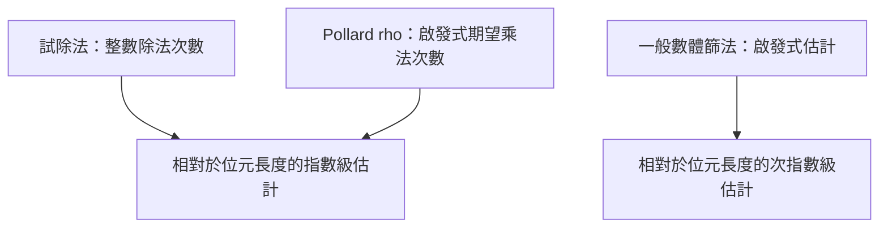

## 1. 前言：整數分解的困難在哪裡

把小整數分解成質數的乘積，是學校裡常見的計算。然而，從大質數的乘積找回因數，在古典電腦上可能需要龐大的計算資源。這種不對稱性是[RSA等公開金鑰密碼](https://kenji.blog/zh-tw/p/modern-cryptography-public-key-hash-signature/)的背景之一。

這並不表示每個大整數都難以分解，也不表示人們已經證明任何古典演算法都不可能快速完成分解。偶數等含有小因數的巨大整數可能很容易處理。下文各演算法的複雜度，也不是整數分解問題本身的下界。密碼安全性需要針對正確產生的金鑰，以及假定攻擊者可用的資源進行評估。

本文先說明Big O標記和輸入規模，再比較試除法、費馬法、Pollard的rho演算法、二次篩法和一般數體篩法，最後討論P與NP問題及量子計算。閱讀時，請區分複雜度估計、安全性證明和實際執行秒數。

## 2. 複雜度與Big O標記

實際耗時受CPU、記憶體、實作和並行化等條件影響。討論複雜度時，需要明確定義輸入規模，以及什麼算作一次基本操作。把多倍精度整數乘法算作一次操作，與計算其內部的位元操作，含義並不相同。

### 漸近上界

對於在充分大的輸入上非負的函數，$f(n)=\mathcal{O}(g(n))$ 表示：

$$
\exists c>0,\ \exists n_0,\ \forall n\ge n_0:\quad 0\le f(n)\le c\,g(n).
$$

常數 $c$ 和 $n_0$ 不依賴輸入 $n$。這定義的是上界，本身不代表「最壞情況」。還必須說明被估計的函數是最壞時間、平均時間，還是隨機演算法的期望時間。

上下界具有相同數量級時用 $\Theta$，下界用 $\Omega$。例如，$f(n)=1$ 也屬於 $\mathcal{O}(2^n)$。因此，僅憑這個上界，不能斷言輸入增加1時耗時恰好加倍。這種記法也不直接表達實測時間的比值。[NIST的定義](https://xlinux.nist.gov/dads/HTML/bigOnotation.html)同樣區分上界和緊確界。

### 常見的成長形式

下表以 $n$ 表示資料元素的個數，計算比較、元素存取等基本操作。

| 數量級 | 例子和條件 |
| --- | --- |
| $\mathcal{O}(1)$ | 在隨機存取模型中，依索引存取陣列元素 |
| $\mathcal{O}(\log n)$ | 在已排序陣列中二分搜尋的比較次數 |
| $\mathcal{O}(n)$ | 線性搜尋在最壞情況下的比較次數 |
| $\mathcal{O}(n\log n)$ | 合併排序的最壞情況，或適當假設下快速排序的平均情況 |
| $\mathcal{O}(n^2)$ | 例如插入排序在最壞情況下的比較次數 |
| $\mathcal{O}(2^n)$ | $n$ 個元素的所有子集合的數量；每個候選的處理成本另計 |
| $\mathcal{O}(n!)$ | $n$ 個不同元素的所有排列的數量；每個候選的處理成本另計 |

對於固定常數 $k$，時間能被 $\mathcal{O}(n^k)$ 限制時，稱為多項式時間。較大的指數或常數仍可能使它不實用；指數級方法也可能適合小規模輸入。下圖整理的是相對於輸入位元長度的代表性估計，不是困難性證明或實際耗時曲線。

## 3. RSA：整數的值與輸入長度

以 $N\ge2$ 表示待分解的整數，以 $b$ 表示其二進位表示的長度。這與前一張表的元素個數 $n$ 不同。

$$
b=\lfloor\log_2 N\rfloor+1,\qquad 2^{b-1}\le N<2^b.
$$

例如，$15$ 的位元長度是4，但 $2^4=16$，並不是 $15$。關於數值 $N$ 的多項式界，可能是關於輸入長度 $b$ 的指數級界。大整數運算本身的成本也會隨 $b$ 改變。

在基本的雙質數RSA中，以不同的奇質數 $p,q$ 構造 $N=pq$。若兩個質數各有1024位元，乘積可能是2047位元或2048位元，並不總是2048位元。公開金鑰包含 $N,e$，私密金鑰包含私密指數 $d$ 等資訊。例如，以下是選取 $d$ 的一組充分條件，其中 $\varphi$ 是尤拉函數：

$$
\varphi(N)=(p-1)(q-1),\quad 1<e<\varphi(N),\quad
\gcd(e,\varphi(N))=1,\quad ed\equiv1\pmod{\varphi(N)}.
$$

[RFC 8017](https://www.rfc-editor.org/rfc/rfc8017.html)更一般地使用 $\lambda(N)=\operatorname{lcm}(p-1,q-1)$ 規定金鑰。知道因數後，可以計算私密指數。然而，RSA求逆問題與整數分解一般是否等價，並沒有得到證明；也不是所有針對RSA的攻擊都需要分解模數。

僅有整數模冪運算，並不構成安全的加密方案。實際使用還需要包含OAEP的加密方案或PSS等簽章方案，並考慮金鑰產生、實作和整個協定。不能把乘法與找回因數之間的不對稱性，當作無條件的安全性證明。

## 4. 五種整數分解演算法

### 4.1 試除法

合數 $N$ 至少有一個不超過 $\sqrt N$ 的質因數。因此，從小的候選因數一直試到 $\lfloor\sqrt N\rfloor$，就能找到因數。這裡不是說「最大的質因數不超過平方根」：例如，$15=3\cdot5$ 的最大質因數是 $5$，大於 $\sqrt{15}$。

對於逐一測試所有整數候選的簡單方法，最壞情況下的除法次數可估計為 $\mathcal{O}(\sqrt N)$。由位元長度的不等式，也可得到 $\mathcal{O}(2^{b/2})$ 的上界。這以一次多倍精度除法為單位計數，並非位元操作的總次數。如果存在小因數，就能提早結束。

### 4.2 費馬法：因數間的距離很重要

對於奇合數，尋找平方差：

$$
N=x^2-y^2=(x-y)(x+y).
$$

從 $x=\lceil\sqrt N\rceil$ 開始遞增，檢查 $x^2-N$ 是否是完全平方數。若 $N=pq$ 且 $p\le q$ 均為奇數，則 $x=(p+q)/2$、$y=(q-p)/2$ 是一組解。檢查到這組解為止的候選數量如下；如果更早遇到另一組解，就可以提早結束。

$$
\frac{p+q}{2}-\lceil\sqrt N\rceil+1.
$$

對於因數接近的 $1009\cdot1013$，第一個候選就能成功。相較之下，$3\cdot104729=314187$ 需要檢查51806個候選。特別是固定 $p=3$、增大質數 $q$ 時，候選數量為 $\Theta(N)$。因此，不能一概把費馬法歸為與試除法相同的平方根數量級。偶數應先除去因數2。

### 4.3 Pollard的rho演算法

對 $x\mapsto x^2+c\pmod N$ 等函數反覆迭代，計算數列中兩個位置的差與 $N$ 的最大公因數。如果數列在未知質因數 $p$ 的模意義下發生碰撞，差值就是 $p$ 的倍數，有時可以由此找出因數。Floyd循環偵測法只保留常數個餘數值，但每個值需要 $\mathcal{O}(b)$ 位元，因此並不是以位元計量的常數空間。

在假定數列行為類似隨機函數的啟發式分析中，找到因數 $p$ 所需的期望模乘次數估計為 $\mathcal{O}(\sqrt p)$。當 $p$ 與 $\sqrt N$ 同一數量級時，可寫為 $\mathcal{O}(N^{1/4})$，進而得到 $\mathcal{O}(2^{b/4})$。這不是無條件的最壞時間保證；乘法和最大公因數運算的位元成本也需要另行考慮。

所得最大公因數 $d$ 只有在 $1<d<N$ 時才表示成功。$d=1$ 時繼續；$d=N$ 時可改變初值或函數後重試。例如，$N=21$、初值為2、$f(x)=x^2+1$ 時，第一次Floyd比較得到5和5，最大公因數是21本身。非平凡因數也可能是合數，需要繼續分解。

### 4.4 二次篩法與MPQS

二次篩法收集僅由小質數相乘得到的平滑值，構造平方同餘式。基本形式中，取 $m=\lfloor\sqrt N\rfloor$，在較小的 $x$ 的範圍內篩選下列值：

$$
Q(x)=(m+x)^2-N.
$$

以符號 $-1$ 和選定的小質數組成因子基底，記錄這些值的指數。在二元體上線性組合指數的奇偶性，尋找乘積為平方數的關係。僅描述隨機取 $x^2\bmod N$ 並檢查其平滑性，不能呈現二次篩法利用較小多項式值的特點。

MPQS（多重多項式二次篩法）是使用多個適當二次多項式的變種。效能依賴實作、輸入和可用資源，因此不能給出「恰好100位數時某種方法必然更快」的通用分界。

目標同餘式與提取因數的操作如下：

$$
X^2\equiv Y^2\pmod N,\qquad d=\gcd(X-Y,N).
$$

如果 $d=1$ 或 $d=N$，應嘗試其他關係。若 $X,Y$ 均與 $N$ 互質，且 $X\not\equiv\pm Y\pmod N$，就能得到非平凡因數，但不一定是質數。例如，$N=1155$、$X=76$、$Y=1$ 時，兩個平方同餘，而 $\gcd(75,1155)=15$、$\gcd(77,1155)=77$ 都是合數。

### 4.5 一般數體篩法（GNFS）

一般數體篩法用來分解不具有特殊形式的大整數。大致過程如下：

1. 選擇模 $N$ 下具有共同根的整數多項式等參數，建立相應的數體環境。
2. 在有理數側和數體側，透過篩選收集滿足關於小質數或質理想的分解條件的關係。
3. 求解表示指數奇偶性等條件的大型稀疏矩陣，組合出可以提取平方的關係。
4. 在兩側計算平方根，轉換為整數的平方同餘式，透過最大公因數提取非平凡因數；關係失敗時重試。

這只是概要，不是數體側平方根及其附加條件的實作指南。由多項式根 $\alpha$ 構造的 $\mathbb Z[\alpha]$，也不一定是該數體的整個整數環。例如，$\alpha=\sqrt5$ 時，$\beta=(1+\sqrt5)/2$ 滿足 $\beta^2-\beta-1=0$，是代數整數，卻不屬於 $\mathbb Z[\sqrt5]$。

使用自然對數 $\ln$ 定義L記法，其中 $c>0$、$0\le\alpha\le1$：

$$
L_N[\alpha,c]=\exp\!\left((c+o(1))(\ln N)^\alpha(\ln\ln N)^{1-\alpha}\right).
$$

當 $N\to\infty$ 時，$o(1)$ 趨近0。兩個端點為 $L_N[0,c]=(\ln N)^{c+o(1)}$ 和 $L_N[1,c]=N^{c+o(1)}$。不能直接刪去漸近項，改成嚴格等式或固定次數的上界。

GNFS的標準啟發式執行時間估計為：

$$
L_N\!\left[\frac13,\left(\frac{64}{9}\right)^{1/3}\right]
=\exp\!\left(\left(\left(\frac{64}{9}\right)^{1/3}+o(1)\right)(\ln N)^{1/3}(\ln\ln N)^{2/3}\right).
$$

常數約為1.923。轉換成輸入位元長度時，由於 $\ln N=b\ln2+\mathcal{O}(1)$，指數中的首項常數也需要換算：

$$
\exp\!\left(\left(\left(\frac{64\ln2}{9}\right)^{1/3}+o(1)\right)b^{1/3}(\ln b)^{2/3}\right).
$$

這裡的常數約為1.702。該估計相對於位元長度是次指數級的：成長快於任意多項式，但慢於每個固定 $\varepsilon>0$ 對應的 $2^{\varepsilon b}$。它既不是針對所有輸入的無條件最壞時間定理，也不是某個規模的實際耗時預測。

作為有明確日期的實例，[2020年2月28日的RSA-250分解公告](https://caramba.loria.fr/rsa250.txt)報告使用NFS分解了一個250位十進位、829位元的整數，計算工作量約為2700核心年（core-years）。這不等於同時使用2700台電腦，也不表示實際經過了2700年。這裡不把該歷史實例當作目前世界紀錄，或所有同樣長度整數的分解成本。

## 5. P與NP問題和量子計算

### 質數判定與尋找因數

判定一個數是否為質數，與找出合數的因數是不同的問題。[AKS論文](https://annals.math.princeton.edu/2004/160-2/p12)證明了質數判定可以在無條件、確定性的多項式時間內完成。這不表示整數分解也有相同的結果。

P、NP、coNP基本上是回答Yes/No的判定問題的類別。質因數分解本身是輸出因數的搜尋問題，因此單說「質因數分解屬於NP」，會使問題類型不明確。例如，給定 $N\ge2$、$2\le K<N$，可以提出這樣的判定問題：是否存在因數，滿足 $1<d\le K$ 且 $d\mid N$？

若答案為Yes，因數 $d$ 就是可以用除法驗證的證據。若為No，可以給出完整的質因數分解作為證據，在多項式時間內核對乘積、各因數的質數性，以及所有質因數都大於 $K$。因此，這個判定問題同時屬於NP和coNP。若搜尋能在多項式時間內完成，判定也能完成；反過來，若有多項式時間的判定演算法，也可以對 $K$ 二分搜尋並反覆提取因數，得到質因數分解。

這種分類既沒有證明NP完全性，也沒有證明古典多項式時間演算法不存在。若一個同時屬於NP和coNP的問題，在通常的多項式時間歸約下是NP完全的，就會推出NP=coNP。[P與NP問題仍未解決](https://www.claymath.org/millennium/p-vs-np/)。即使假設P≠NP，也不能僅憑這一點斷言整數分解不屬於P。

### 秀爾演算法改變了計算模型

[秀爾演算法](https://arxiv.org/abs/quant-ph/9508027)在具有足夠量子計算資源的模型中，可以用關於輸入位元長度的多項式步數完成整數分解。量子部分獲得週期的資訊，再透過測量結果和古典後處理提取因數，必要時重試。這並不是量子傅立葉轉換瞬間讀取了所有候選的答案。

理論步數不能直接決定真實硬體要用「幾小時」還是「幾天」。這類估計需要給出量子閘、錯誤更正、算術電路、可用量子位元等條件。下圖最後一條箭頭表示計算模型改變，不是古典電腦極限的證明。

為這類未來攻擊做準備，是後量子密碼（PQC）的動機之一。正如[RFC 9794](https://www.rfc-editor.org/rfc/rfc9794.html)所說明的，PQC指被設計為能夠抵抗擁有量子電腦的攻擊者的密碼，並不保證絕對無法破解。仍然需要評估數學假設以及實作和運作方式。

## 6. 總結

比較整數分解的複雜度，首先要區分整數的值 $N$ 與輸入位元長度 $b$、基本操作次數與位元成本、最壞時間與期望時間。試除法、費馬法和rho演算法利用不同的結構，而二次篩法與GNFS從大量關係中構造平方同餘式。

密碼安全性不能由單個上界或整數看起來很大來判斷。應綜合已知演算法、輸入產生方式、攻擊模型和實作。對於量子計算的理論結果，也要明確說明哪些已經證明，哪些依賴假設或資源估計，才能形成準確的理解。

### 參考資料

- [NIST DADS：big-O notation](https://xlinux.nist.gov/dads/HTML/bigOnotation.html)
- [Handbook of Applied Cryptography，第2章：複雜度定義](https://cacr.uwaterloo.ca/hac/about/chap2.pdf)
- [第3章：整數分解與RSA問題](https://cacr.uwaterloo.ca/hac/about/chap3.pdf)（1996年的資料，需與後來的分解紀錄和質數判定進展區分）
- [RFC 8017：RSA金鑰與方案](https://www.rfc-editor.org/rfc/rfc8017.html)
- [RSA-250作者公告（2020年）](https://caramba.loria.fr/rsa250.txt)
- [Agrawal–Kayal–Saxena：PRIMES is in P](https://annals.math.princeton.edu/2004/160-2/p12)
- [Clay Mathematics Institute：P vs NP](https://www.claymath.org/millennium/p-vs-np/)
- [Shor：量子計算中的多項式時間因數分解與離散對數演算法](https://arxiv.org/abs/quant-ph/9508027)
- [RFC 9794：後量子密碼術語](https://www.rfc-editor.org/rfc/rfc9794.html)
