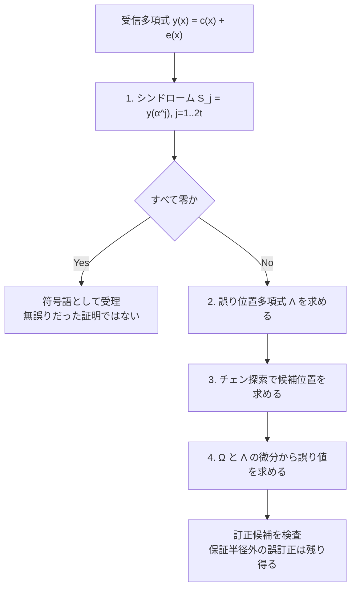
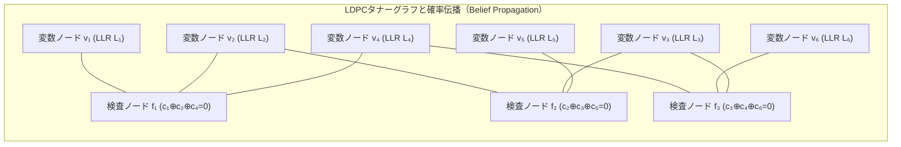
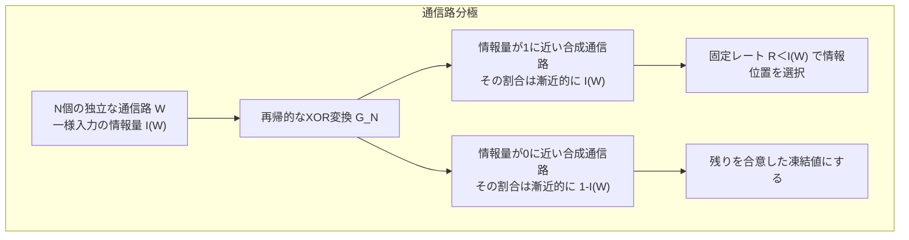

## 1. 導入：深宇宙通信とQRコードに共通する仕組み

深宇宙から届く信号や、一部が汚れたQRコードから、どうして元のデータを取り出せるのでしょうか。鍵になるのは、データに規則的な冗長性を加える<strong>誤り訂正符号（Error-Correcting Codes: ECC）</strong>です。余分な情報を手掛かりに、破損した値を推定・修復します。ただし、どれだけ壊れても復元できるわけではありません。

### 深宇宙通信：微弱な信号を受信し、残った誤りを直す

1977年に打ち上げられたボイジャー1号・2号は木星と土星を訪れ、2号はさらに天王星・海王星へ向かいました。両機が同じ4惑星を巡ったのではありません。以下では惑星探査時の通信を例にし、時々刻々変わる現在の地球からの距離や受信電力を固定値として扱いません。

探査機の高利得アンテナは電波を地球方向へ集中させ、地上の深宇宙通信網（DSN）が微弱な信号を受信します。それでも距離による減衰や熱雑音があり、復調だけではビット誤りが残ります。参考として、電力の単位換算は $10^{-16}\,\mathrm{W}=100\,\mathrm{aW}$ です。これは特定日時・受信局の測定値を示すものではありません。

ボイジャー2号の天王星接近に向けたJPLの報告は、内側の畳み込み符号と外側の $[255,223]$ リード＝ソロモン（RS）符号を組み合わせる方式を説明しています。雑音の影響を段階的に減らす設計であり、画像の全画素やすべての受信ブロックが必ず無誤りになるという保証ではありません。

### QRコード：訂正率は、任意の画像面積を消せる割合ではない

QRコードもRS符号を使います。DENSO WAVEが説明する約7%、15%、25%、30%という復元率は、8ビットの<strong>コード語</strong>を基準にした目安です。「中央の面積を30%ロゴで隠してよい」という意味ではありません。位置検出などに必要なパターン、汚れの分布、RSブロックへの偏り、撮影条件が読み取りを左右します。読み取り時間にも一律10ミリ秒という保証はありません。


本稿では、通信路容量、ハミング距離、有限体上の多項式、グラフ上の確率計算を順に結び付けます。<strong>有限個の誤りを必ず直せるという保証</strong>と、<strong>符号長を大きくすると誤り確率を任意に小さくできるという漸近的な保証</strong>を区別することが出発点です。

---

## 2. クロード・シャノンの1948年革命と「通信路符号化定理」

### 2.1 素朴な反復符号では、信頼性を上げるほど符号化率が下がる

同じビットを何度も送れば、個々の誤りを多数決で取り除けます。しかし、この方法だけでは信頼性を高めるほど情報1ビットに必要な送信回数が増えます。反復符号の限界を、すべての通信方式の限界と取り違えないことが大切です。

最も直感的な<strong>反復符号（Repetition Code）</strong>で計算してみましょう。
送信したい1ビットの情報（$0$ または $1$）が、確率 $p$（ただし $0 < p < 0.5$）で反転してしまう<strong>2元対称通信路（BSC: Binary Symmetric Channel）</strong>を通るとします。エラーを防ぐ最も素朴な方法は、「同じビットを奇数回 $n$ 回繰り返して送り、受信側で<strong>多数決（Majority Voting）</strong>をとる」ことです。

たとえば $n=3$ の反復符号では、情報ビット $k=1$ に対して符号長 $n=3$ の符号語を送ります：
$$0 \mapsto 000, \qquad 1 \mapsto 111$$

受信側で $000$ を送ったにもかかわらず、3ビット中2ビット以上が反転して $011, 101, 110, 111$ のいずれかになった場合、多数決によって誤って「$1$」と復号されてしまいます。そのブロック復号誤り確率 $P_e^{(3)}$ は二項分布から次のようになります：
$$P_e^{(3)} = \binom{3}{2} p^2 (1-p) + \binom{3}{3} p^3 = 3p^2(1-p) + p^3$$

もし通信路のビット誤り率が $p = 0.01$（1%の確率で反転）ならば、$P_e^{(3)} \approx 3 \times 10^{-4} = 0.03\%$ に減ります。しかしその代償として、1ビットの情報を送るために3ビットを費やしたため、<strong>符号化率（Code Rate：1送信ビットあたりの実質情報ビット数）</strong> $R$ は次のように低下します：
$$R = \frac{k}{n} = \frac{1}{3}$$

一般に、奇数 $n = 2t + 1$ 回の反復符号を用いると、$t+1$ 個以上のビットが反転したときに多数決が破綻するため、復号誤り確率 $P_e^{(n)}$ は次式で与えられます：
$$P_e^{(n)} = \sum_{i = (n+1)/2}^{n} \binom{n}{i} p^i (1-p)^{n-i}$$

大数の法則（あるいはチェルノフ限界）により、反復回数 $n \to \infty$ とすれば確かに誤り確率 $P_e^{(n)} \to 0$ へと収束させることができます。<strong>しかし同時に、符号化率 $R = 1/n$ もまた必然的に $0$ へと崩壊してしまいます！</strong>
$$n \to \infty \implies P_e^{(n)} \to 0 \quad \text{だが同時に} \quad R = \frac{1}{n} \to 0$$

この計算が示すのは反復符号という特定の構成の限界です。複数の情報ビットをまとめて符号化する、もっと効率のよい方式まで否定するものではありません。

### 2.2 シャノンの衝撃：通信路容量 $C$ と通信路符号化定理


1948年、クロード・シャノンは『通信の数学的理論』で、雑音のある通信路でも一定の情報レートを保ちながら誤り確率を任意に小さくできることを示しました。

> <strong>通信路符号化定理（有限アルファベットの離散無記憶通信路）</strong><br>
> 遷移確率 $W(y\mid x)$ が定める通信路の容量は $C=\max_{P(X)}I(X;Y)\ge0$（bits/channel use）である。任意の固定レート $0<R<C$ に対し、符号長を大きくするとブロック誤り確率が0へ近づく符号列と復号規則が存在する。$R>C$ では、その誤り確率を0へ収束させられない。

容量は正とは限りません。出力が入力と独立なら $C=0$ です。また、入力コストや電力を制限する場合は、その制約内で最大化します。容量は「雑音の大きさ」だけで一意に決まる値ではありません。

定理は、有限長の一つの符号であらゆる雑音を必ず訂正できるという主張でも、効率的な復号器の存在をそのまま保証するものでもありません。遅延、計算量、目標誤り率を満たす具体的な設計が必要です。

### 2.3 2元対称通信路（BSC）の容量 $C_{\text{BSC}}(p)$ の導出

シャノンは通信路容量 $C$ を、送信確率変数 $X$ と受信確率変数 $Y$ の間の<strong>相互情報量（Mutual Information） $I(X; Y)$</strong> の最大値として定義しました：
$$C = \max_{P(X)} I(X; Y) = \max_{P(X)} \bigl( H(Y) - H(Y \mid X) \bigr)$$

ここで、ビットが確率 $p$ で反転する2元対称通信路（BSC）を考えましょう。入力ビット $X \in \{0, 1\}$ に対し、通信路が加える誤りビットを $E \in \{0, 1\}$（$\Pr(E=1) = p, \Pr(E=0) = 1-p$）とすると、出力は $Y = X \oplus E \pmod 2$ です。
入力 $X$ が与えられたときの条件付きエントロピー $H(Y \mid X)$ は、入力 $X$ の分布によらず、誤りパターンの不確実性すなわち<strong>2値エントロピー関数（Binary Entropy Function） $H_2(p)$</strong> そのものになります：
$$H(Y \mid X) = H_2(p) \triangleq -p \log_2 p - (1-p) \log_2(1-p)$$

一方、出力のエントロピー $H(Y)$ は、$Y$ が2値変数であることから最大でも $1\text{ bit}$ であり、入力分布を等確率 $\Pr(X=0) = \Pr(X=1) = 1/2$ に選んだときに出力も等確率 $\Pr(Y=0) = \Pr(Y=1) = 1/2$ となって最大値 $H(Y) = 1$ を達成します。したがって、2元対称通信路の通信路容量 $C_{\text{BSC}}(p)$ は次の美しい式で表されます：
$$C_{\text{BSC}}(p) = 1 - H_2(p) = 1 + p\log_2 p + (1-p)\log_2(1-p) \quad [\text{bits / channel use}]$$

たとえば、10%ものビットが反転する劣悪な通信路（$p = 0.1$）であっても、
$$H_2(0.1) = -0.1 \log_2(0.1) - 0.9 \log_2(0.9) \approx 0.4690\text{ bits}$$
$$C_{\text{BSC}}(0.1) = 1 - 0.4690 = 0.5310\text{ bits / channel use}$$
となります。したがって $R<0.5310$ の固定レート、たとえば $R=0.5$ なら、十分長い適切な符号を選ぶことで誤り確率を任意に小さくできます。ちょうど容量での有限長無誤りを保証しているのではありません。ランダム符号化の議論は、長いブロック内の雑音の典型的な振る舞いと、符号語を区別できる余地を利用します。

### 2.4 AWGN通信路と、広帯域極限の $-1.59\,\text{dB}$

ボイジャー探査機のような無線通信や深宇宙通信では、信号は離散的なビット反転ではなく、連続的な電波波形に<strong>加法的白色ガウス雑音（AWGN: Additive White Gaussian Noise）</strong>が重畳する通信路を通ります。
帯域幅 $B\text{ [Hz]}$、平均受信信号電力 $S\text{ [W]}$、片側電力スペクトル密度 $N_0\text{ [W/Hz]}$ の白色ガウス雑音電力 $N = N_0 B\text{ [W]}$ のもとで、連続系の通信路容量を与えるのが<strong>シャノン＝ハートレーの定理（Shannon-Hartley Theorem）</strong>です：
$$C_{\text{AWGN}} = B \log_2\!\left(1 + \frac{S}{N}\right) = B \log_2\!\left(1 + \frac{S}{N_0 B}\right) \quad [\text{bits / second}]$$

ここから、平均電力制約を持つこのAWGNモデルでのエネルギー効率の下限を導きます。変調方式を限定しない容量式であり、2値入力などの制約を加えた場合の容量とは区別します。
1情報ビットを送るのに必要なエネルギーを $E_b\text{ [J/bit]}$、情報伝送速度を $R\text{ [bits/s]}$ とすると、信号電力は $S = E_b R$ と書けます。これを上式に代入し、信頼できる通信が可能な条件 $R < C_{\text{AWGN}}$ を整理します：
$$R < B \log_2\!\left(1 + \frac{E_b}{N_0} \frac{R}{B}\right)$$

ここで $\eta \triangleq R / B\text{ [bits/s/Hz]}$（周波数利用効率 / スペクトル効率）とおくと、
$$\eta < \log_2\!\left(1 + \eta \frac{E_b}{N_0}\right) \iff 2^\eta - 1 < \eta \frac{E_b}{N_0} \iff \frac{E_b}{N_0} > \frac{2^\eta - 1}{\eta}$$

この理想モデルで、スペクトル効率を下げて1情報ビットあたりの受信エネルギーを節約する場合（$\eta = R/B \to 0$ の極限）を考えます。ロピタルの定理（または指数関数のテイラー展開 $2^\eta = e^{\eta \ln 2} = 1 + \eta \ln 2 + O(\eta^2)$）を用いると、次の極限値が得られます：
$$\lim_{\eta \to 0} \frac{2^\eta - 1}{\eta} = \ln 2 \approx 0.693147$$

これをデシベル（$\text{dB}$）で表すと、広帯域極限の下限になります：
$$\left(\frac{E_b}{N_0}\right)_{\min} = \ln 2 \approx 0.6931 \implies 10 \log_{10}(\ln 2) \approx \mathbf{-1.5917\,\text{dB}}$$

この値は $\eta\to0$ における<strong>下限（infimum）</strong>です。正のスペクトル効率では必要な比は $(2^\eta-1)/\eta>\ln2$ となります。$E_b/N_0$ はエネルギー同士の比に相当し、受信信号電力と帯域全体の雑音電力の比 $S/N$ とは異なります。「信号が雑音より小さい」とだけ言い換えると、この違いを見失います。

さらに、容量に近づくには符号長や遅延などの代償があります。このモデルの漸近的な結果を、すべての物理通信路に共通する絶対定数や、有限時間での必ず無誤りな通信と解釈することはできません。

---

## 3. リチャード・ハミングの1950年の幾何学的突破：ハミング距離と $[7, 4, 3]$ 完全符号


### 3.1 存在定理から具体的な符号へ

シャノンの存在定理を実用に結び付けるには、符号化と復号を計算できる構成が必要です。リチャード・ハミングの1950年の仕事は、その代表例です。情報ビットにパリティを追加し、パリティの不一致から1ビット誤りの位置を求めます。以下では $[7,4,3]$ 符号を、距離と行列の両方から構成します。

### 3.2 $n$ 次元超立方体 $\mathbb{F}_2^n$ 上のハミング距離と最小距離 $d_{\min}$

長さ $n$ のすべての2進ビット列の集合を、2元体 $\mathbb{F}_2 = \{0, 1\}$ 上の $n$ 次元ベクトル空間（幾何学的には $2^n$ 個の頂点を持つ <strong>$n$ 次元超立方体 Hypercube</strong>） $\mathbb{F}_2^n$ とみなします。

2つのベクトル $\mathbf{u} = (u_1, \dots, u_n)$ と $\mathbf{v} = (v_1, \dots, v_n) \in \mathbb{F}_2^n$ に対し、<strong>ハミング距離 $d_H(\mathbf{u}, \mathbf{v})$</strong> を「対応する座標のうち値が異なるビットの個数」として定義します：
$$d_H(\mathbf{u}, \mathbf{v}) \triangleq \bigl|\{ i \in \{1, \dots, n\} \mid u_i \neq v_i \}\bigr| = w_H(\mathbf{u} - \mathbf{v})$$
ここで $w_H(\mathbf{x}) = |\{i \mid x_i \neq 0\}|$ は非ゼロ成分の個数を与える<strong>ハミング重み（Hamming Weight）</strong>です。ハミング距離は非負性・対称性・三角不等式 $d_H(\mathbf{u}, \mathbf{w}) \le d_H(\mathbf{u}, \mathbf{v}) + d_H(\mathbf{v}, \mathbf{w})$ をすべて満たす厳密な距離空間（Metric Space）をなします。

全空間 $\mathbb{F}_2^n$（$2^n$ 個の頂点）の中から、実際に送信を許可する $M = 2^k$ 個の特別な頂点だけを選び出した部分集合 $\mathcal{C} \subset \mathbb{F}_2^n$ を<strong>符号（Code）</strong>と呼び、その要素 $\mathbf{c} \in \mathcal{C}$ を<strong>符号語（Codeword）</strong>と呼びます。このとき、符号 $\mathcal{C}$ の性能を決定づける最重要パラメータが<strong>最小ハミング距離（Minimum Distance） $d_{\min}$</strong> です：
$$d_{\min}(\mathcal{C}) \triangleq \min_{\substack{\mathbf{u}, \mathbf{v} \in \mathcal{C} \\ \mathbf{u} \neq \mathbf{v}}} d_H(\mathbf{u}, \mathbf{v})$$
特に $\mathcal{C}$ が線形部分空間（<strong>線形符号 Linear Code</strong>：任意の $\mathbf{u}, \mathbf{v} \in \mathcal{C}$ に対して $\mathbf{u} + \mathbf{v} \in \mathcal{C}$）である場合、$\mathbf{u} - \mathbf{v}$ もまた非ゼロの符号語となるため、最小距離は<strong>「ゼロベクトル以外の符号語の最小ハミング重み」</strong>に一致します：
$$d_{\min}(\mathcal{C}) = \min_{\mathbf{c} \in \mathcal{C} \setminus \{\mathbf{0}\}} w_H(\mathbf{c})$$

### 3.3 ハミング球のパッキングによる誤り検出・消失訂正・誤り訂正能力の証明

なぜ最小距離 $d_{\min}$ が大きいほど強い誤り訂正ができるのでしょうか？超立方体 $\mathbb{F}_2^n$ 内に、各符号語 $\mathbf{c} \in \mathcal{C}$ を中心とする<strong>半径 $t$ のハミング球（Hamming Sphere）</strong> $B_t(\mathbf{c}) = \{\mathbf{y} \in \mathbb{F}_2^n \mid d_H(\mathbf{c}, \mathbf{y}) \le t\}$ を描くことで、3つの基本能力が幾何学的に証明されます。

1. <strong>誤り検出能力（Error Detection）：$d_{\min} - 1$ 個まで検出可能</strong>
   符号語間の最小距離が $d_{\min}$ であるとき、ある符号語 $\mathbf{c}$ から $1$ 個以上 $d_{\min} - 1$ 個以下のビットが反転しても、受信語 $\mathbf{y}$ は決して別の符号語 $\mathbf{c}'$ に一致することはありません（一致するには最低 $d_{\min}$ 個の反転が必要）。したがって、受信語 $\mathbf{y} \notin \mathcal{C}$ であることをチェックするだけで、<strong>高々 $d_{\min} - 1$ 個のあらゆるビット誤りを100%確実に検出</strong>できます。
2. <strong>消失訂正能力（Erasure Correction）：$e = d_{\min} - 1$ 個まで復元可能</strong>
   「どの座標が欠損したか（位置）」は分かっているが、その値（$0$ か $1$ か）だけが不明である状態を<strong>消失（Erasure：たとえばパケットロスや破損セクタ）</strong>と呼びます。異なる2つの符号語は少なくとも $d_{\min}$ 箇所の座標で異なる値を持つため、たとえ $e \le d_{\min} - 1$ 箇所の座標が消え去っても、<strong>残りの $n - e$ 箇所の既知座標だけで一致する符号語はただ1つに絞られます</strong>。よって最大 $d_{\min} - 1$ 個の消失を完全に復元できます。
3. <strong>任意誤り訂正能力（Error Correction）：$t = \lfloor(d_{\min}-1)/2\rfloor$ 個まで訂正可能</strong>
   どのビットが反転したか位置すら分からない場合、受信語 $\mathbf{y}$ を「最もハミング距離が近い符号語 $\hat{\mathbf{c}} = \arg\min_{\mathbf{c}\in\mathcal{C}} d_H(\mathbf{y}, \mathbf{c})$」へと復号（最近傍復号）します。このとき、任意の2つの異なる符号語 $\mathbf{c}_1, \mathbf{c}_2$ を中心とする半径 $t$ のハミング球 $B_t(\mathbf{c}_1)$ と $B_t(\mathbf{c}_2)$ が<strong>互いに重ならない（Disjoint：$B_t(\mathbf{c}_1) \cap B_t(\mathbf{c}_2) = \emptyset$）</strong>ための必要十分条件は、三角不等式より：
   $$2t + 1 \le d_{\min} \iff t \le \left\lfloor \frac{d_{\min} - 1}{2} \right\rfloor$$
   です。等号の $t=\lfloor(d_{\min}-1)/2\rfloor$ は最大の保証半径を表します。位置未知の誤りが高々 $t$ 個、位置既知の消失が高々 $e$ 個ある場合、すべての配置について一意復元を保証する条件は次の不等式です：
   $$\mathbf{d_{\min} \ge 2t + e + 1}$$
   消失した座標を除くと符号語間の距離は少なくとも $d_{\min}-e$ なので、残った座標で半径 $t$ の球が交わらないことから従います。この保証範囲を超えても復元できる個別の受信語はありますが、すべての誤り配置を一意に直すことは保証できません。

さらに、半径 $t$ のハミング球1個が含む頂点の個数は $\sum_{i=0}^t \binom{n}{i}(q-1)^i$ 個（$q$ 元体の場合）であり、$|\mathcal{C}|$ 個の互いに素な球の総体積は全空間の要素数 $q^n$ を超えることができないため、符号理論の最も基本的な上界である<strong>ハミング限界（球充填限界 / Sphere-Packing Bound）</strong>が導かれます：
$$|\mathcal{C}| \cdot \sum_{i=0}^{t} \binom{n}{i} (q-1)^i \le q^n \quad \left(\text{2元符号では } 2^k \sum_{i=0}^{t} \binom{n}{i} \le 2^n \right)$$

この不等式で等号が成立し、半径 $t$ の球が空間を隙間も重なりもなく覆う符号を<strong>完全符号（Perfect Code）</strong>と呼びます。ハミング符号や、2元 $[23,12,7]$・3元 $[11,6,5]$ のゴレイ符号が代表例です。完全符号の分類には線形性やパラメータなどの条件があり、非線形の例もあるため、「すべての完全符号がこの二つの具体的構成に限られる」とは言えません。ゴレイ符号の例を、そのままボイジャーの採用符号の説明に結び付けることもしません。

### 3.4 ハミング $(7,4)$ 符号の生成行列 $\mathbf{G}$・検査行列 $\mathbf{H}$・シンドローム復号

ハミングが1950年に構築した $[n, k, d_{\min}] = [7, 4, 3]$ 符号は、$k=4$ ビットの情報 $\mathbf{m} = (m_1, m_2, m_3, m_4)$ に $n-k = 3$ ビットのパリティ検査ビット $(p_1, p_2, p_3)$ を付加して $n=7$ ビットの符号語 $\mathbf{c}$ を作る線形符号です。ハミング限界の左辺を計算すると：
$$2^4 \sum_{i=0}^{1} \binom{7}{i} = 16 \times (1 + 7) = 16 \times 8 = 128 = 2^7$$
となり、見事に等号が成立する<strong>$t=1$ 誤り訂正の完全符号</strong>となっています。

ハミング $(7,4)$ 符号の最もエレガントな構成法は、<strong>パリティ検査行列（Parity-Check Matrix） $\mathbf{H}_{3\times 7}$ の第 $j$ 列（$j=1, 2, \dots, 7$）に、整数 $j$ の3ビット2進数表現そのものを並べる</strong>というアイデアです：
$$\mathbf{H}_{\text{binary}} = \begin{pmatrix}
0 & 0 & 0 & 1 & 1 & 1 & 1 \\
0 & 1 & 1 & 0 & 0 & 1 & 1 \\
1 & 0 & 1 & 0 & 1 & 0 & 1
\end{pmatrix}
\begin{matrix}
\leftarrow 2^2\text{ の位} \\
\leftarrow 2^1\text{ の位} \\
\leftarrow 2^0\text{ の位}
\end{matrix}$$
（列ベクトルが左から順に $1=(001)^T, 2=(010)^T, 3=(011)^T, 4=(100)^T, 5=(101)^T, 6=(110)^T, 7=(111)^T$ に対応しています。）

また、実用上よく使われる<strong>組織符号（Systematic Code：前半4ビットに元のメッセージ $\mathbf{m}$ がそのまま現れ、後半3ビットにパリティ $\mathbf{p}$ が付く形式）</strong>として書く場合は、列を入れ替えて $\mathbf{G}_{4\times 7} = [\mathbf{I}_4 \mid \mathbf{P}]$、$\mathbf{H}_{3\times 7} = [\mathbf{P}^T \mid \mathbf{I}_3]$（$\mathbb{F}_2$ 上では $-\mathbf{P}^T = \mathbf{P}^T$）と定義します：
$$\mathbf{G}_{4\times 7} = \left(\begin{array}{cccc|ccc}
1 & 0 & 0 & 0 & 1 & 1 & 0 \\
0 & 1 & 0 & 0 & 1 & 0 & 1 \\
0 & 0 & 1 & 0 & 0 & 1 & 1 \\
0 & 0 & 0 & 1 & 1 & 1 & 1
\end{array}\right), \qquad
\mathbf{H}_{3\times 7} = \left(\begin{array}{cccc|ccc}
1 & 1 & 0 & 1 & 1 & 0 & 0 \\
1 & 0 & 1 & 1 & 0 & 1 & 0 \\
0 & 1 & 1 & 1 & 0 & 0 & 1
\end{array}\right)$$

すべての符号語 $\mathbf{c} = \mathbf{m}\mathbf{G}$ は、$\mathbb{F}_2$ 上で $\mathbf{G}\mathbf{H}^T = \mathbf{P} \oplus \mathbf{P} = \mathbf{0}$ を満たすため、恒等的に次の直交条件（パリティ検査方程式）を満たします：
$$\mathbf{H}\mathbf{c}^T = \mathbf{0} \pmod 2$$

さて、送信された符号語 $\mathbf{c}$ に通信路で誤りベクトル $\mathbf{e} \in \mathbb{F}_2^7$ が加わり、受信側が $\mathbf{y} = \mathbf{c} + \mathbf{e}$ を受け取ったとしましょう。受信機は $\mathbf{y}$ に検査行列 $\mathbf{H}$ を掛けて、3ビットの<strong>シンドローム（Syndrome：症状ベクトル） $\mathbf{s}$</strong> を計算します：
$$\mathbf{s} = \mathbf{H}\mathbf{y}^T = \mathbf{H}(\mathbf{c} + \mathbf{e})^T = \underbrace{\mathbf{H}\mathbf{c}^T}_{=\mathbf{0}} + \mathbf{H}\mathbf{e}^T = \mathbf{H}\mathbf{e}^T \pmod 2$$

この式が持つ威力に注目してください！シンドローム $\mathbf{s}$ は、<strong>送信されたメッセージ $\mathbf{c}$ が何であったかに一切依存せず、純粋にエラー $\mathbf{e}$ のみに依存</strong>します。
もし第 $j$ ビット目ただ1つだけが反転していた場合（すなわち $\mathbf{e} = (0, \dots, 0, \underset{j\text{番目}}{1}, 0, \dots, 0)$ の単位ベクトル）、行列とベクトルの積 $\mathbf{H}\mathbf{e}^T$ は、<strong>行列 $\mathbf{H}$ の第 $j$ 列ベクトルそのもの</strong>を取り出します！

先ほどの2進数順の検査行列 $\mathbf{H}_{\text{binary}}$ を使っていれば、計算された3ビットのシンドローム $\mathbf{s} = (s_2, s_1, s_0)^T$ をそのまま2進数の数値として読むだけで、
- $\mathbf{s} = (0,0,0)^T \implies$ <strong>受信語は符号に属する</strong>（誤りが高々1個という前提なら誤りなし）
- $\mathbf{s} = (1,0,1)^T \implies 101_2 = 5 \implies$ <strong>第5ビット目が反転している！</strong>

と誤り位置を読み取れます。一方、組織形の $\mathbf H$ では列順が違うので、シンドロームと一致する列を調べます。第6節の実装はこちらを使います。固定の7ビット回路なら位置参照は定数サイズですが、一般の長さ $n$ の符号でシンドローム計算まで無条件に $O(1)$ となるわけではありません。

2個以上の誤りでは、別の列を示して誤訂正することがあります。零シンドロームも「通信路で何も壊れなかった」証拠ではなく、誤りが別の符号語へ移した可能性が残ります。

全体の偶数パリティを1ビット加えると $[8,4,4]$ の拡張ハミング符号になり、適切な復号規則で1ビット訂正・2ビット検出（SECDED）が可能です。これはECCメモリの考え方を理解する基本例ですが、すべてのメモリ製品が同じ符号・回路を採用しているという意味ではありません。

---

## 4. リードとソロモンの1960年の最高傑作：ガロア体 $\mathbb{F}_{2^m}$ 上のリード＝ソロモン（RS）符号

### 4.1 なぜハミング符号では「傷」や「汚れ（バースト誤り）」に勝てないのか？

ハミング $(7,4)$ 符号は、位置を問わず1ブロック中の1ビット誤りを訂正できます。しかし複数ビットをまとめて壊す誤りには、別の設計が必要です。
CDやDVDの表面についた1ミリの引っかき傷、QRコードの上に落ちたコーヒーの雫、あるいはフェージングによる無線通信の瞬断は、1ビットだけではなく<strong>連続する数十〜数百ビットを一気に破壊する「バースト誤り（Burst Errors）」</strong>を引き起こします。ハミング $(7,4)$ 符号で同じブロック中の2ビットが壊れると、単一誤りを前提にした復号器は別のビットを反転して誤訂正します。3ビット以上でも正しく直せるとは限りません。

この壁を打ち破るため、1960年にMITリンカーン研究所の<strong>アーヴィング・リード（Irving S. Reed）</strong>と<strong>ギュスターヴ・ソロモン（Gustave Solomon）</strong>が発表したのが、<strong>リード＝ソロモン符号（Reed-Solomon Codes: RS符号）</strong>です。

### 4.2 ガロア体（有限体） $\mathbb{F}_{2^m}$ による「ビットの束（シンボル）」の代数化

リードとソロモンの第一の着眼点は、<strong>「0と1の単一ビット（$\mathbb{F}_2$）単位で考えるのをやめ、連続する $m$ ビット（たとえば $m=8$ ビット＝1バイト）をひとまとめにした『1つの数値（シンボル）』として扱い、加減乗除が自由にできる有限体（ガロア体 $\mathbb{F}_{2^m}$）の上で符号を組めばよいではないか！」</strong>というものでした。

なぜ通常の整数 $\bmod 256$ ではいけないのでしょうか？$\mathbb{Z}/256\mathbb{Z}$ では、たとえば $2 \times 128 \equiv 0 \pmod{256}$ となってしまい（零因子の存在）、割り算（逆元）が定義できないため、連立一次方程式や多項式補間が一意に解けなくなってしまいます。
有限体の基本的な存在定理によれば、要素数 $q$ の有限体（四則演算が完全に閉じており、0以外のすべての要素が乗法逆元を持つ代数系）が存在するための必要十分条件は、$q = p^m$（素数 $p$ のべき乗）であることです。

バイト単位の符号でよく使う $q = 2^8 = 256$ のガロア体 $\text{GF}(2^8) = \mathbb{F}_{2^8}$ は、2元体 $\mathbb{F}_2$ 上の<strong>8次の既約多項式（Irreducible Polynomial：それ以上因数分解できない多項式） $p(x)$</strong> を法とする多項式剰余環として構築されます（以下の実装では16進表現 `0x11D` に対応する次の既約多項式を使います）：
$$\mathbb{F}_{2^8} \cong \frac{\mathbb{F}_2[x]}{\langle x^8 + x^4 + x^3 + x^2 + 1 \rangle}$$

このガロア体 $\mathbb{F}_{2^8}$ の中では、1バイト（8ビット：$b_7 b_6 \dots b_1 b_0$）のデータが7次以下の多項式 $b_7 x^7 + \dots + b_1 x + b_0$ に対応し、驚くほど美しい性質を持ちます：
1. <strong>足し算と引き算は単なるビットごとの XOR（排他的論理和）</strong>：係数が $\mathbb{F}_2$ なので $1 + 1 = 0$ となり、繰り上がりも一切発生せず、加法と減法は完全に同一の `a ^ b`（XOR演算）になります。
2. <strong>掛け算と割り算は原始元 $\alpha$ の指数（対数）テーブルで $O(1)$</strong>：非ゼロの255個の要素 $\mathbb{F}_{2^8}^\times$ は巡回群をなすため、ある<strong>原始元（Primitive Element） $\alpha$</strong>（通常は多項式 $x$ すなわち数値 `0x02`）のべき乗 $\alpha^0, \alpha^1, \alpha^2, \dots, \alpha^{254}$ によって<strong>255個すべての非ゼロ要素が重複なく生成</strong>されます（$\alpha^{255} = 1$）。したがって、指数表 `EXP_TABLE` と対数表 `LOG_TABLE` をメモリに置いておけば、任意の2要素 $A = \alpha^i, B = \alpha^j$ の積と商は、指数の足し算・引き算だけで一瞬で求まります：
   $$A \cdot B = \alpha^{(i + j) \bmod 255}, \qquad \frac{A}{B} = \alpha^{(i - j) \bmod 255}$$
   これは非ゼロ要素についての式です。ゼロとの積やゼロによる除算には別処理が必要です。表の長さは実装で異なり、指数表を延長して剰余演算を省く場合もあります。第6節では表ではなくビット演算を使います。

これにより、たとえば1バイト（8ビット）の中に連続して何ビットもの破損が起きても、ガロア体 $\mathbb{F}_{2^8}$ の視点からは<strong>「たった1個のシンボル（1変数）が汚れただけ」</strong>に過ぎなくなります！ただし、バーストがシンボル境界をまたぐと複数シンボルが壊れます。配置とインターリーブも重要です。

### 4.3 代数学の奇跡：有限体上の多項式補間とシングルトン限界の達成（MDS性）

リードとソロモンの第二の（そして最大の）着眼点は、高校数学でも馴染み深い<strong>「多項式の一意性」</strong>を有限体 $\mathbb{F}_q$ 上に持ち込んだことです。

- 1次関数（直線） $P(x) = m_0 + m_1 x$ は、横座標が異なる<strong>2点</strong>を通ればただ1本に決まります。もしその直線上の5つの点の座標を送れば、途中で<strong>どの3点が消滅しても</strong>、残った2点から元の直線を100%復元できます。
- 2次関数（放物線） $P(x) = m_0 + m_1 x + m_2 x^2$ は、横座標が相異なる<strong>3点</strong>で次数が高々2の多項式としてただ1つに決まります。

これを一般化しましょう。送りたい $k$ 個の情報シンボルを $\mathbf{m} = (m_0, m_1, \dots, m_{k-1}) \in \mathbb{F}_q^k$ とします。これらをそのまま係数として持つ、$\mathbb{F}_q$ 上の<strong>次数が高々 $k-1$ の情報多項式 $P(x)$</strong> を定義します：
$$P(x) \triangleq m_0 + m_1 x + m_2 x^2 + \dots + m_{k-1} x^{k-1} \in \mathbb{F}_q[x]$$

そして、ガロア体 $\mathbb{F}_q$ の中から相異なる $n$ 個の評価点 $\alpha_1, \alpha_2, \dots, \alpha_n \in \mathbb{F}_q$（ただし $k \le n \le q$）を選び、多項式 $P(x)$ をその $n$ 点で評価した値の列をそのまま<strong>符号語 $\mathbf{c}$</strong> として送信します！
$$\mathbf{c} = \bigl( P(\alpha_1),\; P(\alpha_2),\; \dots,\; P(\alpha_n) \bigr) \in \mathbb{F}_q^n$$

ここで使うのは、因数定理を繰り返すことで示せる次の根の個数の上界です：

> <strong>【定理：有限体上の多項式の根の個数とRS符号の最小距離】</strong>
> 体 $\mathbb{F}_q$ 上の次数が高々 $k-1$ の非ゼロ多項式は、$\mathbb{F}_q$ 内に<strong>高々 $k-1$ 個の根（ゼロ点）しか持つことができない</strong>。
> したがって、異なる2つの情報多項式 $P(x) \neq Q(x)$（ともに次数 $\le k-1$）に対し、その差 $D(x) = P(x) - Q(x)$ も次数 $\le k-1$ の非ゼロ多項式であるため、$P(\alpha_i) = Q(\alpha_i)$ となって値が一致する評価点 $\alpha_i$ は<strong>最大でも $k-1$ 個しか存在しない</strong>。
> ゆえに、$n$ 個の評価点のうち<strong>少なくとも $n - (k - 1) = n - k + 1$ 個の座標で必ず値が異なる</strong>！

つまり、$[n, k]$ リード＝ソロモン符号の最小ハミング距離 $d_{\min}$ は、厳密に次式で与えられます：
$$\mathbf{d_{\min} = n - k + 1}$$

符号理論において、いかなる $[n, k, d_{\min}]$ 符号であっても、最初の $d_{\min}-1$ 個の座標を削ぎ落とした長さ $n - (d_{\min} - 1)$ のベクトルがすべて相異ならなければならないことから、必ず $d_{\min} \le n - k + 1$ が成り立ちます。これを<strong>シングルトン限界（Singleton Bound）</strong>と呼びます。
リード＝ソロモン符号は、この理論上の上限 $d_{\min} = n - k + 1$ を<strong>等号で達成する究極の符号——最大距離分離符号（MDS: Maximum Distance Separable Code）</strong>なのです！

MDS符号である $[n,k]$ RS符号の冗長シンボル数を $r=n-k$ とすると、誤り $t$ 個と消失 $e$ 個の保証条件は $2t+e\le r$ です。特に次の二つが得られます：
- <strong>位置が既知の消失（Erasures）なら</strong>：追加したパリティの個数とまったく同じ <strong>$e = n - k$ シンボル</strong>まで100%復元可能！（任意の $k$ 個の生存シンボル $(x_{i_1}, y_{i_1}), \dots, (x_{i_k}, y_{i_k})$ からラグランジュ補間公式
  $$P(x) = \sum_{j=1}^{k} y_{i_j} \prod_{\substack{m=1 \\ m \neq j}}^{k} \frac{x - x_{i_m}}{x_{i_j} - x_{i_m}}$$
  によって元の多項式 $P(x)$ が一意に再構成されるため。）
- <strong>位置が未知の任意誤り（Errors）なら</strong>：各エラーにつき「どの座標が壊れたか（位置）」と「いくらズレたか（誤り値）」の2つの未知数を特定する必要があるため、パリティ数のちょうど半分である <strong>$t = \lfloor (n - k) / 2 \rfloor$ シンボル</strong>まで100%訂正可能！


### 4.4 巡回形の生成多項式と、規約を明示した代数的復号

第4.3節はメッセージを多項式の係数にする評価形です。一方、巡回形では符号語の座標を多項式の係数とみなし、生成多項式の倍数を作ります。非ゼロ評価点をすべて使う長さ $n=q-1$ のRS符号には、座標や係数の対応を定めた等価な巡回表現があります。短縮した符号まで、その長さのまま必ず巡回になるわけではありません。

以下では冗長数 $n-k=2t$、最初の根が $\alpha^1$ という規約を固定します。これはQRコードなどのあらゆる規約を一括して表すものではありません。
$$g(x)=\prod_{j=1}^{2t}(x-\alpha^j)$$
情報多項式 $m(x)$ をシフトし、$r(x)=x^{2t}m(x)\bmod g(x)$ と置けば、
$$c(x)=x^{2t}m(x)-r(x),\qquad c(\alpha^j)=0\quad(1\le j\le2t)$$
となります。標数2では減算もXORです。



1. <strong>シンドローム</strong>：誤りが $\nu\le t$ 箇所 $i_l$ にあり、値を $Y_l=e_{i_l}$、位置に対応する体要素を $X_l=\alpha^{i_l}$ とします。
   $$S_j=y(\alpha^j)=e(\alpha^j)=\sum_{l=1}^{\nu}Y_lX_l^j,\qquad j=1,\ldots,2t$$
   零シンドロームは符号への所属を表すだけです。別の符号語に移る誤りは検出できません。
2. <strong>誤り位置多項式</strong>：
   $$\Lambda(z)=\prod_{l=1}^{\nu}(1-X_lz)=1+\Lambda_1z+\cdots+\Lambda_\nu z^\nu$$
   この定義から、
   $$S_{j+\nu}+\Lambda_1S_{j+\nu-1}+\cdots+\Lambda_\nu S_j=0,\qquad1\le j\le2t-\nu$$
   が得られます。バーレカンプ＝マッシー法は最短の線形漸化式を求め、通常 $O(t^2)$ 回の体演算で候補を作ります。拡張ユークリッド法を用いる方式もあります。
3. <strong>チェン探索</strong>：符号語の座標に対応する非ゼロ要素 $\alpha^{-i}$ を調べ、$\Lambda(\alpha^{-i})=0$ となる位置を探します。GF(256)の非ゼロ要素は255個ですが、体全体はゼロを含む256個です。候補の次数と根の数が一致するかなども検査します。
4. <strong>誤り値</strong>：ここではシンドローム多項式を明示して、
   $$S(z)=S_1+S_2z+\cdots+S_{2t}z^{2t-1},\qquad
   \Omega(z)=S(z)\Lambda(z)\bmod z^{2t}$$
   と置きます。この規約でのフォーニーの式は
   $$Y_l=-\frac{\Omega(X_l^{-1})}{\Lambda'(X_l^{-1})}$$
   です。1誤りなら $\Omega=YX$、$\Lambda'=-X$ なので右辺は $Y$ になります。ここに余分な $X$ を掛けると $XY$ になってしまいます。最初の根や $S(z)$ の定義が異なる資料では因子が変わるため、式だけを移植してはいけません。

求めた誤り値を減算し、符号語への所属や訂正した距離を検査します。それでも、送信語から保証半径を超えて壊れた受信語が別の符号語の近くにあれば誤訂正し得ます。必要に応じてCRCや上位の再送・検査を組み合わせます。


### 4.5 QRコード・RAID-6・ボイジャーへの応用

- <strong>QRコード</strong>：DENSO WAVEが示す復元率の目安は、Lが約7%、Mが約15%、Qが約25%、Hが約30%です。8ビットのコード語を基準にしており、実際には各RSブロックの訂正能力を守る必要があります。バージョンとレベルによってデータ量・冗長量・ブロック分割が変わるため、これを常に同じパリティ比や任意の画像面積に換算できません。ロゴで機能パターンを隠せば、RS復号の前に位置検出やコード語抽出に失敗することもあります。
- <strong>RAID-6と分散ストレージ</strong>：故障位置が分かるドライブやチャンクは消失として扱えます。例えば $[14,10]$ MDS消失訂正符号なら容量倍率は $14/10=1.4$、任意の4チャンク消失を訂正できます。これは説明用の構成で、すべてのクラウド事業者の標準構成ではありません。RAID-6の2重パリティも、残りのデータと必要なメタデータが健全なら2ドライブ故障からの復元を可能にします。追加の潜在破損や装置全体の損傷まで無条件に救えるわけではありません。
- <strong>ボイジャー2号の連接符号</strong>：JPLの1983年の報告は、拘束長 $K=7$・率 $1/2$ の畳み込み符号、深さ4のインターリーブ、$[255,223]$ RS符号を説明しています。外符号の32バイトの冗長性により、1RS語について $2t+e\le32$ を保証できます。誤りだけなら最大16バイトです。「連続128ビットなら配置によらず必ず16シンボル」とは限りません。バイト境界をまたぐ128ビットは17バイトに及ぶこともあります。インターリーブは内側の復号が残すバーストを複数のRS語へ分散します。ここでのボイジャーの内符号をLDPCと呼ぶのは誤りです。

---

## 5. シャノン限界への肉薄：LDPC符号・ターボ符号・Polar符号


### 5.1 距離だけでなく、受信信号の確からしさを使う

実用的な符号には、目標誤り率だけでなく、計算量、符号長、遅延、回路規模の制約があります。符号語をすべて調べる単純な最尤復号は、2元 $[n,k]$ 符号なら候補が $2^k$ 個です。距離のよい符号を作ることと、雑音下で効率よく復号することは別の課題です。

ターボ符号やLDPC符号の反復復号は、受信値の確からしさを交換して復号性能を高めます。Polar符号は別の構成で、対称容量に漸近できることを証明しました。ここで比較する容量限界は、符号化率や入力制約をそろえた通信路のものです。どの符号も広帯域極限の $-1.59\,\mathrm{dB}$ とだけ比較すればよいわけではありません。

### 5.2 ロバート・ギャラガーのLDPC符号（1962年）とタナーグラフ上の確率伝播

ギャラガーの1962年のLDPC符号は、疎な検査行列を使います。その後、ターボ符号やLDPC符号の反復復号が、長い符号を実用的な計算量で扱う有力な方法になりました。

LDPC符号は、パリティ検査行列 $\mathbf{H}_{m \times n}$ が<strong>疎（Sparse）</strong>な線形符号です。数千〜数万ビットなどの長いブロックでも、各行・列の非ゼロ成分数を抑えて計算できます。次元は $k=n-\operatorname{rank}_{\mathbb F_2}(\mathbf H)$ であり、行が独立でなければ $n-m$ とは一致しません。

この疎な検査行列 $\mathbf{H}$ を、2種類の頂点を持つ2部グラフ——<strong>タナーグラフ（Tanner Graph）</strong>として表現します：
- <strong>変数ノード（Variable Nodes $v_1, \dots, v_n$）</strong>：符号語の各ビット $c_j$ に対応（列に対応）。
- <strong>検査ノード（Check Nodes $f_1, \dots, f_m$）</strong>：各パリティ検査式 $\sum_j H_{ij} c_j = 0 \pmod 2$ に対応（行に対応）。
- 行列の成分 $H_{ij} = 1$ のときに限り、変数ノード $v_j$ と検査ノード $f_i$ の間に枝（Edge）を結びます。



軟判定LDPC復号では、受信信号をいきなり「$0$ か $1$ か」に丸め込む代わりに、受信電圧 $y_i$ から「そのビットが $0$ である確率と $1$ である確率の比の対数」である<strong>対数尤度比（LLR: Log-Likelihood Ratio）</strong>を連続値（軟判定 Soft Decision）として保持します：
$$L(c_i) \triangleq \ln \frac{\Pr(c_i = 0 \mid y_i)}{\Pr(c_i = 1 \mid y_i)}$$
等確率の入力、BPSKの対応 $0\mapsto+1,1\mapsto-1$、独立雑音 $Z\sim\mathcal N(0,\sigma^2)$、観測 $y_i=x_i+Z$ の場合は
$$L_{\mathrm{ch}}(c_i)=\ln\frac{p(y_i\mid c_i=0)}{p(y_i\mid c_i=1)}=\frac{2y_i}{\sigma^2}$$
です。振幅や事前確率が違えば式も変わります。
（$L(c_i) = +10$ なら「ほぼ確実に $0$」、$L(c_i) = -0.1$ なら「ほんのわずかに $1$ っぽいが極めて曖昧」という確信度を表します。）

そして、タナーグラフの枝に沿って、変数ノードと検査ノードが互いの確信度メッセージをキャッチボールのように反復交換する<strong>確率伝播法（Belief Propagation / Sum-Product Algorithm）</strong>を実行します：
1. <strong>検査ノードから変数ノードへのメッセージ $\mu_{f_a \to v_i}$</strong>：「あなた以外の隣接ビットたちの確信度から計算すると、パリティを偶数にするためにあなたが $0$ であるべき対数尤度比はこれだけです」というメッセージを、双曲線正接関数（$\tanh$ 則）によって伝えます：
   $$\mu_{f_a \to v_i} = 2 \operatorname{artanh}\!\left( \prod_{v_j \in N(f_a) \setminus \{v_i\}} \tanh\!\left(\frac{\mu_{v_j \to f_a}}{2}\right) \right)$$
2. <strong>変数ノードから検査ノードへのメッセージ $\mu_{v_i \to f_a}$</strong>：「通信路から直接受け取った自分の初期LLR $L_{\text{ch}}(v_i)$ に、他のすべての検査ノードから届いた助言を足し合わせると、私の最新の確信度はこれです」と返答します：
   $$\mu_{v_i \to f_a} = L_{\text{ch}}(v_i) + \sum_{f_b \in N(v_i) \setminus \{f_a\}} \mu_{f_b \to v_i}$$

疎な行列は枝数を抑えますが、疎であるだけで短いサイクルが消えるわけではありません。木なら確率伝播は正確な周辺確率を計算できますが、ループを持つ有限グラフではメッセージの依存が生じ、収束や成功は保証されません。トラッピングセットなどによって誤りが残る場合もあります。

枝数を $E$ とすると、近傍への計算を共有する実装の1反復の演算量は概ね $O(E)$、$I$ 反復なら $O(IE)$ です。次数を一定に抑えて $E=O(n)$ としても、必要反復数を無条件に一定とみなすことはできません。数値実装ではLLRの飽和や $\operatorname{artanh}$ の定義域にも注意します。

Chung・Forney・Richardson・Urbankeの2001年の論文は、<strong>率 $1/2$ の2値入力AWGN通信路</strong>について、密度進化で求める漸近的なしきい値が、その通信路の容量限界から0.0045 dB以内の設計を報告しています。同じ論文の有限長シミュレーションの例は、より単純な設計・長さ $10^7$・BER $10^{-6}$ で差0.04 dBです。二つの結果や、広帯域下限を混同してはいけません。


### 5.3 Polar符号：対称容量への漸近的な到達

アリカンの2009年のPolar符号は、2元入力離散無記憶通信路 $W$ の<strong>対称容量 $I(W)$</strong>、すなわち入力を等確率にした相互情報量へ漸近する構成です。対称通信路なら $I(W)=C$ ですが、一般の非対称通信路では入力分布を最適化した容量 $C$ と一致するとは限りません。

基本変換は
$$(x_1,x_2)=(u_1,u_2)\begin{pmatrix}1&0\\1&1\end{pmatrix}
=(u_1\oplus u_2,u_2)$$
です。$W^-$ は $(y_1,y_2)$ から $u_1$ を推定し、$W^+$ は正しい $u_1$ を追加して $(y_1,y_2,u_1)$ から $u_2$ を推定する合成通信路です。一様で独立な入力について連鎖則から
$$I(W^-)+I(W^+)=2I(W),\qquad I(W^-)\le I(W)\le I(W^+)$$
となります。「良化・劣化」はこの情報量の意味であり、常に厳密な不等号になるわけではありません。実際の逐次復号では、先行ビットを誤ると、その誤りが後続へ伝播することもあります。

変換を $N=2^m$ へ繰り返す生成行列は、ビット反転順列 $\mathbf B_N$ を使う規約で
$$\mathbf G_N=\mathbf B_N
\begin{pmatrix}1&0\\1&1\end{pmatrix}^{\otimes m}$$
です。任意の固定した $0<\delta<1$ に対し、$N\to\infty$ で情報量が $1-\delta$ を超える合成通信路の割合は $I(W)$ へ、$\delta$ 未満の割合は $1-I(W)$ へ近づきます。有限の $N$ でちょうど $NI(W)$ 本が完全無雑音になるのではありません。



固定レート $R<I(W)$ で情報位置を選び、残りを既知の凍結ビットにします。原論文の一般通信路での保証は凍結値についての平均・適切な値の存在を使い、対称通信路では任意の固定凍結値にも対応する保証があります。

符号化と<strong>逐次除去復号（SC）</strong>の計算量は $O(N\log N)$ です。これは情報位置を決める符号構成の費用とは別です。リストサイズ $L$ の<strong>SCL復号</strong>では通常 $O(LN\log N)$ の時間が必要で、CRCを組み合わせて候補を選ぶ方式もあります。有限長の誤り率や遅延は、レート、構成、リストサイズ、通信路によって変わります。

### 5.4 主要な誤り訂正符号の体系的比較

これまで解説してきた誤り訂正符号の数学的基盤、復号アルゴリズム、および現代社会での主な応用先を一覧表にまとめます。


| 符号 | 数学的な構造 | 代表的な復号 | 主な特徴・用途 |
| :--- | :--- | :--- | :--- |
| ハミング符号（1950、Hamming） | 2元線形符号、$[7,4,3]$ は完全符号 | シンドロームと列の対応 | 1ビット訂正。SECDEDを理解する基本例 |
| RS符号（1960、Reed・Solomon） | 有限体上の多項式、MDS性 | BM/ユークリッド法、チェン探索、フォーニー法。評価形ではWelch–Berlekamp法など | シンボル誤り・消失。QR、保存データ、深宇宙の連接符号 |
| 畳み込み符号・ターボ符号 | トレリス、連接とインターリーブ | ビタビ復号、BCJRなどの反復復号 | 雑音を含む通信。ボイジャーの内符号は畳み込み符号 |
| LDPC（1962、Gallager） | 疎な検査行列、タナーグラフ | 軟判定の確率伝播など | 長いブロックと並列化に向く。特定の率・通信路で容量近傍の設計 |
| Polar（2009、Arıkan） | 再帰的な分極変換、凍結ビット | SC $O(N\log N)$、SCLはリストサイズ依存 | 対称容量に漸近。5G NRの所定の制御情報の符号化 |

同じ行にある手法がすべて同じ計算量・誤り率を持つわけではありません。5G NRの制御情報もすべてPolarではありません。例えば3GPP TS 38.212 v19.3.0の6.3.1.2–6.3.1.3は、PUCCH上のUCIについて、ペイロード $A\ge12$ と $A\le11$ でPolarと小ブロック長用の符号化を使い分けています。

---


## 6. Pythonによる実装検証：ハミング符号とGF(256)の評価RS符号

次のPython 3コードは、組織形のハミング $(7,4)$ 符号と、第4.3節の<strong>評価形RS符号</strong>を実装します。後者ではメッセージが多項式の係数になり、一般に符号語の先頭へそのまま現れません。第4.4節のBM復号器や、QRのビット配置・ブロック分割・巡回組織形を実装したものではなく、QRや探査機との相互運用はできません。

体は $\mathrm{GF}(256)$、既約多項式は `0x11D` です。整数を257で割った余りを使う素体 $\mathrm{GF}(257)$ とは異なります。GF(257)でも評価符号は作れますが、値256も現れるので、すべてを1バイトのまま保存できません。

復号にはWelch–Berlekamp型の連立方程式を使います。誤り数の候補 $\nu=0,\ldots,t$ ごとに、モニックな $E(x)$（次数 $\nu$）と $Q(x)$（次数 $<k+\nu$）について
$$Q(x_i)=y_iE(x_i)\qquad(i=1,\ldots,n)$$
を解きます。未知数は $k+2\nu$ 個です。GF(256)では加減算が同じなので、未知係数を左辺へ移した式もコード中のXORで書けます。

真の情報多項式を $P$ とし、誤りが高々 $\nu$ 個なら、誤り位置を根とする $E$ を使って $Q=PE$ を構成できます。さらに $n\ge k+2\nu$ なら、どの解についても $Q-PE$ は少なくとも $n-\nu$ 点で零となり、その次数は $k+\nu$ 未満なので零多項式です。この根の個数の議論が復元の根拠です。実装は実際の誤り数まで候補を試し、階数不足も扱います。

$Q$ を $E$ で割った余りが零か、商の次数が $k$ 未満かを検査し、再符号化して受信語からの距離が $t$ 以下かも調べます。これは「誤りがちょうど $t$ 個」の場合にしか動かない作りを避け、誤りなしや少数の誤りも扱うためです。評価点は相異なる体要素を1～256個選べ、ゼロも使えます。

コードは読みやすさを優先し、最大 $t+1$ 回の一般的なガウス消去を使います。高速な実用RS復号器や、実行時間のベンチマークとして示すものではありません。公開関数 `rs_encode`・`rs_decode` は入力値・長さ・評価点・訂正半径を検査します。内部の多項式・線形代数ヘルパーは、検査済みの体要素を扱う前提です。

```python
"""Educational evaluation RS over GF(256), not a QR parser or wire format."""
from itertools import product


def field_value(a):
    if type(a) is not int or not 0 <= a < 256:
        raise ValueError("Field elements must be integers from 0 through 255")
    return a


def gf_mul(a, b):
    field_value(a)
    field_value(b)
    result = 0
    for _ in range(8):
        if b & 1:
            result ^= a
        b >>= 1
        a <<= 1
        if a & 256:
            a ^= 0x11D
    return result


def gf_pow(a, exponent):
    field_value(a)
    if type(exponent) is not int or exponent < 0:
        raise ValueError("Exponent must be a nonnegative integer")
    result = 1
    while exponent:
        if exponent & 1:
            result = gf_mul(result, a)
        a = gf_mul(a, a)
        exponent >>= 1
    return result


def gf_inv(a):
    field_value(a)
    if a == 0:
        raise ZeroDivisionError("Zero has no multiplicative inverse")
    return gf_pow(a, 254)


def poly_trim(coefficients):
    result = list(coefficients)
    while result and result[-1] == 0:
        result.pop()
    return result


def poly_eval(coefficients, x):
    result = 0
    for coefficient in reversed(coefficients):
        result = gf_mul(result, x) ^ coefficient
    return result


def poly_divmod(numerator, denominator):
    remainder = poly_trim(numerator)
    denominator = poly_trim(denominator)
    if not denominator:
        raise ZeroDivisionError("Zero polynomial divisor")
    quotient = [0] * max(0, len(remainder) - len(denominator) + 1)
    inverse_lead = gf_inv(denominator[-1])
    while remainder and len(remainder) >= len(denominator):
        degree = len(remainder) - len(denominator)
        factor = gf_mul(remainder[-1], inverse_lead)
        quotient[degree] = factor
        for j, coefficient in enumerate(denominator):
            remainder[degree + j] ^= gf_mul(factor, coefficient)
        remainder = poly_trim(remainder)
    return poly_trim(quotient), remainder


def solve_linear_system(rows, rhs, columns):
    """Return one solution (free variables zero), or None if inconsistent."""
    if len(rows) != len(rhs) or any(len(row) != columns for row in rows):
        raise ValueError("Linear-system dimensions do not match")
    matrix = [list(row) + [value] for row, value in zip(rows, rhs)]
    pivot_columns = []
    pivot_row = 0
    for column in range(columns):
        pivot = next(
            (r for r in range(pivot_row, len(matrix)) if matrix[r][column]),
            None,
        )
        if pivot is None:
            continue
        matrix[pivot_row], matrix[pivot] = matrix[pivot], matrix[pivot_row]
        inverse = gf_inv(matrix[pivot_row][column])
        matrix[pivot_row] = [gf_mul(value, inverse) for value in matrix[pivot_row]]
        for r in range(len(matrix)):
            if r != pivot_row and matrix[r][column]:
                factor = matrix[r][column]
                matrix[r] = [
                    a ^ gf_mul(factor, b)
                    for a, b in zip(matrix[r], matrix[pivot_row])
                ]
        pivot_columns.append(column)
        pivot_row += 1
        if pivot_row == len(matrix):
            break
    if any(not any(row[:columns]) and row[columns] for row in matrix):
        return None
    solution = [0] * columns
    for r, column in enumerate(pivot_columns):
        solution[column] = matrix[r][columns]
    return solution


def check_points(points):
    points = list(points)
    if not points or len(points) > 256:
        raise ValueError("Use from 1 through 256 distinct evaluation points")
    for x in points:
        field_value(x)
    if len(set(points)) != len(points):
        raise ValueError("Evaluation points must be distinct")
    return points


def rs_encode(message, points):
    points = check_points(points)
    message = list(message)
    if not 1 <= len(message) <= len(points):
        raise ValueError("Require 1 <= message length <= code length")
    for value in message:
        field_value(value)
    return [poly_eval(message, x) for x in points]


def rs_decode(received, points, k, max_errors):
    points = check_points(points)
    received = list(received)
    n = len(points)
    if len(received) != n:
        raise ValueError("Received length must match evaluation points")
    if type(k) is not int or not 1 <= k <= n:
        raise ValueError("Require integer 1 <= k <= n")
    if type(max_errors) is not int or max_errors < 0 or k + 2 * max_errors > n:
        raise ValueError("Require integer t >= 0 and k + 2t <= n")
    for value in received:
        field_value(value)
    # Try locator degrees 0,...,t: fewer than t errors must also work.
    for errors in range(max_errors + 1):
        columns = k + 2 * errors
        rows, rhs = [], []
        for x, y in zip(points, received):
            powers = [gf_pow(x, degree) for degree in range(k + errors)]
            rows.append(
                powers + [gf_mul(y, gf_pow(x, degree)) for degree in range(errors)]
            )
            rhs.append(gf_mul(y, gf_pow(x, errors)))
        solution = solve_linear_system(rows, rhs, columns)
        if solution is None:
            continue
        q = solution[:k + errors]
        locator = solution[k + errors:] + [1]
        message, remainder = poly_divmod(q, locator)
        if remainder or len(message) > k:
            continue
        message += [0] * (k - len(message))
        codeword = rs_encode(message, points)
        distance = sum(a != b for a, b in zip(codeword, received))
        if distance <= max_errors:
            return message
    raise ValueError("No codeword within the requested correction radius")


G = (
    (1, 0, 0, 0, 1, 1, 0),
    (0, 1, 0, 0, 1, 0, 1),
    (0, 0, 1, 0, 0, 1, 1),
    (0, 0, 0, 1, 1, 1, 1),
)
H = (
    (1, 1, 0, 1, 1, 0, 0),
    (1, 0, 1, 1, 0, 1, 0),
    (0, 1, 1, 1, 0, 0, 1),
)


def bits(values, length):
    values = list(values)
    if len(values) != length or any(type(v) is not int or v not in (0, 1) for v in values):
        raise ValueError("Invalid bit vector")
    return values


def hamming_encode(message):
    message = bits(message, 4)
    return [sum(message[i] * G[i][j] for i in range(4)) % 2 for j in range(7)]


def hamming_decode(received):
    received = bits(received, 7)
    syndrome = [sum(H[r][j] * received[j] for j in range(7)) % 2 for r in range(3)]
    if any(syndrome):
        position = next(j for j in range(7) if [H[r][j] for r in range(3)] == syndrome)
        received[position] ^= 1
    return received[:4]


if __name__ == "__main__":
    hamming_cases = 0
    for message in product((0, 1), repeat=4):
        codeword = hamming_encode(message)
        for position in range(-1, 7):
            received = codeword.copy()
            if position >= 0:
                received[position] ^= 1
            assert hamming_decode(received) == list(message)
            hamming_cases += 1
    print("Hamming no-error/single-error cases:", hamming_cases)

    payload = b"VOYAGER-1"
    points = list(range(1, 16))
    codeword = rs_encode(payload, points)
    print("GF(256) evaluation codeword:", codeword)
    for count in range(4):
        received = codeword.copy()
        for position in range(count):
            received[position] ^= position + 1
        recovered = bytes(rs_decode(received, points, len(payload), 3))
        print("RS corrupted symbols:", count, "recovered:", recovered.decode("ascii"))
        assert recovered == payload
    # A decoder can miscorrect beyond the transmitted word's guaranteed radius.
    # Construct a received word close to a DIFFERENT valid word.
    alternative = list(payload)
    alternative[0] ^= 1
    alternative_codeword = rs_encode(alternative, points)
    received = alternative_codeword.copy()
    received[0] ^= 1
    assert rs_decode(received, points, len(payload), 3) == alternative
    print("Beyond-radius example returns another nearby codeword:", True)
```

このコードを実行した出力は次のとおりです。

```text
Hamming no-error/single-error cases: 128
GF(256) evaluation codeword: [77, 162, 167, 64, 87, 173, 26, 217, 215, 33, 189, 173, 212, 41, 124]
RS corrupted symbols: 0 recovered: VOYAGER-1
RS corrupted symbols: 1 recovered: VOYAGER-1
RS corrupted symbols: 2 recovered: VOYAGER-1
RS corrupted symbols: 3 recovered: VOYAGER-1
Beyond-radius example returns another nearby codeword: True
```

9バイトのメッセージを15シンボルへ符号化したので、最小距離は7、保証半径は3シンボルです。3/15は20%であり、30%ではありません。例は0～3個の先頭側の誤りを試しています。非連続の位置の誤りにも同じ個数の保証があります。

最後の例は、送信した語とは別の有効な符号語の近くに受信語を作ります。復号器はその近くの符号語を返し、元の情報に戻りません。距離検査まで通るため、<strong>保証半径外の破損を常に検出できるわけではない</strong>ことを示します。ハミング復号器も、高々1ビット誤りの前提を外せば誤訂正します。

この説明用実装については、独立した多項式乗算でGF(256)の全65,536組の積を照合しました。また、長さ4・次元2の全65,536符号語を独立に作り、受信記号を0～3に限った256受信語の半径1復号を全探索で照合しています。ゼロを含む3メッセージの全1シンボル誤り、複数の長さ・誤り数の固定シード例、入力拒否例も検査しました。これは有限範囲の検証であり、全入力の実行試験、QR互換性、実機通信の試験を意味しません。

---


## 7. 深掘り考察：RS・LDPC・Polarをどう使い分けるか

RS符号がMDSなら、なぜすべての用途に採用しないのでしょうか。MDS性は、<strong>固定したシンボル長と次元についての最小距離</strong>を最適にします。雑音の確率分布、軟判定情報、復号の遅延や回路規模まで同時に最適化する性質ではありません。

1. <strong>ブロック長と体の大きさ</strong>：第4.3節の評価形は $n\le q$ なので、GF(256)ではゼロを含めれば256シンボルです。非ゼロ点を使う通常の全長巡回形は255シンボルです。両者を混同してはいけません。拡張や連接などの変種もあるので、「どのRS符号も255バイトが絶対上限」とも言えません。より長い2元ブロックを疎なグラフで扱うLDPCは、別の設計上の利点を持ちます。
2. <strong>軟判定の利用</strong>：受信値を最初に0/1へ丸めると、その確からしさを捨てます。LDPCやPolarの軟判定復号は、その情報を利用できます。ただし、硬判定の損失が常に2 dBという普遍的な式はありません。通信路、変調、レート、目標誤り率によって比較は変わります。RSにも軟情報を利用する方式があり、「RSは硬判定しかできない」という分類は正しくありません。
3. <strong>記憶媒体の条件</strong>：TLCは1セル3ビットで8状態、QLCは4ビットで16状態を区別します。電圧分布の重なりや保持・書換えによる変化が読み誤りにつながります。追加の読み出しから得る確からしさを復号へ渡す設計は有用ですが、すべてのSSDが同じ復号手順や同じ生誤り率・訂正不能誤り率を達成するわけではありません。再読み出しの時間・電力と訂正性能を併せて評価します。

消失位置が既知の保存データでは、RSの「任意の $k$ シンボルから復元」という性質が扱いやすく、雑音を含む物理層では長い軟判定符号が有力です。同じシステムで異なる層の符号を組み合わせることもできます。5G、SSD、QRを、単一の「古い符号から新しい符号への全面移行」として説明するより、誤りモデルと制約に沿って比較する方が正確です。

---

## 8. まとめ：保証できる範囲を理解して冗長性を使う

誤り訂正は、元のデータに構造を与え、壊れ方に関する前提を利用して復元します。

1. シャノンの定理は、所定の通信路・入力制約でレートを容量未満に保てば、長い符号列で誤り確率を任意に小さくできると述べます。有限長での絶対無誤りとは別です。
2. 最小距離は、すべての誤り配置に対する保証を与えます。誤り $t$ 個・消失 $e$ 個なら $2t+e<d_{\min}$ が基本条件です。ハミング符号は、シンドロームを用いてこの保証を具体的に実現します。
3. RS符号は、有限体上の多項式の根の個数と補間を利用し、$d_{\min}=n-k+1$ を達成します。規約を固定して実装し、訂正半径外の誤訂正も考慮する必要があります。
4. LDPCとPolarは、確からしさや通信路分極を使う別の構成です。漸近的なしきい値と有限長性能、SCとSCLの計算量などを分けて評価します。

QRコードを読み取るときも、深宇宙の信号を復号するときも、重要なのは「どんな破損でも直る」という期待ではありません。データに加える冗長性、誤りの単位と分布、復号器の検査、残る失敗確率を組み合わせて信頼性を設計することです。

参考資料：

- [DENSO WAVE：QRコードの誤り訂正](https://www.qrcode.com/en/about/error_correction.html) — 復元率とコード語の説明。
- [JPL：Voyager 2](https://www.jpl.nasa.gov/missions/voyager-2/) — 惑星探査の経路。
- [Lorden・McEliece・Swanson：Node Synchronization for the Viterbi Decoder（1983）](https://tda.jpl.nasa.gov/progress_report/42-73/73C.PDF) — p.22のボイジャー連接符号と実用上の同期の課題。
- [Forney：Introduction to Algebraic Coding Theory, MIT 6.451, Chapter 8](https://ocw.mit.edu/courses/6-451-principles-of-digital-communication-ii-spring-2005/01060b08ba74792ee8d85eb82b9efdb4_chap8.pdf) — pp.101–110の距離、RS評価形、Welch–Berlekamp型復号。
- [Chungほか：On the Design of LDPC Codes within 0.0045 dB of the Shannon Limit（2001）](https://www.cse.lehigh.edu/~jingli/teach/S2003turbo/notes/zeroZeroFourFive.pdf) — p.58のしきい値と有限長結果の区別。
- [Arıkan：Channel Polarization（2009）](https://arxiv.org/abs/0807.3917) — 対称容量と符号化・SC復号。本文の説明は原論文冒頭の定義・定理に基づく。
- [Tal・Vardy：List Decoding of Polar Codes](https://arxiv.org/abs/1206.0050) — 効率的なSCL実装の時間・空間計算量。
- [Östergård・Pottonen：長さ15の完全2元1誤り訂正符号の分類](https://arxiv.org/abs/0806.2513) — 完全符号を一つの線形構成と同一視できないこと。
- [Elkies：The Theory of Error-Correcting Codes（2013）](https://people.math.harvard.edu/~elkies/M256.13/index.html) — 完全符号・ゴレイ符号の講義。
- [ETSI TS 138 212 v19.3.0（2026-04）](https://www.etsi.org/deliver/etsi_ts/138200_138299/138212/19.03.00_60/ts_138212v190300p.pdf) — 6.3.1.2–6.3.1.3のUCI符号化の使い分け。
