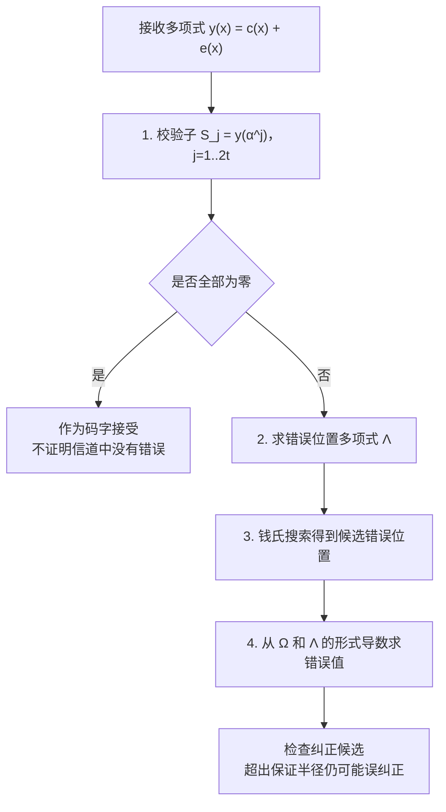
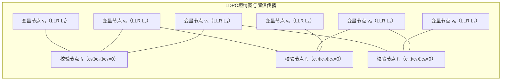
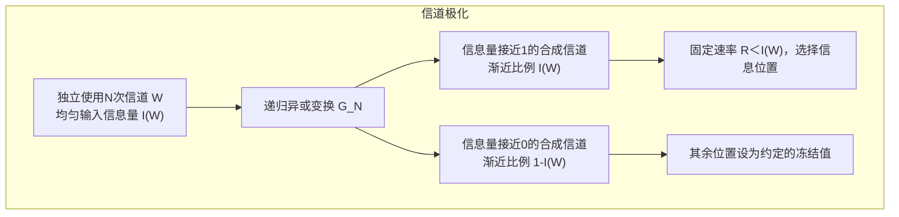

## 1. 引言：深空通信与二维码的共同机制

为什么接收机能从微弱的深空信号或局部污损的二维码中恢复数据？关键是**纠错码（Error-Correcting Codes，ECC）**：发送前加入有规律的冗余，接收后利用这些约束推断并修复损坏的值。不过，有限的冗余不能应对任意程度的破坏。

### 深空通信：接收微弱信号，再纠正残余错误

1977年发射的旅行者1号和2号都探访了木星、土星，2号随后继续飞向天王星、海王星。不是两艘探测器都飞掠了这四颗行星。下面讨论行星探测时期的通信，不把不断变化的当前距离、接收功率写成永久不变的数值。

探测器的高增益天线将无线电能量集中指向地球，由深空网络（DSN）接收。传播衰减和热噪声仍会使解调结果出现比特错误。作为单位换算，$10^{-16}\,\mathrm{W}=100\,\mathrm{aW}$，其中aW表示阿托瓦；这不是某个日期、某个接收站的实测功率。

JPL为旅行者2号天王星探测准备的报告介绍了内层卷积码与外层 $[255,223]$ 里德–所罗门（RS）码的级联方案。各层逐步降低噪声的影响，并不保证所有接收块、所有图像像素永远无错。

### 二维码：纠错率不是可以任意遮挡的图像面积

二维码也使用RS码。DENSO WAVE给出的约7%、15%、25%、30%的恢复能力，是以**8比特码字**为单位的近似指标，不等于“中央随便盖住30%的面积仍能读取”。定位等功能图形、损坏在各RS块中的分布、拍摄条件都会影响读取。读取耗时也没有统一的10毫秒保证。

二维码术语中的一个8比特码字，对应本篇RS数学中的一个符号；它不是由 $n$ 个符号组成的整个RS码字。区分这两个层次，才能正确计算每块的纠错能力。

```mermaid
flowchart TD
    subgraph Voyager["旅行者2号级联编码示例"]
        V1["信息数据"] --> V2["外层RS → 交织 → 内层卷积码"]
        V2 --> V3["定向天线发送，DSN接收"]
        V3 --> V4["含热噪声的接收信号"]
        V4 --> V5["软判决维特比 → 解交织 → RS译码"]
        V5 --> V6["在纠错条件内恢复信息"]
    end
    subgraph QR["二维码"]
        Q1["网址、文本等载荷"] --> Q2["GF(256)上的RS编码与空间布局"]
        Q2 --> Q3["污损、缺失或成像识别错误"]
        Q3 --> Q4["图像识别、提取码字、逐块译码"]
        Q4 --> Q5["估计错误位置与错误值"]
        Q5 --> Q6["满足条件时恢复原始数据"]
    end
```



下面依次说明信道容量、汉明距离、有限域多项式与图上的概率计算。首先要区分两种保证：**一定数量以内的所有错误模式都能纠正**，以及**随着码长增加，译码错误概率可以任意小**。两者不是同一句话。

---

## 2. 香农信道编码定理与适用条件

### 2.1 重复码：提高可靠性会降低编码速率

把同一比特发送多次，可以通过多数表决抵御错误。但如果只采用这种方法，提高可靠性就需要更多次信道使用。这是重复码这一特定构造的限制，不能据此断言所有编码方法都必须牺牲到零速率。

设无记忆二进制对称信道（BSC）中的比特独立翻转，概率为 $0<p<1/2$。长度为3的重复码把1个信息比特映射为：

$$
0 \mapsto 000, \qquad 1 \mapsto 111
$$

发送000时，收到011、101、110或111都会被多数表决误判为1，也就是3个位置中有2个或3个翻转。因此误块概率为：

$$
P_e^{(3)} = \binom{3}{2} p^2 (1-p) + \binom{3}{3} p^3 = 3p^2(1-p) + p^3
$$

当 $p=0.01$ 时，结果是0.000298，约为 $0.03\%$。代价是编码速率变为：

$$
R = \frac{k}{n} = \frac{1}{3}
$$

一般地，重复奇数次 $n=2t+1$，至少 $t+1$ 个比特翻转时多数表决失败：

$$
P_e^{(n)} = \sum_{i = (n+1)/2}^{n} \binom{n}{i} p^i (1-p)^{n-i}
$$

大数定律保证错误概率随码长增长趋于零，但同时：

$$
n \to \infty \implies P_e^{(n)} \to 0 \quad \text{但同时} \quad R = \frac{1}{n} \to 0
$$

例如长度5时，映射是 $0\mapsto00000$、$1\mapsto11111$，速率只有 $1/5$。这说明重复码的效率问题，不说明更有结构的多比特分组编码也有同样的极限。

### 2.2 容量与有噪信道编码定理

香农在1948年的工作表明：在有噪信道上，也可以保持固定的正信息速率，同时让错误概率任意小。

> **有限字母表离散无记忆信道的信道编码定理：**给定转移概率 $W(y\mid x)$，容量为 $C=\max_{P(X)}I(X;Y)\ge0$，单位是比特/次信道使用。对任意固定速率 $0<R<C$，存在码长不断增长的码序列与译码规则，使误块概率趋于零。若 $R>C$，则不能使错误概率收敛到零。

容量不一定为正。如果输出与输入独立，则 $C=0$。如果还存在输入代价或平均功率约束，最大化必须在这些约束内进行。容量不是仅由一个“噪声大小”数值决定的。

定理给出渐近的存在性结论，不保证某一个有限长度的码能纠正一切噪声，也不自动提供计算高效的译码器。实际设计仍要满足时延、计算资源与目标错误率的要求。

### 2.3 推导二进制对称信道的容量

离散无记忆信道的容量是输入分布上的最大互信息：

$$
C = \max_{P(X)} I(X; Y) = \max_{P(X)} \bigl( H(Y) - H(Y \mid X) \bigr)
$$

对BSC，令 $Y=X\oplus E$，噪声比特 $E$ 与输入独立，取1的概率为 $p$。给定输入之后的条件熵就是二元熵：

$$
H(Y \mid X) = H_2(p) \triangleq -p \log_2 p - (1-p) \log_2(1-p)
$$

输出只有两种取值，因此 $H(Y)\le1$ 比特。当输入0、1等概率时，输出也等概率，达到 $H(Y)=1$，从而：

$$
C_{\text{BSC}}(p) = 1 - H_2(p) = 1 + p\log_2 p + (1-p)\log_2(1-p) \quad [\text{bits / channel use}]
$$

例如：

$$
H_2(0.1) = -0.1 \log_2(0.1) - 0.9 \log_2(0.9) \approx 0.4690\text{ bits}
$$

$$
C_{\text{BSC}}(0.1) = 1 - 0.4690 = 0.5310\text{ bits / channel use}
$$

所以固定速率 $R=0.5$ 小于此容量，可以通过足够长的适当编码让错误概率任意小。这不等于在有限码长、恰好等于容量的速率上保证无错。随机编码论证利用长块中噪声的典型行为和码字之间可区分的空间，而不是重复单独一个比特。

### 2.4 AWGN与宽带极限下的 $-1.59\,\mathrm{dB}$

无线信号是连续波形，可以用加性高斯白噪声（AWGN）模型描述，而不是把物理噪声直接等同于独立的0/1翻转。设带宽为 $B$ Hz，平均接收信号功率为 $S$ W，单边噪声功率谱密度为 $N_0$ W/Hz，带内总噪声功率为 $N=N_0B$。在平均功率约束下、不另外限制为二元输入时，香农–哈特利容量为：

$$
C_{\text{AWGN}} = B \log_2\!\left(1 + \frac{S}{N}\right) = B \log_2\!\left(1 + \frac{S}{N_0 B}\right) \quad [\text{bits / second}]
$$

令接收端每信息比特的能量为 $E_b$，信息传输速率为 $R$ 比特/秒，则 $S=E_bR$。这里的 $R$ 与前面以比特/次使用表示的编码速率单位不同。由 $R<C_{\mathrm{AWGN}}$ 得：

$$
R < B \log_2\!\left(1 + \frac{E_b}{N_0} \frac{R}{B}\right)
$$

定义频谱效率 $\eta=R/B$，单位为比特/秒/Hz：

$$
\eta < \log_2\!\left(1 + \eta \frac{E_b}{N_0}\right) \iff 2^\eta - 1 < \eta \frac{E_b}{N_0} \iff \frac{E_b}{N_0} > \frac{2^\eta - 1}{\eta}
$$

在这个理想模型中，让频谱效率 $\eta\to0$。用 $2^\eta=1+\eta\ln2+O(\eta^2)$ 展开，可得：

$$
\lim_{\eta \to 0} \frac{2^\eta - 1}{\eta} = \ln 2 \approx 0.693147
$$

换算为分贝：

$$
\left(\frac{E_b}{N_0}\right)_{\min} = \ln 2 \approx 0.6931 \implies 10 \log_{10}(\ln 2) \approx \mathbf{-1.5917\,\text{dB}}
$$

这是**宽带极限中的下确界**。正频谱效率下，需要的比值界为 $(2^\eta-1)/\eta>\ln2$。$E_b/N_0$ 也不同于接收信号功率与带内总噪声功率之比 $S/N$，不能简单理解为“信号比噪声小”。

逼近容量还需要付出码长、时延等代价。这个有明确模型假设的渐近结论，不是适用于所有物理信道的宇宙常数，也不是有限时间绝对无错通信的保证。加入二元输入等约束后，相关容量还会改变。

---

## 3. 汉明距离、纠错保证与 $[7,4,3]$ 码

### 3.1 从存在性到可计算的构造

要把存在定理用于工程，还需要具体的编码、译码方法。汉明1950年的工作是代表性例子：加入奇偶校验，用不满足的校验约束定位一个翻转比特。下面同时从距离与矩阵构造 $[7,4,3]$ 码。

### 3.2 距离与最小距离

长度为 $n$ 的二进制串组成 $\mathbb F_2^n$，也可以看作 $n$ 维超立方体的顶点。域 $\mathbb F_2$ 中加减法都是异或。汉明距离统计两个向量不同的坐标个数：

$$
d_H(\mathbf{u}, \mathbf{v}) \triangleq \bigl|\{ i \in \{1, \dots, n\} \mid u_i \neq v_i \}\bigr| = w_H(\mathbf{u} - \mathbf{v})
$$

其中 $w_H$ 是非零坐标的个数，称为汉明重量。距离满足非负性、对称性与三角不等式。允许发送的向量组成码 $\mathcal C$，其中的向量称为码字。二元线性码维数为 $k$ 时，有 $2^k$ 个码字。最小距离是：

$$
d_{\min}(\mathcal{C}) \triangleq \min_{\substack{\mathbf{u}, \mathbf{v} \in \mathcal{C} \\ \mathbf{u} \neq \mathbf{v}}} d_H(\mathbf{u}, \mathbf{v})
$$

线性码中，不同码字的差仍是非零码字，因此：

$$
d_{\min}(\mathcal{C}) = \min_{\mathbf{c} \in \mathcal{C} \setminus \{\mathbf{0}\}} w_H(\mathbf{c})
$$

### 3.3 检错、擦除与未知位置错误

1. **检错：**从一个码字出发，改变1到 $d_{\min}-1$ 个坐标，都不可能恰好变成另一个码字。因此只检查接收向量是否属于码，就能检测所有这样的非零错误模式。
2. **擦除：**已知哪些坐标缺失，但不知道它们的值，称为擦除。如果擦除数 $e\le d_{\min}-1$，不同码字在剩余坐标上仍有区别。在其余坐标正确的前提下，原码字唯一确定。
3. **未知位置错误：**最近码字译码能纠正所有不超过 $t$ 个错误的模式，当且仅当不同码字周围半径为 $t$ 的汉明球互不相交。

若某接收向量同时落在两个这样的球中，由三角不等式，两个码字之间的距离不超过 $2t$。反过来，如果两个码字距离不超过 $2t$，可以在它们不同的坐标之间分配取值，构造一个同时距离两者不超过 $t$ 的向量。因此条件为：

$$
2t + 1 \le d_{\min} \iff t \le \left\lfloor \frac{d_{\min} - 1}{2} \right\rfloor
$$

等式 $t=\lfloor(d_{\min}-1)/2\rfloor$ 给出的是**最大保证半径**，较小的半径同样有效。当未知位置错误不超过 $t$ 个、已知位置擦除不超过 $e$ 个时，针对所有配置的唯一恢复保证为：

$$
\mathbf{d_{\min} \ge 2t + e + 1}
$$

删去擦除坐标后，距离至少为 $d_{\min}-e$，再应用不相交球的论证即可。超出这个界的某些具体接收向量仍可能恢复，但不能保证所有错误配置都能唯一恢复。“未知位置”也不要求错误必须按某个随机分布产生。

$q$ 元空间中，半径 $t$ 的球有 $\sum_{i=0}^t\binom ni(q-1)^i$ 个向量。所有不相交球必须装入大小为 $q^n$ 的空间：

$$
|\mathcal{C}| \cdot \sum_{i=0}^{t} \binom{n}{i} (q-1)^i \le q^n \quad \left(\text{对于二元码：} 2^k \sum_{i=0}^{t} \binom{n}{i} \le 2^n \right)
$$

等号成立时，这些球没有重叠、没有空隙地覆盖空间，称为**完美码**。汉明码、二元 $[23,12,7]$ 与三元 $[11,6,5]$ 戈莱码是例子。分类定理需要区分线性性与参数等条件，非线性完美码也存在，不能把所有完美码都等同于两个具体构造。这些例子本身也不证明旅行者号采用了哪种戈莱码。

### 3.4 汉明码的矩阵与校验子

$[7,4,3]$ 码用4个信息比特和3个校验比特组成7比特码字。它满足：

$$
2^4 \sum_{i=0}^{1} \binom{7}{i} = 16 \times (1 + 7) = 16 \times 8 = 128 = 2^7
$$

也就是16个球，每个包含1个中心和7个单比特邻居，恰好覆盖128个向量。

一种方便的校验矩阵构造，是让第 $j$ 列为整数 $j$ 的3位二进制表示：

$$
\mathbf{H}_{\text{binary}} = \begin{pmatrix} 0 & 0 & 0 & 1 & 1 & 1 & 1 \\ 0 & 1 & 1 & 0 & 0 & 1 & 1 \\ 1 & 0 & 1 & 0 & 1 & 0 & 1 \end{pmatrix} \begin{matrix} \leftarrow 2^2\text{ 位} \\ \leftarrow 2^1\text{ 位} \\ \leftarrow 2^0\text{ 位} \end{matrix}
$$

例如第5列就是 $(1,0,1)^T$。如果希望前4位直接是消息、后3位是校验，则使用系统形式 $\mathbf G=[\mathbf I_4\mid\mathbf P]$、$\mathbf H=[\mathbf P^T\mid\mathbf I_3]$：

$$
\mathbf{G}_{4\times 7} = \left(\begin{array}{cccc|ccc} 1 & 0 & 0 & 0 & 1 & 1 & 0 \\ 0 & 1 & 0 & 0 & 1 & 0 & 1 \\ 0 & 0 & 1 & 0 & 0 & 1 & 1 \\ 0 & 0 & 0 & 1 & 1 & 1 & 1 \end{array}\right), \qquad \mathbf{H}_{3\times 7} = \left(\begin{array}{cccc|ccc} 1 & 1 & 0 & 1 & 1 & 0 & 0 \\ 1 & 0 & 1 & 1 & 0 & 1 & 0 \\ 0 & 1 & 1 & 1 & 0 & 0 & 1 \end{array}\right)
$$

由于 $\mathbf G\mathbf H^T=0$，每个编码后的向量都满足：

$$
\mathbf{H}\mathbf{c}^T = \mathbf{0} \pmod 2
$$

接收到 $\mathbf y=\mathbf c+\mathbf e$ 后，计算**校验子（syndrome，也称伴随式）**：

$$
\mathbf{s} = \mathbf{H}\mathbf{y}^T = \mathbf{H}(\mathbf{c} + \mathbf{e})^T = \underbrace{\mathbf{H}\mathbf{c}^T}_{=\mathbf{0}} + \mathbf{H}\mathbf{e}^T = \mathbf{H}\mathbf{e}^T \pmod 2
$$

它只取决于错误。如果只有第 $j$ 位翻转，结果就是所用 $\mathbf H$ 的第 $j$ 列。在二进制列顺序下，校验子101直接表示第5位；在系统形式的列顺序下，则要匹配列，不能把数值直接当作位置。第6节代码使用后者。

零校验子只表示接收向量属于码。如果已知最多1位错误，它意味着没有错误；不满足此前提时，信道可能把一个合法码字改成另一个。多个错误还可能诱使单错译码器再翻转一个原本正确的比特。

例如消息 `[1,0,1,1]` 用上述系统矩阵编码为 `[1,0,1,1,0,1,0]`。翻转从零开始的索引2，也就是第三个比特，校验子为 `[0,1,1]`，匹配矩阵列索引2。固定7比特电路的规模固定，但一般长度 $n$ 的校验子计算并非总是 $O(1)$。

再增加一个整体偶校验位，就得到 $[8,4,4]$ 扩展汉明码。配合适当译码规则，可以单错纠正、双错检测（SECDED）。这是理解ECC内存的基本模型，不代表所有内存产品都采用完全相同的码与电路。

---

## 4. RS码：有限域、多项式与代数译码

### 4.1 为什么需要处理突发错误

汉明 $(7,4)$ 码能纠正同一码块内任意位置的1位错误，但光盘划痕、二维码污损或无线衰落可能一次影响多个比特。同一码块中的2位错误就足以使单错译码器误纠正。

里德与所罗门1960年的构造把比特组合为有限域**符号**。这改变了距离与纠错能力的计量单位。物理损伤怎样映射为符号错误，还与布局、交织有关。

### 4.2 将字节表示为有限域元素

$m$ 比特符号可以用 $\mathbb F_{2^m}$ 表示。普通整数模256运算不是同一个域：例如 $2\cdot128\equiv0\pmod{256}$，两个非零数相乘得到零，非零元素也不一定有逆元。有限域存在的阶数恰为素数幂。

在GF(256)中，一个字节对应二元系数、次数不超过7的多项式。下面的实现用16进制 `0x11D` 所代表的8次不可约多项式对乘积取余：

$$
\mathbb{F}_{2^8} \cong \frac{\mathbb{F}_2[x]}{\langle x^8 + x^4 + x^3 + x^2 + 1 \rangle}
$$

加减法都是按位异或，因为系数域中 $1+1=0$。255个非零元素构成循环乘法群。在这里的表示中，可以选 $\alpha=x$，也就是字节 `0x02` 为本原元；$\alpha^0,\ldots,\alpha^{254}$ 遍历全部非零元素，$\alpha^{255}=1$。

用对数表和指数表，可把非零元素的乘除变为指数的模255加减：

$$
A \cdot B = \alpha^{(i + j) \bmod 255}, \qquad \frac{A}{B} = \alpha^{(i - j) \bmod 255}
$$

零元素要单独处理，除以零无定义。表长取决于实现，也可以延长指数表以省去显式取模。第6节代码为了便于说明，使用移位与异或进行乘法。

同一个字节内部哪怕多位被破坏，也只算1个符号错误；但跨越字节边界就可能影响多个符号。因此不能只按“总共损坏多少比特”判断纠错能力。

### 4.3 求值编码、插值与Singleton界

横坐标不同的两个点唯一确定次数不超过1的多项式。发送5个求值结果，只要任意2个正确结果幸存，就能在3个擦除后恢复它。3个横坐标互异的点则唯一确定次数不超过2的多项式。

把 $k$ 个消息符号作为系数：

$$
P(x) \triangleq m_0 + m_1 x + m_2 x^2 + \dots + m_{k-1} x^{k-1} \in \mathbb{F}_q[x]
$$

在 $\mathbb F_q$ 中选择 $n$ 个互异求值点 $\alpha_i$，其中 $k\le n\le q$，发送：

$$
\mathbf{c} = \bigl( P(\alpha_1),\; P(\alpha_2),\; \dots,\; P(\alpha_n) \bigr) \in \mathbb{F}_q^n
$$

因式定理说明：域上的非零多项式，根的个数不超过次数。不同消息多项式 $P,Q$ 的差次数小于 $k$，最多在 $k-1$ 个求值点为零，所以相应码字至少有 $n-k+1$ 个不同坐标。

另一方面，将所有码字删去 $d_{\min}-1$ 个坐标，剩下的向量仍必须互不相同，否则原码字间距小于 $d_{\min}$。对含 $q^k$ 个码字的码，有 $q^k\le q^{n-d_{\min}+1}$，即Singleton界 $d_{\min}\le n-k+1$。RS码达到等号：

$$
\mathbf{d_{\min} = n - k + 1}
$$

这就是**最大距离可分（MDS）**性质：在指定字母表、长度、维数下，最小距离达到这一上界，不意味着所有工程性能都最优。

令冗余符号数 $r=n-k$，则错误与擦除的保证为 $2t+e\le r$：

- **已知位置擦除：**最多缺失 $n-k$ 个符号。任意 $k$ 个正确幸存求值，通过拉格朗日插值恢复消息多项式：

$$
P(x) = \sum_{j=1}^{k} y_{i_j} \prod_{\substack{m=1 \\ m \neq j}}^{k} \frac{x - x_{i_m}}{x_{i_j} - x_{i_m}}
$$

- **未知位置错误：**最多纠正 $\lfloor(n-k)/2\rfloor$ 个受损符号，不论每个受损符号内部翻转了几个比特。

### 4.4 循环形式与必须明确的Forney公式约定

求值形式把消息作为多项式系数，发送多项式在不同点的值；循环形式则把码字坐标看作另一个多项式的系数，要求它是生成多项式的倍数。使用全部非零点、长度为 $n=q-1$ 的RS码，可以在明确坐标和系数对应后写成等价的循环形式。短缩后的码不一定在新长度下仍是循环码。

以下固定冗余 $n-k=2t$，第一个生成根为 $\alpha^1$。这只是本节推导的约定，不是所有二维码或探测器格式的统一规定：

$$
g(x)=\prod_{j=1}^{2t}(x-\alpha^j)
$$

令余式 $r(x)=x^{2t}m(x)\bmod g(x)$，消息移位后减去余式得到：

$$
c(x)=x^{2t}m(x)-r(x),\qquad c(\alpha^j)=0\quad(1\le j\le2t)
$$

在特征2中，减法仍为异或。



1. **校验子：**假定 $\nu\le t$ 个错误位于 $i_l$，非零错误值为 $Y_l=e_{i_l}$，令 $X_l=\alpha^{i_l}$。在生成根处求值，合法码字部分为零：

$$
S_j=y(\alpha^j)=e(\alpha^j)=\sum_{l=1}^{\nu}Y_lX_l^j,\qquad j=1,\ldots,2t
$$

零校验子只说明属于码，无法发现从一个合法码字变成另一个的错误。

2. **错误位置多项式：**

$$
\Lambda(z)=\prod_{l=1}^{\nu}(1-X_lz)=1+\Lambda_1z+\cdots+\Lambda_\nu z^\nu
$$

把 $\Lambda(X_l^{-1})=0$ 乘以相应的 $Y_lX_l^{j+\nu}$ 并求和，得到线性递推：

$$
S_{j+\nu}+\Lambda_1S_{j+\nu-1}+\cdots+\Lambda_\nu S_j=0,\qquad1\le j\le2t-\nu
$$

Berlekamp–Massey算法求最短线性递推，通常用 $O(t^2)$ 次域运算求得候选多项式。扩展欧几里得方法也可以解相应的关键方程。

3. **钱氏搜索：**检查码字各坐标对应的非零元素 $\alpha^{-i}$，寻找 $\Lambda(\alpha^{-i})=0$ 的候选位置。GF(256)总共有256个元素，其中非零元素255个。还要验证根的数目是否与位置多项式的次数相符等条件。

4. **错误值：**明确把校验子多项式和错误求值多项式定义为：

$$
S(z)=S_1+S_2z+\cdots+S_{2t}z^{2t-1},\qquad \Omega(z)=S(z)\Lambda(z)\bmod z^{2t}
$$

在这一组定义下，Forney公式为：

$$
Y_l=-\frac{\Omega(X_l^{-1})}{\Lambda'(X_l^{-1})}
$$

若只有1个错误，则 $\Omega=YX$、$\Lambda'=-X$，右端恰好是 $Y$。多乘一个 $X$ 就会得到 $XY$。更换第一个生成根或校验子多项式定义后，公式中的因子可能改变，所以不能脱离约定直接移植公式。

减去估计的错误后，还应检查结果是否属于码、修改的符号数是否在范围内。但如果接收向量已经接近另一个合法码字，这些检查仍可能通过并产生误纠正。可以结合CRC、重传或上层检查增加保护，不能承诺检测所有超出半径的破坏。

### 4.5 二维码、存储擦除与旅行者号级联编码

- **二维码：**L/M/Q/H的约7/15/25/30%是以码字为单位的恢复能力指标。各个RS块都要满足纠错条件。版本、等级、数据容量、冗余量与分块方式有关，不能直接换算成任意图像面积。遮挡功能图形还可能在RS译码前就造成定位或码字提取失败。
- **RAID-6与分布式存储：**已知位置的失效盘或缺失数据块属于擦除。例如说明用的 $[14,10]$ MDS擦除码，容量倍率为 $14/10=1.4$，在幸存数据与必要元数据正确时，可容忍任意4块缺失。这不声称所有云厂商都采用这一配置。RAID-6的双校验也在相应条件下支持双盘恢复，不包括额外潜在损坏或整个设施丢失等任意灾难。
- **旅行者2号：**JPL的1983年报告说明了约束长度 $K=7$、速率 $1/2$ 的卷积码、深度4交织与 $[255,223]$ RS外码。每个RS码字有32个冗余字节，保证 $2t+e\le32$，单纯未知错误最多16字节。未按字节对齐的连续128比特可能跨17个字节，而不一定正好是16个。交织把内层译码残留的突发错误分散到多个RS码字。这里旅行者号的内码是卷积码，不是LDPC。

---

## 5. LDPC、Turbo与Polar：利用可靠性信息逼近容量

### 5.1 最小距离之外的译码问题

实用编码还需要兼顾目标错误率、时延、码长、计算量和硬件规模。对二元维数为 $k$ 的码，朴素最大似然穷举需要比较 $2^k$ 个候选。最小距离好，不代表总能高效译码。

Turbo与LDPC的迭代译码交换可靠性信息，Polar则通过另一种构造逼近对称容量。比较性能时应统一信道、输入约束和速率，不能把所有码一律与宽带下界 $-1.59\,\mathrm{dB}$ 比较。

### 5.2 稀疏校验矩阵与坦纳图上的置信传播

加拉格尔1962年的LDPC码使用稀疏校验矩阵。即使块长较大，每行、每列的非零项数也可以保持较小。对 $m\times n$ 的校验矩阵 $\mathbf H$，码的维数是 $k=n-\operatorname{rank}_{\mathbb F_2}(\mathbf H)$；只有行独立时才能写成 $n-m$。

坦纳图把变量节点对应到列和码字比特，把校验节点对应到行和奇偶约束，且仅当 $H_{a,i}=1$ 时连接一条边：



软判决译码保留观测值的可靠性，而不是立刻硬判决为0或1。对数似然比（LLR）可写为：

$$
L(c_i) \triangleq \ln \frac{\Pr(c_i = 0 \mid y_i)}{\Pr(c_i = 1 \mid y_i)}
$$

输入等概率、单位幅度BPSK映射为 $0\mapsto+1$、$1\mapsto-1$，独立噪声 $Z\sim\mathcal N(0,\sigma^2)$，观测 $y_i=x_i+Z$ 时，有：

$$
L_{\mathrm{ch}}(c_i)=\ln\frac{p(y_i\mid c_i=0)}{p(y_i\mid c_i=1)}=\frac{2y_i}{\sigma^2}
$$

幅度或先验概率不同，公式也会不同。LLR为 $+10$ 时强烈支持0，为 $-0.1$ 时只是略偏向1。

和积算法沿边交换外部信息，排除接收该消息的邻居自身的贡献：

$$
\mu_{f_a \to v_i} = 2 \operatorname{artanh}\!\left( \prod_{v_j \in N(f_a) \setminus \{v_i\}} \tanh\!\left(\frac{\mu_{v_j \to f_a}}{2}\right) \right)
$$

$$
\mu_{v_i \to f_a} = L_{\text{ch}}(v_i) + \sum_{f_b \in N(v_i) \setminus \{f_a\}} \mu_{f_b \to v_i}
$$

这里 $N$ 表示相应邻居集合。迭代调度决定使用哪一轮的消息，但不改变排除目标邻居的原则。

稀疏性减少边数，却不自动排除短环。在树上，置信传播能够计算精确边缘概率；有限有环图中，消息相关、陷阱集与不收敛都可能使错误残留。

设边数为 $E$，共享邻居计算的实现每轮大约需要 $O(E)$ 次运算，进行 $I$ 轮则为 $O(IE)$。次数有界时可以有 $E=O(n)$，但不能无条件把所需迭代轮数当作常数。数值实现也要处理LLR饱和与 $\operatorname{artanh}$ 的定义域。

Chung等人在2001年报告的0.0045 dB，指的是**速率 $1/2$ 的二元输入AWGN信道**上，由密度进化得到的渐近阈值与该信道容量界的差。同一论文另一个较简单设计的有限长度仿真，在码长 $10^7$、误比特率 $10^{-6}$ 时差距为0.04 dB。这些不是所有设备的性能保证，也不能与宽带能量下界混为一谈。

### 5.3 Polar码：对称容量与有限码长

阿里坎2009年的Polar构造逼近二元输入离散无记忆信道 $W$ 的**对称容量 $I(W)$**，即均匀输入下的互信息。对称信道时它等于容量 $C$；一般非对称信道中，不一定等于优化输入分布后的最大值。

基本异或变换是：

$$
(x_1,x_2)=(u_1,u_2)\begin{pmatrix}1&0\\1&1\end{pmatrix} =(u_1\oplus u_2,u_2)
$$

合成信道 $W^-$ 根据 $(y_1,y_2)$ 推断 $u_1$；$W^+$ 在已知正确 $u_1$ 的条件下，根据 $(y_1,y_2,u_1)$ 推断 $u_2$。对均匀独立输入，互信息链式法则给出：

$$
I(W^-)+I(W^+)=2I(W),\qquad I(W^-)\le I(W)\le I(W^+)
$$

“变好、变差”是这里的信息量意义，不是每个情况下都严格变化。实际逐次译码时，先前判错的比特可能把错误传播到后续判决。

令 $N=2^m$，在采用比特反序置换 $\mathbf B_N$ 的约定下，生成矩阵为：

$$
\mathbf G_N=\mathbf B_N \begin{pmatrix}1&0\\1&1\end{pmatrix}^{\otimes m}
$$

对任意固定 $0<\delta<1$，当 $N\to\infty$ 时，信息量超过 $1-\delta$ 的合成信道比例趋于 $I(W)$，小于 $\delta$ 的比例趋于 $1-I(W)$。不是在有限 $N$ 时恰好有 $NI(W)$ 个信道突然变成完全无噪。



在固定速率 $R<I(W)$ 下选择信息位置，其余输入冻结为约定值。一般信道的原始保证利用对冻结值的平均以及合适冻结值的存在性；对称信道则有适用于任意固定冻结值的相应界。

编码与**逐次消除译码（SC）**的时间复杂度是 $O(N\log N)$，选择信息位置的构造成本另计。高效的**逐次消除列表译码（SCL）**在列表大小 $L$ 下需要 $O(LN\log N)$ 时间，CRC辅助方式用于帮助选择候选。有限长度的错误率和时延还取决于构造、速率、列表大小及信道，不能笼统承诺没有错误平层。

### 5.4 主要编码体系的比较

| 编码 | 数学结构 | 代表译码方式 | 特点与用途 |
| :--- | :--- | :--- | :--- |
| 汉明码（1950） | 二元线性码，$[7,4,3]$ 是完美码 | 校验子与列匹配 | 单比特纠正，理解SECDED的基本例子 |
| RS码（1960） | 有限域多项式，MDS性质 | BM/欧几里得、钱氏搜索、Forney；求值形式也可用Welch–Berlekamp | 符号错误与擦除；二维码、存储、深空级联编码 |
| 卷积码与Turbo码 | 网格状态、级联与交织 | 维特比、BCJR等迭代译码 | 有噪通信；旅行者内码为卷积码 |
| LDPC（1962） | 稀疏校验矩阵、坦纳图 | 软判决置信传播等 | 长块与并行化；特定信道、速率下可逼近容量 |
| Polar（2009） | 递归极化与冻结比特 | SC为 $O(N\log N)$；SCL依赖列表大小 | 渐近逼近对称容量；5G NR规定的部分控制信息编码 |

同一行中的方法不一定具有相同的复杂度和错误率，5G控制信息也并非全部采用Polar。例如3GPP TS 38.212 v19.3.0第6.3.1.2–6.3.1.3节对PUCCH上的UCI区分：载荷 $A\ge12$ 使用Polar，$A\le11$ 使用小块长编码。

---

## 6. Python验证：汉明码与GF(256)求值RS码

下面的独立Python 3程序实现系统形式的汉明 $(7,4)$ 码，以及第4.3节的**求值RS码**。RS消息符号是多项式系数，通常不会原样出现在码字开头。这不是第4.4节的BM译码器，也不实现二维码的比特布局、分块与循环系统格式，不能直接与二维码或探测器通信格式互通。

程序采用GF(256)与不可约多项式 `0x11D`。它不同于整数模257组成的素域GF(257)。后者也能构造求值码，但结果可能是256，不能总按单字节保存。

译码使用Welch–Berlekamp型线性系统。对候选错误位置多项式次数 $\nu=0,\ldots,t$，求首一多项式 $E(x)$（次数为 $\nu$）与次数小于 $k+\nu$ 的 $Q(x)$，使：

$$
Q(x_i)=y_iE(x_i)\qquad(i=1,\ldots,n)
$$

未知系数共有 $k+2\nu$ 个。GF(256)中加减法相同，所以把项移到等号另一侧仍使用异或。

设真实消息多项式为 $P$。若错误数不超过 $\nu$，可令 $E$ 在错误点为零，必要时补足次数，并构造 $Q=PE$。反过来，当 $n\ge k+2\nu$ 时，任意解的 $Q-PE$ 在至少 $n-\nu$ 个正确点上为零，而次数小于 $k+\nu$，因此必须是零多项式。这才是线性系统能够恢复消息的根的个数依据。

实现依次尝试0到 $t$ 的候选多项式次数，支持矩形方程组和秩不足；把 $Q$ 除以 $E$，检查余式为零、商次数小于 $k$，再重新编码并检查与接收向量的距离不超过 $t$。因此零错误、少于 $t$ 个错误和恰好达到边界都能处理。求值点须互不相同，可从域中选1到256个，包括零。

这里优先考虑可读性，最多运行 $t+1$ 次一般高斯消元，不是高性能RS译码器或运行时间基准。公共函数 `rs_encode`、`rs_decode` 检查输入值、长度、求值点与半径；内部多项式和线性系统辅助函数假定处理的是已检查的域元素。

```python
"""Educational evaluation RS over GF(256), not a QR parser or wire format."""
from itertools import product


def field_value(a):
    if type(a) is not int or not 0 <= a < 256:
        raise ValueError("Field elements must be integers from 0 through 255")
    return a


def gf_mul(a, b):
    field_value(a)
    field_value(b)
    result = 0
    for _ in range(8):
        if b & 1:
            result ^= a
        b >>= 1
        a <<= 1
        if a & 256:
            a ^= 0x11D
    return result


def gf_pow(a, exponent):
    field_value(a)
    if type(exponent) is not int or exponent < 0:
        raise ValueError("Exponent must be a nonnegative integer")
    result = 1
    while exponent:
        if exponent & 1:
            result = gf_mul(result, a)
        a = gf_mul(a, a)
        exponent >>= 1
    return result


def gf_inv(a):
    field_value(a)
    if a == 0:
        raise ZeroDivisionError("Zero has no multiplicative inverse")
    return gf_pow(a, 254)


def poly_trim(coefficients):
    result = list(coefficients)
    while result and result[-1] == 0:
        result.pop()
    return result


def poly_eval(coefficients, x):
    result = 0
    for coefficient in reversed(coefficients):
        result = gf_mul(result, x) ^ coefficient
    return result


def poly_divmod(numerator, denominator):
    remainder = poly_trim(numerator)
    denominator = poly_trim(denominator)
    if not denominator:
        raise ZeroDivisionError("Zero polynomial divisor")
    quotient = [0] * max(0, len(remainder) - len(denominator) + 1)
    inverse_lead = gf_inv(denominator[-1])
    while remainder and len(remainder) >= len(denominator):
        degree = len(remainder) - len(denominator)
        factor = gf_mul(remainder[-1], inverse_lead)
        quotient[degree] = factor
        for j, coefficient in enumerate(denominator):
            remainder[degree + j] ^= gf_mul(factor, coefficient)
        remainder = poly_trim(remainder)
    return poly_trim(quotient), remainder


def solve_linear_system(rows, rhs, columns):
    """Return one solution (free variables zero), or None if inconsistent."""
    if len(rows) != len(rhs) or any(len(row) != columns for row in rows):
        raise ValueError("Linear-system dimensions do not match")
    matrix = [list(row) + [value] for row, value in zip(rows, rhs)]
    pivot_columns = []
    pivot_row = 0
    for column in range(columns):
        pivot = next(
            (r for r in range(pivot_row, len(matrix)) if matrix[r][column]),
            None,
        )
        if pivot is None:
            continue
        matrix[pivot_row], matrix[pivot] = matrix[pivot], matrix[pivot_row]
        inverse = gf_inv(matrix[pivot_row][column])
        matrix[pivot_row] = [gf_mul(value, inverse) for value in matrix[pivot_row]]
        for r in range(len(matrix)):
            if r != pivot_row and matrix[r][column]:
                factor = matrix[r][column]
                matrix[r] = [
                    a ^ gf_mul(factor, b)
                    for a, b in zip(matrix[r], matrix[pivot_row])
                ]
        pivot_columns.append(column)
        pivot_row += 1
        if pivot_row == len(matrix):
            break
    if any(not any(row[:columns]) and row[columns] for row in matrix):
        return None
    solution = [0] * columns
    for r, column in enumerate(pivot_columns):
        solution[column] = matrix[r][columns]
    return solution


def check_points(points):
    points = list(points)
    if not points or len(points) > 256:
        raise ValueError("Use from 1 through 256 distinct evaluation points")
    for x in points:
        field_value(x)
    if len(set(points)) != len(points):
        raise ValueError("Evaluation points must be distinct")
    return points


def rs_encode(message, points):
    points = check_points(points)
    message = list(message)
    if not 1 <= len(message) <= len(points):
        raise ValueError("Require 1 <= message length <= code length")
    for value in message:
        field_value(value)
    return [poly_eval(message, x) for x in points]


def rs_decode(received, points, k, max_errors):
    points = check_points(points)
    received = list(received)
    n = len(points)
    if len(received) != n:
        raise ValueError("Received length must match evaluation points")
    if type(k) is not int or not 1 <= k <= n:
        raise ValueError("Require integer 1 <= k <= n")
    if type(max_errors) is not int or max_errors < 0 or k + 2 * max_errors > n:
        raise ValueError("Require integer t >= 0 and k + 2t <= n")
    for value in received:
        field_value(value)
    # Try locator degrees 0,...,t: fewer than t errors must also work.
    for errors in range(max_errors + 1):
        columns = k + 2 * errors
        rows, rhs = [], []
        for x, y in zip(points, received):
            powers = [gf_pow(x, degree) for degree in range(k + errors)]
            rows.append(
                powers + [gf_mul(y, gf_pow(x, degree)) for degree in range(errors)]
            )
            rhs.append(gf_mul(y, gf_pow(x, errors)))
        solution = solve_linear_system(rows, rhs, columns)
        if solution is None:
            continue
        q = solution[:k + errors]
        locator = solution[k + errors:] + [1]
        message, remainder = poly_divmod(q, locator)
        if remainder or len(message) > k:
            continue
        message += [0] * (k - len(message))
        codeword = rs_encode(message, points)
        distance = sum(a != b for a, b in zip(codeword, received))
        if distance <= max_errors:
            return message
    raise ValueError("No codeword within the requested correction radius")


G = (
    (1, 0, 0, 0, 1, 1, 0),
    (0, 1, 0, 0, 1, 0, 1),
    (0, 0, 1, 0, 0, 1, 1),
    (0, 0, 0, 1, 1, 1, 1),
)
H = (
    (1, 1, 0, 1, 1, 0, 0),
    (1, 0, 1, 1, 0, 1, 0),
    (0, 1, 1, 1, 0, 0, 1),
)


def bits(values, length):
    values = list(values)
    if len(values) != length or any(type(v) is not int or v not in (0, 1) for v in values):
        raise ValueError("Invalid bit vector")
    return values


def hamming_encode(message):
    message = bits(message, 4)
    return [sum(message[i] * G[i][j] for i in range(4)) % 2 for j in range(7)]


def hamming_decode(received):
    received = bits(received, 7)
    syndrome = [sum(H[r][j] * received[j] for j in range(7)) % 2 for r in range(3)]
    if any(syndrome):
        position = next(j for j in range(7) if [H[r][j] for r in range(3)] == syndrome)
        received[position] ^= 1
    return received[:4]


if __name__ == "__main__":
    hamming_cases = 0
    for message in product((0, 1), repeat=4):
        codeword = hamming_encode(message)
        for position in range(-1, 7):
            received = codeword.copy()
            if position >= 0:
                received[position] ^= 1
            assert hamming_decode(received) == list(message)
            hamming_cases += 1
    print("Hamming no-error/single-error cases:", hamming_cases)

    payload = b"VOYAGER-1"
    points = list(range(1, 16))
    codeword = rs_encode(payload, points)
    print("GF(256) evaluation codeword:", codeword)
    for count in range(4):
        received = codeword.copy()
        for position in range(count):
            received[position] ^= position + 1
        recovered = bytes(rs_decode(received, points, len(payload), 3))
        print("RS corrupted symbols:", count, "recovered:", recovered.decode("ascii"))
        assert recovered == payload
    # A decoder can miscorrect beyond the transmitted word's guaranteed radius.
    # Construct a received word close to a DIFFERENT valid word.
    alternative = list(payload)
    alternative[0] ^= 1
    alternative_codeword = rs_encode(alternative, points)
    received = alternative_codeword.copy()
    received[0] ^= 1
    assert rs_decode(received, points, len(payload), 3) == alternative
    print("Beyond-radius example returns another nearby codeword:", True)
```

实际运行输出：

```text
Hamming no-error/single-error cases: 128
GF(256) evaluation codeword: [77, 162, 167, 64, 87, 173, 26, 217, 215, 33, 189, 173, 212, 41, 124]
RS corrupted symbols: 0 recovered: VOYAGER-1
RS corrupted symbols: 1 recovered: VOYAGER-1
RS corrupted symbols: 2 recovered: VOYAGER-1
RS corrupted symbols: 3 recovered: VOYAGER-1
Beyond-radius example returns another nearby codeword: True
```

9字节消息编码为15个符号，最小距离为7，保证半径为3个符号。3/15是20%，不是30%。示例分别破坏0到3个靠前的位置，同样的计数保证也适用于非连续位置。

例如也可以选择 $\alpha^0,\ldots,\alpha^{14}$ 为求值点，并破坏从零开始的索引 `[1,6,13]`。同一译码器支持这种情况；改用字节值 `1..15` 作为求值点时，码字也会改变。三个不相邻的字节错误不等于连续24比特突发。

最后一个例子故意构造靠近**另一个合法码字**的接收向量。译码器返回那个码字，并通过距离检查，却没有恢复原消息。这说明超出保证半径的破坏不能总被发现。汉明译码器在违反最多1位错误的前提时也可能误纠正。

对此教学实现，独立检查包括GF(256)的全部65,536组乘积，以及独立生成的长度4、维数2的全部65,536个码字。将接收符号限为0到3的256个接收向量，其半径1译码与完整码表穷举结果一致。还检查了含零消息在内的3个消息的所有单符号错误位置与非零错误值、多个长度和错误数的固定种子例、秩不足系统与无效输入。这是有限范围证据，不代表执行过所有可能输入、完整二维码互通或真实通信硬件实验。

---

## 7. 如何选择RS、LDPC与Polar

RS达到MDS界，为什么不用于所有场景？因为MDS优化的是**固定符号长度和维数下的最小距离**，没有同时优化概率译码性能、软信息利用、时延与电路规模。

1. **域大小与块长：**第4.3节的求值形式满足 $n\le q$，GF(256)包含零时可有256个求值符号，常见的全部非零点循环形式则是255个。还有扩展、级联等变种，不能说任何RS码都绝对受限于255字节。以稀疏图处理较长二元块的LDPC具有另一种设计优势。
2. **软信息：**先硬判决为0/1会丢失观测可靠性，软判决LDPC、Polar译码可以利用这些信息。但增益不是恒定2 dB，而随信道、调制、速率与目标错误率而变。RS也有使用软信息的译码方式，不能说它只能硬判决。
3. **存储单元条件：**TLC每单元存3比特，区分8个状态；QLC存4比特，区分16个状态。电压分布重叠、保持特性变化与擦写都会造成错误。追加读取提供的可靠性信息可能有用，但不是所有SSD都有相同译码器、原始误比特率或不可纠正错误率，还要权衡额外读取的时间和能量。

对位置已知的存储擦除，RS的“任意 $k$ 个正确幸存符号都可恢复”很方便；有噪物理链路则常适合较长的软判决码。同一系统还可以在不同层组合不同编码。与其把5G、SSD、二维码说成一次全面的新旧替代，不如依据各自错误模型与约束比较。

---

## 8. 结语：用明确的条件设计冗余

纠错利用数据结构，以及关于破坏方式的假设恢复信息。

1. 香农定理针对规定的信道和输入约束，保证低于容量时存在越来越长的码，使错误概率任意小；这不同于有限长度绝对无错。
2. 最小距离给出针对所有配置的保证：未知错误 $t$ 个、擦除 $e$ 个时，基本条件是 $2t+e<d_{\min}$。汉明校验子把这一保证变成具体计算。
3. RS用有限域多项式的根与插值达到 $d_{\min}=n-k+1$。实现要固定约定，也要考虑保证半径之外的误纠正。
4. LDPC使用稀疏概率图，Polar使用信道极化。渐近阈值、有限长度性能、SC与SCL复杂度，是不同层面的指标。

读取二维码或接收深空信号时，可靠性来自冗余、错误单位和分布、译码检查及残余失败概率的共同设计，而不是“任何损坏都必然恢复”的承诺。

参考资料：

- [DENSO WAVE：二维码纠错](https://www.qrcode.com/en/about/error_correction.html) — 恢复能力与码字单位。
- [JPL：旅行者2号](https://www.jpl.nasa.gov/missions/voyager-2/) — 行星探测路线。
- [Lorden、McEliece、Swanson：Node Synchronization for the Viterbi Decoder（1983）](https://tda.jpl.nasa.gov/progress_report/42-73/73C.PDF) — 第22页的级联编码与同步问题。
- [Forney：MIT 6.451代数编码理论第8章](https://ocw.mit.edu/courses/6-451-principles-of-digital-communication-ii-spring-2005/01060b08ba74792ee8d85eb82b9efdb4_chap8.pdf) — 第101–110页的距离、求值RS与Welch–Berlekamp型重构。
- [Chung等：On the Design of LDPC Codes within 0.0045 dB of the Shannon Limit（2001）](https://www.cse.lehigh.edu/~jingli/teach/S2003turbo/notes/zeroZeroFourFive.pdf) — 第58页区分阈值与有限长度仿真。
- [Arıkan：Channel Polarization（2009）](https://arxiv.org/abs/0807.3917) — 对称容量、编码与SC译码；本文依据开头的定义与定理。
- [Tal、Vardy：List Decoding of Polar Codes](https://arxiv.org/abs/1206.0050) — 高效SCL的时间与空间复杂度。
- [Östergård、Pottonen：长度15的二元单错纠正完美码分类](https://arxiv.org/abs/0806.2513) — 完美码不能等同于单一线性构造。
- [Elkies：The Theory of Error-Correcting Codes（2013）](https://people.math.harvard.edu/~elkies/M256.13/index.html) — 完美码与戈莱码课程。
- [ETSI TS 138 212 v19.3.0（2026-04）](https://www.etsi.org/deliver/etsi_ts/138200_138299/138212/19.03.00_60/ts_138212v190300p.pdf) — 第6.3.1.2–6.3.1.3节的UCI编码选择。
